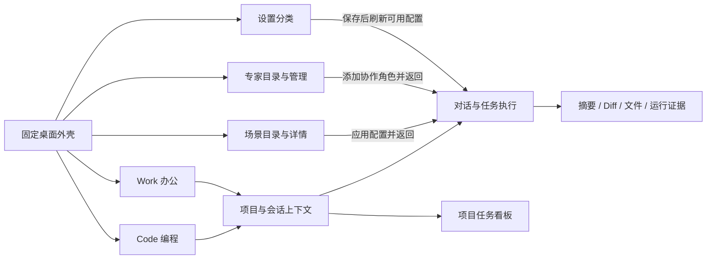
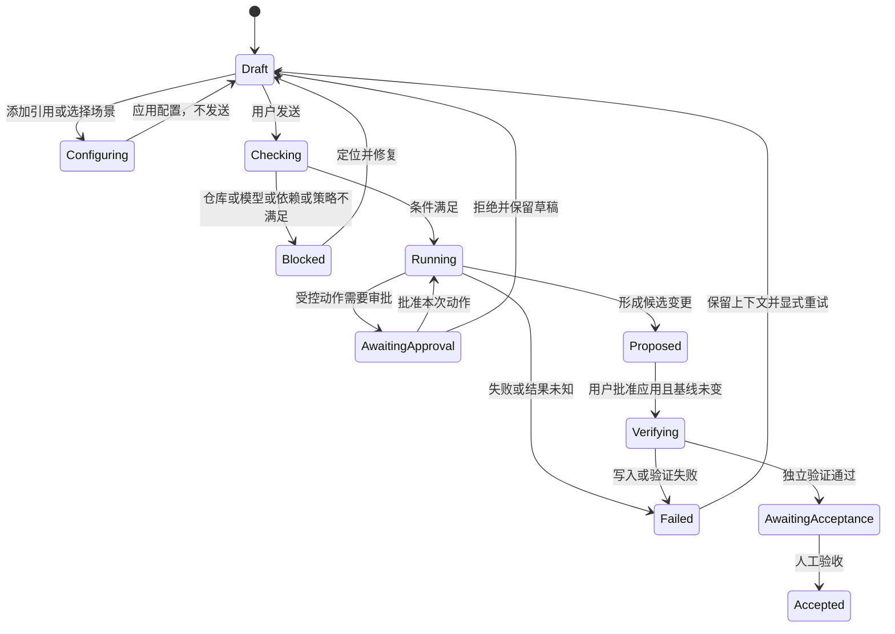
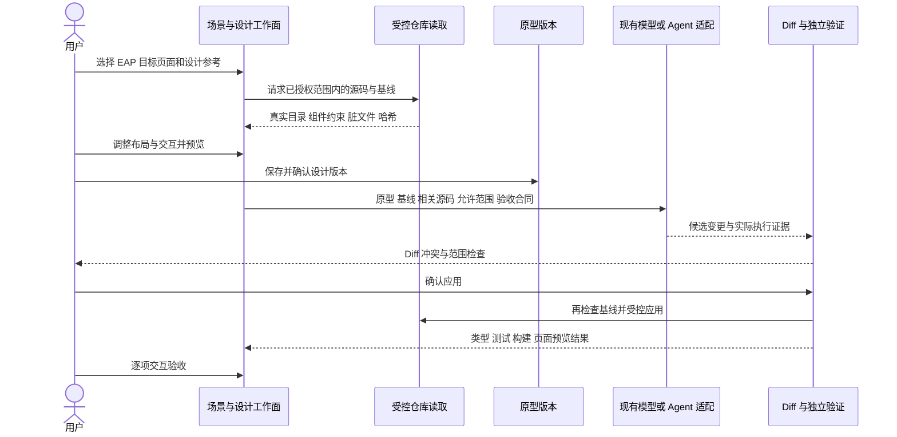
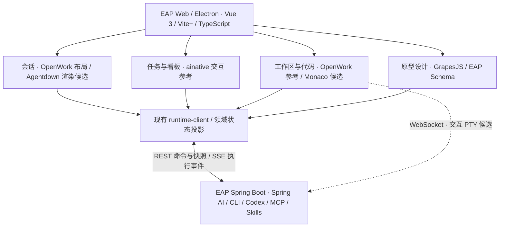
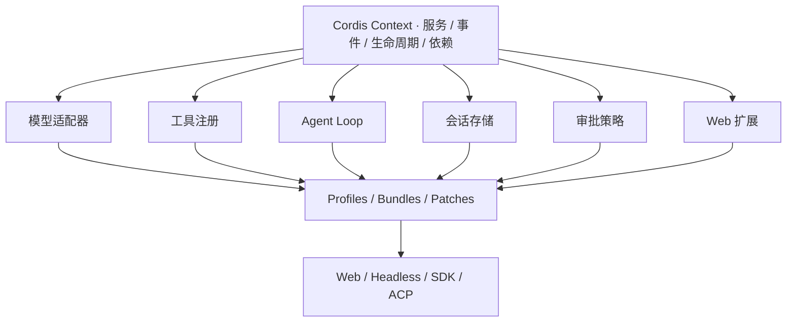
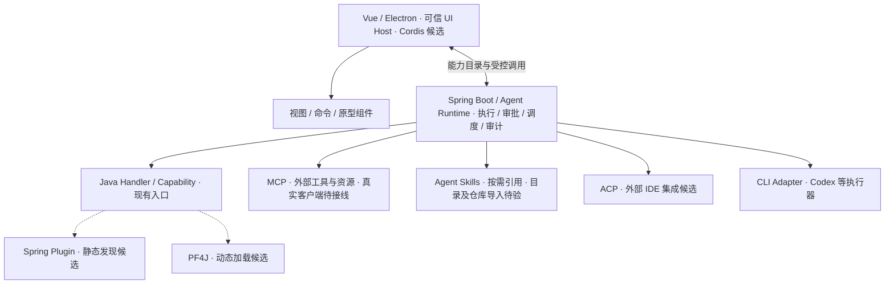
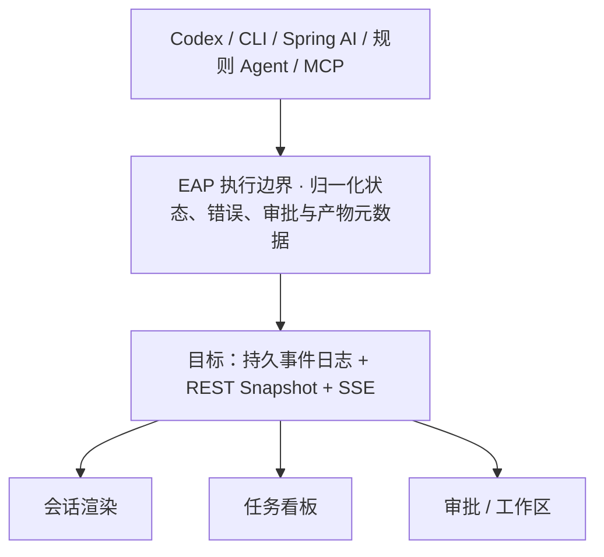
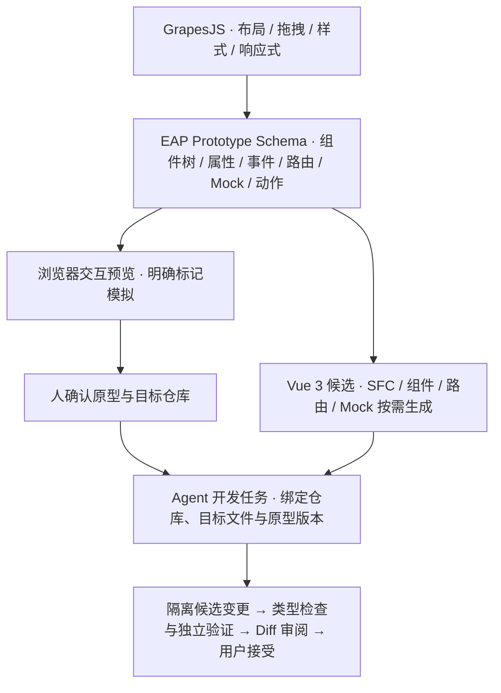

# Engineering Automation Platform：当前产品与架构合同

> 当前工作基线：`main / 119391f`（2026-11-05）；技术路线回顾仅调整文档，后续因用户报告模型故障增加普通API显式Responses协议修复，限定实现与离线回归见[模型协议决定](decisions/model-catalog-and-chat-selection.md#普通api连接的协议选择2026-11-05实现与离线回归通过实网待验)。未调用真实付费模型或启停用户服务。此前 `82aa504` 的整理与测试证据保留在[开发指南](agent-development-guide.md#本轮整理记录基线82aa504)，不是本轮执行结果。适用：本地桌面工程工作台的增量开发与验收。
> **优先级：用户最新明确要求 → 本文 §0B 产品合同 → §0A 技术/执行边界 → 历史资料。** 五个固定一级入口 `code · 编程 / work · 办公 / 场景 / 专家 / 设置`；旧双入口、Builder 第六入口、M0/完整 Mission 前置、插件任意扩展一级导航均不再生效。
> 本地确定性工具优先，必要时使用 LLM/外部 Agent，结果独立验证。原型先可点击并经人确认，再按实际缺口渐进实施；不授权全量重写、任意工具调用或第三方代码注入。

## 当前进度阅读与提交同步规则

本文件维护**当前规范与验收关口**，不再追加逐次交付日志。[方案历史总览](records/product-plan-history.md)完整保存精简前1685行，包括全部被覆盖方案、测试数字、媒体链接及失败证据；按原章节稳定锚点追溯。任务提交前更新对应验收行、[完整规划接续台账](planning-status.md)及相关decision；不能只在顶部追加“已完成”。

| 范围 | 已有实现 / 阶段证据 | 尚未关闭的关口 |
|---|---|---|
| 工作面与共享UI | 五入口；场景配置/任务准备、Builder设计/版本/历史、看板任务/原型/执行审阅；主题与共享组件；统一UI Icon/name入口 | 全页面真实系统缩放、焦点/失败矩阵、其他管理页图标迁移及用户接受 |
| 原型与本地上下文 | GrapesJS真实编辑、八类语义映射、不可变版本、只读目录/源码、Task与Run原型快照 | 更多组件/状态/动作映射、多文件组件约束、自身页面真实交付 |
| 源码与交付 | 单目标生成前持久基线、候选与应用读回、目录互锁、POST_HOC/PREBOUND、独立验证及持久接受/拒绝 | 真实供应商生成→应用→实际页面→用户接受整链；未知人工核对/取消；Git Run不归因为代码作者 |
| 专家与Skill | 单专家授权知识检索/旧记忆隔离；Skill文本导入、不可变版本、启停与无工具Chat显式引用 | 完整角色/资源整合、Skill目录/仓库导入、MCP真实协议、规划/Agent与Work执行；不执行脚本或自动授予工具权限 |
| 后端与桌面 | api/engine/ai/web/runtime五模块；Electron安全preload与安装引导脚手架 | IDEA重新导入/实际重启与完整生产启动；Windows sidecar、一体启停/迁移、打包签名和人工验收 |
| Agent上下文与记忆 | Spring AI20条消息窗口；知识全文/关键词检索；授权知识/Skill使用后逐轮清空模型记忆 | CE-01/KR-01基线、MEM-01恢复/工作记忆；派生内容撤权失效先于放开记忆；不默认换框架或引入向量库 |
| 本地工具与目录 | Java/CLI能力与程序操作登记、PATH/指定路径发现、工作区绑定和只读文件树 | FS-01统一数据/临时资源归属与迁移合同、TM-01一个受管工具；登记不等于安装，cwd不是OS沙箱 |
| 工具发现与使用 | Handler/CLI管理与特定业务调用已存在，前端交互实例没有通用调用合同 | TD-01可信定义/依赖自动绑定；TC-01运行时调用与呈现，TC-02前端实例；发现不等于授权或业务完成 |
| 功能插件与场景组合 | 固定Chat/Builder可信预装Host与启停原型；看板/原型服务已有业务切片 | PL-01看板贡献首片、PL-02/SC-03设计器与场景依赖；不是外部安装器或任意JS隔离 |

**既有验证基线（不是本次执行）**：[后端拆分记录](records/architecture-history.md#backend-runtime-modules)记录干净reactor verify **652项、0失败/错误、6条件跳过**，启动包四个依赖jar和19份迁移已核；[图标记录](records/frontend-history.md#frontend-icons)记录前端 **97文件/574项**及类型/边界/构建通过、限定浏览器主题检查和最终独立复核。较早525/647等数字只在历史中保留。Fake模型、真实数据库、服务浏览器、真实供应商及用户接受分别记录；不计算掩盖这些差异的“整体完成百分比”。

<a id="section-0a"></a>
## 0A. Spring AI 与技术执行边界

<a id="section-0a-1"></a>
### 0A.1 保留架构与当前模块归属

- 保留 Java 25 / Spring Boot 4.1.1 / Spring AI 2.0.2、Maven reactor，以及 Vue 3 + TypeScript + Vite+ + pnpm workspace + Tailwind 4 / 标准CSS变量；不引入Sass或另建React Renderer。
- 后端保持单一Java服务：`backend/eap-api`为稳定能力契约；`eap-engine`为确定性执行、任务/Run及持久化；`eap-ai`为模型/Chat/Skill及交付整合；`eap-web`为HTTP边界；`eap-runtime`只保留启动装配、运行资源和跨模块测试。依赖方向 runtime→web→ai→engine→api；普通DTO在application.dto，AI响应在ai.dto。已应用迁移不重写，不为拆模块改变API/权限。
- 共享UI、hooks/effects/layout/plugin等落点以[唯一共享模块规范](decisions/frontend-ui-shared-module-boundaries.md)为准；组件以`frontend/packages/ui/src/index.ts`实际导出为准。允许实现用户明确需要的跨仓库基础定义，不因没有第二消费者阻止，但必须有实现/公开入口/样式/验证，不能建空壳。
- `@eap/ui`为组件与统一`Icon`/类型化name入口，`@eap/icons`仅内部本地Lucide资源层；Reka为内部交互依赖。已按需纳入shadcn TooltipContent并保留来源/许可，不等于全库迁移；页面不另设第三方UI入口。`@eap/style`不持有路由/存储，应用负责偏好持久化。
- Vue Router、Pinia、Query、Monaco、xterm、Vue Flow及SDK拆包属于按缺口评估的演进选项，不是本轮无条件安装/迁移指令；先复用现有runtime-client、composable、受信Host和领域页面。新文案走i18n，不按旧建议目录一次性搬迁。
- 前端测试统一在所属应用/包根`__tests__/`，与`src/`同级；测试夹具、快照与类型合同一并隔离，见[测试目录决策](decisions/frontend-test-layout.md)。工程检查集中在`scripts/vsh`工作区包；跨包只允许声明依赖及公开exports，禁止私有源码直引/别名绕过，包含运行时文件环和工作区声明环门禁。审查反例修复及用户批准模板语法修复后，最新104文件601项、根check、类型/架构/测试lint-fmt/build通过；glob展开限定复核与业务验收分开，见[工具决定](decisions/frontend-tooling-boundaries.md)。

<a id="section-0a-2"></a>
### 0A.2 责任边界（规范性决定）

```text
Chat / SQL Expert / 后续 Mission / Builder AI 辅助
                   |
                   v
          EAP AI Application Service
                   |
          Spring AI 2.0.2
      ChatClient / ChatModel / Tool Calling / ChatMemory
          |                     |
   官方模型 Starter          EAP 受控 ToolCallback
   (按需扩展供应商)            -> Capability/Policy/Executor
                                 -> Trace / Artifact

外部编码 Agent：CodexAdapter / 后续官方协议适配器
    -> 独立会话、审批、执行与证据；不伪装成普通 ChatModel

Mission/Run/Approval/Verification：EAP 领域层，不能由 ChatMemory 替代
Workspace Plugin：Vue UI 扩展层，不等于 Spring AI Tool / MCP / Skill
```

**原则**：Spring AI 负责通用模型接入、消息、Advisor、工具调用编排及可选记忆/MCP 客户端集成；EAP 负责工具权限、确定性工程能力、任务状态、审批、执行证据、持久化和独立验证。Spring AI 的 MCP 支持并不意味着现有 EAP MCP 登记服务已经完成真实协议接线，必须核对当前实现与授权桥接后再宣称可用。不得同时维护第二套模型 Provider 注册与调用循环；确有业务兼容需求时允许保留薄适配桥。

<a id="section-0a-3"></a>
### 0A.3 模型、配置与执行的有效合同

- 模型状态至少区分`disabled / not_configured / configured_unverified / available / error`；只有真实验证才显示available，配置存在不等于连接成功，不自动计费探测。Fake ChatModel验证普通对话/工具/拒绝/错误/SQL回退，不替代供应商能力验收。
- 用户可在本地设置配置、启停和切换连接/外部Agent；Spring AI官方集成和程序化构建承载模型协议，旧环境属性不是唯一产品事实源。迁移见[环境说明](environment.md)。凭据由本地服务保护，不进入浏览器、Trace或Artifact；浏览器不直连供应商。
- Chat复用`EngineeringChatService`与受控API，显示所选模型、真实/模拟与工具授权结果；多供应商按需接官方Starter，OpenAI-compatible不保证所有供应商语义。Codex/Hermes有独立入口与配置，不走普通ChatModel，不套用SQL缓存/压缩。
- 普通API连接显式选择`chat-completions / responses`，不由域名猜测；旧数据默认前者。Responses复用官方SDK与Spring AI记忆/调用边界，首片仅文本/代码提案、不支持Git工具；协议变更提升revision并须重新确认会话，禁止自动降级重试或迁移凭据。账号认证与wire协议分开，实网恢复仍待用户验收。
- 模型只提出工具请求，EAP负责权限、路径、参数、执行和证据；保持工具调用上限。内存ChatMemory不是持久会话、任务审计或可恢复Mission；SQL规则、缓存与失败回退保留，规则输出不能标成模型分析。
- 已有CLI直接复用Capability / Handler / ProcessExecutor；命令模板属于能力，进程生命周期属于执行器，Task/Mission只关联和投影。Chat/Expert/看板不为同一Git操作另拼命令或另建执行器；参数数组、超时、限额、环境策略、脱敏及真实进程回归须保留。
- Java默认是**本机本地服务**，UI与执行共置；可保存本机连接及工作区绑定。UI标签/intendedPath不是写权限，不静默扩到父目录/整盘；不做远端多租户实例代持异机路径/密钥或隔离云VM。Python只作安装引导，不作Agent宿主。见[运行环境](running-context.md)。
- MCP是互操作协议，不是本地CLI必选包装，也不提供目录授权/进程恢复。复用Spring AI MCP集成并对接EAP授权，只有真实`initialize → tools/list → tools/call`及拒绝/超时/隔离证据才能称接通；登记、探测或Fake Handler不算。stdio与远端HTTP安全策略独立，工具标识保留服务器命名空间。
- Skill、Knowledge、Expert/DAG、Workspace Plugin与Capability保持各自生命周期；Skill指导不授予执行权限，知识检索必须受授权范围限制。知识更新/删除一致性与引用溯源须验证，是否引入向量检索由评测决定。现有DAG不是永久专家产品定义，也不等于自主Agent。
- 优先通过受支持CLI/SDK/协议复用已有Agent Harness，只补证明存在的缺口，不重造模型工具循环。记录持久化不等于进程恢复；证据不足记UNKNOWN并阻塞下一次启动，不能用父进程消失/缺PID证明进程树结束。取消、人工核对和跨重启接管仍按实际能力单独验收。
- 用户主路径是输入需求、引用文件、选专家及模型/Agent、强度与审批、受控执行并审阅；普通仓库需求无需先做Builder/Handoff/完整Mission。无模型时确定性能力和手工设计仍可用，优先真实自身页面交付，不连续扩建连接管理。
- 插件只贡献受信内部工作面，不改变五入口；Manifest不能任意import路径/URL、修改全局容器或自动授予权限。停用/卸载与数据删除分开，保留任务/版本/审计。第三方可执行UI须独立隔离/来源/兼容/许可评估，未完成前不开放。
- Electron共享Vue UI；`nodeIntegration:false`、`contextIsolation:true`、`sandbox:true`、webSecurity开启。preload只暴露具名方法，不暴露通用IPC、任意文件访问/shell；Main验证路径/参数/权限。Web缺能力返回unsupported；安装、签名和各目标OS须真实验证，脚手架不等于桌面产品交付。

更多执行边界见[工具接入决定](decisions/tool-integration-runtime-boundaries.md)、[扩展边界](decisions/extension-boundaries.md)、[桌面规范](desktop-spec.md)。旧S0–S3、CLI/扩展静态审计及详细设计只在[历史§0A](records/product-plan-history.md#section-0a)和[历史§2C](records/product-plan-history.md#section-2c)保留，不作重复实施指令。

### 0A.4 Agent能力与本地运行环境演进

规范细节与源码依据见[技术路线回顾决定](decisions/agent-runtime-evolution.md)。当前继续Spring AI，LangChain4j仅在明确自主协作需求或可复现框架阻碍后做同条件对照；记忆/RAG/MCP的应用缺口不证明框架不支持。不长期并存两套模型工具循环。

- 对话历史、模型窗口、任务工作记忆、长期记忆与本轮检索材料分开。现有知识/Skill逐轮清空保护保留，替代方案须处理派生回答/摘要的撤权与版本失效；不只增加持久Store就宣称可恢复。
- 上下文在现有拼装路径统一预算、来源、相关性选择、输出预留与可解释限额；检索先建立真实问题/预期来源基线，再决定向量、混合检索或重排。字符上限不是token用量。
- MCP首片是一个只读服务器的真实Client闭环；A2A面向独立Agent协作，内部DAG不必套协议。Server、A2A与自主多Agent按需求另批，不按教材章节全部实现。
- 系统工具引用与EAP受管工具并存，后者锁版本、校验、安装回滚、在途保护；仍复用现有CLI/Capability/Executor。安装需明确动作，不允许模型静默下载或全局安装。
- TD-01分离可信工具定义与本机路径/连接/实例绑定，自动汇总已声明能力、探测已知依赖，未知来源仅候选导入；不扫描整盘或运行未知脚本，主动探测与低副作用检查分开，保留停用/授权及在途快照。TC-01/TC-02明确Java运行时、前端Host交互实例及Electron具名能力；调用入口/Schema/范围/审批、结果与贡献呈现分离，不新增绕过策略的任意执行口。先已有Git真实调用，再人工验证草稿实例；反向Agent调用另评审。细则见[工具发现](decisions/agent-runtime-evolution.md#54-工具发现与本机绑定td-01)及[调用合同](decisions/agent-runtime-evolution.md#55-调用执行归属与呈现tc-01--tc-02)。
- 本机数据根分配置、工具、任务scratch、产物、缓存和日志；先盘点旧相对路径并验证迁移/恢复。资源须有归属、限额/保留期与清理责任，运行中/UNKNOWN不自动回收，用户仓库不随插件或工具卸载删除。
- 纯预览/校验/有界转换优先浏览器内存/Worker/Blob，按需评估IndexedDB/OPFS；本机程序、授权工作区、离页执行与持久交付走本地运行时。渲染页只用窄接口，不开放任意fs/shell。浏览器scratch状态不是磁盘目录。

<a id="section-0b"></a>
## 0B. 桌面界面、交互与交付合同

<a id="section-0b-1"></a>
### 0B.1 依据与适用方式

用户录屏及明确要求定义交互目标；代码和可复现验证定义实现事实。参考画面、设计推导、mock、真实实现和人工接受必须分开；视频未展示EAP编辑器或代码交付成功，不作为原型交付通过证据。旧`5981064`等审查基线只见历史；本轮基线与既有验证见顶部，当前缺口统一见§0B.9。

<a id="section-0b-2"></a>
### 0B.2 录屏观察索引：看到了什么，意味着什么

时间为截取帧所在秒数；区间只用于定位演示片段，不表示逐帧确认全部行为。

**本地图片引用约定（2026-10-31）**：下列图片和录屏未经脱敏，已随仓库提交，供其他机器拉取后对照设计。图片是参考应用的设计证据，不是 EAP 已实现或已验收的证据。原始视频：[本地录屏，约 03:20](<屏幕录制 2026-10-26 143418.mp4>)（Git LFS）。

| 位置 | 可见事实 | EAP 应采用的交互语义 | 不能据此宣称 |
|---|---|---|---|
| 00:00–00:24 | 窄活动栏、项目/会话树、顶部当前会话标题；输入框留在底部；`＋` 弹出文件、指令、动作、专家、技能、MCP 等入口 | 全窗口工作台；引用上下文按需添加；项目和会话是工作对象 | 菜单存在就证明全部工具已接通 |
| 00:24 / 00:32 | 文件支持工作区选择与本地上传；MCP 子菜单展示空态及管理入口 | 资源可搜索、选择、移除；缺失能力应有明确空态 | 当前 EAP 文本附件等同图片/录屏支持 |
| 00:40–00:48 | 会话模式弹层与审批弹层是独立控件；模型弹层包含强度和刷新反馈 | 任务目标、执行模式、审批策略、模型能力应分开建模 | `AI 审核` 标签等于已实现风险审核 |
| 00:48 / 00:56 | 模型面板显示“刷新失败，当前展示缓存”，仍显示缓存模型 | 发现状态、缓存时间、有效选中模型分别显示；失败不静默清空 | 缓存模型本次可调用或其强度已验证 |
| 01:04–01:12 | Work 新对话可选场景卡片、添加协作专家，下方仍是同一个输入框；可选项目 | Code/Work 是工作模式；场景与专家参与任务配置 | 办公只是一个空白导航页或文档列表 |
| 01:20–01:36 | 场景有本地/市场、详情；详情包含适用 Code/Work、工作指引、工具、技能、MCP；预设只读、缺依赖提示 | 场景是可复用任务配置；配置、安装依赖、授予权限分别处理 | 需要先建市场才能使用本地场景 |
| 01:52 | 专家卡片有搜索、分类和“我的专家”；保留项目/会话侧栏 | 专家既可管理，也可选入当前任务协作 | 三个固定提示词角色等同用户专家体系 |
| 02:00–02:32 | 进入设置后左侧上下文栏换成设置分类，可搜索；中间展示对应设置 | 设置是全局配置工作区，有明确返回上下文 | 配置修改可以自动扩张任务权限 |
| 02:48 | 项目内任务看板分待规划、待处理、进行中、待验收、已完成 | 会话、任务、执行、验收不是同一状态；完成需人工验收 | 当前 EAP Mission 壳具备录屏里的持续运行能力 |
| 02:56–03:12 | 变更视图有文件列表、原文件/当前文件、审核状态；返回对话可开摘要侧面板 | Diff 与摘要围绕当前会话/任务；打开关闭不丢草稿 | 文件已写入就构建通过，或模型答复等于代码变更 |

关键参考图 1：**01:04，Work 新对话**。场景、协作专家与任务输入处在同一条主路径。图中选择状态是参考应用画面，不是 EAP 实现。


对照要点：活动栏固定在最左，项目/会话侧栏与主工作面分开；场景和专家选择位于输入框上方，底部仍是同一个输入区。不要将其实现成另一套演示首页或独立办公列表页。

关键参考图 2：**01:28，场景详情**。适用工作模式、工作指引、工具/技能/MCP 及依赖缺失是场景的数据，而非几个跳转按钮。


对照要点：列表、详情和依赖状态组成同一场景工作面；预设可只读，复制后编辑。字段及权限语义见 §0B.4。

关键参考图 3：**03:12，对话摘要侧面板**。摘要、变更、授权、任务、后台进程与来源围绕当前会话；正文和输入框仍可使用。


对照要点：摘要是由顶栏入口打开的当前会话面板；不是设置页的永久右栏，也不应覆盖输入操作。面板合同见 §0B.6。

其他复核时间点：00:24 引用菜单、00:40 会话模式、00:44 审批策略、00:48 模型刷新失败、01:20 场景列表、01:52 专家、02:48 看板。原始录屏与截帧未经脱敏；按 `032af1d` 已纳入仓库供跨机器复核，视频由Git LFS管理，不作为EAP验收证据。

| 时间 / 本地关键帧 | 对照的界面与交互 | 设计合同 |
|---|---|---|
| [00:24 引用菜单](assets/ui-reference-20261026/frame-024.jpg) | 文件、指令、专家、技能、MCP 的分层入口及空态 | §0B.5 输入框 |
| [00:40 会话模式](assets/ui-reference-20261026/frame-040.jpg) | 会话模式弹层，与审批策略分别选择 | §0B.5 输入框 |
| [00:44 审批策略](assets/ui-reference-20261026/frame-044.jpg) | 审批选项及解释文案，不能以标签代替执行约束 | §0B.5 输入框 |
| [00:48 模型与强度](assets/ui-reference-20261026/frame-048.jpg) | 模型强度、刷新失败与缓存提示 | §0B.5 / §0B.6 |
| [01:04 Work 新对话](assets/ui-reference-20261026/frame-064.jpg) | 场景、协作专家和输入区的整体空间关系 | §0B.3 / §0B.4 |
| [01:20 场景列表](assets/ui-reference-20261026/frame-080.jpg) | 场景目录、分类与详情入口 | §0B.4 |
| [01:28 场景详情](assets/ui-reference-20261026/frame-088.jpg) | 适用模式、指引与资源依赖 | §0B.4 |
| [01:52 专家目录](assets/ui-reference-20261026/frame-112.jpg) | 搜索、分类和我的专家，保留工作上下文 | §0B.4 |
| [02:48 项目看板](assets/ui-reference-20261026/frame-168.jpg) | 项目下五列任务状态与任务工作面 | §0B.6 看板 |
| [03:12 当前会话摘要](assets/ui-reference-20261026/frame-192.jpg) | 顶栏操作、正文、摘要与固定输入区 | §0B.6 |

**EAP 历史对照截图（不是目标布局）**：下图仅用于回顾此前实现与参考画面的差异，不应照着复刻为最终界面。


<a id="section-0b-3"></a>
### 0B.3 桌面外壳与五入口的设计合同

Java 是本地服务端实现，不决定页面必须采用网站式导航。当前可继续用 Vue/Vite 浏览器承载验证；未实际由 Electron 宿主承载时，不展示假最小化/最大化/关闭按钮。后续宿主集成复用这套外壳，不重做业务页面。

```text
┌────────────────────── 约 44–48px 顶部上下文栏 ──────────────────────┐
│ EAP / 折叠侧栏   当前项目·会话/任务标题        摘要 终端 变更 源文件 ⋯ │
├──────┬──────────────────┬────────────────────────┬─────────────────┤
│      │ 新对话           │ 当前工作面             │ 可选详情面板    │
│ Code │ 项目 A           │                        │ 当前会话摘要    │
│ Work │   任务看板       │ 对话 / 场景 / 编辑器   │ 授权、步骤      │
│ 场景 │   会话 1         │ / Diff / 设置          │ 变更、来源      │
│ 专家 │ 项目 B           │                        │                 │
│      │ 自由对话         ├────────────────────────┤ 默认关闭        │
│ 设置 │                  │ 输入区 + 底部操作条    │ 独立滚动        │
└──────┴──────────────────┴────────────────────────┴─────────────────┘
 52–64px   约 240–280px        minmax(0, 1fr)          约 300–360px
```

尺寸为 CSS px 的初步建议，不从录屏像素反推硬编码；100%/125% 缩放、1280×800 和 1440×900 为首轮验收视口，窄窗口采用可收起侧栏。不得用全页横向滚动解决输入区溢出。

**唯一工作台与数据来源**：真实服务与mock渲染同一`ChatWorkspace`、`createChatSession`、`TaskComposer`、导航和面板，使用同一`createChatApi`/DTO与`/api`路径。`vp run dev`代理Java；`vp run dev:mock`或`VITE_USE_MOCK=true`仅开发时注册模拟服务，生产不启用。界面不提供来源切换按钮，不另建演示首页；场景、版本和任务回链不改变来源或自动发送。

前端、真实后端与mock按同一合同推进，mock不能永久替代业务实现。真实失败不回退mock，未实现mock端点返回404且不回退Java/模型；模拟结果明确未读写仓库、未跑真实测试。看板/原型版本均共用API与门禁；本机草稿不等于服务端不可变版本。当前模拟服务边界与早期分支纠偏见[历史§0B.3](records/product-plan-history.md#section-0b-3)。

窄窗口另以约 708px 宽的当前问题视口回归：侧栏抽屉需有遮罩、明确关闭入口、Esc/外部点击退出；关闭后正文与整个输入操作条可达。发送、审批和模型选择不得落在不可滚动的裁切区域。冷启动优先进入 Code 任务工作面或恢复用户最后的工作上下文，不因旧 SQL 路由默认值而永久进入分析控制台；SQL 仍作为可选确定性能力保留。

| 区域 | 必须行为 | 当前纠偏 |
|---|---|---|
| 活动栏 | 五入口顺序固定；设置贴底；图标、文字、选中态、键盘焦点明确 | 不继承旧深色后台 `.rail`；不因插件数量增加一级入口 |
| 上下文侧栏 | Code/Work 展示项目、会话、任务入口；场景/专家优先保留来源会话上下文；设置切换成分类栏 | 现有“设置子菜单/SQL入口列表”不能替代项目树；Builder A/B 是实例，不应永久暴露成产品分类 |
| 顶部栏 | 当前会话/任务名称和相关操作；无上下文的动作禁用或隐藏；运行时状态紧凑显示 | 不长期占用空间展示品牌、假工作区切换和全局刷新；本机任务分组不得伪装真实仓库 |
| 工作面 | 高度受窗口约束；正文、列表独立滚动；切换入口保留草稿、选择及滚动位置 | 不将标题、告警、卡片、页脚层层堆叠导致输入框不可见 |
| 会话工具面板 | 摘要、终端、变更、源文件入口在对话顶栏右侧，再点一次关闭。**布局按面板分流，不得统一成同一套展开方式**：① **摘要** 锚定为右侧栏，自动收缩会话区宽度，正文与输入仍可用；② **源文件** 为右侧浮层（可含搜索），目录以**树展开**浏览，不是进入式 ⌂/↑ 换层，也不应用全屏替换对话；③ **终端** 停靠在对话**下方**底栏，收缩会话区高度，**不是**右侧锚定栏；④ **变更** 锚定右侧栏展示候选/已应用/目录原有修改。摘要卡可跳到变更、源文件、终端或输入授权 | 设置页不固定展示 SQL 检查器；终端未接通时可打开底栏诚实空态，不得展示伪日志或授予任意 shell。不把风险条数、增删行数写成没有的数据 |
| 底部 | 聊天输入区固定在工作面底部；系统状态无需重复成全局脚注 | SQL 特有指标只留在分析工作台；非 SQL 页面不显示“确定性覆盖/模型占比”等永久页脚 |



**路由恢复合同**：打开场景/专家/设置前记录来源会话与所选项目；返回时恢复正文滚动位置、输入草稿、引用、模型选择和运行状态。应用场景/专家只能改相应配置，不清空用户输入、不自动新建/发送、不丢失其他引用。刷新/关闭应用后的恢复另行定义；当前内存保留不等于跨重启恢复。

<a id="section-0b-4"></a>
### 0B.4 Code、Work、场景、专家与插件的关系

此前实现把五入口理解为“五组页面导航”，造成主流程断裂。目标关系如下：

| 概念 | 用户含义 | 与现有实现的边界 |
|---|---|---|
| Code / Work | 同一应用的工作模式，共用会话骨架，默认目标与可用场景不同 | 不是两套模型连接、两套会话引擎；Work共用交互骨架，办公执行仍未接入，不能冒充已支持 |
| Project / Repository | 任务所属项目及**本地服务所在机器**上确认的真实目录、仓库和基线（产品默认 UI 与 Java 共置） | 浏览器显示标签不是 repoId；本地服务可绑定本机工作区；禁止远端多租户实例代持异机路径；自由对话可不绑定仓库 |
| Session | 保留用户对话、草稿、选择及关联执行 | 不是 ChatMemory 的别名，也不是一个长期后台进程 |
| Scenario | 适用 Code/Work、指引、资源依赖、默认配置和交互流程的可复用组合 | “原型 → 代码”“代码审阅”“文档编写”可为场景；不是插件本身，也不是一次执行记录 |
| Expert | 配置驱动的专业角色，明确可访问资源与可用能力，可加入任务 | `general/sql/frontend`是内置指导角色；单专家授权知识Chat已接，完整角色/其他资源和DAG执行未因此完成 |
| Workspace Plugin | 提供受信 UI 页面与交互贡献的内部扩展 | Builder 编辑器可由插件提供，场景调用它；插件不自动取得工具权限，不决定活动栏结构 |
| Task / Run | 具体需求及一次尝试的状态、变更、验证、审批与证据 | 会话可关联任务；无需先补完整调度平台才能做一次受控开发 |

**场景最低配置合同（目标字段，非新增表承诺）**：`id / version / name / description / supportedWorkModes / instructions / resourceRefs / requestedCapabilities / defaultSessionMode / defaultApprovalPolicy / outputContract`。资源引用使用现有 Skill/MCP/Expert/Capability 标识；复用既有配置与版本能力，确认存储缺口后再决定结构，不建立平行注册中心。

场景列表先做本地可用、部分缺依赖、禁用三态；详情展示已安装/未安装、已配置/未连接、允许/询问/禁止。全局启用只是可用上限，场景默认选择和会话授权不能绕过它。预设可只读、允许复制为用户配置。市场是后续入口，未实现时隐藏或明确空态，不制作假可安装结果。专家入口优先“可选用/可管理”，无需为匹配录屏先做市场。

**插件化演进**：看板UI与原型设计器可作为可信功能插件；“原型到代码”是引用插件及核心服务的场景，不是单一前端插件。Task/Run、审批、执行、目录和验证不随插件停用而消失。先以现有看板收敛版本/兼容、贡献点、activate/dispose、实例配置和依赖失败合同，再迁设计器；不先建空SDK。启停不等于外部安装，前端安装不自动补齐Java服务。缺依赖显示不可用；激活失败回滚局部贡献；停用释放UI资源、保留任务/版本/产物，在途任务仍由核心观察。任意第三方同页JS不能仅靠Manifest隔离；外部包来源/兼容/升级回滚/隔离另行评审。完整门禁见[插件与场景决定](decisions/agent-runtime-evolution.md#6-核心插件与场景)。

<a id="section-0b-5"></a>
### 0B.5 输入框：相互独立的选择与可见状态

```text
┌──────────────────────────────────────────────────────────────────┐
│ 已引用：App.vue  work-pages.css  原型版本 v3  ×   协作：前端专家 × │
│ 描述需求…… 可粘贴文本；文件/图片支持范围明确                     │
│                                                                  │
│ ＋  智能体⌄  审批策略⌄        上下文状态  模型·连接⌄ 强度⌄  发送↑ │
└──────────────────────────────────────────────────────────────────┘
```

| 选择轴 | 目标行为 | 当前实现与限制 |
|---|---|---|
| 任务目标 | 讨论、审阅、按原型开发等，场景可提供默认值 | 当前 `TaskContext.mode=chat/code` 是输出目标，不是完整执行模式 |
| 会话执行模式 | 聊天不使用工具；规划仅做允许的读取和计划；智能体使用已授权执行器 | 当前无完整规划/Agent 模式；不能只改 select 标签就宣称支持；插件创造可延后 |
| 审批策略 | 与执行模式独立，显示实际生效策略和每次待批准动作 | 当前仅 `review/read_only`；没有风险审核服务时，不得把 `review` 命名为“AI 审核” |
| 模型 | 只选已启用连接上、允许列表中的具体模型；同名模型显示所属连接 | 连接变更或模型失效需明确提示；切换会清服务端记忆时提前说明 |
| 推理强度 | 根据当前模型能力动态显示，提交值来自能力映射 | 不把所有模型统一硬套“最大”；不支持时隐藏或解释禁用，切换模型后重新校验 |
| 专家、指令与引用 | 可添加、可移除、能检查将发送的内容；管理入口返回后不丢上下文 | 固定角色与配置专家应分清；当前文本附件不能承担图片和录屏理解 |
| 上下文状态 | 展示附带资料及限额；有真实 token 统计才显示 token 用量 | 不用装饰性圆环伪装计量；过大资料分块或拒绝，不静默截断 |

`＋` 菜单按文件/原型、指令、专家、技能、MCP 等类别组织，并提供搜索、数量、选中项和管理跳转。未实现能力在交互原型中明确标“演示”，正式界面隐藏或说明不可用；菜单不能成为尚未接通能力的广告墙。弹层定位在输入区附近，空间不足时翻转，Esc/外部点击关闭，选择项不清空正文，焦点回到输入区。

模型连接路径是 **凭据接入 → 获取目录 → 选择允许模型和默认模型 → 会话选择 → 按模型能力选择强度**。ChatGPT 账号登录与 OpenAI API Key 是两个凭据入口；DeepSeek 使用 Key。目录刷新失败时保留上次目录并注明缓存时间、错误和重试；允许列表不能因刷新自动全选；发现模型不等于验证调用成功。模型/Agent 目标也不合并：普通 ChatModel 不自动具备仓库工具循环。



该图是任务交互合同，不表示已有取消、持续后台运行或跨重启恢复。HTTP/UI缓存与持久Task/Run证据分别记录，不能由其中一个推断全链支持。发送中可切换页面，必须显示任务仍在进行；无法取消时直接说明，不提供只停止动画的假取消。

<a id="section-0b-6"></a>
### 0B.6 会话相关面板与任务看板

顶栏四入口共用「开关式」状态，但**展开载体不同**（以产品参考帧为准，禁止把终端做成右侧栏，也禁止把源文件做成进入式全屏目录）：

- **摘要（右侧锚定栏）**：打开后会话区宽度收缩；展示当前项目/仓库、会话目标、所选模型、真实生效权限、任务步骤、变更、验证、后台进程与资料来源。未知值显示未知；切换会话后不能沿用上个会话的摘要。正文与输入框保持可用。
- **变更（右侧锚定栏）**：区分“本次任务候选”“本次任务已应用”和“目录里原有修改”；提供文件列表、逐文件 Diff、冲突/审核状态。当前 `before/content` 展示仅是候选比较，不是完整仓库审查器。
- **源文件（右侧浮层 + 树展开）**：浮层覆盖对话右侧，可含搜索；目录在树中展开/收起子项，显示项目相对路径与版本/哈希；本地上传与仓库内文件不是同一个来源。不是 ⌂/↑ 进入下一层、也不是用全屏面板替换对话。
- **终端（底部停靠栏）**：停靠在对话与输入区下方（或对话主体下方），收缩会话区高度，横跨主内容宽度；必须来自真实受控执行及明确执行号。未接通时可打开底栏并诚实说明无执行日志，不得展示伪日志，页面显示日志不赋予任意 shell 权限。
- **任务看板**：归属项目，任务链接相关会话、需求、原型与 Run；待规划 → 待处理 → 进行中 → 待验收 → 已完成为目标交互，实际状态与允许动作由 EAP 统一任务规则确定。按 §0B.11 借鉴 Hermes 设计，优先复用 EAP 已有能力及合适的独立开源依赖，不直接接入 Hermes 功能，也不先自研完整调度平台。只读 `git status` Run不构成代码开发交付能力；首轮交付不要求无人值守。

<a id="section-0b-7"></a>
### 0B.7 “原型 → 代码”重新定义：必须能改造已有 EAP 页面

<a id="section-0b-7-1"></a>
#### 0B.7.1 历史问题与当前范围

2026-10-26的结构性缺口分析及Current/Target图已移至[历史快照](records/product-plan-history.md#section-0b-7-1)，不能继续称GrapesJS、生成前基线、持久应用或Task关联“尚未实现”。当前未关闭的是实际供应商自身改页、更多组件/多文件约束和用户接受；下述合同持续有效。

<a id="section-0b-7-2"></a>
#### 0B.7.2 两条入口共用一个交付合同

“原型 → 代码”归属场景，但不强制用户从空白 Builder A 开始，也不把 Builder 设成新的第六一级入口。

- **已有仓库界面调整**：选择 EAP 项目和目标页面 → 引用现有截图/录屏/代码 → 建立可点击的布局及交互草案 → 人工确认 → 基于现有代码实施。允许先用 Vue 可点击夹具承载草案，不必等待通用拖拽编辑器完成；夹具和模拟数据明确标记。
- **新页面原型开发**：场景内打开编辑器 → 使用受支持组件设计页面与状态 → 预览 → 保存不可变版本 → 选择真实目标仓库和路由 → 同一开发/验证链路。

截图/录屏是设计参考，既不直接变成 Vue 源码，也不携带仓库授权。不能宣称可把任意已有 Vue 页面无损反向导入 GrapesJS。后续 GrapesJS 用作原型编辑器时保留其项目数据与独立语义 Schema；代码实现优先复用当前仓库组件，未知映射进入“需人工实现/确认”状态。

<a id="section-0b-7-3"></a>
#### 0B.7.3 场景界面与操作步骤

| 步骤 | 用户可见内容及动作 | 进入下一步的条件 |
|---|---|---|
| 1. 选择目标 | 项目、**本地服务确认**的仓库路径（默认共置本机）、分支/基线、目标页面；区分现有页面调整/新页面 | 仓库可在本地服务机器上读取，目标明确；无模型也可做读取和设计 |
| 2. 了解现状 | 技术栈、组件/Token、关联源码、当前修改列表；显示扫描范围与未读取部分 | 用户确认相关范围；不读整个仓库、不读取凭据 |
| 3. 设计与交互 | 原有界面对照、布局草案、属性、状态/动作；支持预览、调整及明确模拟边界 | 至少一次真实点击/切换/弹层/状态验证 |
| 4. 保存并确认 | 不可变版本、参考资料、组件映射、逐条交互验收；可继续编辑形成新版本 | 用户确认采用该设计版本 |
| 5. 开发准备 | 原型版本、目标仓库、允许文件、基线哈希、实现执行器、模型、策略和预计验证命令 | 条件齐全；失败显示具体缺口，不能只跳到空聊天 |
| 6. 候选与应用 | 文件列表、Diff、已有修改/冲突、范围检查；应用前再次核对基线 | 用户确认应用；基线变化须重新审阅 |
| 7. 验证与验收 | 每条命令/退出码、页面预览地址、交互验收清单、失败信息 | 构建检查通过且人工交互验收后才显示完成 |

实现输入合同至少携带：`prototypeVersionId/contentHash`、可信 `repository identity`、`target page/routes`、`base commit + selected file hashes + dirty snapshot`、`allowed paths`、`component/token mapping version`、`interaction acceptance`、`executor/model selection`、`effective policy`。这些是逻辑字段，可复用现有对象，不要求全部新建表。仓库路径与授权来自**本地服务本机绑定**（默认共置；见 [running-context.md](running-context.md)）。浏览器标签/`intendedPath` 不能直接覆盖进程绑定；不得把未共置的远端 Java 路径冒充用户仓库。

最小补充的 `PrototypeSchema` 要能表达 `pages/nodes/layout/properties/state/actions/references/componentMappings/acceptance`；第一版只支持侧栏切换、展开/关闭弹层、选择项、简单状态变化。未知节点或动作明确阻塞自动交付，不静默变成静态 HTML。导出 HTML 只能作为参考产物。



不强制先实现完整 Mission 调度、跨重启接管、市场或多仓库编排。先评估复用现有受控补丁路径或已有 Agent 宿主；需要 Agent 的仓库理解能力时使用现有适配，不再自研工具循环。涉及真实模型和文件变更另按既有授权边界执行。

**原型安全与资产约束**：GrapesJS编辑数据与独立语义Schema都必须保存，稳定节点ID、映射/Schema版本、迁移/校验及来源可追溯；不可变版本的修改产生新版本。设计态与Vue真实预览分层，不能把Vue直接塞进iframe当作原生映射。AI局部设计补丁先预览再批准，不直接注入任意HTML、script、内联事件或远程资源；组件/属性/URL白名单校验。原型模拟不执行Git/SVN/文件写入/Agent；无AI也能手动编辑、保存重开及预览。导出不是交付，手工维护代码与生成内容分清，冲突停止而非覆盖。详细设计来源见[历史§3A](records/product-plan-history.md#section-3a)。

<a id="section-0b-8"></a>
### 0B.8 历史开发记录与证据入口

[完整累计记录及旧能力矩阵](records/product-plan-history.md#section-0b-8)保存原§0B.8全部文字、命令、失败、浏览器观察与测试数字；[阶段交付记录](records/product-plan-history.md#source-l31)保存原页首逐次日志。它们只证明当时范围，不能把旧“待后续”或“尚未实现”当作当前待办。当前状态只读顶部、下表及接续台账；本次未重跑任何业务验收。

<a id="section-0b-9"></a>
### 0B.9 因文字沟通偏差产生的调整需求

本表为当前有效验收ID与未关闭关口。文档回顾基线`119391f`；实现/阶段验证通过不关闭整项用户验收。媒体复核及Comments 1–10的限定修复见[媒体对照记录](records/frontend-history.md#reference-ui-review)，原555/556项阶段数字与详细日志保存在[历史§0B.9](records/product-plan-history.md#section-0b-9)；不叠加为本轮执行。

| ID / 优先级 | 原先误解或当前偏差 | 必须调整为 | 可观察的验收结果 |
|---|---|---|---|
| UI-01 / P0 | 固定五按钮就算桌面布局完成 | 按 §0B.3 同时实现上下文栏、侧栏、工作面和可选面板 | **部分交付**：摘要收窄时欢迎卡横溢已修；侧栏边界长文收入可展开「边界说明」；约 708px 项目侧栏带遮罩浮层，Esc/遮罩/关闭可退，关闭后发送可达。**多页面 708 矩阵已核**；**≈1280@125%（1024 宽）SQL 抽检无页横溢**。仍缺：全桌面视口×缩放完整矩阵的人工联调记录 |
| UI-02 / P0 | Code 侧栏只是聊天/SQL页面入口 | 项目树、会话、任务入口；SQL 为确定性工作面 | **部分交付**：本机分组/会话树、持久看板任务、SQL独立工作面；侧栏入口复用真实 `/ai/workspace/files` 和共享Tree/Drawer，只读源码可引用。专家/设置唯一返回来源入口及Work草稿/引用保持已补；标签与本地服务路径分离。仍缺：SQL业务跑数、全导航一致性及用户接受；不再将真实目录读取列为未实现 |
| UI-03 / P0 | 工作区名称等于仓库绑定；或把 EAP 做成远端云代持异机路径 | 分离 UI 分组标签、偏好路径与**本地服务**进程路径；默认宿主 `local-service`；空配置 colocated 默认绑定；桥可选 | **部分交付**：文案/宿主/colocated/HTTP绑定根与dirty已核，Electron安全preload壳已存在。仍缺：真实桌面目录选择联调、sidecar与安装包验证；不是从零新增桌面壳 |
| UI-04 / P1 | Work 是占位文字，场景是另一张静态页 | 共用新对话骨架，选择场景与协作专家 | **部分交付**：欢迎区明示选择不发送；选中后目录往返与**刷新**均不清空（`sessionExtras` 本机持久化）。仍缺：真实办公执行接入 |
| SC-01 / P0 | 原型到代码 = 三步导览 + 跳聊天 | 场景详情、资源/目标条件和 §0B.7 任务工作面 | **部分交付**：场景配置与任务工作面分离，设计复用Builder；版本和开发准备分面，准备API按需读取、返回保留选择；真实/mock共用GrapesJS与门禁。自定义场景已补显式保存、服务端revision/CAS、刷新读取与删除保护，见[场景配置切片](records/resource-history.md#scenario-configuration)。仍缺：真实模型自身改页→验证→用户接受，不再把GrapesJS接线列为未实现 |
| SC-02 / P1 | 场景、插件、技能、专家混用 | 明确 §0B.4 的职责和配置引用 | **部分交付**：场景职责/依赖定位保留，自定义场景标为配置而非插件，保存不安装/授权或执行资源；独立Skill文本版本管理与Chat显式引用首片已通过阶段验证。仍缺：场景资源引用与Skill的完整整合、目录导入及真实MCP协议；配置revision不是不可变原型版本或执行证据 |
| CP-01 / P0 | 用 `chat/code` 两值冒充会话执行模式 | 任务目标与执行模式分离；工具按真实能力启用 | **部分交付**：规划/智能体未接通即禁用；Git 随 `git_status`；无模型发送禁用+去设置。仍缺：规划/智能体真实执行器 |
| CP-02 / P0 | `review` 可叫“AI审核” | 按真实后端能力显示生效策略 | **部分交付**：文案为逐次确认/只读；摘要与策略菜单明示「风险审核未接入」。拒绝后不继续写入此前已接 |
| CP-03 / P1 | 表单选择框堆满输入区即满足截图 | 多行编辑 + 轻量操作条 + 就近弹层 | **部分交付**：开弹层不清正文、Esc回焦；知识/Skill紧凑引用，模型/发送成组靠右、缺模型提示在下方；限定四视口发送可达。仍缺：审批流在短窗的人工联调 |
| MD-01 / P0 | 保存连接或发现模型就证明推理协议可用 | 凭据/显式wireApi→目录→允许模型→会话具体模型与能力 | **部分交付**：连接/目录/白名单/默认/强度已有，追加普通API Responses文本/代码提案及显式选择、revision/重绑定和Git拒绝，离线回归通过；失败保留缓存且不自动全选。10/28 DeepSeek目录测试为历史。仍缺：重启加载后当前网关/认证/推理档位实网验证、浏览器接受及Responses工具；不宣布本次403故障已恢复 |
| EX-01 / P1 | 固定三角色等于专家协作 | 将配置专家按明确合同接入任务 | **部分交付**：指引追溯保留；单个持久专家授权知识→Chat、发送重检、撤权/旧记忆隔离已交付（c9d23a7），有实库/Fake模型与浏览器证据。仍缺：完整角色与其余资源、真实供应商效果；不执行DAG或自动授予工具权限 |
| PB-01 / P0 | 标题+正文+点击按钮就是可视化原型 | 先支持 EAP 页面布局/交互草案，再扩展通用编辑器 | **部分交付**：GrapesJS真实画布、工程/Schema、page/section/text/heading/button/link/list/input八类映射、Vue交互预览与保存重开已验证；Builder设计/版本/历史演示分面，未知映射阻塞。仍缺：目标页面所需更多组件/状态/动作映射与真实改页验收，不承诺任意Vue无损导入 |
| PB-02 / P0 | 传原型 ID 就完成交付开发 | 生成前绑定目标与基线、读取相关现有源码；propose 必须含 `targetPath` | **部分交付**：单目标完整有界源码已在模型前持久保存/读回，原型与Task/revision快照及PREBOUND已交付（f6aed04、69892f3）。仍缺：真实供应商自身改页验收、多文件组件图约束 |
| PB-03 / P0 | 模型返回完整文件后才取哈希足够 | 生成前固定文件快照，应用前再校验，保留既有修改 | **部分交付**：单文件候选、APPLYING意图、写后读回与APPLIED重放、基线冲突及UNKNOWN目录/任务互锁已持久化；POST_HOC/PREBOUND归因已交付。仍缺：真实模型改页/完整交互验收、未知人工核对；不承诺多文件事务或OS级CAS |
| PB-04 / P0 | 写入成功等于界面调整完成 | Diff→应用→类型/测试/构建→页面预览→人工交互验收 | **部分交付**：Run独立typecheck/test/build真实三项联调、同源源码/交付证据和持久人工接受/拒绝机制已交付（04edef5及后续交付切片）。仍缺：EAP自身真实模型改页→预览→用户接受整链验收；测试人工决定不等于用户已接受 |
| CT-01 / P1 | 页面保留等于任务恢复，或会话失效只能手工新建 | 区分 UI缓存、模型记忆、请求和持久Run；显式重连后可重试当前草稿 | **部分交付**：看板持久回放/UNKNOWN阻塞保留；同ID重连及草稿重试保留；**本轮**：聊天 SSE 事件流、`cancel`、执行快照游标与前端投影去重/缺序离线通过。保留本地上下文但不重放历史；仍缺真实浏览器流式/取消接受及跨重启进程接管 |
| RV-01 / P1 | SQL检查器等于全局摘要 | 任务/会话相关摘要、文件Diff、验证和来源 | **部分交付**：会话摘要/变更右栏、源文件浮层、终端底栏各守职责；看板按Run选择审阅/验证，源码交付与接受/拒绝独立工作面且持久回放；设置不挂任务面板。仍缺：SQL实际任务证据、完整自身改页证据及用户接受；Chat终端未因此获得任意shell能力 |
| CE-01 / P0 | 有拼装与字符限制就算上下文工程 | 在既有路径统一预算、来源、选择及失效合同 | **部分交付**：后端 `ContextBudget` + 前端回合用量摘要/`CONTEXT_BUDGET_EXCEEDED` 可读提示（无正文）；mock 回合附带预算与显式超限；`ContextBudgetTest`/`contextBudgetView`/`chatBackend` 离线通过；mock 浏览器已验。仍缺：真实 token、压缩策略、ChatMemory 精确计量、用户接受；不宣称 MEM-01 |
| KR-01 / P0；KR-02 / 条件后续 | 没向量库等于没检索 | 先评测已有FTS/关键词，证明不足再比较增强 | **部分交付（KR-01）**：fixture + FTS；排序质量样本；**生产形排序样本**离线通过 + gated FTS 排序对照用例。仍缺：实库跑通 FTS 排序对照；**KR-02 未触发** |
| MEM-01 / P1 | 窗口持久化等于完整记忆 | 历史/绑定恢复、任务工作记忆分层，依赖CE-01 | **部分交付**：分层+PUT/UI（约束/事实展示）+本地持久+Task/Run；对抗失效；mock 浏览器验目标/约束。仍缺：以对抗证据取消 sticky 清空；用户产品接受；自动长期抽取延期 |
| MCP-01 / P0 | 登记/探测等于协议执行 | 既有授权/会话桥接一个只读服务器 | **部分交付**：stdio + 分页 + **官方只读包矩阵**（everything/`echo` + sequential-thinking/`sequentialthinking` + memory/`read_graph`，mock 浏览器已验三包；门禁 stdio 用例已加）+ http + legacy SSE + Streamable-HTTP + 生产白名单 + GET/Last-Event-ID 续传；门禁实跑与常驻 listen 仍待 |
| FS-01 / P0 | 工作区树等于应用目录管理；UI scratch等于磁盘目录 | 数据根、缓存/产物/任务临时资源归属，浏览器与本机执行分界 | **部分交付**：data-layout + migrationReadiness + 能力页只读盘点 UI（mock/真机已验）；物理迁移未批准 |
| TM-01 / P1 | 程序登记等于安装与版本管理 | FS-01后增加一个可信受管工具，系统引用保留 | **待实施**：锁版本/校验/失败回滚、实际调用、在途卸载阻止；不改系统工具 |
| TD-01 / P0 | 每个工具都要手填，或发现程序就认定能执行 | 可信定义自动汇总、已知依赖绑定，未知候选需适配 | **部分交付**：可信工具目录 + 绑定快照 + 显式 `--version` 探测写回 + **探测持久化缓存**（`.eap/cache/trusted-tool-probes.json`）；mock 浏览器已验离页回读。真实重启与用户接受仍待 |
| TC-01 / P0 | 目录登记/查询取消等于完整使用，或Java工具需前端重实现 | 明确入口/输入输出/范围/策略，前端通用交互与受信结果适配 | **部分交付**：目录触发只读 git-status API 与能力页入口；mock 成功/拒绝/超时/取消呈现与 Abort 取消（浏览器已验）。真实 git 失败矩阵与用户接受仍待 |
| TC-02 / P1 | 保存版本等于当前草稿，当前页面就是隐含目标 | 前端Host处理具体实例/文档/revision，先人工读取 | **待实施**：多实例/切页/关闭断线/revision冲突；TC-01合同后协调插件Host，模型反向调用另评审 |
| PL-01 / P0；PL-02 / P1 | 固定Chat/Builder启停原型等于通用安装器 | 现有看板贡献首片，再迁设计器，复用核心服务 | **部分交付（PL-01）**：board 启停/持久化回滚 + 依赖缺失/激活失败 mock 呈现（浏览器已验）；PL-02 未启动；外部动态代码延期 |
| SC-03 / P1 | 原型到代码等于一个页面插件 | 场景组合设计器/可选看板及核心交付服务 | **待实施**：依赖声明与缺失提示，配置/版本/任务分离；保留SC-01保存UNKNOWN删除阻断及真实交付关口 |
| FW-01 / 条件后续 | 能力未接线就直接换框架 | 明确需求/可复现阻碍后同条件比较Spring AI与LangChain4j | **未启动**：兼容、成本、正确性、取消/错误及迁移回归；需独立决定，不长期双循环 |

这些需求是对“语义未实现”的纠偏，不因已有代码能编译而降级为可选润色。P0 表示下一轮需优先确认和实施，不是授权一次性重写全应用。

<a id="section-0b-10"></a>
### 0B.10 分阶段实施与 EAP 自身验证用例

| 阶段 | 最小可交付范围 | 复用 / 暂缓 | 退出条件 |
|---|---|---|---|
| R0：交互对齐 | 按录屏制作五入口、项目会话、新对话、场景选择、输入框弹层、摘要/Diff 的可点击草案 | Vue 组件/Token；暂缓市场、真实终端、自动调度 | 用户能走完脚本并确认交互；演示状态明确 |
| RK：看板设计与依赖验证 | 按 §0B.11 审查 EAP 现有任务/执行能力，评估独立开源依赖，明确状态、并发与审阅合同 | 借鉴 Hermes 思路；采用合适组件/库；无合适资源时补最小必要部分，不接入 Hermes 服务 | 依赖采用/拒绝理由明确，EAP 单一状态与执行归属确定，不以库存在代替业务验证 |
| R1：真实上下文 | 本地服务绑定本机仓库、文件来源、模型配置、场景应用与返回；Code优先，Work共用骨架；看板按 RK 结论增量实现 | 会话/模型/工作区在**本地服务**本机数据与进程内；复用 runtime-client；可选桌面壳 | 本机路径与配置可核对；默认共置；无自动发送/授权扩张 |
| R2：自身页面开发切片 | 选择 EAP 前端一处页面/组件，从设计版本和相关源码产生候选并审阅 | 现有版本存储、受控执行/Agent适配；无需完整Mission或通用GrapesJS导入 | 基线与范围可追溯，候选复用原组件，已有修改受保护 |
| R3：闭环验收 | 应用受控变更、运行检查、打开实际页面、人工逐项验收 | 已有 pnpm/Vite 及构建执行能力；不自动推送/合并 | 类型/测试/构建 + 用户交互验收，版本↔变更↔证据可查 |
| R4：能力扩展 | 丰富 Builder Schema/GrapesJS、Work场景及配置专家 | 按实际缺口增量实现 | 每次按同一交付合同验收，未通过不扩大支持范围 |

**首个自身验证用例：调整 EAP 设置侧栏与对话输入框。**

1. 选择当前 EAP 仓库及实际前端目录；展示 `App.vue`、`DesktopNavigation.vue`、`ChatWorkspace.vue`、`TaskComposer.vue`、`work-pages.css` 及必要共享组件/Token。先记录已有未提交修改；只读识别不代表已授权写入。
2. 引用用户截图/本录屏的交互结论；制作可点击的导航、输入框弹层和摘要布局。明确哪部分是当前界面、哪部分是候选草案，不把参考应用画面当成 EAP 预览。
3. 用户确认设计后保存不可变版本与验收清单，锁定允许修改范围。先选择合适的隔离实施方式；不能仅靠分支名或 worktree 名称假定隔离有效。
4. 产生基于现有源码的最小变更，检查是否保留本地修改、复用共享组件、没有额外空壳或依赖替换；生成失败/不支持时展示具体原因与下一步。
5. 审阅 Diff 后受控应用，运行现有类型检查、相关测试、构建与边界检查；展示输出及失败项。实际打开页面验证五入口、场景返回、引用、模型切换、短窗口输入框可见等交互。
6. 人工确认后标记本次交付已验收，并保留原型/基线/变更/检查记录。**在 EAP 内实际走通之前，“原型 → 代码帮助调整 EAP 自身界面”维持未完成。**

**原则落地**：KISS 用同一会话骨架和清楚的状态；DRY 复用既有连接/版本/API/执行器；SRP 将场景配置、设计版本、执行与验收分开；YAGNI 优先真实自身用例，暂缓完整市场、调度及无损逆向编辑器。阶段测试通过不替代交互接受，交互接受也不替代真实仓库交付验证。

**技术补强切片**：CE-01/KR-01先定义上下文失效和检索基线；FS-01确认目录/旧数据合同；TD-01/TC-01先以既有Git验证发现/绑定和调用/呈现，不等TM-01或完整插件SDK；TC-02在调用合同后验证前端实例，反向Agent调用另批。MCP-01与PL-01按边界分别推进；MEM-01依赖CE-01，TM-01依赖FS-01，PL-02/SC-03依赖PL-01。KR-02/FW-01仅由证据触发。它们不替换R0–R4，也不是自身单页面交付的全套前置，退出矩阵见[技术路线决定](decisions/agent-runtime-evolution.md#7-分阶段切片与退出门禁)。

<a id="section-0b-11"></a>
### 0B.11 Kanban：EAP单一事实源与RK验收合同

**EAP看板属于EAP自身功能**：任务、Run、数据库、API与事件由EAP管理。
**插件边界**：看板UI以PL-01逐步转为可信贡献，当前尚非通用可安装插件；插件停用不删除Task/Run、停止核心执行或另建状态机。Hermes Kanban并非纯UI插件，参考其持久运行时与视图分层，不复制其运行系统。Hermes只作为设计/源码参考，不要求安装Hermes、接其Kanban API/SQLite/Dispatcher/Worker、嵌入React界面或同步两套状态；旧RH接入阶段取消，改为RK设计与独立依赖验证。Vibe Kanban也只作可选参考，不为界面相似更换技术栈。

采用顺序：**现有EAP能力 → 独立开源组件/库 → 按许可提取可维护实现 → 参考设计补最小缺口**。列/卡/详情先用Vue与`@eap/ui`；拖拽需键盘替代且不直接写权威状态；存储复用JDBC/Flyway；领取/重试先最小规则；HTTP/有限轮询足够时不加消息总线。Agent沿用既有适配，不自建Harness。

每项候选记录缺口、现有能力不足原因、官方来源/版本、许可/NOTICE、维护状态、Vue/Java/Spring/Windows兼容性、外部服务依赖、最小样例、运维成本与采用/拒绝理由。未调查标待评估，未找到合适库记录检索范围；项目内部源码不冒充独立库。不得为补看板先建设完整分布式调度、无人值守或市场。

| 对象或动作 | EAP 内负责边界 | 约束 |
|---|---|---|
| 项目、仓库、原型版本、验收清单 | 现有项目/仓库及原型服务 | 标签不是目录授权；资料引用不扩大允许范围 |
| 任务状态与允许动作 | 统一任务应用服务及持久化 | 核对现有 Task/Mission 后确定承载对象，不新建平行状态机 |
| Run/尝试、领取、重试 | 执行管理与最小调度层 | 一个尝试最多一个有效领取者；重复请求不能并发启动同一尝试 |
| 文件/命令/Agent执行 | 现有 Capability、执行器和适配器 | 受控工作区、参数、超时及权限由实际执行边界校验 |
| 任务事件、快照、日志与产物 | EAP API 与证据存储 | 事件描述事实；前端计数/乐观更新不是完成证据 |
| 独立验证及人工验收 | EAP验证边界及用户 | 命令退出、候选写入、构建通过、人工接受分别记录 |

目标生命周期可表达待规划、待处理、运行中、阻塞、待验收、完成及失败/取消等状态，但最终枚举与现有数据迁移需在实现审查中确定，不照抄 Hermes 的字符串。执行器回报成功后仍需验证/审阅；不再出现“Hermes 已完成 / EAP 未验收”的双系统展示。

<a id="section-0b-11-5"></a>
#### 0B.11.5 交互、API 与事件合同

- **创建与准备**：在 EAP 记录目标、项目、验收条件、设计版本及执行配置；草稿/待规划任务不因创建就自动运行。缺条件显示具体原因。
- **状态与动作**：API共享统一规则，支持查询、创建和经验证的生命周期动作；拖动是请求，服务端拒绝时回滚并解释。不可将所有状态任意拖动为完成。
- **领取与幂等**：对并发领取、重复启动、动作超时分别定义处理；结果不确定时先核对现有任务/Run，不盲目创建新尝试。
- **更新与隔离**：按项目、看板、任务范围读取快照；事件触发重读，必要时有限轮询。重连缺事件时重新取快照，切项目不显示上一项目数据。
- **执行反馈**：运行、阻塞、失败、取消请求与实际结束分开显示；未验证进程终止时不得标为已取消。页面离开不负责终止服务端已接管的执行。
- **恢复边界**：任务记录持久化、页面重开可读取，与进程跨重启恢复是不同能力。首轮不承诺自动接管遗留进程，结果未知时明确阻塞。
- **权限与验收**：复用 EAP 现有仓库授权及执行策略；模型、专家和场景选择不自动授权。候选、应用、验证、人工接受均有关联证据。

<a id="section-0b-11-6"></a>
#### 0B.11.6 RK 实现验证与分阶段采用

原先“RH：Hermes接入验证”阶段取消，改为 **RK：看板设计与独立依赖验证**。它先确定 EAP 内部合同及通用依赖是否值得采用，不测试接入 Hermes 服务。

| 验证项 | 操作与成功证据 | 不通过时的处理 |
|---|---|---|
| RK-1 能力与依赖审查 | 列出 EAP 已有 Task/Mission/Execution/持久化/执行器与缺口，形成候选依赖采用/拒绝表 | 没有合适依赖时参考 Hermes 思路补最小缺口，说明原因 |
| RK-2 EAP任务闭环 | 在 EAP 创建任务、保存目标及验收条件、重开可见；创建不自动执行 | 修正 EAP 数据/API 合同，不用模拟内存状态当持久化通过 |
| RK-3 状态与并发 | 列移动遵循服务端规则；拒绝回滚；重复请求及并发领取不会重复执行 | 固化状态规则、事务和幂等边界后再接真实执行 |
| RK-4 一次受控执行 | 在明确授权的隔离样例目录通过现有执行器完成小任务，记录 Run、目录、结果和产物 | 可先用无需模型的确定性任务；Fake只验证合同，真实付费模型另行授权 |
| RK-5 审阅与原型关联 | 设计版本→任务→Run→Diff→验证→人工验收可追溯，缺证据不能完成 | 补关联与审阅功能，不让模型声明或文件写入替代验收 |
| RK-6 页面与失败边界 | 切换/重开能读真实状态；断线、执行失败、未知结果及取消能力分别呈现 | 按实际支持标注；不扩大授权或虚构恢复能力 |

当前实施状态（2026-11-01同步）：RK-1～3任务准备/并发/启动去重、RK-4受控只读Git检查、RK-6重读/失败/未知阻塞已落地；RK-5已从原型→任务→Run快照推进到单文件生成/持久应用、独立验证、POST_HOC/PREBOUND来源和人工接受/拒绝记录。真实供应商自身改页及用户交互验收仍待，Git检查Run不是代码实现者，取消和跨重启接管未因此实现。证据见[受控执行](records/delivery-history.md#board-controlled-run)、[独立验证](records/delivery-history.md#board-run-verification)、[交付决定](records/delivery-history.md#board-source-delivery)、[生成前任务绑定](records/delivery-history.md#code-task-prebinding)。

**KB验收ID仍保留**：KB-01/P0为能力/依赖复用审查；KB-02/P0为EAP单一状态、执行归属与并发规则；KB-03/P1为Vue看板/详情/状态更新；KB-04/P0为原型→任务→执行证据→验收关联。当前有限实现以RK状态及§0B.9为准，不以旧阶段顺序重新启动已交付工作。详细比较表、架构图和查阅来源见[历史§0B.11](records/product-plan-history.md#section-0b-11)。

<a id="ide-planning-diagrams"></a>
## 0C. Agent IDE 规划图与前后端复用路线（2026-11-07）

依据：[工作台整体规划](https://chatgpt.com/s/t_6aee876efc5c81918a7f9ea12d87863d)、[标准化扩展体系](https://chatgpt.com/s/t_6aee877c63d08191aa553135b4fd69df)、[Vue 3 项目对比](https://chatgpt.com/s/t_6aee890aab188191ad26a32d178f9aeb)及六张截图。本节把讨论中的图和仓库定位映射到 §0A/§0B 现行合同。图中的目标能力、候选组件和历史讨论工期均按规划理解。仓库事实以本地 `119391f` 加当前工作树为核对范围，未提交的 Chat reconnect 代码单独看待。

### 0C.1 统一工作台布局（截图 5）

```text
┌ EAP Agent IDE ──────────────────────────────────────────────────┐
│ code · 编程 / work · 办公 / 场景 / 专家 / 设置                   │
├───────────────┬───────────────────────────────┬─────────────────┤
│ 工作区树      │ 标签：会话 / 文件 / Diff       │ 上下文 / 审批    │
│ Agent 任务    │ 当前会话或代码审阅            │ 产物 / 验证      │
│               ├───────────────────────────────┴─────────────────┤
│               │ Terminal / Problems / Output                    │
├───────────────┴─────────────────────────────────────────────────┤
│ 分支 · 工作区连接状态 · 执行状态                                │
└─────────────────────────────────────────────────────────────────┘
```

在现有 `WorkbenchFrame.vue` 和五入口外壳内演进。代码工作区、终端与审批按上下文打开。先用只读文件和真实 Diff 校验操作动线，终端面板显示现有 Run 输出，交互式 PTY 按独立权限关口验收。

### 0C.2 前端能力来源与通信分层（截图 6）



共享组件按 §0A.1 落入现有公开入口。Pinia、Query 等按实际状态与缓存缺口评估。Web/Electron 共享 Vue 工作面，Electron 特有能力走受控 preload。

### 0C.3 DSH 的 Cordis 组合机制（截图 2，上游参考）



EAP 借鉴依赖声明、注册撤销和运行组合。前端 PoC 仅比较一个可信视图和一个命令的注册、停用、重复启用、订阅清理及打包差异。模型、会话持久化和执行仍由 Java 侧负责。[DSH 核心子系统](https://github.com/deepseek-ai/deepseek-harness/blob/master/docs/subsystems/core.md) · [Cordis](https://github.com/cordiverse/cordis)

### 0C.4 EAP 混合扩展架构（截图 1，按当前证据修订）



分享聊天把 PF4J 标为已有热更新能力。本次检查 `backend/**/pom.xml` 未发现 PF4J 或 Spring Plugin 声明，当前以 Java Handler/Capability 为接入点。需要静态选择时才比较 Spring Plugin 与现有 Bean 发现机制，明确需要动态 jar 生命周期时才评估 PF4J。能力目录聚合展示，权限和运行仍按各自的接入路径管理。Hermes 提供 Skills/Tools 使用方式参考，DSH 提供组合机制参考，ACP 对接 IDE 与 Agent，MCP 对接工具与资源。

### 0C.5 执行事件、回放与断线恢复（截图 4）



增量接在 `AiChatController`、现有 Run/Task 接口和 `runtime-client` 上。Chat reconnect 路由在当前工作树可见，其存在只证明有重连接口代码。目标事件包含 `eventId`、执行内 `sequence`、`executionId`、可选会话/任务 ID、类型、时间及协议版本。快照带游标，按执行内序号补齐并去重，覆盖从补读切到实时订阅的间隙。游标失效时显式刷新快照。审批和取消由 REST 提交并由后端裁决，事件记录经过脱敏。持久回放、跨重启恢复及进程重接分别验证。

### 0C.6 从可视原型到 Vue 代码交付（截图 3）



复用 `GrapesEditorScaffold.vue`、`BuilderWorkspace.vue` 与 §0B.7 的两条入口。先验证一个已有 EAP 页面的小改造和受支持组件映射。生成输入应固定原型版本和源码基线。GrapesJS 负责可视编辑，EAP 负责语义映射和 Vue 候选交付。无法映射的交互留给显式任务，应用到目标和用户接受分别记录。

<a id="ide-repository-reuse"></a>
### 0C.7 仓库复用矩阵

首轮按 **Agentdown 渲染验证 → OpenWork 工作区对照 → ainative 看板对照** 排序。链接定位到具体上游，建议的复用点仍需按目标 tag/commit 检查源码、LICENSE、传递依赖、维护状态和 Vue/Java 兼容性。

| 前端切片 | 上游仓库 | 复用方式与 EAP 落点 | 首片验收 |
|---|---|---|---|
| 会话、工具、审批、产物 | [codexiaoke/agentdown](https://github.com/codexiaoke/agentdown) | 先隔离验证 `AgentChatWorkspace` / `RunSurface` 的实际导出和适配成本。复用现有 `ChatWorkspace.vue` 与事件投影，候选渲染器只消费结构化数据 | 同一段 EAP 流式事件可显示文本、工具和审批，重复事件只渲染一次，拒绝后的状态来自后端 |
| 工作台、文件树、代码与 Diff | [afumu/openwork](https://github.com/afumu/openwork) · [VS Code](https://github.com/microsoft/vscode) · [Monaco](https://github.com/microsoft/monaco-editor) | 参考准确的同名 OpenWork 仓库及 VS Code 布局，保留 EAP 外壳和路径授权。Monaco 仅在实际 Diff 需求验证后引入 | 从现有任务打开真实候选 Diff，能定位目标文件，路径越界失败 |
| 看板、时间线、DAG | [irchelper/ainative](https://github.com/irchelper/ainative) · [VueDraggablePlus](https://github.com/Alfred-Skyblue/vue-draggable-plus) · [Vue Flow](https://github.com/bcakmakoglu/vue-flow) | 参考状态投影与任务详情。拖拽和 DAG 库按需采用，后端沿用 §0B.11 的 RK 合同 | 非法拖动被拒并恢复；刷新后从服务端读取真实状态 |
| 原型、终端与会话任务联动 | [GrapesJS](https://github.com/GrapesJS/grapesjs) · [xterm.js](https://github.com/xtermjs/xterm.js) · [Taskyon](https://github.com/Xyntopia/taskyon) | GrapesJS 延续已有集成，xterm.js 只评估渲染，Taskyon 仅对照产品交互 | 原型可还原及预览，执行输出可读，写操作经现有授权路径 |

| 后端切片 | 上游仓库 | 复用方式与 EAP 落点 | 首片验收 |
|---|---|---|---|
| 模型与工具调用 | [Spring AI](https://github.com/spring-projects/spring-ai) · [MCP Java SDK](https://github.com/modelcontextprotocol/java-sdk) | `eap-ai` 复用当前 Spring AI。MCP 接线优先核对 Spring AI 与 SDK 兼容性，经现有 Capability/Policy 路径调用 | Fake 模型与真实接入分别验收，一个只读 MCP 工具含成功、拒绝、超时 |
| 外部执行与 IDE 接入 | [Codex](https://github.com/openai/codex) · [ACP](https://github.com/agentclientprotocol/agent-client-protocol) | 复用已有 CLI/Codex Adapter，ACP 待有明确 IDE 客户端需求后评估，`eap-engine` 持有 Run 和证据 | 一个受控执行可查询、取消、审阅，未知进程状态可见 |
| Skill 与扩展生命周期 | [Agent Skills](https://github.com/agentskills/agentskills) · [Hermes Agent](https://github.com/NousResearch/hermes-agent) · [DeepSeek Harness](https://github.com/deepseek-ai/deepseek-harness) | 复用 EAP 版本化 Skill 与授权链，借鉴按需加载、配置组合及资源回收 | 明确选择的 Skill 版本可追踪，停用后新会话无法引用，历史记录保留 |
| Java 扩展发现和动态装载 | [Spring Plugin](https://github.com/spring-projects/spring-plugin) · [PF4J](https://github.com/pf4j/pf4j) | 条件候选，按 §0C.4 分开验证，保留当前注册入口 | 有实际需求后比较选择、冲突、停用及资源清理，再决定依赖 |

### 0C.8 增量开发关口

| 顺序 | 前后端一起交付 | 放行证据 |
|---|---|---|
| 1. 基线与会话 | 固定现有 API/事件样例，比较 Agentdown 适配与现有渲染，补同一执行的快照和恢复缺口 | 真实流式、取消、重连证据分开记录，重复和缺失事件有回归 |
| 2. 任务与审批 | 沿用 RK 看板合同，复用执行状态投影和后端审批门禁 | 同一审批从会话与看板得到一致状态，拒绝或过期能控制真实执行 |
| 3. 工作区与原型交付 | 先现有 EAP 页面、只读文件树、真实 Diff，再按需补编辑/PTY 和更多原型映射 | 可点击原型经人确认后，候选能构建、独立复核并由用户接受 |
| 4. 标准扩展与打包 | 独立验收只读 MCP、Skill 扩展及必要的宿主 PoC，按实际目标平台验证桌面包 | 许可证与依赖锁定、注册停用资源清理、真实进程与权限验证各有记录 |

顺序与 §0B.10/§0B.11 共同使用。聊天中的 P0–P5 是讨论用分期，当前排期从已有实现的验收缺口起算。实现前固定仓库版本、要读的上游文件、EAP 接入点和退出条件。许可、适配成本或故障回归达不到门槛时，继续使用现有 EAP 组件。


## 文档与交付治理

- 当前用户授权定义范围；先检查Git状态、实际代码/测试/配置与模块AGENTS，不覆盖未知本地修改。外部Agent文本仅为观察，独立核对Diff、构建、测试及业务结果。
- 提交前同步当前验收行、接续台账及相关决策；报告实现、已验证、失败、跳过、未验证、用户未接受分别列明。命令/配置成功、mock成功、写入成功均不等于业务完成；禁止伪造执行输出、隐藏缺口或以历史结果充当新测。
- 测试/真模型/进程/数据库/提交/推送/合并等按当前授权执行，本文件的目标或历史复制式指令不构成额外授权。已存在的规则/知识/数据库/专家/能力与回归必须保留，修改SPI/Schema需差距证据和兼容验证。
- 本文保持当前合同；长篇命令/测试矩阵在[开发与验收指南](agent-development-guide.md)，历史目标与完整旧执行提示在[方案历史总览](records/product-plan-history.md#section-8)。不再将同一日志复制到多个当前页面。
