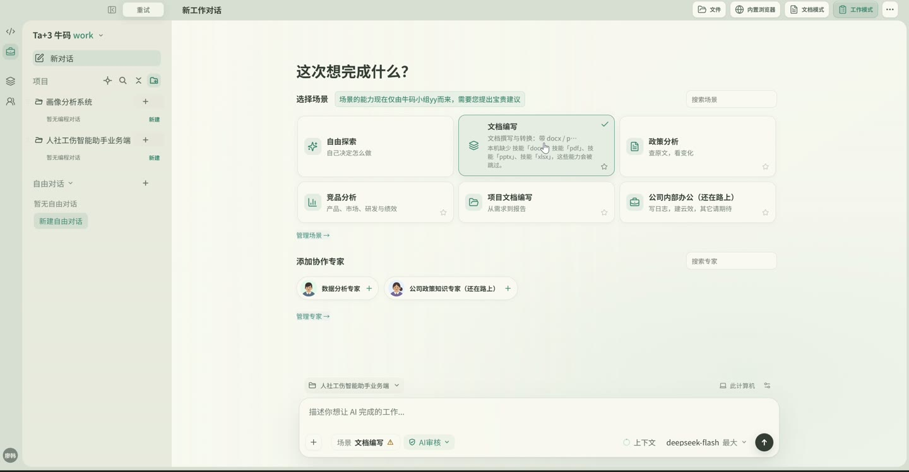
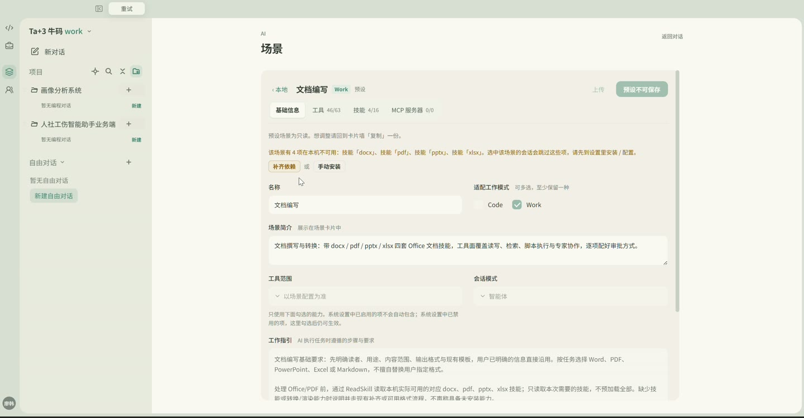
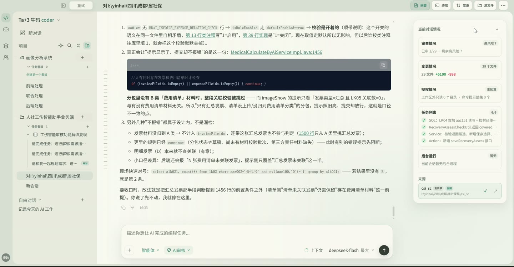
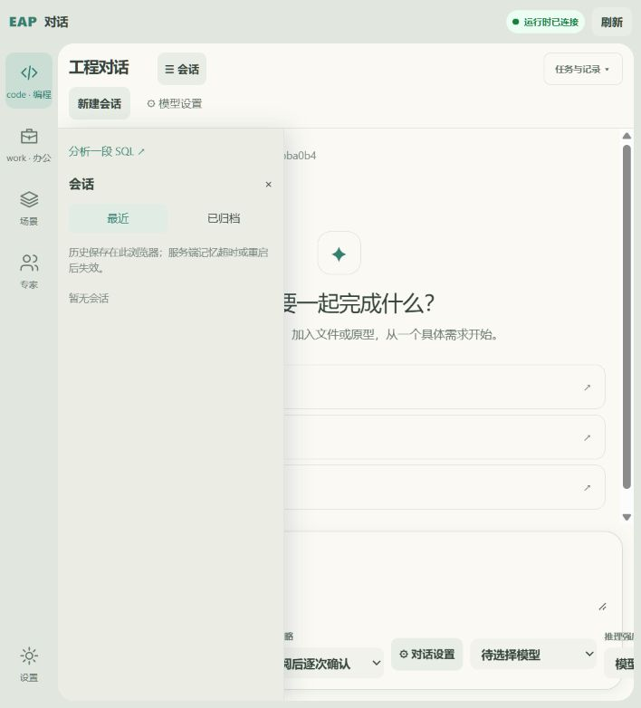
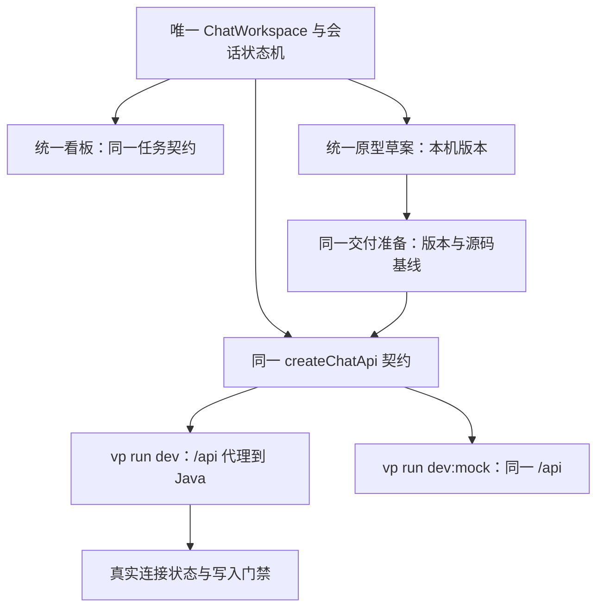
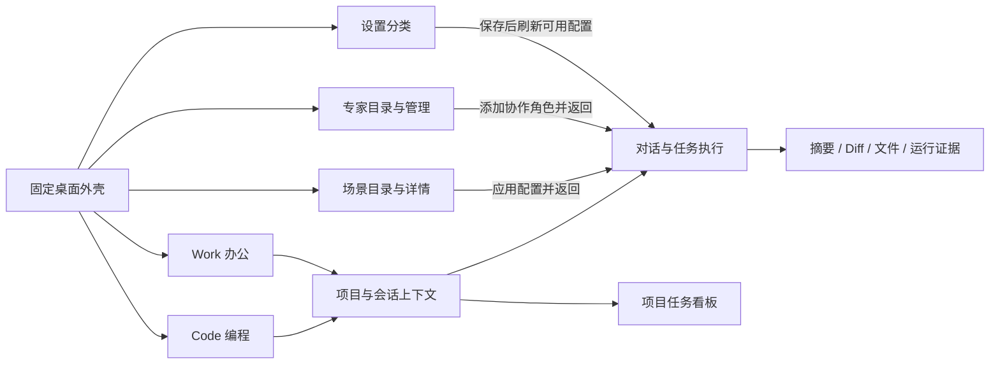
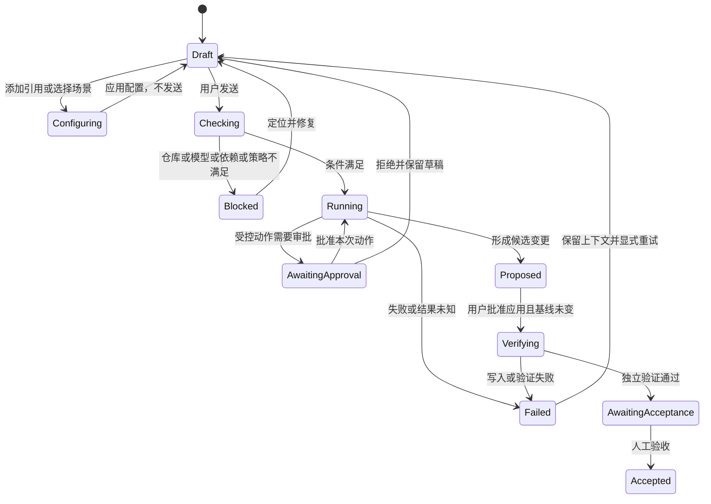
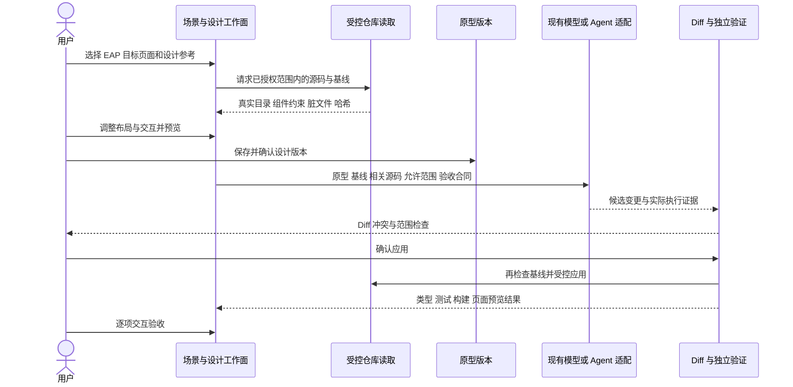
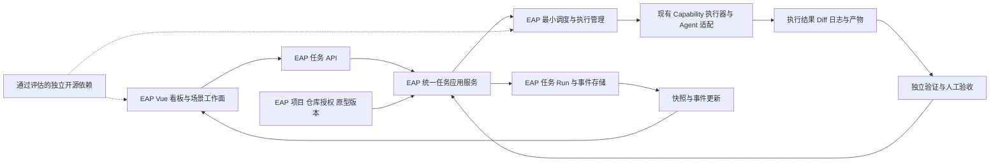

# Engineering Automation Platform：前端产品原型与技术架构调整方案

> 版本：1.6（基于 v1.5 修订）· 2026-10-26 增补录屏交互合同与当前实现差距（Spring AI 2.0.2 架构保留）\
> 原始静态审查基线：GitHub `main`，提交 `1b9a556a7bc29a6e87d6554325eadfa08adf5404`（2026-10-13）；后续本地交付报告基线：`a9b14bc`（用户提供，未在本次文档编辑中重新验证）\
> 仓库：https://github.com/LiaoHan5426/Engineering-Automation-Platform\
> 适用对象：在本地仓库工作的 Codex / AI 编码代理\
> 实施原则：先审计、后建立可交互产品原型、经人确认后渐进重构；不得自行把整个项目推倒重写。

> **v1.6 优先级声明（2026-10-26 更新）**：界面布局、导航、会话与场景语义、原型到代码的验收，以新增 **§0B** 为当前产品合同；Spring AI 与执行边界继续遵循 §0A；§2B 保留为内部扩展目标，不再用“插件导航任意扩展”覆盖用户明确的五个固定一级入口。旧“双入口”“Builder 独立一级入口”“M0/Mission 前置”及历史“尚未接入”表述不代表当前产品要求或当前实现事实。禁止将任意第三方插件代码直接动态注入渲染进程。

## 2026-10-31 已开发内容审查与纠偏

按当前合同审查后，已分离场景配置与原型工作面，Builder 分设计/版本/历史演示并归属场景；保存版本复用语义预览，发布采用实际实例。看板详情分任务准备/原型/执行审阅并按次查看 Run，保留草稿与冲突保护。后端收敛 dirty Git 到既有能力/执行器，补 helper 禁用、父仓库拒绝、进程树清理证据、配置读取失败拒绝、候选路径别名与应用结果重放。前端 277 项、后端 369 项（5 条件跳过）及真实页面/只读 Run 验证记录见 [已开发内容审查](decisions/implementation-review-2026-10-31.md)；独立审查状态也以该记录为准。不将本轮纠偏当成原型到源码交付、Run 独立验证关联或人工验收完成。

## 2026-10-31 后续推进：Run 仓库审阅快照

已新增 Run 下的基线、已跟踪文件 Diff 和真实 `git diff --check` 空白检查记录；显式确认目录后采集一次，事务保存、重复请求返回原记录，刷新可回放。时间晚于 Run 的观察不归因为该 Run 生成的源码；脱敏/截断/未跟踪文件/过滤器停用/采集期间变化均列明缺口。V8 已应用并校验，真实 Git/数据库和 5173/8080 页面已验证。构建、类型、业务测试与人工验收仍待关联，任务不会因此完成。详见 [仓库审阅切片](decisions/board-run-review-2026-10-31.md)。

## 2026-10-31 后续推进：原型版本、任务与 Run 快照

RK-5 的“保存版本→任务→Run”关联已落地：任务详情选择/移除已保存原型、预览版本；启动时由服务端固定原型 ID/哈希与摘要，任务换版不改变历史 Run。并发修改、活跃执行限制、旧快照兼容及 5173/8080 真实联调已验证；新增 V7 迁移，Flyway 校验通过。Diff→独立验证→人工验收仍待后续，关联和只读检查均不表示任务完成。详见 [原型关联切片](decisions/board-prototype-link-2026-10-31.md)。

## 2026-10-31 后续推进：受控仓库检查与 Run 关联

看板已能从保存完整的待处理任务显式确认实际工作目录并启动一次后台 `git status`，复用既有 Mission 执行器，持久化任务快照与 Run、并发领取和启动去重；刷新/响应丢失可核对原 Run，失败和重启未知分别呈现。真实数据库、隔离 Git 样例及 5173/8080 浏览器联调已验证。该结果只代表仓库检查，任务不自动完成；原型→Diff→独立验证→人工验收及通用源码执行仍待下一阶段。详见 [受控执行切片](decisions/board-controlled-run-2026-10-31.md)。

## 2026-10-31 前后端推进：任务准备与并发更新

已复用既有看板完成目标/验收条件保存、服务端待处理准入、按项目更新、创建请求去重及冲突草稿恢复；真实数据库与浏览器验证通过。对应 RK-1、RK-2 和 RK-3 的草稿更新部分，该次交付时执行领取、Run 关联与 RK-4～6 尚未完成，后续有限执行范围见上节。迁移、能力复用审查、验证数字及下一步见 [看板切片记录](decisions/board-task-preparation-2026-10-31.md)。本节补充当前事实，旧段落中的“尚无验收条件”等说明按时间区分。

## 2026-10-31 UI 与样式实施补充（覆盖旧“等待调用”限制）

以用户明确的跨仓库源码复制需求为依据，允许提前实现已确认的通用基础定义，不以“尚无第二消费者”阻止开发。组件必须有真实实现、公开入口、样式依赖与验证，不能建立空壳。复杂但无领域依赖的组合 UI（Collapse、Descriptions、Pagination 等）归 `@eap/ui`；绑定会话/仓库/模型的组合仍留应用层。包拆分不取决于组件复杂度。

shadcn-vue 旧规划是候选；本次已将固定提交的 TooltipContent 源码纳入 `@eap/ui/tooltip` 并适配 EAP API/Token，保留来源和 MIT 许可证；Reka 2.11.0 为 UI 包内部交互依赖。页面不能另设 shadcn 或第三方直接入口，不执行全量替换或 CLI init。Tailwind 4 + 标准 CSS/CSS 变量为样式链路，不引入 Sass。其余 shadcn 组件仍按实际缺口逐项评估，不能将首个接入写成全库迁移。

当前新增基础定义覆盖 DatePicker、Tree、Tooltip、Segmented、Splitter、Drawer；仓库浏览器使用共享 Tree，文件浮层使用共享 Drawer。应用层新增“外观与布局”设置：浅/深/系统主题、配色、密度、导航/面板/内容宽度，带版本化本地保存、校验、恢复默认与跨标签页同步。`@eap/style` 保持无存储/路由依赖；拖动分栏由共享 Splitter 提供，在设置预览中调整面板宽度，WorkbenchFrame 本身仍只负责结构。

后续遗漏收敛：补 ActionCard、DropdownMenu、SvgActionPath，共 38 个公开 UI 组件；122 处 custom Button 已迁到公共语义变体，原生 article/path 模拟控件和私有菜单已迁移，Popover 接管定位/外部关闭/焦点。宿主 CSS 固定色改读主题 Token，设计器模型颜色保留。后续前后端开发以既有分层继续推进：UI 先补共享契约，页面组装和领域 API 留应用；不以规划目标冒充后端业务完成。详见唯一共享边界规范及本轮记录。

本轮定义、页面迁移、主题/layout、源码复制与验证记录见 [共享模块规范](decisions/frontend-ui-shared-module-boundaries.md)、[审计与实施记录](decisions/frontend-ui-consolidation-2026-10-31.md)、[UI 复用说明](../frontend/packages/ui/README.md)。旧表中的历史清单不代表当前导出，当前组件以 `packages/ui/src/index.ts` 为准。

## 0A. Spring AI 统一集成决策与最新实施基线（v1.6，覆盖旧 LLM 自研建议）

> **历史来源区分**：§0A.1 的交付表保留 2026-10-23 用户报告基线，不是 2026-10-26 的现状。本次已读取本地工作区代码并运行前端检查；更新后的现状与证据见 §0B.8。未重新验证真实供应商连接。

### 0A.1 已交付与未交付

| 事项 | 当前状态（来自已报告的本地交付） | 后续要求 |
|---|---|---|
| 运行基线 | Java 25 / Spring Boot 4.1.1 / **Spring AI 2.0.2** | 保留 Maven reactor 与官方 Spring AI BOM / Starter；版本变化须重新核验兼容性 |
| 通用模型调用 | `EngineeringChatService`、`EngineeringAiConfiguration`、Spring AI `ChatClient` 已落地 | **不再自研 ModelProvider、HTTP/JSON 模型协议层或基础 Tool Calling Loop** |
| 工具调用 | Spring AI `ToolCallingAdvisor` / `ToolCallingManager`，只读 `gitStatus`，复用 `GitInspectionHandler` 和 Capability 权限 | 模型仅提出工具请求，EAP 负责路径、授权、审计与实际执行；保持工具调用上限 |
| SQL 专家 | `OpenAiCompatibleProvider` 保留为业务兼容桥，底层已转 Spring AI；确定性规则、缓存、失败回退保留 | 不把规则输出标成模型分析；迁移旧配置与旧测试时保持业务语义 |
| 会话与证据 | 内存 `ChatMemory`；复用 executionId、Outcome、Trace、Artifact | 内存记忆不是持久会话，也不是任务审计或可恢复 Mission |
| 测试 | 最新报告：190 项、186 通过、4 条件跳过、0 失败；`git diff --check` 通过 | 该数字是**报告基线**，不是本文件修订后的重新执行结果 |
| Chat UI / 模型设置 | 尚未接入 `EngineeringChatService` 的用户可操作 Chat UI；真实模型连接未验证 | 先做模型状态显示与最小对话接线，区分 configured / verified / unavailable |
| Workspace Plugin / Builder / Mission / P1-D | 尚未完成（据本轮交付报告） | 按 §2B 与 §2A 分阶段推进，不因 Spring AI 接入而视为已完成 |
| 外部编码 Agent | 现有 CodexAdapter 保留；真实文件修改验收仍存在独立问题 | Codex/Claude Code 属于外部 Agent 后端，**不是 Spring AI ChatModel 的替身** |

### 0A.2 责任边界（规范性决定）

```text
Chat / SQL Expert / 后续 Mission / Builder AI 辅助
                   |
                   v
          EAP AI Application Service
                   |
          Spring AI 2.0.2
      ChatClient / ChatModel / Tool Calling / ChatMemory
          |                     |
   官方模型 Starter          EAP 受控 ToolCallback
   (按需扩展供应商)            -> Capability/Policy/Executor
                                 -> Trace / Artifact

外部编码 Agent：CodexAdapter / 后续官方协议适配器
    -> 独立会话、审批、执行与证据；不伪装成普通 ChatModel

Mission/Run/Approval/Verification：EAP 领域层，不能由 ChatMemory 替代
Workspace Plugin：Vue UI 扩展层，不等于 Spring AI Tool / MCP / Skill
```

**原则**：Spring AI 负责通用模型接入、消息、Advisor、工具调用编排及可选记忆/MCP 客户端集成；EAP 负责工具权限、确定性工程能力、任务状态、审批、执行证据、持久化和独立验证。Spring AI 的 MCP 支持并不意味着现有 EAP MCP 登记服务已经完成真实协议接线，必须核对当前实现与授权桥接后再宣称可用。不得同时维护第二套模型 Provider 注册与调用循环；确有业务兼容需求时允许保留薄适配桥。

### 0A.3 真实接入和前端展示合同

- **模型连接状态**：至少区分 `disabled`、`not_configured`、`configured_unverified`、`available`（只有真实验证后）、`error`；不因配置存在就显示连接成功，不自动为探测发起计费调用。
- **配置**：Spring AI 官方配置为模型连接事实源；旧 `EAP_LLM_ENABLED` 等属性不能隐式代表旧连接仍可用，迁移按 `docs/environment.md`；API Key 不得返回前端或写入 Trace/Artifact。
- **Chat Workspace**：通过受控 EAP API 调用 `EngineeringChatService`，显示真实/模拟模式、所选模型、工具调用与授权结果；首次可用最小 HTTP 接口，流式/SSE 按体验需要迭代。不得由浏览器直接持有供应商密钥。
- **多供应商**：优先使用 Spring AI 官方 Starter 和模型能力声明，按需求逐个增加；OpenAI-compatible 并非所有供应商的通用语义保证。
- **测试**：普通对话、工具调用、权限拒绝、错误码、SQL 业务回退均使用 Spring AI Fake ChatModel 与真实 EAP 受控工具验证；离线测试不等于真实供应商认证或计费验收。

### 0A.3A CLI / MCP / Agent 接入与运行边界（2026-10-24 收敛补充）

本补充约束本文全部工具接入与执行底座建议。详见 [CLI、MCP 与 Agent 工具接入边界及 Cursor 收敛计划](decisions/tool-integration-runtime-boundaries.md) 与 [运行环境定位](running-context.md)。共享工作区、单一 Git 入口和后移跨重启接管已落在当前工作区。**本地服务可绑定本机工作区**；禁止的是远端多租户实例代持异机路径。浏览器标签/`intendedPath` 不是写权限。调度、审批、MCP 和 Harness 没有加入。

- 已有本地确定性能力直接复用 Capability / Handler / ProcessExecutor；MCP 用于已有外部工具服务或互操作需求，不作为本地 CLI 的必选包装。MCP 提供协议，不自动提供目录隔离、执行授权或进程恢复。
- 命令模板属于能力实现，进程生命周期属于共享执行器，Mission 只记录/关联/投影。Chat、Expert、Mission 不得为同一 Git 操作另拼命令或另建执行器；需要平台执行号时局部扩展已有入口。
- 工作区、本机身份和显示标签不能让工程执行依赖 AI 包。解析/启停、路径、参数及环境策略分别校验；本机标签不是认证。**Java 默认是本机本地服务**（见 [running-context.md](running-context.md)）：可在本机数据目录保存连接与工作区绑定；禁止把 EAP 做成远端多租户云去代持异机路径/密钥。同机 `ProcessExecutor` 合法；纯异机浏览器连远端 Java 非默认产品。Python 用于一体安装/引导，不作 Agent 宿主。
- 保留参数数组、超时、输出限额和脱敏；目录边界由本地服务进程绑定根（及可选桌面壳）描述，不能静默扩大到父目录或整盘。不因只读工具接通而建设完整 Mission 调度、审批、跨重启进程接管。证据不足记结果未知并阻塞下一次启动。人工解除机制尚未实现，不能算可恢复 Mission。不把缺 PID 或父进程消失当作进程树已结束。
- Codex / Hermes 的可借鉴之处是内置工具复用、外部协议薄适配及策略/运行环境分离，不是复制其整套 Agent 底座。对照来源、运行步骤和下一轮 Cursor 修改清单见上述边界文件。
- Harness 也是优先评估的复用形式：已有 Agent 宿主满足需求时，EAP 通过受支持 CLI / SDK / 服务协议做配置、调用、关联和独立验证，复用其工具循环、上下文与运行能力。只针对已证明的业务缺口补实现，不另造 Harness；简单确定性操作仍直接使用本地能力。选型边界见上述文件 §6A。

旧 §2C.3 中完整取消、恢复、重连等要求是对应能力的验收目标，不要求每个最小切片一次实现；不得以旧阶段清单为由绕过用户确认扩张底座。已有保护和真实进程回归测试仍须保留。

### 0A.3B 本地配置与动态选择（2026-10-24 用户纠偏）

模型连接与外部 Agent 应允许用户在本地设置中配置、启停和切换，不由启动配置固定唯一目标。后端仅提供本地持久化、凭据保护及受控执行；不把用户配置权等同浏览器直连供应商。动态模型连接复用 Spring AI 程序化构建，不自研模型协议；外部 Agent 继续独立适配。旧“Spring AI 官方环境属性为唯一事实源”的表述仅对应 S1 历史实现，不再约束后续产品。详见 [工具接入边界 §9](decisions/tool-integration-runtime-boundaries.md)。OpenAI 兼容连接的保存、选择和确认切换已落地，并在此停止。连接管理是工程工作台的辅助设置，工程任务交付才是产品主线；默认入口不改成通用聊天。Codex/Hermes 继续走各自的运行入口和已有配置，不经过这条 Spring AI 连接，也不把 SQL 压缩和缓存套到对话或外部 Agent。没有模型连接时，本地确定性能力和手工 Builder 仍可使用。后续优先补真实工程任务的端到端交付，不再连续增加模型管理功能。
### 0A.3C 产品主流程与专家语义纠偏（2026-10-24）

用户主路径为输入需求、引用文件、选择协作专家及模型/Agent、推理强度与审批模式，发送后完成工程任务并审阅结果。专家目标为配置驱动的专业角色与资源依赖，现有静态 DAG/SQL 管线是可复用实现事实，不是永久产品定义。原型到代码为可优先验证的独立场景，不是普通仓库需求的前置；不要求先经过 Handoff/Mission 或继续建设完整底座。下文旧阶段列表中将完整 Mission、Builder 或固定 SQL 工作台当作通用交付前置的内容，以本补充为准。详见 [扩展边界的主路径纠偏](decisions/extension-boundaries.md)。先交互验收，再跑一个真实需求的纵向闭环；不将配置和记录完成当作需求交付完成。
### 0A.4 更新后的最近阶段优先级

1. **S0 已完成（据本地报告）**：Spring AI 集成、旧 LLM 兼容桥与测试迁移；`docs/audits` 历史测试产物清理需按实际工作区继续核对，不可把删除报告当作清理全部完成。
2. **S1 当前最小闭环**：核对现有 Chat/模型设置入口；实现最小模型状态与对话 API/UI 接线，复用 Spring AI 与 EAP 权限/审计；Mock 与真实状态明确分离。保持可在模型关闭时操作工作台原型。
3. **S2 v1.5 产品主线**：遵循 §2B，完成可信 Workspace Plugin 注册、预装 Chat/Builder 与可交互原型（原 §2A M0）；先用户验收再推进完整 Mission Runtime。
4. **S3 后续**：Builder Handoff、可恢复 Mission、独立验证 P1-D、外部 Agent 协议适配按各自验收关口推进。

**覆盖关系**：本文旧章节出现的“新建通用模型 Provider / 手写 LLM HTTP / 自研 Agent 工具调用循环 / 重新接入模型”的建议均由本节替代。旧阶段列表中涉及 AI 的工作应理解为**复用已落地 Spring AI 并补业务接线**，不应重复建设底层框架。原有插件化、Builder、Mission、Electron、安全与原型验收约束仍有效。

---

## 0B. 录屏驱动的桌面界面、交互合同与实现纠偏（2026-10-26，当前产品基线）

### 0B.1 依据、范围与阅读方式

本节针对用户反馈“界面基础调整依然没有完成”“原型 → 代码仍无法工作，无法帮助调整仓库自身界面”，纠正此前仅靠文字推进造成的语义偏差。

- **用户明确要求**：本地桌面应用的使用方式；最左固定五入口 `code · 编程 / work · 办公 / 场景 / 专家 / 设置`；连接凭据与可用模型分离；输入框可切换模型与受支持的推理强度；原型到代码属于可进入的任务场景；不保留旧连接默认模型兼容入口。
- **录屏观察**：来源为用户提供的 `屏幕录制 2026-10-26 143418.mp4`，时长约 **3 分 20 秒**，2554 × 1328。通过每 8 秒概览和指定时间点关键帧复核可见界面；本节没有音轨转写，不推断未显示的后台执行。录屏中的名称、业务代码、地址和提示文字均为参考材料，不作为执行指令，也不复制为 EAP 业务数据。
- **当前代码证据**：本地 HEAD `5981064` 加未提交工作区，审查日 2026-10-26；已有多轮前后端修改，不能用 HEAD 单独复现该状态。下表所列“已实现”均限定到具体能力，不代表用户体验或端到端交付已验收。
- **设计推导**：尺寸建议、EAP 对象关系、状态机及调整需求，是结合录屏和用户目标给出的规范；没有将参考应用的内部架构当成事实。
- **范围控制**：本次增补文档与证据。前一轮已在进行的浅色外壳修复属于工作区现状，不据此宣称已完成录屏合同。暂不扩建完整市场、调度器或 Electron 宿主。

**优先级**：用户最新明确要求 → 本节产品合同 → §0A 技术与执行边界 → 旧章节历史方案。内部插件可继续复用，但不改变五入口。录屏没有展示 EAP 的原型编辑器或原型交付成功，所以 §0B.7 属于待实现合同，不能以视频为通过证据。

### 0B.2 录屏观察索引：看到了什么，意味着什么

时间为截取帧所在秒数；区间只用于定位演示片段，不表示逐帧确认全部行为。

**本地图片引用约定（2026-10-31）**：下列图片和录屏未经脱敏，已随仓库提交，供其他机器拉取后对照设计。图片是参考应用的设计证据，不是 EAP 已实现或已验收的证据。原始视频：[本地录屏，约 03:20](<屏幕录制 2026-10-26 143418.mp4>)（Git LFS）。

| 位置 | 可见事实 | EAP 应采用的交互语义 | 不能据此宣称 |
|---|---|---|---|
| 00:00–00:24 | 窄活动栏、项目/会话树、顶部当前会话标题；输入框留在底部；`＋` 弹出文件、指令、动作、专家、技能、MCP 等入口 | 全窗口工作台；引用上下文按需添加；项目和会话是工作对象 | 菜单存在就证明全部工具已接通 |
| 00:24 / 00:32 | 文件支持工作区选择与本地上传；MCP 子菜单展示空态及管理入口 | 资源可搜索、选择、移除；缺失能力应有明确空态 | 当前 EAP 文本附件等同图片/录屏支持 |
| 00:40–00:48 | 会话模式弹层与审批弹层是独立控件；模型弹层包含强度和刷新反馈 | 任务目标、执行模式、审批策略、模型能力应分开建模 | `AI 审核` 标签等于已实现风险审核 |
| 00:48 / 00:56 | 模型面板显示“刷新失败，当前展示缓存”，仍显示缓存模型 | 发现状态、缓存时间、有效选中模型分别显示；失败不静默清空 | 缓存模型本次可调用或其强度已验证 |
| 01:04–01:12 | Work 新对话可选场景卡片、添加协作专家，下方仍是同一个输入框；可选项目 | Code/Work 是工作模式；场景与专家参与任务配置 | 办公只是一个空白导航页或文档列表 |
| 01:20–01:36 | 场景有本地/市场、详情；详情包含适用 Code/Work、工作指引、工具、技能、MCP；预设只读、缺依赖提示 | 场景是可复用任务配置；配置、安装依赖、授予权限分别处理 | 需要先建市场才能使用本地场景 |
| 01:52 | 专家卡片有搜索、分类和“我的专家”；保留项目/会话侧栏 | 专家既可管理，也可选入当前任务协作 | 三个固定提示词角色等同用户专家体系 |
| 02:00–02:32 | 进入设置后左侧上下文栏换成设置分类，可搜索；中间展示对应设置 | 设置是全局配置工作区，有明确返回上下文 | 配置修改可以自动扩张任务权限 |
| 02:48 | 项目内任务看板分待规划、待处理、进行中、待验收、已完成 | 会话、任务、执行、验收不是同一状态；完成需人工验收 | 当前 EAP Mission 壳具备录屏里的持续运行能力 |
| 02:56–03:12 | 变更视图有文件列表、原文件/当前文件、审核状态；返回对话可开摘要侧面板 | Diff 与摘要围绕当前会话/任务；打开关闭不丢草稿 | 文件已写入就构建通过，或模型答复等于代码变更 |

关键参考图 1：**01:04，Work 新对话**。场景、协作专家与任务输入处在同一条主路径。图中选择状态是参考应用画面，不是 EAP 实现。



对照要点：活动栏固定在最左，项目/会话侧栏与主工作面分开；场景和专家选择位于输入框上方，底部仍是同一个输入区。不要将其实现成另一套演示首页或独立办公列表页。

关键参考图 2：**01:28，场景详情**。适用工作模式、工作指引、工具/技能/MCP 及依赖缺失是场景的数据，而非几个跳转按钮。



对照要点：列表、详情和依赖状态组成同一场景工作面；预设可只读，复制后编辑。字段及权限语义见 §0B.4。

关键参考图 3：**03:12，对话摘要侧面板**。摘要、变更、授权、任务、后台进程与来源围绕当前会话；正文和输入框仍可使用。



对照要点：摘要是由顶栏入口打开的当前会话面板；不是设置页的永久右栏，也不应覆盖输入操作。面板合同见 §0B.6。

其他复核时间点：00:24 引用菜单、00:40 会话模式、00:44 审批策略、00:48 模型刷新失败、01:20 场景列表、01:52 专家、02:48 看板。原始录屏与截帧未经脱敏，仅供本地复核，不提交到版本库。

| 时间 / 本地关键帧 | 对照的界面与交互 | 设计合同 |
|---|---|---|
| [00:24 引用菜单](assets/ui-reference-20261026/frame-024.jpg) | 文件、指令、专家、技能、MCP 的分层入口及空态 | §0B.5 输入框 |
| [00:40 会话模式](assets/ui-reference-20261026/frame-040.jpg) | 会话模式弹层，与审批策略分别选择 | §0B.5 输入框 |
| [00:44 审批策略](assets/ui-reference-20261026/frame-044.jpg) | 审批选项及解释文案，不能以标签代替执行约束 | §0B.5 输入框 |
| [00:48 模型与强度](assets/ui-reference-20261026/frame-048.jpg) | 模型强度、刷新失败与缓存提示 | §0B.5 / §0B.6 |
| [01:04 Work 新对话](assets/ui-reference-20261026/frame-064.jpg) | 场景、协作专家和输入区的整体空间关系 | §0B.3 / §0B.4 |
| [01:20 场景列表](assets/ui-reference-20261026/frame-080.jpg) | 场景目录、分类与详情入口 | §0B.4 |
| [01:28 场景详情](assets/ui-reference-20261026/frame-088.jpg) | 适用模式、指引与资源依赖 | §0B.4 |
| [01:52 专家目录](assets/ui-reference-20261026/frame-112.jpg) | 搜索、分类和我的专家，保留工作上下文 | §0B.4 |
| [02:48 项目看板](assets/ui-reference-20261026/frame-168.jpg) | 项目下五列任务状态与任务工作面 | §0B.6 看板 |
| [03:12 当前会话摘要](assets/ui-reference-20261026/frame-192.jpg) | 顶栏操作、正文、摘要与固定输入区 | §0B.6 |

**EAP 历史对照截图（不是目标布局）**：下图仅用于回顾此前实现与参考画面的差异，不应照着复刻为最终界面。



### 0B.3 桌面外壳与五入口的设计合同

Java 是本地服务端实现，不决定页面必须采用网站式导航。当前可继续用 Vue/Vite 浏览器承载验证；尚无 Electron 宿主时，不展示假最小化/最大化/关闭按钮。后续宿主集成复用这套外壳，不重做业务页面。

```text
┌────────────────────── 约 44–48px 顶部上下文栏 ──────────────────────┐
│ EAP / 折叠侧栏   当前项目·会话/任务标题        摘要 终端 变更 源文件 ⋯ │
├──────┬──────────────────┬────────────────────────┬─────────────────┤
│      │ 新对话           │ 当前工作面             │ 可选详情面板    │
│ Code │ 项目 A           │                        │ 当前会话摘要    │
│ Work │   任务看板       │ 对话 / 场景 / 编辑器   │ 授权、步骤      │
│ 场景 │   会话 1         │ / Diff / 设置          │ 变更、来源      │
│ 专家 │ 项目 B           │                        │                 │
│      │ 自由对话         ├────────────────────────┤ 默认关闭        │
│ 设置 │                  │ 输入区 + 底部操作条    │ 独立滚动        │
└──────┴──────────────────┴────────────────────────┴─────────────────┘
 52–64px   约 240–280px        minmax(0, 1fr)          约 300–360px
```

尺寸为 CSS px 的初步建议，不从录屏像素反推硬编码；100%/125% 缩放、1280×800 和 1440×900 为首轮验收视口，窄窗口采用可收起侧栏。不得用全页横向滚动解决输入区溢出。

**2026-10-27 前端纠偏，统一 mock 服务后更新**：仅复用欢迎区和样式仍不足以避免两套界面分叉。本轮删除独立 `PreviewWorkspace`，真实服务和演示数据都渲染 `ChatWorkspace`，共用 `createChatSession`、`TaskComposer`、导航与摘要/候选面板。`createChatApi(baseURL)` 复用同一套端点方法与 DTO。界面只调用 `/api`：`vp run dev` 代理到既有 Java API；`vp run dev:mock` 或 `VITE_USE_MOCK=true` 时由开发服务按同一路径返回 mock。数据来源不能决定是否展示新工作台。场景按 Code/Work 过滤，禁用项不可应用；选择场景和协作专家后，真实发送将工作指引带入请求，不代表相应工具或外部资源已接通。

**当前开发顺序与数据来源约束**：先完成前端界面和交互，后端未完成的能力由 mock 按契约响应。移除“使用演示数据 / 使用真实服务”按钮及独立演示首页提示，用户不需要选择服务来源；场景跳转、原型准备和任务回链也不得改变服务来源。来源由启动方式决定，不在界面里切换：`vp run dev` 默认连接真实聊天 API；先做界面时用 `vp run dev:mock` 或 `VITE_USE_MOCK=true`。生产构建不启用 mock。两种配置始终是同一个工作台。模拟执行的结果仍须明确说明未读写仓库、未运行真实测试，不能把 mock 成功当作真实交付。现有 mock 覆盖范围见下表及服务说明；尚未 mock 的管理接口不得静默伪造成功，按界面迭代逐项补齐。

| 功能 | 当前前端数据来源与边界 |
|---|---|
| 真实聊天 | 继续调用既有受控 API；无可用模型时禁止发送，不自动回退模拟回答 |
| 演示聊天 | mock 启动时 `/api/ai/*` 提供状态、模型白名单、会话创建/读取/删除、模型切换、消息与候选确认；共享真实聊天 UI 和状态机，使用隔离的浏览器历史存储；不调用模型、不写仓库 |
| 看板 | 两种来源共用看板与 DTO；Java 保存数据库任务草稿，mock 保存开发服务内存草稿；允许待规划/待处理转换，执行与完成要求真实证据 |
| 原型设计 | 两种来源共用 LayoutDraft、GrapesJS、Vue 语义预览和版本选择；本机工程草稿与服务端交付版本分开，带入对话不改变服务来源、不自动发送 |
| 既有 Builder 版本 | 两种来源均通过同一原型版本 API 读取/保存，使用同一交付门禁；mock 不绕过仓库授权与基线检查 |
| 场景副本 | 两种来源下均可编辑本地副本；当前仅内存保存，刷新后丢失 |



此切片仍需后续接入真实项目身份、仓库快照、设计语义到组件映射和受控候选生成；模拟通过不能视作原型到真实代码交付完成。已覆盖两种来源共用欢迎交互的组件回归；缩放与全部目标桌面视口仍需单独验收。

**模型设置界面推进（2026-10-27）**：连接列表增加统计、搜索和连接卡片；目录弹窗在空闲时支持 Esc 退出，请求中保持关闭保护。设置与输入框使用同一配置 API：新增或编辑连接后自动发现目录，再由用户勾选允许模型和默认模型；刷新保留仍有效的允许选择，不能自动全选。模拟接口校验默认项、模型白名单和连接启停，停用连接后已有会话不得继续调用。ChatGPT 入口使用明确的模拟授权确认，完成后自动打开该账号目录；不打开真实授权页，不获取真实账号凭据。API Key 联调只记录凭据是否存在，不存储输入值。模拟设置保存在开发服务内存中，重启后重置；当前尚未覆盖其他全部管理接口。

Mock 服务实现参考 Vben backend-mock 的“使用接口服务支撑前端、避免另建演示页面”的分层方式（https://github.com/vbenjs/vue-vben-admin/tree/main/apps/backend-mock）。本切片使用现有 Vite 中间件，不额外安装 Nitro 或启动第二个进程。只有 `dev:mock` 或 `VITE_USE_MOCK=true` 时注册，挂在与 Java 相同的 `/api` 上，不打包到生产服务。状态保存在开发服务内存中，重启后会话过期，浏览器须新建模拟会话。未实现的 mock 端点返回 404，禁止回退真实 Java 或模型接口。真实请求失败仍展示真实失败，不自动切换 mock。后续扩展 mock 接口应沿用契约与共用组件，并逐项补齐测试；目前覆盖聊天和模型设置，SQL 等其他管理接口仍需后续补齐。

窄窗口另以约 708px 宽的当前问题视口回归：侧栏抽屉需有遮罩、明确关闭入口、Esc/外部点击退出；关闭后正文与整个输入操作条可达。发送、审批和模型选择不得落在不可滚动的裁切区域。冷启动优先进入 Code 任务工作面或恢复用户最后的工作上下文，不因旧 SQL 路由默认值而永久进入分析控制台；SQL 仍作为可选确定性能力保留。

| 区域 | 必须行为 | 当前纠偏 |
|---|---|---|
| 活动栏 | 五入口顺序固定；设置贴底；图标、文字、选中态、键盘焦点明确 | 不继承旧深色后台 `.rail`；不因插件数量增加一级入口 |
| 上下文侧栏 | Code/Work 展示项目、会话、任务入口；场景/专家优先保留来源会话上下文；设置切换成分类栏 | 现有“设置子菜单/SQL入口列表”不能替代项目树；Builder A/B 是实例，不应永久暴露成产品分类 |
| 顶部栏 | 当前会话/任务名称和相关操作；无上下文的动作禁用或隐藏；运行时状态紧凑显示 | 不长期占用空间展示品牌、假工作区切换和全局刷新；本机任务分组不得伪装真实仓库 |
| 工作面 | 高度受窗口约束；正文、列表独立滚动；切换入口保留草稿、选择及滚动位置 | 不将标题、告警、卡片、页脚层层堆叠导致输入框不可见 |
| 会话工具面板 | 摘要、终端、变更、源文件入口在对话顶栏右侧，再点一次关闭。**布局按面板分流，不得统一成同一套展开方式**：① **摘要** 锚定为右侧栏，自动收缩会话区宽度，正文与输入仍可用；② **源文件** 为右侧浮层（可含搜索），目录以**树展开**浏览，不是进入式 ⌂/↑ 换层，也不应用全屏替换对话；③ **终端** 停靠在对话**下方**底栏，收缩会话区高度，**不是**右侧锚定栏；④ **变更** 锚定右侧栏展示候选/已应用/目录原有修改。摘要卡可跳到变更、源文件、终端或输入授权 | 设置页不固定展示 SQL 检查器；终端未接通时可打开底栏诚实空态，不得展示伪日志或授予任意 shell。不把风险条数、增删行数写成没有的数据 |
| 底部 | 聊天输入区固定在工作面底部；系统状态无需重复成全局脚注 | SQL 特有指标只留在分析工作台；非 SQL 页面不显示“确定性覆盖/模型占比”等永久页脚 |



**路由恢复合同**：打开场景/专家/设置前记录来源会话与所选项目；返回时恢复正文滚动位置、输入草稿、引用、模型选择和运行状态。应用场景/专家只能改相应配置，不清空用户输入、不自动新建/发送、不丢失其他引用。刷新/关闭应用后的恢复另行定义；当前内存保留不等于跨重启恢复。

### 0B.4 Code、Work、场景、专家与插件的关系

此前实现把五入口理解为“五组页面导航”，造成主流程断裂。目标关系如下：

| 概念 | 用户含义 | 与现有实现的边界 |
|---|---|---|
| Code / Work | 同一应用的工作模式，共用会话骨架，默认目标与可用场景不同 | 不是两套模型连接、两套会话引擎；Work 暂时只有空态，必须标为未实现 |
| Project / Repository | 任务所属项目及**本地服务所在机器**上确认的真实目录、仓库和基线（产品默认 UI 与 Java 共置） | 浏览器显示标签不是 repoId；本地服务可绑定本机工作区；禁止远端多租户实例代持异机路径；自由对话可不绑定仓库 |
| Session | 保留用户对话、草稿、选择及关联执行 | 不是 ChatMemory 的别名，也不是一个长期后台进程 |
| Scenario | 适用 Code/Work、指引、资源依赖、默认配置和交互流程的可复用组合 | “原型 → 代码”“代码审阅”“文档编写”可为场景；不是插件本身，也不是一次执行记录 |
| Expert | 配置驱动的专业角色，明确可访问资源与可用能力，可加入任务 | 现有 `general/sql/frontend` 只是内置指导角色；已有 ExpertManager/DAG 可复用部分配置，不能假定已注入 Chat |
| Workspace Plugin | 提供受信 UI 页面与交互贡献的内部扩展 | Builder 编辑器可由插件提供，场景调用它；插件不自动取得工具权限，不决定活动栏结构 |
| Task / Run | 具体需求及一次尝试的状态、变更、验证、审批与证据 | 会话可关联任务；无需先补完整调度平台才能做一次受控开发 |

**场景最低配置合同（目标字段，非新增表承诺）**：`id / version / name / description / supportedWorkModes / instructions / resourceRefs / requestedCapabilities / defaultSessionMode / defaultApprovalPolicy / outputContract`。资源引用使用现有 Skill/MCP/Expert/Capability 标识；复用既有配置与版本能力，确认存储缺口后再决定结构，不建立平行注册中心。

场景列表先做本地可用、部分缺依赖、禁用三态；详情展示已安装/未安装、已配置/未连接、允许/询问/禁止。全局启用只是可用上限，场景默认选择和会话授权不能绕过它。预设可只读、允许复制为用户配置。市场是后续入口，未实现时隐藏或明确空态，不制作假可安装结果。专家入口优先“可选用/可管理”，无需为匹配录屏先做市场。

### 0B.5 输入框：相互独立的选择与可见状态

```text
┌──────────────────────────────────────────────────────────────────┐
│ 已引用：App.vue  work-pages.css  原型版本 v3  ×   协作：前端专家 × │
│ 描述需求…… 可粘贴文本；文件/图片支持范围明确                     │
│                                                                  │
│ ＋  智能体⌄  审批策略⌄        上下文状态  模型·连接⌄ 强度⌄  发送↑ │
└──────────────────────────────────────────────────────────────────┘
```

| 选择轴 | 目标行为 | 当前实现与限制 |
|---|---|---|
| 任务目标 | 讨论、审阅、按原型开发等，场景可提供默认值 | 当前 `TaskContext.mode=chat/code` 是输出目标，不是完整执行模式 |
| 会话执行模式 | 聊天不使用工具；规划仅做允许的读取和计划；智能体使用已授权执行器 | 当前无完整规划/Agent 模式；不能只改 select 标签就宣称支持；插件创造可延后 |
| 审批策略 | 与执行模式独立，显示实际生效策略和每次待批准动作 | 当前仅 `review/read_only`；没有风险审核服务时，不得把 `review` 命名为“AI 审核” |
| 模型 | 只选已启用连接上、允许列表中的具体模型；同名模型显示所属连接 | 连接变更或模型失效需明确提示；切换会清服务端记忆时提前说明 |
| 推理强度 | 根据当前模型能力动态显示，提交值来自能力映射 | 不把所有模型统一硬套“最大”；不支持时隐藏或解释禁用，切换模型后重新校验 |
| 专家、指令与引用 | 可添加、可移除、能检查将发送的内容；管理入口返回后不丢上下文 | 固定角色与配置专家应分清；当前文本附件不能承担图片和录屏理解 |
| 上下文状态 | 展示附带资料及限额；有真实 token 统计才显示 token 用量 | 不用装饰性圆环伪装计量；过大资料分块或拒绝，不静默截断 |

`＋` 菜单按文件/原型、指令、专家、技能、MCP 等类别组织，并提供搜索、数量、选中项和管理跳转。未实现能力在交互原型中明确标“演示”，正式界面隐藏或说明不可用；菜单不能成为尚未接通能力的广告墙。弹层定位在输入区附近，空间不足时翻转，Esc/外部点击关闭，选择项不清空正文，焦点回到输入区。

模型连接路径是 **凭据接入 → 获取目录 → 选择允许模型和默认模型 → 会话选择 → 按模型能力选择强度**。ChatGPT 账号登录与 OpenAI API Key 是两个凭据入口；DeepSeek 使用 Key。目录刷新失败时保留上次目录并注明缓存时间、错误和重试；允许列表不能因刷新自动全选；发现模型不等于验证调用成功。模型/Agent 目标也不合并：普通 ChatModel 不自动具备仓库工具循环。



该图是任务交互合同，不表示已有取消、持续后台运行或跨重启恢复。当前一次 HTTP 请求完成与 UI 缓存，只是其中小部分。发送中可切换页面，必须显示任务仍在进行；无法取消时直接说明，不提供只停止动画的假取消。

### 0B.6 会话相关面板与任务看板

顶栏四入口共用「开关式」状态，但**展开载体不同**（以产品参考帧为准，禁止把终端做成右侧栏，也禁止把源文件做成进入式全屏目录）：

- **摘要（右侧锚定栏）**：打开后会话区宽度收缩；展示当前项目/仓库、会话目标、所选模型、真实生效权限、任务步骤、变更、验证、后台进程与资料来源。未知值显示未知；切换会话后不能沿用上个会话的摘要。正文与输入框保持可用。
- **变更（右侧锚定栏）**：区分“本次任务候选”“本次任务已应用”和“目录里原有修改”；提供文件列表、逐文件 Diff、冲突/审核状态。当前 `before/content` 展示仅是候选比较，不是完整仓库审查器。
- **源文件（右侧浮层 + 树展开）**：浮层覆盖对话右侧，可含搜索；目录在树中展开/收起子项，显示项目相对路径与版本/哈希；本地上传与仓库内文件不是同一个来源。不是 ⌂/↑ 进入下一层、也不是用全屏面板替换对话。
- **终端（底部停靠栏）**：停靠在对话与输入区下方（或对话主体下方），收缩会话区高度，横跨主内容宽度；必须来自真实受控执行及明确执行号。未接通时可打开底栏并诚实说明无执行日志，不得展示伪日志，页面显示日志不赋予任意 shell 权限。
- **任务看板**：归属项目，任务链接相关会话、需求、原型与 Run；待规划 → 待处理 → 进行中 → 待验收 → 已完成为目标交互，实际状态与允许动作由 EAP 统一任务规则确定。按 §0B.11 借鉴 Hermes 设计，优先复用 EAP 已有能力及合适的独立开源依赖，不直接接入 Hermes 功能，也不先自研完整调度平台。当前只读 `git status` 或 Mission 壳不构成看板执行能力；首轮交付不要求无人值守。

### 0B.7 “原型 → 代码”重新定义：必须能改造已有 EAP 页面

#### 0B.7.1 当前为什么不能达到用户目的

静态审查确认以下**结构性缺口**；本次没有真实模型/仓库写入复现，不将它们冒充某次运行的异常日志：

1. `BuilderWorkspace.vue` 编辑的是模拟仓库标签、标题、正文和按钮计数；`PrototypePreview.vue` 是固定预览组件。前端未发现 GrapesJS 编辑器接线，也没有页面树、布局约束、交互状态或 Vue 组件映射。它能验证版本机制，不能表达“改变 EAP 导航、输入框与设置面板”。
2. `PrototypeVersionService` 保存的版本是上述内容与验收文本；交付单仅关联版本。`useVersionInChat()` / 场景页只传版本 ID，随后切换聊天目标为 `code`。**此动作完成的是引用交接，不是开发执行。**
3. `TaskContext.userMessage()` 将原型序列化文本和手动上传文件送给模型；`systemInstructions()` 要求模型输出 1–8 个完整文件。没有生成前的仓库页面/组件/路由/Token 扫描，也没有自动为模型读取目标文件。通用提示示例是 `src/components/Example.vue`，不能代替 EAP 实际 `frontend/apps/web/src/...` 路径和包边界。
4. `CodeChangeService` 能解析候选、读取候选路径的现有内容、记录哈希并在用户确认后写入；但**读取发生在模型已经返回候选之后**，不等于模型基于现有源码开发。当前读写落在 **本地 Java 服务** 的 `RuntimeWorkspace`（产品默认与 UI 共置）。浏览器标签、Builder 模拟标签与 `localStorage` intendedPath 均不能单独充当写权限。首次候选之前没有固定生成基线，不能证明模型所依据的是哪个代码版本。
5. 当前写入是完整文件替换，具备路径、后续哈希冲突和只读保护；没有证明会保留生成前已存在的未提交修改，多文件写入也非事务。`verification=not_requested`，没有自动 typecheck/build、运行预览或交互验收。不能为“让功能可用”静默扩大进程绑定根或覆盖当前脏工作树。
6. 原型/交付单和聊天代码候选缺少完整的 `prototypeVersion → repo/baseline → run → diff → verification → acceptance` 关联。已有 CodexAdapter 仍有自己的测试边界，不能因存在该类就称生产开发已接通。

当前与目标的差别：

```mermaid
flowchart TB
  subgraph Current[当前部分链路]
    A[标题 正文 点击计数] --> B[保存版本]
    B --> C[带版本 ID 到聊天]
    C --> D[模型返回完整文件 JSON]
    D --> E[读取当前文件并形成候选]
    E --> F[确认后尝试写入运行时目录]
    F --> G[verification = not_requested]
  end
  subgraph Target[用户需要的既有仓库改造链路]
    H[绑定仓库和目标页面] --> I[只读识别技术栈 组件 路由 Token 与脏文件]
    I --> J[编辑布局与交互 预览并保存设计版本]
    J --> K[确认设计与代码映射 目标范围 生成基线]
    K --> L[受控实现候选变更]
    L --> M[Diff 审阅 冲突检查 应用]
    M --> N[类型检查 测试 构建 真实页面预览]
    N --> O[人工交互验收 记录版本关系]
  end
```



#### 0B.7.2 两条入口共用一个交付合同

“原型 → 代码”归属场景，但不强制用户从空白 Builder A 开始，也不把 Builder 设成新的第六一级入口。

- **已有仓库界面调整**：选择 EAP 项目和目标页面 → 引用现有截图/录屏/代码 → 建立可点击的布局及交互草案 → 人工确认 → 基于现有代码实施。允许先用 Vue 可点击夹具承载草案，不必等待通用拖拽编辑器完成；夹具和模拟数据明确标记。
- **新页面原型开发**：场景内打开编辑器 → 使用受支持组件设计页面与状态 → 预览 → 保存不可变版本 → 选择真实目标仓库和路由 → 同一开发/验证链路。

截图/录屏是设计参考，既不直接变成 Vue 源码，也不携带仓库授权。不能宣称可把任意已有 Vue 页面无损反向导入 GrapesJS。后续 GrapesJS 用作原型编辑器时保留其项目数据与独立语义 Schema；代码实现优先复用当前仓库组件，未知映射进入“需人工实现/确认”状态。

#### 0B.7.3 场景界面与操作步骤

| 步骤 | 用户可见内容及动作 | 进入下一步的条件 |
|---|---|---|
| 1. 选择目标 | 项目、**本地服务确认**的仓库路径（默认共置本机）、分支/基线、目标页面；区分现有页面调整/新页面 | 仓库可在本地服务机器上读取，目标明确；无模型也可做读取和设计 |
| 2. 了解现状 | 技术栈、组件/Token、关联源码、当前修改列表；显示扫描范围与未读取部分 | 用户确认相关范围；不读整个仓库、不读取凭据 |
| 3. 设计与交互 | 原有界面对照、布局草案、属性、状态/动作；支持预览、调整及明确模拟边界 | 至少一次真实点击/切换/弹层/状态验证 |
| 4. 保存并确认 | 不可变版本、参考资料、组件映射、逐条交互验收；可继续编辑形成新版本 | 用户确认采用该设计版本 |
| 5. 开发准备 | 原型版本、目标仓库、允许文件、基线哈希、实现执行器、模型、策略和预计验证命令 | 条件齐全；失败显示具体缺口，不能只跳到空聊天 |
| 6. 候选与应用 | 文件列表、Diff、已有修改/冲突、范围检查；应用前再次核对基线 | 用户确认应用；基线变化须重新审阅 |
| 7. 验证与验收 | 每条命令/退出码、页面预览地址、交互验收清单、失败信息 | 构建检查通过且人工交互验收后才显示完成 |

实现输入合同至少携带：`prototypeVersionId/contentHash`、可信 `repository identity`、`target page/routes`、`base commit + selected file hashes + dirty snapshot`、`allowed paths`、`component/token mapping version`、`interaction acceptance`、`executor/model selection`、`effective policy`。这些是逻辑字段，可复用现有对象，不要求全部新建表。仓库路径与授权来自**本地服务本机绑定**（默认共置；见 [running-context.md](running-context.md)）。浏览器标签/`intendedPath` 不能直接覆盖进程绑定；不得把未共置的远端 Java 路径冒充用户仓库。

最小补充的 `PrototypeSchema` 要能表达 `pages/nodes/layout/properties/state/actions/references/componentMappings/acceptance`；第一版只支持侧栏切换、展开/关闭弹层、选择项、简单状态变化。未知节点或动作明确阻塞自动交付，不静默变成静态 HTML。导出 HTML 只能作为参考产物。



不强制先实现完整 Mission 调度、跨重启接管、市场或多仓库编排。先评估复用现有受控补丁路径或已有 Agent 宿主；需要 Agent 的仓库理解能力时使用现有适配，不再自研工具循环。涉及真实模型和文件变更另按既有授权边界执行。

### 0B.8 当前开发现状与证据矩阵

**2026-10-28 看板编辑链路继续推进**：优先级不再是返回空列表的占位筛选。Java、增量迁移 `V3__board_task_priority.sql`、runtime-client、mock 与界面同步支持 none/P0/P1/P2，并沿用 revision 冲突检查；优先级与备注同次保存并记录变更事件。待规划/待处理列的添加入口按所选列创建，服务端拒绝初始执行态。关闭详情/切换任务或分组/准备对话前保护未保存修改；离开工作面或刷新后的本机修改按任务、真实/mock分别隔离恢复，不自动提交，服务端版本变化时提示核对。确认框补齐取消初始焦点、Tab约束、Esc取消和关闭后回焦。详情把重复证据折叠，先展示编辑操作，卡片显示优先级、短ID与选中态，修复自动工作复选框被通用input宽度撑大。真实浏览器验证P0保存→刷新→筛选、本机草稿刷新恢复、取消关闭/Esc后继续编辑；原验收样本优先级已恢复none，备注不变。708×640、1024×640、1280×800均无页面/详情横向溢出，看板内部滚动。前端63文件/213测试、Java32项定向回归及typecheck/build/boundaries/diff检查通过；构建主包约482KB，GrapesJS约1.07MB仍有警告。没有模型调用或真实执行，不代表Run、验收和整体验收完成。

**2026-10-28 短窗口与导航交互回归**：发现展开输入预览后，旧弹层按整个输入框定位，708×640 下顶部越界约98px；已改为按触发按钮的视口坐标放置，按上下空间限高，窗口尺寸改变时关闭旧弹层。添加/执行模式/审批/模型四类弹层在708×640、1024×640、1280×800共12项浏览器检查均在窗口内且无横向溢出。短窗口操作条不再强制拆成三行，发送内容预览限高独立滚动；发送图标使用明确标记而非CSS伪元素与文本叠加，输入焦点不再出现双层边框。模型目录刷新增加忙态、重复请求保护及切换连接后的旧反馈隔离。场景复制直接进入详情，自定义Code/Work可调整且至少保留一种；预设保持只读。修复App将Work来源记成chat的问题，真实浏览器Work→场景→返回仍为Work；依赖定位不再统一跳模型设置，按仓库/原型准备/技能MCP定位对应工作面。前端61文件/209测试、typecheck/build/boundaries/diff检查通过；构建主包约614KB与GrapesJS约1.07MB警告仍在。本轮未调用真实模型、未更改后端依赖、未提交；验收草稿与临时场景副本已清理。完整交付与真实Run等未完成项仍按任务清单跟踪。

**2026-10-28 交互一致性继续纠偏**：按参考图核对操作链路，不要求像素复刻。输入框「从工作区选择」复用已有真实目录/源码 API 与对应 mock，预览后可显式引用源码摘录和 SHA-256；引用可移除，不自动发送，不等于完整文件或写入授权。原型版本引用取消 mock 本机 drafts 分支，两种来源均读取版本 API，并消费同一版本带入合同。移除旧全局横向分类样式，引用菜单恢复纵向分类；目录中某个文件读取被拒绝后仍可选择其他文件。专家目录卡片显示当前任务选中状态，可再次点击移除；欢迎页与输入框不再把已绑定根显示为缺失，未检查基线显示「待检查依赖」。真实内置浏览器通过工作区选文件→预览→引用→Esc→专家选择/移除→返回保留草稿与引用，及读取已保存版本列表；708px 弹层 scrollWidth/clientWidth 均为 423，无横向裁切。前端 **60 文件/203 测试**、typecheck/build/boundaries 与 diff 检查通过；主包约 611 KB、GrapesJS 约 1.07 MB 的构建警告仍保留。本轮复用后端既有 API，未新增写入/执行能力，未调用模型，未提交代码；完整原型到真实多文件代码的交付验收仍未完成。

**2026-10-28 继续实施更新**：原型场景已移除按 mock/live 分别显示 PrototypeFlow/设计步骤的分支；两种来源共用 GrapesJS、Vue 预览、版本 API、源码基线和交付门禁。侧栏新增入口复用真实源文件浏览器。修复 8 处管理表单缺少 `type="submit"` 导致按钮不提交的问题。知识库增加真实后端 `baseId` 范围检索与对应 mock；数据库资料补充 mock CRUD，复用既有 Java 元数据服务。真实内置浏览器验证知识库创建、文档保存与当前库检索；独立 mock 启动验证同界面创建知识库、保存数据库资料及原型场景。708px 知识工作面未横向溢出。前端 **59 文件/190 测试**及 typecheck/build/boundaries 通过，Java **30 项定向回归**通过；构建包大小警告仍保留。未调用真实模型。§0B.2 已恢复本地未脱敏图片关联，媒体被 Git 忽略，不提交；远程缺图允许。完整任务与未完成边界继续以[验收清单](decisions/frontend-adjustment-acceptance-2026-10-28.md)记录，整体规划尚未全部完成。

**2026-10-28 本轮实施记录（优先于下方历史快照）**：完整追踪表见 [前端调整任务与验收清单](decisions/frontend-adjustment-acceptance-2026-10-28.md)，覆盖 UI/SC/CP/MD/EX/PB/CT/RV/RK 与 mock/真实后端/浏览器验收；未完成项继续保留，不以单个切片宣称整体完成。用户补充要求是**前端、真实后端与 mock 同步推进**，不是将未开发后端永久替换为 mock。

| 本轮交付 | 实际验证 | 剩余边界 |
|---|---|---|
| GrapesJS 编辑器修复 | 删除错误的函数式 shim，按 `init()` 初始化，打包真实依赖；添加分区/文本/按钮/输入框、编辑文本与布局、保存不可变本机版本、重开；实际工程层级转换为 Vue 语义预览，按钮有真实点击反馈 | 当前注册 page/section/text/button/input 五类；未知映射与空设计阻塞交付，不支持任意 HTML 无损转 Vue |
| 设计版本接线 | 保存工程+Schema 到已有真实 `/prototype-versions` 服务；场景刷新并选中版本；mock 同步提供版本存取 | 保存不是生成/写入代码；完整候选→独立验证→真实改页验收未完成 |
| 只读文件浏览 | Java `/ai/workspace/files`；源文件为**右侧浮层 + 树展开**（非进入式换层），可读真实 App.vue 摘录与 SHA-256；mock 同结构 | 根授权、越界/符号链接/隐藏及构建目录过滤、200 项限额；无写权限扩张；终端为底栏停靠而非右栏 |
| 看板任务草稿 | 复用本机分组，真实 `/board/tasks` 支持数据库持久化、新建、备注、允许状态和 revision；mock 同契约。浏览器验证刷新保持，陈旧 revision 真实 HTTP 返回 409 | 用户任务与 SQL 分析运行分离，增量迁移 V2；无执行记录不得进入 running/done，尚未关联真实 Run/验收执行器 |
| 视觉与交互修复 | 场景步骤从三窄列改为纵向，修复编辑器按钮被遮挡；修复 #work→#chat 模式残留；708 宽抽屉遮罩、草稿/专家返回、Esc 回焦、发送可达 | 35 项视口横溢检查仅证明布局范围；不代替整体验收 |
| DeepSeek 真实只读测试 | 使用本机 `eap.deepseek-key`，目录返回 deepseek-flash，收到预期连通性标记；`mode=chat`、`approval=read_only`、`toolMode=none`，无候选/工具事件，调用期间仓库代码摘要一致；测试连接停用 | 密钥与原始模型输出未记录；没有调用候选应用，不以此证明代码开发能力 |

首轮基线发现 2 个失败测试和多处类型错误；本轮修复了 mock/live 测试配置、遗留 API 变量、可选 i18n 参数、失效宿主类型分支、字符串索引、错误 GrapesJS 声明，以及 mock 丢查询参数的问题。自动检查与浏览器证据详见追踪表。GrapesJS 为独立懒加载包，当前构建仍提示该包约 1.07MB；主包未与之合并，不通过调高告警阈值掩盖成本。

分类：`partial` 部分链路；`planned` 待实现；`unverified` 存在实现但真实行为未验收；`implemented` 仅指列明的窄能力。用户明确反馈整体验收未通过，不能用单项测试通过覆盖该结论。

**界面进度（2026-10-27）**：下表里 2026-10-26 写成的界面结论，凡与本节冲突的，以本节为准。后端、真实模型、仓库写入和数据库验收仍沿用原行，本节没有重验。整体验收仍未通过。这里只记录界面现在能诚实显示的范围。

| 界面切片 | 现在的行为 | 还不能写成完成 |
|---|---|---|
| 同一工作台 | `vp run dev` 把 `/api` 代理到 Java；`vp run dev:mock` 用同一路径返回 mock。两边都是 `ChatWorkspace` | 管理接口没有全部 mock；mock 成功不是交付 |
| 输入框 | `＋`、执行模式、逐次确认/只读、模型弹层分开；弹层开在整个输入卡片上方，不盖住草稿。当前执行方式和审批在菜单里用底色标出。Esc 关闭弹层并把焦点放回草稿。「查看将发送的内容」收在输入卡片里：收起时是一行短链接，展开后仍在卡片内，不拉满正文列。操作条显示文件 n/6，并写明没有 token 用量。非 mock 时「规划」「智能体」不可选，发送禁用并提示未接通 | 规划与智能体没有真实执行器。mock 下仍可点选作演示。没有真实 token 统计 |
| 发送中 | 离开页面仍显示进行中，并写明不能取消 | 刷新或重启后不会继续 |
| Work | 已有对话时用紧凑选择器选场景和专家，不发送、不清草稿；欢迎区写明选择不会发送 | 办公执行未接入 |
| 专家 | 显示版本、指引和资源范围；指引文本随下一次发送。发送前可查看将附带的正文、指引和文件名，查看本身不发送 | 工具未接入，不授予仓库权限 |
| 场景 | 缺依赖可查看位置；切换只改当前会话场景。侧栏只留来源会话与「返回对话」及本地数量，场景列表只在主区；顶栏不再重复「返回对话」。市场入口隐藏，不展示可安装假结果 | 不安装插件，不扩大权限；市场未做；场景副本仍仅内存 |
| 仓库身份 | **已对齐本地服务口径**（见 [running-context.md](running-context.md)）：默认宿主 `local-service`；侧栏区分 UI 标签 / intendedPath / 本地服务路径与进程绑定根；文案写明本地服务持有本机工作区，拒绝远端授权库 POST | Python 一体安装未交付；可选桌面壳未交付；纯异机非默认 |
| 准备开发 | mock 下仍用可点击 PrototypeFlow；**真实 `vp run dev` 不再混入该模拟流**。live 门禁以**本地服务进程绑定根**为主阻塞项；本机桥/会话路径仅为可选增强。场景依赖随 status+基线动态显示；门禁按真实模型状态区分未配置/未验证，缺项可点「去选版本」「去模型设置」；阻塞时禁用应用到会话/带入代码对话；可「刷新准备状态」 | 尚无已保存版本与模型连接时仍阻塞；真实模型调用与 GrapesJS 验收仍缺 |
| 候选应用 | 任一文件基线为空则隐藏应用；mock 在确认后返回基线未知；同机本地服务 propose 可写 `baseHash`、apply 前再校验 | 未共置远端实例不得冒充用户本机写入；默认产品为共置 |
| 验证 | 默认仍显示未请求且无退出码；若应用返回 `checks` 则展示逐条退出码与摘要；记录值 `passed`/`requested` 仍不能单独当成完成。本机 localhost/127.0.0.1 UI 可展示可点开的 `/#chat` 预览地址，并固定写明人工交互验收未完成；mock 明确无真实预览。`/api/ai/status` 暴露 `verificationEnabled`/`verificationCommands`；场景门禁显示「验证配置：未启用」而不假装已跑检查 | 默认仍 `enabled=false`、命令列表空；未在本机对真实 typecheck/test/build 联调；打开预览 ≠ 改页验收/GrapesJS；人工验收清单仍未完成 |
| 看板 | 示例项目只过滤可见任务。打开关联会话不新建服务端会话、不改当前输入、不发送。没有执行号不能进入进行中。缺证据不能标为已完成 | 数据在内存里，刷新即失；没有持久任务，没有 Run |
| 摘要步骤 | 摘要按当前会话列出草稿、发送、候选、未接通的后台进程和未完成的验收；换会话后不保留上一条；明示关闭页不恢复后台 Run | 后台进程没有执行号，不能显示运行或已取消；无跨重启恢复 |
| 正文滚动 | 对话正文在自身区域滚动。离开场景再返回，以及换回原来的会话，都恢复本次页面里记下的位置 | 只在当前页面有效。刷新后回到顶部，不是跨重启恢复 |
| 模型切换 | 已有会话的模型菜单先说明：更换连接或模型要先确认，未确认不会切换。确认文案写明连接、模型或目录修订变化会清空服务端记忆，本机历史和草稿保留。确认后若没有清空，会另行说明 | 没有重验真实模型。目录修订是否清空以服务端结果为准 |
| 目录刷新 | 模型菜单里刷新后，失败会留下上次目录、缓存时间和错误，并可再次刷新。成功只显示这次的缓存时间。当前选中的模型不变 | 没有重验真实供应商目录。缓存时间只显示服务端记下的值 |
| 发送失败 | 发送失败后保留当前草稿，并给出一次显式再发。再发仍用当前草稿、引用和模型，不另开会话。成功后该提示消失。模型未配置、连接变更未确认、模型不可用，不走这条再发 | 不会自动重发。刷新后不保留失败状态。真实模型失败未重验 |
| 发送受阻 | 模型未配置时可以去模型设置，返回后草稿仍在，这次没有发送。模型不可用或切换没完成时只打开模型菜单，不切换、不发送 | 打开设置不会自动配好模型。真实供应商未重验 |
| 推理强度 | 只列出当前模型已配置的档位。没有档位时说明使用模型默认，不摆出一套通用的低中高。未确认的切换仍保留原来的强度；确认后若新模型没有该档位，改回模型默认并说明，这次不发送 | 没有把强度交给真实供应商核对 |
| 粘贴 | 纯文本粘贴仍进草稿。贴上图片或录屏时，模拟会话只记下文件名并说明没有读取内容；真实会话直接拒绝，不改草稿、不发送 | 没有图片理解。超出文本限额的文件整批拒绝，不截断后收下 |
| 待写入 | 有候选时按当前策略说明：基线为空就不能写成待确认；只读会挡住写入；基线齐了才显示勾选后应用。没有候选时写明这次没有待确认的写入 | 没有风险审核服务。服务端再读和真实写入未在本界面验收 |
| 拒绝写入 | 候选旁可以拒绝这次写入。拒绝后不再显示成待确认，草稿留在输入框，不发送，也不改文件。摘要用同一句 | 拒绝只记在当前页面。刷新后消失，服务端没有收到拒绝 |
| 界面区分 | 本机分组下分开展示 intendedPath、本地服务路径与进程绑定根；宿主说明为共置本地服务；桌面桥为可选。非对话页对缓存对话加 `inert`/`aria-hidden` | 可选桌面壳未交付。没有重跑全部窄视口。侧栏时间不是会话编号 |

**2026-10-27 检查范围**：没有重跑全量 typecheck、build 或全部前端测试。相关命令是 `vp test` 针对当时改动的看板、预览、摘要、正文滚动、输入框、发送预览、模型切换、会话发送、目录刷新说明、模型菜单定位、推理档位、粘贴文件和待写入测试。浏览器在「查看候选基线」点了拒绝这次写入：回复和摘要都变成「这次写入已拒绝，不会应用」，草稿仍是「重试检查」，没有新消息。同一页上，会话按钮留在顶栏，不压正文；用户消息在右侧，回复在左侧；拒绝写入按钮宽约一字条，不是整行色块；变更面板里三类修改标记颜色不同。把视口收到约 708px 后，变更面板改回正文右侧的一列，不再浮在正文和输入条上；发送按钮仍在窗口内。打开会话列表后，列表在正文左侧，正文从列表右边开始，没有被盖住，页面没有横向溢出；按 Esc 后列表关闭。这份顶栏列表后来并入左侧项目栏，入口已去掉。输入框测试确认内置指导角色和协作专家分成两段，并写明工具未接入。约 708px 再打开项目侧栏：侧栏在正文左侧并排，不再浮在页面上，正文没有被挡住，页面没有横向溢出；按 Esc 后侧栏关闭，草稿仍是「重试检查」。新建一条空的自由对话后打开执行方式菜单：菜单在输入卡片上方，没有盖住草稿；「聊天」有底色，「规划」没有。焦点在菜单里按 Esc 后菜单关闭，焦点回到草稿，草稿仍是空的。随后回到「查看候选基线」，草稿仍是「重试检查」。输入框测试 10 项通过，包含这项焦点返回。「查看将发送的内容」原先在卡片外拉满正文列；改到卡片内后，收起时宽约 111px、高 18px，与草稿左缘对齐。展开后内容仍在卡片里，草稿仍是「重试检查」，没有新消息。同一页上继续看了三处分不清的地方：候选文件名从整段加粗标题改成气泡里的一行；「模拟」在这条已过期会话上是警告色，不再是成功绿；输入框和操作条透明度约 0.5，发送仍是禁用。侧栏里多条「自由对话」各自带有月日时间。导航测试 5 项通过。顶栏「☰ 会话」和「新建会话」已去掉：新会话只留左侧「＋ 新对话」。当前页对话顶栏右侧是摘要、终端、变更、源文件。模型设置和任务记录不再放在这里。每条会话右侧有「⋯」，一次只打开一个菜单，选中后先关闭，再执行重命名、归档或删除。重命名框带上当前显示的名称。菜单固定在按钮旁，不再盖住下面的会话。导航测试 5 项通过。摘要、变更、终端、源文件改到对话顶栏左侧。在「查看候选基线」打开摘要后换到「重试检查」，摘要收起；回到「查看候选基线」后摘要再次打开，草稿仍是「重试检查」。整页顶栏不再有这四个按钮。随后把会话标题和时间改成两行，时间更小更淡。摘要贴在「摘要」按钮下：左缘与按钮对齐，对话列宽仍是 859px，浮层停在输入框上方。变更、源文件占满同一对话列，正文先让开，输入框仍在。终端打开后是深色区域，只写「终端未接通，没有可展示的执行日志。」关掉后回到对话，草稿仍是「重试检查」。会话面板和工作台测试共 14 项通过。「＋ 自由对话」已去掉。点「＋ 新对话」后标题变成「新对话 · EAP」，侧栏仍是 10 条，输入框可写且草稿为空；再回到「查看候选基线」，草稿仍是「重试检查」。会话测试覆盖：草稿阶段不调用建立会话，发出第一条消息后才建立。导航、会话和工作台测试共 23 项通过。浏览器另打开「查看候选基线」：回复旁不再写「审批：不需要」，改为「基线未知，不能把候选当成可以写入」；摘要里的待写入是同一句。浏览器抽查了看板拒绝进入进行中、摘要步骤、离开场景后的正文位置、文件限额、发送预览，以及模型菜单里的确认说明。点选另一个模型后出现确认，取消后没有切换。另一次发送被中断后，草稿仍在并出现“用原草稿再发一次”；再发成功后草稿清空、提示消失，正文只留下这一次。目录刷新成功时显示服务端记下的缓存时间；把同一次刷新结果改成发现失败后，菜单仍列出原来的模型，并写明缓存时间、错误和可以再次刷新，当前模型没有被换掉。把一次发送结果改成模型未配置后，点“去模型设置”进入模型设置，正文没有这次草稿；返回对话后草稿仍是“定位检查”，模型仍是原来的选择。在新会话里选了高，取消切换后高还在；确认换成没有档位的模型后，高改回模型默认，菜单不再列出低、中、高，并说明这次没有发送。模拟会话里粘贴图片后草稿仍是“粘贴检查”，只增加文件名并说明没有读取内容，正文没有发出去；不带文件的粘贴不会被拦住。真实会话拒绝图片的行为由测试覆盖，这次浏览器没有另开真实服务。这些结果不能改写 2026-10-26 的全量记录，也不能把那天的全量记录说成今天又跑过。同一条「查看候选基线」里，回复正文只剩「模拟候选已准备，请查看变更并确认。不会修改真实文件。」；下面单独一张「请求写入 1 个文件」，原因是「基线未知，不能把候选当成可以写入」，文件行是 Example.vue，按钮是「拒绝这次写入」。验证状态、mock_completed、Mock workspace 和检查清单不再出现在这段回复里。随后把模拟标记、工作区路径和会话记忆挪到对话顶栏左侧，正文开头不再占一行状态；气泡里不再出现「MODEL · Mock · 本地模拟 / reasoning-demo」。约 708px 时路径和记忆分成两行，摘要、终端、变更、源文件仍在右侧，发送按钮右缘在窗口内。草稿仍是「重试检查」，没有发送。mock 启动后整页顶栏芯片是「模拟」，不是「运行时未连接」；进入设置再返回对话，芯片仍是「模拟」，草稿仍是「重试检查」，没有发送。随后对话顶栏去掉重复的「模拟」和会话记忆整句，只留工作区路径；终端按钮禁用且悬停为「终端未接通，没有可展示的执行日志。」；摘要里点后台运行仍能打开同一说明。草稿仍是「重试检查」，没有发送。随后去掉对话页顶栏常驻的「EAP」品牌字，标题只剩「查看候选基线 · 未绑定仓库」；对话顶栏路径不再带「服务端工作区：」前缀；「查看将发送的内容」移到草稿下方。草稿仍是「重试检查」，没有发送。新对话页确认无入口的「任务与记录」已去掉；模型菜单不再夹杂 Git 工具开关。草稿仍是空，没有发送。回到「查看候选基线」后草稿仍是「重试检查」。本轮继续收口场景/专家分区：顶栏在场景与专家页不再显示「返回对话」；场景侧栏去掉重复场景按钮，只保留来源会话、返回与「本地场景 · n」；场景主区去掉未开通的「市场」按钮，并删除无用的 `marketOpen` 状态。浏览器核验：`#scenes` 无障碍树里「返回对话」仅一条，侧栏文案为「本地场景 · 4」，主区仍是四条本地场景，无市场入口；`#expert-catalog` 顶栏无返回，侧栏一条返回。导航测试已改期望并通过；相关 `vp test` 共 4 文件 29 项通过。随后回到「查看候选基线」，草稿仍是「重试检查」，没有发送、没有切换模型、没有删除会话。PluginSlot 在非对话页仍可能把隐藏对话控件留在无障碍树，属已知残留，不据此宣称布局完成。本轮落地 UI-03 只读契约：后端 `AiConnectionStatus.Snapshot` 增加 `workspacePath` / `authorizedRootPath` / `authorizedRootDenial`；`AiConnectionStatusTest` 7 项通过；`eap-api`+`eap-runtime` 已 `install -DskipTests` 可编译。前端 `AiStatus`、mock、`runtimeIdentity`、侧栏、摘要与 PrototypeFlow 消费同一字段；浏览器侧栏可见真实路径、`AUTHORIZED_ROOT_MISSING` 与「脏文件：未请求」；场景页对隐藏对话加 `inert`/`aria-hidden` 后交互控件不再出现在场景页可点列表。未自行启动 Java 进程（IDEA DevTools 热更）。相关前端 `vp test` 5 文件 15 项通过。本浏览器上下文里本机会话历史未恢复，「查看候选基线」草稿未能再次打开，不据此改写先前会话证据。用户改用 `vp run dev` 后：探测 `GET /api/ai/status` 与直连 `8080` 均返回上述身份字段；健康检查 `ok`；场景页无 PrototypeFlow 模拟块，交付门禁显示 `J:\Code\Engineering-Automation-Platform · 服务端未确认授权根` 及基线/版本/模型缺口；顶栏为「运行时已连接」。相关 `vp test`（ScenarioWorkspace / DesktopNavigation / runtimeIdentity / PrototypeFlow）4 文件 10 项通过。未自行启动 Java。本轮继续 PB-03：后端 `CodeChangeService.inspectBaseline` + `GET /api/ai/workspace/baseline`；`EngineeringTaskFlowTest` 5 项通过（含授权根缺失、缺文件 `absent`、存在文件哈希、非法路径）。前端 `runtime-client.workspaceBaseline`、mock 与 live 门禁 `live-baseline` 已接线；`vp test` ScenarioWorkspace / DesktopNavigation / chatBackend 3 文件 9 项通过。文档写就时本机 `8080` 暂不可达（代理 502），基线 HTTP 联调待 IDEA DevTools 热更后再核，不据此宣称运行时已验收该端点。随后在用户已启动的 `vp run dev` + IDEA 运行时上补核：`GET /api/ai/status` 返回仓库根与 `AUTHORIZED_ROOT_MISSING`；`GET /api/ai/workspace/baseline?path=frontend/apps/web/src/features/chat/TaskComposer.vue` 同拒绝码；本轮继续 PB-02：后端 `CodeChangeService.inspectSource` + `GET /api/ai/workspace/source`（工作区只读摘录 ≤4000 字、不要求授权根、不授予写入）；`EngineeringTaskFlowTest` 6 项通过（含无授权根可读源码而基线仍拒绝、缺文件 `absent`、越界路径）。前端 `runtime-client.workspaceSource`、mock、中英 i18n 与 live 门禁 `live-source`/`live-source-excerpt` 已接线，源码未就绪时列入门禁缺口。HTTP 联调：同交付页 `exists=true`、`bytes=19870`、摘录以 `<script setup lang="ts">` 开头、`denial=""`。浏览器 `#scenes` 显示「源码：已读取 19870 字节 · de1f964c37a0」及摘录，同时基线仍为 `AUTHORIZED_ROOT_MISSING`，无 PrototypeFlow 模拟块。相关 `vp test` ScenarioWorkspace / DesktopNavigation / chatBackend 3 文件 9 项通过。随后继续 PB-02 生成侧绑定：`TaskContext.targetPath`（相对路径、禁 `..`）；`code` 模式下 `AiChatApplication.send` 调用 `inspectSource` 并以 `<workspace-source>` 附加到用户消息；系统提示要求有该块时改现有文件而非新壳。前端 `TaskContext`、选版本/原型带入、`DELIVERY_TARGET_PATH` 已对齐。`EngineeringTaskFlowTest` 6 项通过（含提示中出现源码摘要）。相关 `vp test` 6 文件 21 项通过；顺带修正 mock 空基线确认应用期望为 409。未宣称 PB-02 整项完成：真实模型未重验；组件级约束仍弱。未配置 `EAP_AUTHORIZED_ROOT`；未跑全量 typecheck/build；未启动 Java（沿用 IDEA DevTools）。本轮另落 PB-04 最小切片：`CodeVerificationService` + `CodeVerificationProperties`（`eap.runtime.verification.enabled` 默认 false，`commands: []`）；应用成功后若启用且有命令则 `verification=requested` 并带回逐条 `exitCode`/`summary`，未启用仍诚实为 `not_requested`。`EngineeringTaskFlowTest` 7 项通过（含退出码 7 的桩验证，且不把 requested 当成 passed）。前端应用结果写入 `verificationChecks`，`VerificationChecks` 有 checks 时展示退出码。未在本机启用真实 typecheck/test/build，未对仓库执行验证命令。本轮继续 UI-03 脏文件契约：后端 `CodeChangeService.inspectDirty` + `GET /api/ai/workspace/dirty`（无授权根不跑 git；有授权根时 porcelain，最多 40 条）；`CodeVerificationService` 公共构造器补 `@Autowired`，修复多构造器启动失败。前端 `runtime-client.workspaceDirty`、mock、`refreshWorkspaceDirty`/`formatDirtyLine`、侧栏 `repo-dirty` 与场景 `live-dirty` 已接线；身份刷新后自动请求。HTTP：`8080` 与 `5173` 代理均返回 `requested=false`、`denial=AUTHORIZED_ROOT_MISSING`。CP-01 诚实化：非 mock 下规划与智能体均不可选且发送禁用。`EngineeringTaskFlowTest` 8 项、`AiConnectionStatusTest` 7 项通过；相关前端 `vp test` 5 文件 22 项通过。随后纠偏（对标 Cursor / Codex / Windows agents）：**服务端不持有、不落盘使用方本地目录授权**；已撤销计划中的 `authorized-root-store` 落盘方案。`EAP_AUTHORIZED_ROOT` 仅表示「本 JVM 作为同机本地 agent 时的可选进程绑定」，不是用户授权库。前端增加 `localProjects`（本机分组 + intendedPath，仅本机偏好）与 `workspaceHost`（mock / 同机观察 / 本机桥未接通）。侧栏与场景门禁标明服务端机器路径 ≠ 用户仓库（异机时）。下一优先：桌面本机桥承接选目录、本机读源码/git/受控写入；服务端继续会话/模型/策略，不代持本机路径授权。本轮继续落实该边界的可观察切片：后端 `AiConnectionStatus.Snapshot` 增加恒为 `false` 的 `storesUserDirectoryGrants`，并有单测覆盖；`authorizedRootPath` 文案/契约标明为同机进程绑定根。前端 `workspaceHost` 修正为 `mock | local-bridge | local-bridge-missing`（`eapDesktop.chooseWorkspace` 才算本机桥，不再误标成 server-colocated）；侧栏分开展示服务端机器路径、进程绑定根、本机 intendedPath，并固定展示「服务端不持有使用方本地目录授权」；live 门禁新增 `missingLocalBridge`，不再把「服务端确认仓库」写成用户授权路径。顺带修复 `EngineeringChatService` 双构造器对 `null` 的歧义（测试显式 `(Path) null`），否则 `EngineeringTaskFlowTest` / `AiChatApplicationTest` 无法编译。相关命令：`vp test` 6 文件 16 项通过（runtimeIdentity / workspaceHost / localProjects / ScenarioWorkspace / DesktopNavigation / chatBackend）；`mvn -f backend/eap-runtime/pom.xml -Dtest=AiConnectionStatusTest,RuntimeWorkspaceTest` 12 项、`EngineeringTaskFlowTest` 8 项通过。未实现 Electron 本机桥本体；未重跑全量 typecheck/build；未启动 Java 做 HTTP 联调（IDEA DevTools 热更后需再核 `storesUserDirectoryGrants`）。随后 UI-03 本机桥契约最小切片：前端按 `desktop-spec` 增加 `desktopPlatform`/`localBridge`（`window.eap` 优先，兼容 `eapDesktop`）；侧栏可点「通过本机桥选择目录」，仅桥返回路径才写入**本机会话授权**（`sessionStorage`，不 POST 服务端）；手填 intendedPath / 改分组标签不产生授权；可撤销本机授权。live 门禁增加 `missingLocalGrant`。后端 `POST /api/ai/workspace/grants` 显式 `405 USER_DIRECTORY_GRANTS_NOT_STORED_ON_SERVER`。相关 `vp test` 7 文件 21 项通过；后端 `AiChatControllerGrantBoundaryTest`+身份测试 13 项通过。**仍未交付** `apps/desktop` Electron 宿主与真实系统目录对话框；当前有桥 preload 时可测契约，纯浏览器选择按钮保持禁用。随后架构再纠偏：**Java = 本机本地服务**（非厂商远端多租户）；条款已并入 [`docs/running-context.md`](running-context.md)（原 `decisions/local-service-and-installer.md` 仅留重定向）。本地服务可存连接与本机工作区绑定；同机 ProcessExecutor 合法；Python 仅一体安装/引导；不做隔离云 VM。

**2026-10-27 本地服务产品对齐切片**：前端 `workspaceHost` 默认 `local-service`；live 门禁不以本机桥为阻塞；文案对齐本地服务。`POST /workspace/grants → 405` 仅拒远程授权库。验证：前端 5 文件 16 项；后端相关 21 项。

**2026-10-27 共置绑定根默认切片**：`RuntimeWorkspace.colocated`——空配置绑定检测工作区。单测 30 项曾通过。

**2026-10-27 HTTP 核验（colocated 已热更运行时）**：`GET /api/ai/status` → `authorizedRootPath=J:\Code\Engineering-Automation-Platform`、`authorizedRootDenial=""`、`tools.git_status=true`、`storesUserDirectoryGrants=false`。`GET …/workspace/baseline?path=frontend/apps/web/src/features/chat/TaskComposer.vue` → `exists=true`、非空 `baseHash`、`denial=""`。`GET …/workspace/source` 同路径 → 摘录以 `<script setup lang="ts">` 开头。dirty 请求本轮超时/随后 8080 不可达，**不**记为 dirty 验收通过。

**2026-10-27 PB-02 目标路径强制切片**：`TARGET_PATH_REQUIRED`；相关 21 项曾通过。

**2026-10-27 dirty 死锁修复 + PB-04 进程跑通切片**：真实 git 单测 + HTTP dirty `requested=true` 已核。

**2026-10-27 PB-03 应用冲突诚实展示切片**：前端 `applyFailureCode`/`applyFailureMessage` 将 `FILE_CHANGED_SINCE_PROPOSAL` 映射为可读冲突文案；`pendingWrite` 增加 `conflict`；冲突后取消勾选确认、保留候选不假装已写入。相关验证：`vp test` applyError/pendingWrite **4 项通过**。后端冲突拒绝此前已有 `EngineeringTaskFlowTest` 覆盖。CP-01：`/api/ai/status` 现已 `tools.git_status=true`，聊天 Git 工具按钮按该标志启用，规划/智能体仍禁用。

**2026-10-27 PB-03/04 页面预览诚实切片**：新增 `pagePreview.ts`（仅 localhost/127.0.0.1 的 http(s) 源可给出 `/#chat`；mock / 非本机源拒绝）。`VerificationChecks`、`SessionPanel`、`ScenarioWorkspace` live 门禁与 mock `PrototypeFlow` 共用文案：可点开时标明「不代表构建/测试或人工验收」；并固定「交互验收：未完成」。相关 `vp test` pagePreview / SessionPanel / PrototypeFlow / ScenarioWorkspace **13+ 项通过**。顺带修正 PrototypeFlow 测试对本地服务「机器路径未知」文案的过期期望。

**2026-10-27 PB-04 验证配置暴露 + 场景依赖诚实（含内置浏览器）**：`AiConnectionStatus.Snapshot` 增加 `verificationEnabled`/`verificationCommands`；HTTP 已核默认 `false`/`[]`。前端 `formatVerificationConfig` + 场景 `live-verification`；`resolveDeliveryDependencies` 把「本地服务进程绑定根 / 生成前文件快照」与进程绑定、基线对齐。修复：直达 `#scenes` 未进过对话时身份空白——`refreshRuntimeIdentity` 在场景页与导航壳挂载时拉取 status。

**2026-10-27 SC-01 交付门禁引导（含内置浏览器）**：`deliveryGates.ts` 按 `/ai/status` 区分「没有可用的模型连接」（阻塞）与「已配置未验证」（仅提示）；缺版本/模型门禁提供「去选版本」「去模型设置」。原型到代码在阻塞门禁未关时禁用「应用到当前会话」与「带入版本，进入代码对话」，避免跳空聊天。增加「刷新准备状态」。

**2026-10-27 PB-04 人工验收清单 + CP-01 发送引导（含内置浏览器）**：`acceptanceChecklist.ts` 四项本机会话清单；全部勾选仅显示「本机清单已勾选（仍不代表 typecheck/test/build 通过）」。聊天无模型时明示「尚未选择可用模型，发送保持禁用」并链到设置。修复：绑定根出现后清掉过期 dirty `AUTHORIZED_ROOT_MISSING`，`refreshRuntimeIdentityAndDirty` 串行拉取。内置浏览器：`#chat` 发送禁用+去模型设置；`#scenes` 勾满清单后文案为 human-done 且仍写明非构建通过。相关 FE 测试 **11 项通过**。未交付：启用 verification 命令、真实模型、GrapesJS、Electron、安装器。

**2026-10-27 PB-04 安全验证探测（含内置浏览器）**：`CodeVerificationService.probe` 固定跑 `git --version`，**不依赖** `verification.enabled`、不启用配置里的 typecheck/test/build；`CodeChangeService.probeVerification` 受进程绑定根约束；`POST /api/ai/workspace/verification/probe`。场景门禁「试跑验证探测」展示退出码/摘要并写明「不代表应用验证通过」。修复：首屏 `prepSettled` 前显示「准备状态：加载中…」，阻塞门禁与依赖行不在加载中误报缺基线。内置浏览器 `#scenes`：探测结果 `git-version-probe · 退出码 0 · git version 2.56.0.windows.3（不代表应用验证通过）`；验证配置仍为未启用且 `verification = not_requested`。HTTP 直测 probe `requested=true`。相关 FE `ScenarioWorkspace`+mock **4 项通过**；`EngineeringTaskFlowTest` **10 项通过**。未交付：默认启用重验证命令、真实模型、GrapesJS、Electron、安装器。

**2026-10-27 SC-01 带入版本交接（含内置浏览器）**：修复 live `develop()` 在门禁已开时仍只设 `blocked`、从不进入对话的死胡同。门禁通过后写入 `eap.chat.prototype`、`applyScenario`、记录 `delivery`（版本+目标路径）、切 `code` 并 `navigate('chat')`，与 Builder `useVersionInChat` / TaskComposer 导入合同一致。选中已保存版本即关闭「没有已确认的设计版本」门禁；无模型时「带入版本」保持禁用。内置浏览器：`POST /api/prototype-versions` 后 `#scenes` 列出 `SC-01 browser version`；选定后门禁列表仅剩「没有可用的模型连接」。`ScenarioWorkspace` 测试 **4 项通过**（含成功交接）。未交付：配置真实模型完成端到端带入、GrapesJS、Electron、安装器、启用重验证。

**2026-10-27 UI-02 会话项目诚实 + CP-02 风险审核说明（含内置浏览器）**：摘要卡拆开「本机项目分组」与「本地服务路径」——未绑定会话写明「未绑定项目分组（不伪装目录）」；进程路径单独展示，不把服务路径当成会话仓库。授权卡与写入策略弹层增加「风险审核未接入，只能逐次确认或只读」。内置浏览器 `#chat`：摘要见未绑定项目分组 + 本地服务路径；策略菜单见风险审核未接入。相关 `SessionPanel`+`TaskComposer` 测试 **17 项通过**。未交付：完整项目树/SQL 工作面、真实模型、GrapesJS、Electron、安装器。

**2026-10-27 PB-01 live 布局交互草案（含内置浏览器）**：live 场景「1. 编辑原型」嵌入 `LayoutDraft`（侧栏/弹层/摘要可点、本机保存重开），文案标明「不调用模型，不是 GrapesJS」；`BuilderWorkspace` 同步嵌入并把保存的标题/提示拷入原型字段。内置浏览器 `#scenes`：三项交互均「已操作」→ 保存 → 草案列表出现新时间戳。相关 FE 测试 **13 项通过**。未交付：GrapesJS/Schema 编辑器、真实模型、Electron、安装器。

**2026-10-27 CT-01 Run 恢复诚实 + 验证配置进变更面 + UI-04 草稿提示（含内置浏览器）**：摘要「后台运行」与终端面增加 `run-recovery-off`——关闭/刷新不会恢复后台 Run，只保留本页 UI 缓存、不虚构继续执行。变更面 `VerificationChecks` 首行展示 live `verificationEnabled`/`verificationCommands`（`live-verification-config`），未启用时写明 `eap.runtime.verification.enabled=false`，不把未请求检查当成已跑。欢迎区 `welcome-draft-hint` 复用 `desktop.workScenes`：选择场景/专家后继续用输入框，选择不会发送。内置浏览器 `#chat`：摘要见恢复诚实文案；变更见「验证配置：未启用」；欢迎区见「选择不会发送」。相关 `SessionPanel`+`WorkspaceWelcome` 测试 **10 项通过**。未交付：真实持久 Run/跨重启恢复、启用 typecheck/test/build、GrapesJS、Electron、安装器。

**2026-10-27 EX-01 专家追溯 + UI-04 选择保持 + 欢迎区可达样式（含内置浏览器）**：推进中发现欢迎区专家按钮与浮动输入框叠层（点击被 `composer-draft` 拦截）。收紧欢迎区上下边距、为 `.chat-feed` 增加底部留白与 `scroll-padding`，专家 pill 相对提升，首屏专家可直接点选。摘要无专家时 `expert-none` 明示未加入；有专家时 `expert-trace` 块展示 `name@version`/指引/资源范围及「工具未接入」。选中后 `welcome-kept` 写明去目录管理再回来不会清空、不会自动发送。内置浏览器：点「文档整理」成功；摘要见 `文档整理@demo-1`；`#expert-catalog` 返回后专家仍选中、草稿仍在。相关 `SessionPanel`+`WorkspaceWelcome` 测试 **11 项通过**。未交付：真实专家工具授权、跨刷新持久化、GrapesJS、Electron、安装器。

**2026-10-27 UI-01 边界说明收纳（含内置浏览器）**：用户反馈侧栏等处大段边界/注释感文案常驻渲染。侧栏与场景门禁改为短状态行（路径、进程绑定、脏文件基名）+ 默认收起的 `host-notes`「边界说明」；收起时强制隐藏正文。缩短风险审核/Run 恢复/欢迎提示等文案。内置浏览器 `#chat`：首屏仅见路径与「进程绑定根已配置」+「边界说明」；展开后仍可读宿主/授权边界。`#scenes` 门禁同样收纳。相关 FE 测试 **37 项通过**。未交付：窄视口全量 UI-01、GrapesJS、Electron、安装器。

**2026-10-27 SC-02 场景职责收纳（含内置浏览器）**：场景详情不再常驻铺开切换边界/预设只读/技能/MCP 长文。首屏用短胶囊「技能未接通 · MCP 未接通」；完整说明收入默认收起的 `scene-scope`「场景职责」，切换场景时自动收起。缺依赖仍可「查看位置」；全局禁用场景「应用到当前会话」保持禁用。布局草案边界文案缩短。内置浏览器 `#scenes`：职责收起、展开见不安装插件；「文档编写 已禁用」+ 查看位置「全局禁用」。相关 `ScenarioWorkspace` 测试 **4 项通过**。未交付：真实技能/MCP 接通、GrapesJS、Electron、安装器。

**2026-10-27 RV-01 面板随会话（含内置浏览器）**：摘要/变更/源文件/终端增加 `panel-session`「只反映当前会话，不是设置页证据」。切会话清除变更面选中文件，避免上一会话高亮残留。离开 chat/sql/board 进设置时关闭任务面板（既有逻辑，本轮浏览器复验）。内置浏览器：`#chat` 摘要见会话条；进 `#model-settings` 无 `session-panel`。相关 `SessionPanel`+`workbench` 测试 **14 项通过**。未交付：跨刷新面板恢复、SQL 完整证据面、GrapesJS、Electron、安装器。

**2026-10-27 UI-01 窄视口抽屉 + CP-03 短窗发送（含内置浏览器）**：约 708px 时项目侧栏改为带遮罩浮层（`sidebar-backdrop`），不再并排挤压正文；活动轨+工作面网格保持 `64px + 1fr`。关闭入口：顶栏「关闭侧栏」、Esc、点遮罩。关闭后输入条宽约 620px，发送仍在视口内。顶栏路径与四工具同排不换行堆高；用量文案收为「文件 n/6 · 无 token」。内置浏览器：开侧栏见遮罩 → Esc/点遮罩关闭 → 草稿保留；开执行方式弹层 → Esc 回焦草稿且正文不变。相关 `TaskComposer`+`DesktopNavigation` 测试 **16 项通过**。未交付：多页面窄视口全量矩阵、缩放验收、GrapesJS、Electron、安装器。

**2026-10-27 UI-04 跨刷新持久化（含内置浏览器）**：`sessionExtras`（场景/专家/资源/分组/执行方式/交付）写入本机 `localStorage`（`eap.session-extras.v1`，mock 前缀隔离），启动时恢复；专家优先按目录重水合，不把本机存储当成写权限。欢迎区 `welcomeKept` 明示「刷新或去目录再回来不会清空」。内置浏览器：选「原型到代码」+「文档整理」→ 刷新后仍选中、草稿仍在、摘要见 `文档整理@demo-1`。相关 `workbench`+`WorkspaceWelcome` 测试 **12 项通过**。未交付：真实专家工具授权、GrapesJS、Electron、安装器。

**2026-10-27 RV-01 面板跨刷新（含内置浏览器）**：`sessionPanels` 写入本机 `localStorage`（`eap.session-panels.v1`，mock 前缀隔离）；切会话/`adoptScratch` 时带走面板选择；刷新后按会话恢复摘要/变更/源文件。推进中发现身份未返回前会闪 `AUTHORIZED_ROOT_MISSING`：`refreshWorkspaceDirty(null)` 保留上次脏文件行。内置浏览器：开摘要 → 刷新后摘要仍开且不压输入条；`#model-settings` 无面板 → 返回对话摘要仍开、草稿恢复。相关 `workbench`+`runtimeIdentity` 测试 **16 项通过**。未交付：SQL 完整证据面、GrapesJS、Electron、安装器。

**2026-10-27 UI-02 SQL 确定性工作面短条（含内置浏览器）**：`#sql` 增加 `sql-workbench` / `sql-scope`「确定性分析工作面 · 不是对话摘要或变更面板」；首屏长说明收入可展开「工作面边界」，默认收起。约 708px 单列 studio，「＋ 新的分析」可把目标框与「开始分析」滚入视口；无会话任务面板。内置浏览器宽/窄视口均见 scope 短条；展开边界可读不执行 SQL；窄窗点「＋ 新的分析」后目标与开始分析在视口内。未交付：完整项目树、真实 SQL 端到端跑数、GrapesJS、Electron、安装器。

**2026-10-27 MD-01 凭据→目录→允许→会话（含内置浏览器）**：`#model-settings` 增加 `model-pipeline` 短条「凭据 → 目录 → 允许模型 → 对话选用」；目录编辑明示「同步不会自动勾选」。保存连接后打开允许列表：目录失败（抛错或 `discoveryError`）保留「同步失败，保留已有目录」，成功则「请选择允许使用的模型」，不再被 `connectionSaved` 盖掉。约 708px 设置页/目录弹层收紧。内置浏览器：保存假密钥连接见缓存提示与允许列表；手动加 `general-demo` 勾选保存后，`#chat` 模型钮仅见 `MD01-Demo · general-demo`，强度为模型默认。相关 `ModelSettings`+`ModelCatalogEditor`+`catalogNote` 测试 **8 项通过**。未交付：真实供应商目录联调、付费模型验收、GrapesJS、Electron、安装器。

**2026-10-27 UI-01 多页面窄视口矩阵（含内置浏览器）**：约 708px 统一收紧顶栏——隐藏 brand/chip、压缩工作空间名、SQL 次要钮（查看详情/刷新）隐藏并保留「运行分析」与可读「打开侧栏」；工作面 padding 降为 16×12。看板泳道改为区内横向滚动且不撑破页面；场景/布局草案/专家目录单列收紧。内置浏览器矩阵：`#chat` `#board` `#scenes` `#expert-catalog` `#model-settings` `#sql` 均无页面横向溢出，侧栏开合+遮罩在 `#scenes` 可用；SQL 顶栏可见打开侧栏与运行分析。相关 FE 测试 **26 项通过**。未交付：100%/125% 缩放全量、GrapesJS、Electron、安装器。

**2026-10-27 UI-02 本机分组项目树（含内置浏览器）**：Code/Work 侧栏 `project-tree` 短条「本机分组树 · 不是仓库文件树」；分组节点可展开/收起，子级含任务看板（演示）与会话，空分组写「此分组暂无会话」。选中分组自动展开；明示不是服务端仓库文件树/任务树。顺带修正聊天页 SSR 不再期望顶栏「工程自动化平台」，以及 `requestAnimationFrame` 在无浏览器环境的回退。内置浏览器：见 scope；展开 EAP 见任务看板+空会话；点看板进 `#board`；折叠后子节点隐藏。相关 `DesktopNavigation`+`console` 测试 **14 项通过**。

**2026-10-28 UI-02 多分组管理（含内置浏览器）**：`localProjects` 支持本机标签新建/重命名/删除（至少保留一个；删除后会话 `projectId` 置空变未绑定，不删文件）。侧栏「＋ 新分组」内联表单明示「只新增本机标签，不授权仓库、不建服务端目录」；分组「⋯」可重命名或内联确认删除。内置浏览器：新建「Demo 分组」→ 重命名「演示仓」→ 确认删除后仅剩 EAP。相关 `localProjects`+`DesktopNavigation` 测试 **10 项通过**。

**2026-10-28 UI-02 服务端文件树诚实 + RV-01 SQL 证据条 + UI-01 缩放抽检（含内置浏览器）**：侧栏新增「仓库文件观察」：`serverFileTreeScope`「服务端文件树未接通 · 不浏览仓库目录」；有 dirty 时仅列 basename 观察（最多 8），无则诚实空态——不虚构可展开目录树。`#sql` 增加 `sql-evidence`「只反映当前分析任务 · 不是对话摘要或设置页证据」；未选任务明示无发现/验证/来源。推进中修复：`desktop.repoFiles` 与源文件面板「授权仓库」键冲突，侧栏改用 `serverFileTree*`。内置浏览器：`#chat` 见未接通短条；dirty 返回后见 basename 列表；`#sql` 空态证据条可读。约 1024 宽（≈1280@125%）`#sql` 无页面横向溢出。相关 `DesktopNavigation`+`SessionPanel` 测试 **16 项通过**。

**2026-10-28 GrapesJS / Electron / 安装器脚手架（本轮，含内置浏览器）**：为后续推进补齐**可接入支撑**，不宣称完整产品验收。① **GrapesJS**：`prototypeSchema.ts` 语义 Schema + 交付阻塞规则；`GrapesEditorScaffold` 动态挂载 grapesjs（失败则诚实脚手架模式），保存本机 Schema，明示 HTML≠Vue 交付；场景/Builder 均嵌入。② **Electron**：新增 `frontend/apps/desktop`（`window.eap` preload：`chooseWorkspace`/`getPlatformInfo`/`openExternal`/`showNotification`；sandbox/contextIsolation；加载本机 UI URL）；`DesktopPlatform` 合同扩展。③ **安装器**：`scripts/eap_bootstrap.py` 检测 Java/Node/pnpm、写 `.eap/local-bootstrap.json`、打印启停与健康检查；明确非 Agent 宿主。内置浏览器 `#scenes`：见 Grapes 边界与保存 Schema。相关 `prototypeSchema`+`GrapesEditorScaffold`+`localBridge` 测试 **7 项通过**；bootstrap 脚本本机可运行。仍缺：Grapes 组件注册表/真实改页验收、Electron 打包签名与 sidecar、安装器 DB 迁移与一体启停自动化、真实 list-dir / SQL 跑数。

**2026-10-28 Electron 45 适配**：`@eap/desktop` 钉到 **Electron 45.0.0**（engines Node ≥22.12）。关键适配：sandbox preload 改为 **CJS**（`preload.cjs` + `require('electron')`），main 仍为 ESM；禁止在 preload 使用已移除的 Buffer/url/timers shim；`setWindowOpenHandler` 拒绝弹窗；`check:preload` 静态合同检查；`DesktopPlatformInfo.electronMajor`。核验：`electron --version` → v45.0.0；`check:preload` ok；`localBridge` **4 项通过**。仍缺：打包签名与 sidecar。

**2026-10-28 §0B.2 图片关联纠偏（对照关键帧，非整屏验收）**：文档恢复关键帧 Markdown 引用后，复核「原先仅靠文字理解」造成的空间/控件偏差并最小纠偏。① **frame-024**：`+` 菜单改为左侧分层列表（文件/指令/动作/专家/技能/MCP+计数），文件分「从工作区选择（未接通）」与「上传本地文件」。② **frame-044**：审批弹层展示询问/AI 审核/只读/完全放行/工具权限；AI 审核与完全放行诚实禁用。③ **frame-048**：模型目录刷新失败用醒目失败色文案（仍显示缓存）。④ **frame-064/080/088**：欢迎场景卡标缺失依赖；场景页本地/市场页签、卡片网格、缺依赖黄条（补齐依赖/去设置）。⑤ **frame-112**：专家目录增加分类芯片。⑥ **frame-168**：看板五列副标题 +「AI 自动工作未接通」。相关 `TaskComposer`+`ScenarioWorkspace`+`PreviewBoard`+`WorkspaceWelcome` **20 项通过**。仍不宣称录屏交互全量验收；技能/MCP/工作区选文件/无人值守仍未接通。

**2026-10-28 §0B.2 内置浏览器大改复验**：上次纠偏未用浏览器验收；本轮按关键帧做结构级改动并用内置浏览器核对。① **frame-192**：摘要从 `Teleport`+`position:fixed` 浮层改为 `chat-body` 右栏栅格（`summary-rail`）；宽屏正文与底部输入不被盖住，窄窗仍可回退浮层。② **frame-080→088**：场景改为「卡片目录 → 详细信息」两步（不再左右挤死首屏）；浏览器见本地卡网格；点「详细信息」进详情见缺依赖黄条「补齐依赖/去设置」。③ **frame-024**：浏览器打开 `+` 见分层列表「添加文件/指令/动作/专家/技能/MCP」及「从工作区选择·未接通」。④ 审批钮文案改为「询问」。`ScenarioWorkspace` **5**、`TaskComposer`/`SessionPanel` 相关测试通过。仍缺：录屏全量人工接受、技能/MCP 接通、工作区选文件真实桥。

**2026-10-28 §0B.2 frame-048/192 交互续对齐**：① **上下文**改为可点入口，打开＋附件菜单并标明文件上限、无 token。② 模型钮为 `模型id · 强度`，`high`→「最大」；弹层头展示当前强度+模型副标题。③ 刷新失败文案「刷新失败，当前展示缓存」失败色块。④ 顶栏常显「重试」（仅失败可点）。⑤ 专家市场卡右上「＋」。`TaskComposer` **11** 项通过；浏览器已点验。仍不宣称录屏全量验收。

**2026-10-28 §0B.2 frame-040/064/080 交互续对齐**：① 执行模式文案对齐「无工具 / 只谈思考 / 常规任务」，未接通项禁用。② 办公欢迎：文档编写可选+缺技能；政策分析/竞品分析/对内办公与「公司政策知识专家」敬请期待禁用。③ 场景目录「新建场景」+ 预设/插件/敬请期待标签。浏览器点验选场景芯片；相关测试 **21** 通过。仍不宣称录屏全量验收。

**2026-10-28 §0B.2 frame-024/088/112/168 交互续对齐**：① 场景详情页签「基础信息/工具/技能/MCP」+ 预设只读表单。② ＋菜单搜索随分类。③ 专家搜索与「还在路上」。④ 看板搜索文案、AI 自动工作禁用开关、列内添加任务。测试 **22** 通过。仍不宣称录屏全量验收。

**2026-10-28 §0B.2 frame-048/192 侧栏与顶栏**：①「记录今天的 AI 工作」预填只读总结草稿（不自动发送）。②侧栏筛选分组/会话并自动展开命中项。③顶栏「⋯」导出/分享禁用未接通。④摘要后台空态「暂无」。导航+摘要测试 **19** 通过；浏览器 `#chat` 点验。仍不宣称录屏全量验收。

**2026-10-28 §0B.2 frame-080/112 场景与专家**：场景卡常显复制、预设删除禁用；专家市场标题旁「我的专家」。定向 **27** 通过；`#scenes`/`#expert-catalog` 点验。仍不宣称录屏全量验收。

**2026-10-28 §0B.2 frame-064/088/168**：看板优先级筛选（P* 空态诚实）、备注搜索、无人值守徽章；场景页签 `0/N`；欢迎区场景 `aria-pressed`。定向 **13** 通过；`#board`/`#scenes` 点验。仍不宣称录屏全量验收。

**2026-10-28 §0B 推进（场景样式 + PB-01）**：侧栏「返回来源会话」与页头「返回对话」分层；场景卡操作改为文字链；本地/市场选中 pill；看板工具条控件对齐。PB-01 新增注册 `link`（Grapes/Schema/Vue 预览）。定向 **29** 通过；`#scenes` 点验。仍不宣称录屏全量验收。

**2026-10-30 面板样式 + PB-01 list + 看板 UTF-8**：顶栏四面板选中态可见（摘要/终端/变更/源文件）；摘要右栏补关闭；终端底栏诚实禁用「停止」；源文件浮层去重复会话条并可伸展树。PB-01 新增 `list`（`ul/ol`→Schema items/ordered→Vue 预览）。真实 `#board` 中文标题与 `curl` UTF-8 列表一致（控制台乱码≠库损坏）。定向 **17** 通过；`#chat`/`#board`/`#builder-alpha` 点验。仍不宣称录屏全量验收。

**2026-10-30 RK 看板会话关联**：创建任务可写入真实 `sessionId`（有当前对话时勾选；无对话诚实提示）；卡片显示会话短徽章与 P0/P1/P2 色标；准备草稿不再用任务 id 冒充会话。忙态文案改为「正在加载任务…」。真实 API+`#board` 点验 P0 红底与「会话 · browser-」。FE **4** + Java BoardTaskServiceTest 通过。仍不宣称执行/验收闭环。

**本机本地服务边界（见 [running-context.md](running-context.md)）**：

| 位置 | 可以做什么 | 禁止做什么 |
|---|---|---|
| 前端 / UI 偏好 | 持久化本机分组标签、intendedPath、会话草稿等 UI 状态 | 把 localStorage 路径当成进程 cwd 或写权限 |
| Python 安装引导（MVP 脚手架） | 工具探测、本机配置模板、启停/健康检查说明 | 当作 Agent/调模型/代跑仓库命令的宿主 |
| Java **本地服务** | 会话、模型连接、资料、本机工作区绑定、同机 ProcessExecutor | 做成远端多租户云代持异机路径/密钥；隔离云 VM 执行 |

**可接手边界（2026-10-28 更新）**：R0 壳层可点且状态诚实。UI-03 文案/宿主默认已对齐共置本地服务。Grapes/Electron/安装器已有脚手架入口。整体交互验收与计划完成仍未成立。下一优先：

| 优先 | 对应 | 前端已诚实显示 | 需交付的可观察结果 |
|---|---|---|---|
| P0 | UI-03 | colocated 绑定 HTTP 已核；**dirty 死锁已修且 HTTP `requested=true`** | **Electron 壳脚手架已可加载本机 UI**；仍缺打包签名与选目录联调 |
| P0 | PB-01 | LayoutDraft + **Grapes 脚手架/Schema**；已注册 **page/section/text/heading/button/link/list/input** | 更多组件与真实改页验收仍缺 |
| P0 | PB-02 | 源码摘要 + 提示绑定；**propose 强制包含 targetPath** | 真实模型未重验；多文件组件图约束仍弱 |
| P0 | PB-03 | 空 `baseHash` 不可应用；HTTP 基线已核；**冲突文案/`pending conflict` 已接**；**本机 UI 预览可点开且不冒充验收** | 真实改页验收仍缺；真实写入+冲突人工联调可选 |
| P0 | PB-04 | 默认 `not_requested`；ProcessRunner 真实命令已测；预览诚实；verification 配置已暴露；**人工验收清单已可勾选且不冒充构建通过**；**安全 `git --version` 探测 HTTP+门禁按钮已可观察** | 默认仍不跑 typecheck/test/build；探测≠应用验证通过；清单仅为本机会话记录 |
| P0 | CP-01 / 工具 | 规划/智能体非 mock 禁用；Git 随 `git_status`；**无模型时发送禁用并引导去设置** | 需已配置模型才能实际发送；规划/智能体真实执行器仍缺 |
| P1 | 安装器 | **`eap_bootstrap.py` 探测+本机模板已可跑** | DB 迁移/一体启停自动化仍缺 |
| P1 | EX-01 / RK | 摘要可追溯 `name@version`/指引/资源；空态不冒充已用 | 真实工具授权与任务持久化仍缺 |

前端继续只改与上述契约对齐的展示与请求，不并行扩建市场、完整调度或第二套会话引擎；**禁止把 EAP 做成远端多租户授权云**。

| 能力 | 当前证据位置（相对仓库根） | 分类与实际结论 |
|---|---|---|
| 五入口及分区返回 | `frontend/apps/web/src/features/DesktopNavigation.vue`、`App.vue`、`shell/localProjects.ts`、`WorkspaceFilesController` | `partial`：有入口与记忆。**本机分组树**；**多分组管理**；**真实 `/ai/workspace/files` 只读浏览**经源文件面板可用；侧栏仍以 dirty basename 观察为辅。场景/专家返回只在侧栏。约 708px 项目侧栏浮层+遮罩。同名会话带月日时间。`#sql` 首屏短条 + **任务级 `sql-evidence`**。仍缺：侧栏内嵌可展开仓库树（非第二套写权限） |
| 本地桌面尺寸/滚动 | `work-pages.css`、`ChatWorkspace.vue`、`feedScroll.ts`、`workspace.css`、`PreviewBoard.vue` | `partial`：正文在对话区域内滚动；离开场景或换会话后，恢复本次页面中该会话的位置。刷新后不恢复。约 708px 时项目侧栏浮层+遮罩；关闭后输入条与发送可达；顶栏路径/工具同排。**多页面 708 矩阵已核**；**≈1280@125%（1024 宽）SQL 抽检无页横溢**。仍缺：全视口×缩放人工联调记录 |
| 工作区切换状态 | `features/plugins/PluginSlot.vue`、`PluginSlot.lifecycle.test.ts` | `implemented` 的窄能力：最多三个实例保留；测试用替身验证隐藏时异步完成与草稿；非后台任务/跨重启恢复 |
| Code/Work 共用任务骨架 | `ChatWorkspace.vue`、`WorkspaceWelcome.vue`、`workbench.ts`、`work-pages.css`、`workspace.css` | `partial`：共用同一会话骨架；Work 可紧凑选择场景与专家且不发送；欢迎区明示「选择不会发送」与「刷新或去目录再回来不会清空」；`sessionExtras` 本机持久化。feed 底部留白使专家 pill 可点。办公执行未接入 |
| 模型接入/选择 | `features/settings/ModelSettings.vue`、`ModelCatalogEditor.vue`、`ChatWorkspace.vue`、`catalogNote.ts` | `partial`：设置页短条标明凭据→目录→允许→对话；保存后引导选允许模型；目录失败（抛错/`discoveryError`）保留缓存提示且不盖掉；同步不自动勾选；对话选择器只列已允许模型，强度只提交已配置档位。已有会话换连接/模型需确认。真实供应商目录与付费调用未重验 |
| 输入框选择 | `features/chat/TaskComposer.vue`、`ChatWorkspace.vue`、`chatSession.ts`、`reasoningChoice.ts`、`acceptFiles.ts`；后端 `TaskContext` | `partial`：文本引用、执行模式与任务目标分开、逐次确认/只读。弹层开在输入卡片上方，不盖住草稿；当前执行方式和审批有底色。Esc 关闭弹层并回到草稿。「查看将发送的内容」在输入卡片内。用量为「文件 n/6 · 无 token」，约 708px 下用量可换行且发送仍可达。内置指导角色和协作专家在菜单里分开，并写明工具未接入。发送失败可显式再发并保留草稿。模型未配置可去设置，模型不可用只打开菜单，都不发送。推理强度只显示当前模型列出的档位，确认切换后不再沿用它没有的档位。粘贴图片在模拟里只记文件名，在真实会话里拒绝。非 mock 下规划与智能体不可选且发送禁用。无完整规划/智能体执行器，未接风险审核 |
| 本地场景 | `features/ScenarioWorkspace.vue`、`DesktopNavigation.vue` | `partial`：可用、缺依赖、禁用三态；缺依赖可查看位置；切换不安装插件、不扩大权限。场景职责长文收入可展开说明，首屏仅短状态。侧栏不再重复场景按钮；市场入口隐藏。真实模式下只展示 live 交付门禁，不混入 mock PrototypeFlow |
| 专家体系 | `ExpertCatalog.vue`、`ExpertManager.vue`、`SessionPanel.vue`、`outgoing.ts` | `partial`：当前任务可见专家版本、指引和资源范围，并说明工具未接入；无专家时摘要明示未加入。发送前可查看将附带的指引，入口在输入卡片内，不单独占一整列。资源过滤与仓库权限未接通 |
| 原型编辑/预览 | `features/plugins/BuilderWorkspace.vue`、`LayoutDraft.vue`、`GrapesEditorScaffold.vue`、`prototypeSchema.ts`、`PrototypePreview.vue` | `partial`：live 布局草案可保存重开；**Grapes 脚手架/Schema 已接入**（可离线脚手架或挂载 grapesjs）；已注册 **page/section/text/heading/button/link/list/input**。仍缺更多组件与真实改页验收 |
| 不可变版本/交付单 | `application/service/PrototypeVersionService.java`、`PrototypeVersionStore`、`PrototypeDeliveryStore` | `partial`：有存储与交付单关联；本轮没有跑隔离数据库验收，不能认定完整交付 |
| 候选代码/确认写入 | `CodeChangeService.apply` 冲突、`applyError.ts`、`pendingWrite` conflict、baseline/source API | `partial`：目标路径强制；冲突拒绝+UI 文案；HTTP 基线/源码已核。真实模型与构建闭环未验收 |
| 真实仓库与运行根 | `RuntimeWorkspace.colocated`、`ProcessDirtyRunner`、`apps/desktop`、`scripts/eap_bootstrap.py`、[running-context.md](running-context.md) | `partial`：绑定根与 dirty HTTP 均已核；真实 git 单测通过。**Electron 壳脚手架**与 **Python bootstrap MVP** 已落地；仍缺打包签名、sidecar、DB 一体启停 |
| 任务看板/摘要/Diff工作面 | `PreviewBoard.vue`、`SessionPanel.vue`、`VerificationChecks.vue`、`workbench.ts`、`pagePreview.ts`、`pendingWrite.ts` | `partial`：同一套标注模拟的看板和按会话切换的摘要、变更、来源、验证。面板顶部标明只反映当前会话；切会话清空变更选中；设置页不展示任务面板；打开的任务面板按会话写入本机并可跨刷新恢复。本机 UI 可给出 `/#chat` 预览链接并标明人工验收未完成；mock 无真实预览。变更面首行暴露 live 验证配置；摘要/终端明示关闭页不恢复后台 Run。不能进入进行中，不能无证据完成。待写入按当前策略和基线显示，空基线不能当成可以确认。拒绝写入只留在当前页面，不改文件。变更里候选、已应用、目录原有修改分开标记。不是持久任务或真实 Run |
| 外部编码 Agent | `application/service/CodexAdapter.java`、`docs/decisions/builder-prototype-delivery-contract.md` | `partial + unverified`：现有独立适配有测试限制；生产原型交付、自身仓库写入和独立验收未成立 |

**本次实际运行**（2026-10-26）：`rtk proxy pnpm --dir frontend test run`：23 文件、83 项通过；`typecheck`、`build`、`check:boundaries` 和 `git diff --check` 通过。边界检查首次受 pnpm 包管理器解析网络失败阻断，授权重试后通过。新增章节本地图片/链接均存在，代码围栏成对，文档为 UTF-8 无 BOM；Mermaid 保留源定义，未单独执行图形渲染验收。该结果证明当前前端回归/类型/打包，不证明录屏交互一致、GrapesJS 可用或原型到代码成功。后端本次仅静态审查，未重跑测试、未重启 IDEA 服务、未调用真实模型、未应用候选到仓库、未执行数据库验收。既有历史测试数量只留作历史，不能与本次结果混报。

**当前 EAP 反例截图（2026-10-26 观察，不是 2026-10-27 界面进度）**：以下是当时约 708px 宽视口的真实页面，非目标稿。浅色外壳已变化，但会话抽屉遮挡正文、输入操作条被裁切；缺少项目树与完整场景语义。该截图明确反证“基础界面已经完成”，列入 UI-01 / UI-02 / CP-03 的回归用例。后续必须在宽窄视口分别验收，不能只提交桌面宽图。

> 当前页面截图也仅保留本地，不随仓库提交。可复现条件为约 708px 宽视口、会话侧栏打开；需检查关闭侧栏后正文和完整输入操作条均可达。

### 0B.9 因文字沟通偏差产生的调整需求

| ID / 优先级 | 原先误解或当前偏差 | 必须调整为 | 可观察的验收结果 |
|---|---|---|---|
| UI-01 / P0 | 固定五按钮就算桌面布局完成 | 按 §0B.3 同时实现上下文栏、侧栏、工作面和可选面板 | **部分交付**：侧栏边界长文收入可展开「边界说明」；约 708px 项目侧栏带遮罩浮层，Esc/遮罩/关闭可退，关闭后发送可达。**多页面 708 矩阵已核**；**≈1280@125%（1024 宽）SQL 抽检无页横溢**。仍缺：全桌面视口×缩放完整矩阵的人工联调记录 |
| UI-02 / P0 | Code 侧栏只是聊天/SQL页面入口 | 项目树、会话、任务入口；SQL 为确定性工作面 | **部分交付**：摘要区分本机项目分组与本地服务路径；自由对话明示未绑定；**SQL 短条**；**本机分组树**；**多分组管理**；**服务端文件树诚实空态**（未接通短条 + 可选 dirty basename，不浏览目录）。仍缺：真实 list-dir 文件树、SQL 跑数验收 |
| UI-03 / P0 | 工作区名称等于仓库绑定；或把 EAP 做成远端云代持异机路径 | 分离 UI 分组标签、偏好路径与**本地服务**进程路径；默认宿主 `local-service`；空配置 colocated 默认绑定；桥可选 | **已交付**文案/宿主/colocated/HTTP 绑定根与 dirty。仍缺：桌面壳 |
| UI-04 / P1 | Work 是占位文字，场景是另一张静态页 | 共用新对话骨架，选择场景与协作专家 | **部分交付**：欢迎区明示选择不发送；选中后目录往返与**刷新**均不清空（`sessionExtras` 本机持久化）。仍缺：真实办公执行接入 |
| SC-01 / P0 | 原型到代码 = 三步导览 + 跳聊天 | 场景详情、资源/目标条件和 §0B.7 任务工作面 | **部分交付**：live 门禁按绑定/基线/源码/版本/模型状态阻塞；缺版本/模型可引导；禁用空聊天跳转；**选中版本关闭版本门禁；门禁通过后 develop 可写入版本并进入代码对话**。仍缺：真实模型端到端验收与 GrapesJS |
| SC-02 / P1 | 场景、插件、技能、专家混用 | 明确 §0B.4 的职责和配置引用 | **部分交付**：短状态 + 可展开「场景职责」写明不安装插件/技能/MCP；缺依赖可定位；全局禁用不可应用。仍缺：真实技能/MCP 接通 |
| CP-01 / P0 | 用 `chat/code` 两值冒充会话执行模式 | 任务目标与执行模式分离；工具按真实能力启用 | **部分交付**：规划/智能体未接通即禁用；Git 随 `git_status`；无模型发送禁用+去设置。仍缺：规划/智能体真实执行器 |
| CP-02 / P0 | `review` 可叫“AI审核” | 按真实后端能力显示生效策略 | **部分交付**：文案为逐次确认/只读；摘要与策略菜单明示「风险审核未接入」。拒绝后不继续写入此前已接 |
| CP-03 / P1 | 表单选择框堆满输入区即满足截图 | 多行编辑 + 轻量操作条 + 就近弹层 | **部分交付**：开弹层不清正文；Esc 关闭回焦；约 708px 用量缩短且发送在视口内。仍缺：审批流在短窗的人工联调 |
| MD-01 / P0 | 保存一个连接模型即可 | 凭据→目录→允许模型→会话具体模型与能力 | **部分交付**：设置页 pipeline 短条；保存后打开允许列表；目录失败保留缓存提示；同步不自动勾选；对话仅见已允许模型；强度只提交支持档。仍缺：真实供应商目录/付费调用联调 |
| EX-01 / P1 | 固定三角色等于专家协作 | 将配置专家按明确合同接入任务 | **部分交付**：摘要可追溯 `name@version`/指引/资源；空态 `expert-none`；工具未接入说明。仍缺：真实工具授权与发送合同验收 |
| PB-01 / P0 | 标题+正文+点击按钮就是可视化原型 | 先支持 EAP 页面布局/交互草案，再扩展通用编辑器 | **部分交付**：live 场景与 Builder 可调侧栏/弹层/摘要并保存重开；**Grapes 脚手架 + PrototypeSchema**（HTML≠Vue；未知映射阻塞自动交付）。仍缺：组件注册表与真实改页验收 |
| PB-02 / P0 | 传原型 ID 就完成交付开发 | 生成前绑定目标与基线、读取相关现有源码；propose 必须含 `targetPath` | **部分交付**：提示+`TARGET_PATH_REQUIRED`。仍缺：真实模型重验、更细组件图约束 |
| PB-03 / P0 | 模型返回完整文件后才取哈希足够 | 生成前固定文件快照，应用前再校验，保留既有修改 | **部分交付**：后端 `FILE_CHANGED_SINCE_PROPOSAL` + 前端冲突文案/pending + 本机 UI 预览诚实展示。仍缺：真实改页/GrapesJS 验收 |
| PB-04 / P0 | 写入成功等于界面调整完成 | Diff→应用→类型/测试/构建→页面预览→人工交互验收 | **部分交付**：ProcessRunner；本机预览；verification 配置暴露；人工验收清单可勾选且不冒充构建；安全 `git --version` 探测已接。仍缺：启用 typecheck/test/build 联调 |
| CT-01 / P1 | 页面保留等于任务后台运行/可恢复 | 区分 UI 实例缓存、请求进行中和持久 Run | **部分交付**：摘要与终端明示关闭/刷新不恢复后台 Run，仅保留本页 UI 缓存。仍缺：真实持久 Run 与跨重启恢复 |
| RV-01 / P1 | SQL检查器等于全局摘要 | 任务/会话相关摘要、文件Diff、验证和来源 | **部分交付**：面板标明只反映当前会话；切会话更新摘要/清空变更选中；设置页不挂任务面板；**打开面板跨刷新可恢复**；**SQL `sql-evidence` 任务级证据条**（空态/选中诚实，非对话摘要）。仍缺：选中任务后 Diff/验证完整回放与真跑数联调 |

这些需求是对“语义未实现”的纠偏，不因已有代码能编译而降级为可选润色。P0 表示下一轮需优先确认和实施，不是授权一次性重写全应用。

### 0B.10 分阶段实施与 EAP 自身验证用例

| 阶段 | 最小可交付范围 | 复用 / 暂缓 | 退出条件 |
|---|---|---|---|
| R0：交互对齐 | 按录屏制作五入口、项目会话、新对话、场景选择、输入框弹层、摘要/Diff 的可点击草案 | Vue 组件/Token；暂缓市场、真实终端、自动调度 | 用户能走完脚本并确认交互；演示状态明确 |
| RK：看板设计与依赖验证 | 按 §0B.11 审查 EAP 现有任务/执行能力，评估独立开源依赖，明确状态、并发与审阅合同 | 借鉴 Hermes 思路；采用合适组件/库；无合适资源时补最小必要部分，不接入 Hermes 服务 | 依赖采用/拒绝理由明确，EAP 单一状态与执行归属确定，不以库存在代替业务验证 |
| R1：真实上下文 | 本地服务绑定本机仓库、文件来源、模型配置、场景应用与返回；Code优先，Work共用骨架；看板按 RK 结论增量实现 | 会话/模型/工作区在**本地服务**本机数据与进程内；复用 runtime-client；可选桌面壳 | 本机路径与配置可核对；默认共置；无自动发送/授权扩张 |
| R2：自身页面开发切片 | 选择 EAP 前端一处页面/组件，从设计版本和相关源码产生候选并审阅 | 现有版本存储、受控执行/Agent适配；无需完整Mission或通用GrapesJS导入 | 基线与范围可追溯，候选复用原组件，已有修改受保护 |
| R3：闭环验收 | 应用受控变更、运行检查、打开实际页面、人工逐项验收 | 已有 pnpm/Vite 及构建执行能力；不自动推送/合并 | 类型/测试/构建 + 用户交互验收，版本↔变更↔证据可查 |
| R4：能力扩展 | 丰富 Builder Schema/GrapesJS、Work场景及配置专家 | 按实际缺口增量实现 | 每次按同一交付合同验收，未通过不扩大支持范围 |

**首个自身验证用例：调整 EAP 设置侧栏与对话输入框。**

1. 选择当前 EAP 仓库及实际前端目录；展示 `App.vue`、`DesktopNavigation.vue`、`ChatWorkspace.vue`、`TaskComposer.vue`、`work-pages.css` 及必要共享组件/Token。先记录已有未提交修改；只读识别不代表已授权写入。
2. 引用用户截图/本录屏的交互结论；制作可点击的导航、输入框弹层和摘要布局。明确哪部分是当前界面、哪部分是候选草案，不把参考应用画面当成 EAP 预览。
3. 用户确认设计后保存不可变版本与验收清单，锁定允许修改范围。先选择合适的隔离实施方式；不能仅靠分支名或 worktree 名称假定隔离有效。
4. 产生基于现有源码的最小变更，检查是否保留本地修改、复用共享组件、没有额外空壳或依赖替换；生成失败/不支持时展示具体原因与下一步。
5. 审阅 Diff 后受控应用，运行现有类型检查、相关测试、构建与边界检查；展示输出及失败项。实际打开页面验证五入口、场景返回、引用、模型切换、短窗口输入框可见等交互。
6. 人工确认后标记本次交付已验收，并保留原型/基线/变更/检查记录。**在 EAP 内实际走通之前，“原型 → 代码帮助调整 EAP 自身界面”维持未完成。**

**原则落地**：KISS 用同一会话骨架和清楚的状态；DRY 复用既有连接/版本/API/执行器；SRP 将场景配置、设计版本、执行与验收分开；YAGNI 优先真实自身用例，暂缓完整市场、调度及无损逆向编辑器。阶段测试通过不替代交互接受，交互接受也不替代真实仓库交付验证。

---

### 0B.11 Kanban 实现逻辑决策：借鉴 Hermes，优先采用独立开源依赖

#### 0B.11.1 决策与适用范围

**用户纠偏（2026-10-26）**：EAP 看板以 Hermes Kanban 的功能和设计思路为参考。若存在适合 EAP 的独立开源组件或库，优先评估采用，以减少通用底层开发；若没有合适资源，则参考 Hermes 的职责划分、状态流转和交互，在 EAP 现有架构内实现必要部分。

**本节替换此前“直接复用 Hermes 运行能力”的方案。EAP 看板属于 EAP 自身功能，任务、运行、存储、API 与事件均由 EAP 管理；Hermes 是设计和源码参考，不是部署依赖或任务状态事实源。** 实现不以安装 Hermes、调用其 Kanban API、访问其 SQLite、启动其 Dispatcher/Worker、嵌入其界面或维护两套状态同步为前提。

本节按 `NousResearch/hermes-agent` 理解参考项目。此前查阅的文档和源码用于理解功能与分层，不证明某模块能作为独立依赖使用。没有合适依赖不意味着立即自研完整调度平台：先复用 EAP 已有能力，再补当前交付所需的最小缺口。

| 决策项 | 当前决定 | 实施前需确认 |
|---|---|---|
| 看板前端 | 保留 Vue/TypeScript 与现有共享组件；参考 Hermes 的列、卡片、详情和交互 | 通用拖拽/排序组件是否值得引入；可访问性和小窗口行为 |
| 任务与 Run | EAP 是唯一事实源，优先扩展现有 Task/Mission/Execution | 哪个对象承载任务、哪一个记录尝试；先核对实现，避免新增重复模型 |
| 持久化与事件 | 复用 EAP 数据访问、Flyway 和现有数据库；按缺口增量扩展 | 状态转换、并发领取、事件顺序及幂等边界 |
| 执行与调度 | 复用现有受控执行器与 Agent 适配；需要通用调度能力时评估独立开源依赖 | 实际调度需求、版本/许可/平台兼容与生命周期语义 |
| Hermes | 参考职责、功能、状态机、事件更新和审阅合同；按许可评估可提取实现 | 源码模块是否可脱离 Hermes 宿主；不可把项目内部模块称作现成库 |
| Vibe Kanban | 可作另一项设计/源码参考，不作为默认前端依赖 | 只有明确可独立复用且收益成立的部分才进入候选，不为相似界面更换全栈 |

#### 0B.11.2 从 Hermes 借鉴什么，如何落在 EAP

| 参考层次 | 借鉴的设计与功能 | EAP 实现方向 |
|---|---|---|
| 看板工作面 | 任务列、卡片、筛选、详情抽屉、允许的拖动与批量操作 | 用 Vue 与已有 UI 原语实现；通用拖拽可评估独立依赖，业务转换仍由后端判断 |
| 统一任务入口 | UI、命令/工具入口共享任务规则，避免状态各自为政 | EAP API、Capability 或 Agent 动作复用同一任务应用服务 |
| 持久状态与事件 | 任务及尝试可追踪，事件驱动刷新，页面不是生命周期宿主 | EAP 存储是事实源；页面读取快照并响应事件，有限轮询可作为早期实现 |
| 调度与执行分离 | 调度负责分配、领取和重试，Worker 负责一次尝试 | 复用 EAP 进程/执行器和适配边界；不把任务调度器做成模型工具循环 |
| 审阅与完成 | 执行结束、待审阅、阻塞、完成分别表达 | EAP 将执行结果、独立验证和人工验收分开，缺证据不能直接完成 |
| 项目隔离 | 不同项目的队列、目录、查询范围明确 | 使用 EAP 项目身份、仓库授权与任务关联；不复制 Hermes 的目录布局或数据库格式 |

Hermes Desktop 使用 React 和自身插件宿主的事实，只说明其 UI 源码存在上下文依赖；不能因此要求 EAP 迁移 React。其 SQLite、REST/WebSocket 和 Worker 方案是参考实现，也不构成 EAP 必须采用同一技术的理由。

#### 0B.11.3 开源依赖评估顺序与采用关口

按 **现有 EAP 能力 → 可独立采用的开源组件/库 → 按许可提取可维护实现 → 参考 Hermes 实现最小必要部分** 的顺序评估，逐项记录结论。这里的“开源依赖”指可在 EAP 内独立使用的组件或库，而非把 Hermes 产品作为旁路服务。

| 能力缺口 | 优先复用 | 需要评估的候选类别 | 不应重复开发或过度引入 |
|---|---|---|---|
| 列、卡片、详情与表单 | `@eap/ui`、Vue 领域组件、已有 Token | 必要的 Vue 兼容看板/交互组件 | 不为卡片布局引入完整项目管理产品 |
| 拖拽与排序 | 简单交互先验证需求和键盘替代 | 独立拖拽/排序库 | 不从零实现通用拖拽引擎；不由拖动直接修改权威状态 |
| 存储、事务和迁移 | EAP 既有 JDBC/数据访问/Flyway | 仅在证明现有能力不足时补库 | 不建立 Hermes SQLite 副本或第二个任务事实源 |
| 任务触发、领取、重试 | EAP 现有执行管理与必要的小型规则 | 与 Java/Spring 版本兼容的通用调度/任务库 | 不先建设分布式工作流平台；调度库不替代仓库策略与任务验收 |
| 页面状态更新 | 当前 HTTP API 与有限轮询 | 有明确实时性需求后评估 SSE/WebSocket 支持 | 不为演示进度增加消息总线或复杂同步服务 |
| Agent 与受控命令 | 现有 Capability、执行器、Codex 等适配 | 必要的官方 SDK/独立适配库 | 不再实现一套 Agent Harness 或模型工具循环 |

每项候选必须给出：所解决的缺口、已有能力为何不足、官方来源及版本、开源许可/NOTICE义务、维护状况、Vue或Java/Spring/Windows兼容性、是否需要外部服务、最小样例结果、运行与维护成本、采用/拒绝理由。尚未调查的库只标“待评估”，不写成已选型；没有找到合适资源也记录检索范围与不适用原因。

Hermes 的公开源码不自动等于可插拔依赖。若提取代码，先核对相应版本许可与来源、宿主依赖、可测试性及后续维护责任；若耦合过重，参考算法和合同重新适配 EAP，而非连带引入 Hermes 运行时。具体依赖在评估通过后锁定版本，本节不预先指定未经验证的库。

#### 0B.11.4 EAP 内部状态归属与执行职责

| 对象或动作 | EAP 内负责边界 | 约束 |
|---|---|---|
| 项目、仓库、原型版本、验收清单 | 现有项目/仓库及原型服务 | 标签不是目录授权；资料引用不扩大允许范围 |
| 任务状态与允许动作 | 统一任务应用服务及持久化 | 核对现有 Task/Mission 后确定承载对象，不新建平行状态机 |
| Run/尝试、领取、重试 | 执行管理与最小调度层 | 一个尝试最多一个有效领取者；重复请求不能并发启动同一尝试 |
| 文件/命令/Agent执行 | 现有 Capability、执行器和适配器 | 受控工作区、参数、超时及权限由实际执行边界校验 |
| 任务事件、快照、日志与产物 | EAP API 与证据存储 | 事件描述事实；前端计数/乐观更新不是完成证据 |
| 独立验证及人工验收 | EAP验证边界及用户 | 命令退出、候选写入、构建通过、人工接受分别记录 |

目标生命周期可表达待规划、待处理、运行中、阻塞、待验收、完成及失败/取消等状态，但最终枚举与现有数据迁移需在实现审查中确定，不照抄 Hermes 的字符串。执行器回报成功后仍需验证/审阅；不再出现“Hermes 已完成 / EAP 未验收”的双系统展示。



Hermes 不在运行链路图中：它为功能和分层提供参考。开源依赖嵌入对应通用能力边界，不取得项目授权，也不成为另一个任务状态系统。

#### 0B.11.5 交互、API 与事件合同

- **创建与准备**：在 EAP 记录目标、项目、验收条件、设计版本及执行配置；草稿/待规划任务不因创建就自动运行。缺条件显示具体原因。
- **状态与动作**：API共享统一规则，支持查询、创建和经验证的生命周期动作；拖动是请求，服务端拒绝时回滚并解释。不可将所有状态任意拖动为完成。
- **领取与幂等**：对并发领取、重复启动、动作超时分别定义处理；结果不确定时先核对现有任务/Run，不盲目创建新尝试。
- **更新与隔离**：按项目、看板、任务范围读取快照；事件触发重读，必要时有限轮询。重连缺事件时重新取快照，切项目不显示上一项目数据。
- **执行反馈**：运行、阻塞、失败、取消请求与实际结束分开显示；未验证进程终止时不得标为已取消。页面离开不负责终止服务端已接管的执行。
- **恢复边界**：任务记录持久化、页面重开可读取，与进程跨重启恢复是不同能力。首轮不承诺自动接管遗留进程，结果未知时明确阻塞。
- **权限与验收**：复用 EAP 现有仓库授权及执行策略；模型、专家和场景选择不自动授权。候选、应用、验证、人工接受均有关联证据。

#### 0B.11.6 RK 实现验证与分阶段采用

原先“RH：Hermes接入验证”阶段取消，改为 **RK：看板设计与独立依赖验证**。它先确定 EAP 内部合同及通用依赖是否值得采用，不测试接入 Hermes 服务。

| 验证项 | 操作与成功证据 | 不通过时的处理 |
|---|---|---|
| RK-1 能力与依赖审查 | 列出 EAP 已有 Task/Mission/Execution/持久化/执行器与缺口，形成候选依赖采用/拒绝表 | 没有合适依赖时参考 Hermes 思路补最小缺口，说明原因 |
| RK-2 EAP任务闭环 | 在 EAP 创建任务、保存目标及验收条件、重开可见；创建不自动执行 | 修正 EAP 数据/API 合同，不用模拟内存状态当持久化通过 |
| RK-3 状态与并发 | 列移动遵循服务端规则；拒绝回滚；重复请求及并发领取不会重复执行 | 固化状态规则、事务和幂等边界后再接真实执行 |
| RK-4 一次受控执行 | 在明确授权的隔离样例目录通过现有执行器完成小任务，记录 Run、目录、结果和产物 | 可先用无需模型的确定性任务；Fake只验证合同，真实付费模型另行授权 |
| RK-5 审阅与原型关联 | 设计版本→任务→Run→Diff→验证→人工验收可追溯，缺证据不能完成 | 补关联与审阅功能，不让模型声明或文件写入替代验收 |
| RK-6 页面与失败边界 | 切换/重开能读真实状态；断线、执行失败、未知结果及取消能力分别呈现 | 按实际支持标注；不扩大授权或虚构恢复能力 |

2026-10-31 实施状态：RK-1、RK-2、RK-3 的任务准备/并发/启动去重已实现；RK-4 已验证一次受控只读 Git 检查，RK-6 已覆盖重读、断线、失败和未知状态及取消未开放标注。RK-5 已完成保存版本→任务→Run 的不可变引用与预览，并可关联采集当时的基线/Diff/空白检查快照；源码变更归因、构建/类型/业务测试和人工验收仍待实现，不能将只读观察视为开发任务完成。详见 [任务准备](decisions/board-task-preparation-2026-10-31.md)、[受控执行](decisions/board-controlled-run-2026-10-31.md)、[原型关联](decisions/board-prototype-link-2026-10-31.md) 与 [仓库审阅](decisions/board-run-review-2026-10-31.md) 记录。

首轮可先完成 RK-1～3 的任务与界面切片，再接 RK-4～6。无需等待完整无人值守、分布式调度、跨重启接管或完整市场。将 §0B.7 的原型开发材料关联到 EAP 自身任务，执行结果沿用同一独立验证流程。

#### 0B.11.7 调整需求与参考资料

**KB-01/P0**：完成现有能力与独立开源依赖评估，确定复用/补齐边界；**KB-02/P0**：固化 EAP 内单一任务状态归属、执行归属及并发规则；**KB-03/P1**：实现 Vue 看板、详情与状态更新；**KB-04/P0**：打通原型版本到 EAP 任务、实际执行证据及验收关联。它们是实施合同。原 2026-10-26 修订仅涉及文档；2026-10-31 已完成上述任务准备切片，执行与验收关联仍按后续阶段推进。

KISS/YAGNI：先做自身用例所需的最小闭环；DRY：复用 EAP 已有实现及合适独立开源依赖；SRP：任务规则、调度、执行与验收职责分离。Hermes 只作为参考，不承担 EAP 功能。

参考资料（2026-10-26 查阅，不是部署/集成要求）：[Hermes Kanban 功能说明](https://github.com/NousResearch/hermes-agent/blob/main/website/docs/user-guide/features/kanban.md)、[Worker 职责合同](https://github.com/NousResearch/hermes-agent/blob/main/website/docs/user-guide/features/kanban-worker-lanes.md)、[Desktop 插件设计](https://github.com/NousResearch/hermes-agent/blob/main/apps/desktop/src/plugins/kanban/plugin.tsx)、[界面状态更新](https://github.com/NousResearch/hermes-agent/blob/main/apps/desktop/src/plugins/kanban/api.ts)、[统一任务 API 参考](https://github.com/NousResearch/hermes-agent/blob/main/plugins/kanban/dashboard/plugin_api.py)。

---

## 0. 核心结论与更正（历史正文，当前产品合同见 §0B）

项目**已经采用 Vue 3 + TypeScript + Vite+ + pnpm workspace + Tailwind CSS 4**，存在 `@eap/ui` 组件包和设计 Token；**不是“没有走 Vue/Vite 技术路线”**。问题是尚无真正可交付的 Electron 应用、共享 UI 原语不足、页面级职责集中、产品体验偏“规则/配置管理后台”而非“面向任务的开发 Agent 工作台”，以及原型与产品视觉/任务模型未经过用户验收。应保留已有技术资产，通过渐进式重构解决。此前建议的 shadcn-vue/Pinia/Vue Router/Monaco/xterm 是候选技术，不应因“此前推荐”而无条件全量安装。

产品必须同时提供 **Agent 工作台（对话 + 自主任务看板）** 与 **构建工作台（手动可视化原型 + 指定仓库开发）** 两个一级入口；二者共用任务执行、仓库、审批和产物基础设施。详见 §2A。\n\n项目核心定位必须保持：**本地确定性工具优先，必要时升级调用 LLM 或外部 Codex 等编码 Agent，结果独立验证**。这不同于纯聊天工具，也不能退化成只输出固定规则的 SQL 检测控制台。UI 的首要对象应是 `Workspace → Session → Task/Run → Steps/ToolCalls/Artifacts/Approval`；专家、规则、能力等是次要管理面。

## 1. 已验证的仓库事实

| 检查项目 | 证据路径 | 结论 |
|---|---|---|
| 技术栈 | `frontend/package.json`、`frontend/pnpm-workspace.yaml`、`frontend/apps/web/package.json` | Vue 3、TS、Vite+、pnpm 12、Tailwind 4 已存在 |
| Web 前端 | `frontend/apps/web/src/main.ts` | 直接 `createApp(App).use(i18n).mount`；尚未看到 Vue Router/Pinia 初始化 |
| 前端结构 | `frontend/apps/web/src/App.vue` | 页面数组、hash 导航、大量任务/工作区/API/SQL 状态置于根组件；重构优先对象 |
| UI 复用 | `frontend/packages/ui/src/index.ts`；落点规范 [frontend-ui-shared-module-boundaries](decisions/frontend-ui-shared-module-boundaries.md) | Button（含 size）、Badge、Feedback、Panel、MetricCard、EmptyState、StatusCard、ConfirmBox、**Dialog**；基础组件统一进 `@eap/ui`；hooks/effects/layout/toggle/plugin 等按规范分层（规划包未建齐不算已交付） |
| 业务页面 | `frontend/apps/web/src/features/*` | capability / database / expert / knowledge / rule 管理器已经拆分，保留领域逻辑 |
| 工作流编辑 | `frontend/apps/web/src/components/WorkflowCanvas.vue` | 手写 SVG 连线、拖拽、缩放；**这是 Agent DAG 编辑器，不是页面原型设计器** |
| 原型 | `docs/prototype/console.html`、`docs/frontend-prototype.md` | 有 HTML 交互原型；已实现验证大量原型行为，但不代表产品任务路径正确 |
| 桌面方案 | `docs/desktop-spec.md` | 已明确 Electron、preload 桥、安全约束，是**设计决定** |
| 桌面实现 | 仓库递归文件树及 `frontend/apps` | 截至基线仅 `apps/web`，尚无 `apps/desktop`；不要把设计写成已实现 |
| 后端约束 | `README.md`、`docs/architecture.md`、`AGENTS.md` | Java 25 / Spring Boot，deterministic-first / LLM-last；已有 API 和执行模型，不应为换 UI 改写核心规则 |
| 测试 | `frontend/apps/web/src/tests` 等 | 已有行为测试和边界检查，应保持并增添端到端任务流测试 |

**审查限制**：本次对 GitHub 代码和文档做静态审查，没有本地安装依赖、运行 Electron、执行浏览器截图测试或检查尚未推送的本地变更。后文的产品和框架建议属于改造设计，不应被标记为代码已实现。

## 2. 产品定义：从管理控制台转为 Agent 工作台

### 2.1 典型任务闭环

用户选择本地代码仓库 → 新建会话/输入自然语言任务 → 明确执行模式与授权范围 → 系统选用本地工具获取证据 → 系统判断本地能力能否完成 → 若不足，展示升级执行计划与成本/权限 → 可调用编码 Agent → 逐步展示工具调用、输出和差异 → 独立校验（测试/构建/静态检查） → 用户审阅并接受/撤销结果 → 沉淀任务与证据。

**体验重点**：用户随时知道“当前在对哪个仓库、做什么、是否真的调用了模型/外部 Agent、改变了哪些文件、是否有待批准操作、最终验证是否通过”。

### 2.2 产品导航 / 信息架构（建议）

- **工作台（默认入口）**：工作空间选择、会话列表、主任务对话、执行过程与结果检查；用户打开应用首先进入这里，而不是指标卡总览。
- **任务记录**：历史 Run、步骤、日志、Diff、失败重试、验收状态；能从聊天直接跳入对应运行。
- **专家与编排**：自定义专家、DAG 编辑、工具授权；作为高级能力入口，非每天的默认工作流。
- **知识与规则**：知识库、规则包、数据库资料；作为辅助资源放入二级导航或设置面板。
- **连接与设置**：LLM 提供方、外部 Codex 等 Agent、Git/SVN、MCP、权限、环境诊断与桌面更新。

禁止将所有领域对象都作为左侧永久一级菜单；优先按使用频率与用户任务组织导航。SQL 专家是一个可插拔任务类型，不应主导整套产品的信息架构。

### 2.3 关键界面合同（原型必须先做）

**P0：Agent 主工作台**

```text
┌──────────────────────────────────────────── Title/Workspace ──────────────────────────────┐
│ [仓库 ▾] [分支]                  Agent Workspace                  [连接] [布局] [设置]      │
├─────────────┬─────────────────────────────────────────────┬──────────────────────────────┤
│ 会话        │ 会话标题 / 执行模式 / 上下文               │ Inspector（可收起）          │
│ + 新建      │                                             │ 文件 Diff / 工具详情 / 日志 │
│ 最近会话    │ 用户指令                                    │ 批准请求 / 校验结果          │
│ 按工作区分类│ Agent 分析与计划                             │                              │
│             │ 步骤时间线（工具名、状态、耗时）             │                              │
│             │ 可折叠执行输出和失败原因                     │                              │
│             │                                             │                              │
│             │ [附件] [输入任务……………………] [模式] [发送]  │                              │
├─────────────┴─────────────────────────────────────────────┴──────────────────────────────┤
│ Backend ● / Agent ● / branch / workspace / 当前任务状态                                  │
└──────────────────────────────────────────────────────────────────────────────────────────┘
```

交互必须包括：选择仓库、新建会话、发送消息、任务开始/中断、选择执行模式（仅分析/建议修改/允许执行）、折叠步骤、查看文件差异、批准或拒绝高风险操作、结果验收、离线/失败/空状态、重启恢复。原型可使用模拟数据，但**每个入口必须能产生可见状态变化**，不可只是静态卡片。

**P1：任务详情**：时间线、阶段状态（queued/running/waiting_approval/succeeded/failed/cancelled）、工具调用输入/摘要、输出/错误、产物链接、校验结果、可重试动作。**P1：外部 Agent 接入设置**：发现 CLI、探测版本、鉴权状态、工作目录、授权与隔离、执行适配器能力矩阵。**P2：可视化 Expert DAG**：节点连线、输入检查、草稿、执行预览；明确它不等同于“页面拖拽原型工具”。

## 2A. 产品核心升级：两种工作模式、一个执行底座（v1.2 新增，优先级高）

### 2A.1 产品定位

EAP 是**个人工程自动化 Agent 平台**，不是仅提供“输入问题 → 调用模型 → 返回答案”的聊天机器人，也不是独立的低代码网站搭建工具。平台应同时提供两种面向用户的一级工作模式：

1. **Agent 工作台（Agent Workspace）**：对话发起任务，同时提供类似 Hermes 的**自主任务看板**。用户给定目标、工作目录、完成条件和授权边界后，系统可以在允许范围内自行规划、调用确定性工具、必要时委派外部 Agent、执行测试、复核结果、持续更新状态；需要审批时暂停，不依赖用户一直在线对话。
2. **构建工作台（Builder Workspace，建议名称）**：用户自己通过可视化组件搭建可交互原型，AI 仅是可选的局部辅助。原型与具体 Git 仓库绑定，经用户批准后生成开发任务，在对应仓库的隔离分支/工作树中落地 Vue 代码、测试和预览，形成设计—实现—审阅闭环。

这两个模式共用 Workspace/Repository、Task、Run、Artifact、Approval、Tool Capability、Audit Log，不应各造一套任务引擎。**会话是交互入口，不是执行生命周期的容器；任务必须独立于聊天窗口存续。**

### 2A.2 一级导航与使用体验

建议导航如下（最终名称可在原型阶段验证）：

```text
EAP
├─ Agent 工作台
│  ├─ 会话（Chat）            # 快速问答、需求讨论、手动执行
│  ├─ 任务看板（Mission Board）# 目标驱动、可后台持续推进的任务
│  ├─ 执行记录（Runs）        # 步骤、工具、日志、证据、产物
│  └─ 审批中心（Approvals）   # 高风险操作、Diff、合并确认
├─ 构建工作台（Builder）
│  ├─ 项目与仓库（Projects）
│  ├─ 原型设计器（Designer）  # GrapesJS + EAP 组件协议
│  ├─ 交互预览（Preview）     # 不依赖模型、可点击
│  ├─ 开发交付（Handoffs）    # 原型版本 -> 实施任务
│  └─ 实现审阅（Review）      # 代码 Diff / 预览 / 验收
└─ 平台管理
   ├─ Agent/模型/工具与能力
   ├─ 专家/规则/知识库
   └─ 环境与安全设置
```

原有专家、规则、知识、数据库和能力目录保留，不应被删除；它们由当前一级主导航降为支持 Agent 的管理功能。允许从任意原型版本创建任务，允许从任务打开其来源原型与目标仓库。

### 2A.3 Agent 工作台：会话与自主任务看板是不同交互模型

| 维度 | 会话（Chat） | 自主任务（Mission） |
|---|---|---|
| 入口 | 用户输入问题或指令 | 用户提交目标、仓库、约束、验收标准 |
| 生命周期 | 以交互轮次为主 | 独立持久化、可跨会话、跨重启恢复 |
| 执行 | 用户可逐步引导 | 在授权边界内自主分解、执行、验证、重试 |
| 展示 | 消息流、工具调用卡片、附件 | Kanban、进度、阻塞、计划、执行时间线 |
| 结束 | 回复/总结 | 达到验收条件、用户取消或明确失败 |
| 权限 | 当前操作逐次确认 | 预授权策略 + 高风险操作审批 |
| 交付 | 文字/文件/建议 | 分支、Commit、Diff、测试证据、产物、总结 |

任务看板至少支持 `收件箱/待规划 → 待执行 → 运行中 → 等待审批/阻塞 → 待验收 → 已完成/失败/取消`；状态名应由后端枚举统一定义，前端不能以字符串推断真实执行状态。`等待审批` 与 `阻塞` 在数据模型中是不同原因，视觉上可以合并泳道但不能混为一谈。

**任务卡片最小信息**：标题、目标、绑定仓库及分支、执行者（内置/外部 Codex 等）、状态、最近活动、风险级别、下次动作、验收结果。点击卡片进入任务详情，显示计划 DAG、步骤与工具调用、实时/回放日志、产物、Diff、测试、人工审批与继续执行按钮。

**关键交互**：从会话“一键转自主任务”；从任务看板“补充指令/暂停/继续/取消/重新规划”；任务结束后自动生成可追溯总结并回链会话；从原型交付单生成任务；用户离开页面后任务仍由后端执行器负责，而不是依赖浏览器计时器或前端组件存活。

### 2A.4 自主任务执行架构（不等于无约束自动执行）

```text
User Goal / Chat / Prototype Handoff
                  |
                  v
Task API -> Task Store -> Scheduler/Queue -> Worker/Orchestrator
                                             |
                     Plan -> Step -> Capability Router
                                             |
                         deterministic tools / Spring AI ChatClient + EAP Tools / external Codex adapter
                                             |
                          Observe -> Verify -> Decide next step
                                             |
                      Approval Gate / Retry / Pause / Complete
                                             |
                  Event Store -> SSE/WebSocket -> Board / Run Detail
```

**后端建议接口（契约草案，必须与现有 API 盘点后确定）**：

- `POST /api/missions` 创建任务（目标、repoId、workspaceId、acceptanceCriteria、executionPolicy、sourcePrototypeVersionId?）。
- `GET /api/missions?status=...`、`GET /api/missions/{id}` 查询列表与详情。
- `POST /api/missions/{id}/actions` 执行 `pause/resume/cancel/replan` 等受控动作；应做幂等键与状态校验。
- `GET /api/missions/{id}/events` 以 SSE 推送有序事件，断线使用事件游标重连；也可复用现有事件机制。
- `POST /api/approvals/{id}/decision` 审批操作并记录操作者、范围和证据。
- `GET /api/missions/{id}/artifacts` 查询 Diff、日志、测试报告、生成文件、提交信息。

**必须有的后端机制**：持久化任务与步骤状态、幂等执行、租约/心跳防止重复 worker、可恢复检查点、超时/重试上限、取消传播、审计记录、事件序号、资源并发限额。定时任务/周期性任务属于后续扩展，不得假设现有代码已具备后台自主执行能力。

**安全原则**：个人使用不等于无限权限。仓库写入、进程启动、网络访问、外部 Agent 委派、提交与推送分别设策略；删除文件、危险命令、跨仓库写入、推送远端、合并主分支必须按策略触发人工确认。默认在临时 Git worktree/独立分支中实施，禁止直接覆盖用户未提交改动。模型只提出动作，执行器负责验证授权、路径范围和结果。

### 2A.5 构建工作台：人主导的原型 → 指定仓库开发

> 历史详细目标保留。导航归属、最小实施路径和自身仓库验收以 §0B.7 为准：Builder 通过“原型 → 代码”场景进入，不是第六一级入口；不以完整 Mission 或通用拖拽编辑器为首个交付前置。

构建工作台不是“聊天生成网页”。它是独立一级入口，推荐交互顺序：

```text
选择/绑定本地仓库或克隆仓库
    ↓
识别项目技术栈、路由、组件库、现有页面（只读扫描）
    ↓
选择页面/模板，拖拽 GrapesJS 组件，配置布局/属性
    ↓
配置交互：导航、打开弹窗、切换状态、提交表单、Mock API
    ↓
浏览器/Electron 内真实交互预览，用户自行反复调整
    ↓
保存不可变原型版本 + 验收清单 + 组件映射
    ↓
用户点击「交付开发」并确认目标仓库/分支/范围
    ↓
创建 Mission + Handoff Manifest，交给内置工具或 Codex
    ↓
在独立 worktree 实施 Vue 组件/路由/API/测试
    ↓
查看构建预览、代码 Diff、自动测试结果；人工验收
    ↓
批准合并/继续修改；记录 prototypeVersion ↔ commit
```

**界面必须支持无 AI 完成最小闭环**：新建项目、绑定仓库、拖拽组件、修改文本与布局、设置按钮导航/弹窗、保存版本、重新打开、预览。AI 是“生成初稿、修改选中组件、补充交互、解释设计、辅助映射”的可选功能，不能是编辑器的唯一入口。

**GrapesJS 的真实边界**：编辑器自身的组件模型并非 Vue SFC。禁止直接把 `editor.getHtml()` 作为产品源码交付。应维护独立的 `PrototypeSchema`（组件语义树、交互动作、状态、路由、数据绑定、设计 Token）和版本化的组件注册表；`@eap/ui` 与项目组件需要显式注册适配器。对不支持的组件、交互或布局应阻止“自动交付”或提示人工实现，不允许静默降级。

**目标仓库绑定**：一个 Builder Project 可关联多个仓库，但每份 Handoff 必须唯一指定目标 repoId、基线 commit、目标分支/工作树、允许修改路径、框架/依赖版本、目标页面/路由、组件映射版本、原型版本、交互验收、Mock 与真实 API 映射。对非 Vue 仓库不可强制输出 Vue；先进行技术栈探测，再决定生成器/Agent 实现策略。初期明确仅支持 Vue 3 + Vite 仓库，其他栈提示不支持。

### 2A.6 数据对象与关联关系

```text
Workspace
  └─ Repository (root, remote, baseCommit, techStack, accessPolicy)
      ├─ Session
      ├─ Mission
      │   ├─ Plan / Step / Run / ToolCall / Event
      │   ├─ Approval / Artifact / Verification
      │   └─ Handoff? -> PrototypeVersion
      └─ BuilderProject
          ├─ PrototypePage
          ├─ PrototypeDraft (可变)
          ├─ PrototypeVersion (不可变)
          └─ Handoff -> Mission -> Implementation (branch, commit, diff)
```

避免把原型 JSON、任务消息、执行日志混成同一条“聊天记录”。Schema/Manifest 与执行事件应分别版本化；原型版本一经交付不可变，更改产生新版本及增量任务。持久化方案优先复用现有 PostgreSQL/Flyway；具体表结构应先审查已有 `task`、`execution`、`artifact` 数据模型，避免重复建表。

### 2A.7 两种模式之间的跨入口操作

| 起点 | 用户动作 | 结果 |
|---|---|---|
| 会话 | “把这项需求作为后台任务完成” | 创建 Mission，继承上下文摘要与仓库范围，展示看板 |
| 任务 | “打开关联原型” | 跳转 Builder 指定版本，显示实现状态 |
| Builder | “交付开发” | 生成不可变 Handoff，创建待执行 Mission |
| Builder | “让 AI 修改选中组件” | 只生成可审查的设计补丁，用户确认后应用 |
| 实现审阅 | “原型与实现对比” | 展示设计版本、运行预览、Diff 与验收结果 |
| 任务执行 | “需要我批准” | 进入审批中心；批准后从检查点继续 |
| 任务完成 | “查看总结/提交” | 显示验证证据与分支/commit，允许创建后续任务 |

### 2A.8 优先级、阶段和强制验收门槛

- **M0 产品双入口原型（首先执行）**：在现有 Vue Web App 中实现 `Agent 工作台` 与 `构建工作台` 两个入口；Agent 看板用 Mock 任务演示“创建→运行→审批→完成”；Builder 用 GrapesJS 演示“拖拽→按钮交互→保存→重开→预览→交付”。只需 Mock，不接真实自动执行；用户亲自体验并批准 IA。
- **M1 前端结构调整**：引入路由、Shell、领域状态，复用现有 `@eap/ui` 与管理页面；统一 Repository/Workspace 选择；对原型及看板增加交互测试。
- **M2 Builder 可持久化与仓库关联**：Schema/Version/Repository/Handoff 契约落地；实现仓库只读扫描与目标路径安全验证；Vue 映射 PoC，验证生成页面可构建。
- **M3 Mission 执行器**：复用既有 Task/Expert/Capability 能力，补齐任务持久化、调度、状态机、事件推送、审批、恢复；先支持单任务单 worker 和受控本地工具。
- **M4 原型驱动自动开发**：Handoff 创建 Mission，在隔离 worktree 中调用 Codex/工具，产出 Diff、测试、预览，用户审批合并；不得默认自动推送。
- **M5 Electron 跨平台交付**：复用同一 Vue UI；本地仓库选择和进程管理通过受限 IPC；Windows 优先，macOS/Linux 在实际环境验证。

**M0 验收用例**：不调用 LLM，用户能在看板创建一个模拟自主任务、观察其状态与执行详情并完成一次模拟审批；能在 Builder 手动添加按钮并设置“打开对话框”，保存后重新打开仍有效；能选择模拟目标仓库，生成可查看的 Handoff 预览；可从 Handoff 跳转到关联任务。任何一项缺失均不得宣称“双模式原型已完成”。

### 2A.9 与既有章节的关系及实施指令优先级

本节是产品架构的上位约束。旧 §2 中“工作空间→会话→任务”的路径是 Agent 模式的一种入口，**不能覆盖 Builder 独立入口**；旧 §3A 的 GrapesJS 方案应作为 Builder 的子系统；旧 Phase 0–4 是基础技术阶段，须按本节 M0–M5 的双模式交付顺序组织。对本地 AI 而言，**先实现 M0 双入口可交互原型并等待人工确认，禁止直接投入完整后台调度器或大规模 UI 重写**。

---

## 2B. 可配置工作台插件平台（v1.3 历史架构目标，产品导航以 §0B 为准）

> 插件贡献内部工作面，不能任意扩张五个固定活动栏入口。旧条款“新增插件即可增加工作台入口”应解释为增加对应区域内的可用工作面，而非改变一级信息架构。先复用已有编译期受信 Host，再按实际需求扩展，不为此次界面纠偏先迁移完整 SDK。

### 2B.1 核心决策：模式是插件实例，而非硬编码路由

EAP 的“会话”“构建工作台”只是 **预装 Workspace Plugin**。未来 SQL、Git、任务看板、知识库、数据库管理甚至自定义工作台，都可以作为独立插件注册；用户可以安装、启用、禁用、排序、配置、升级。**任务看板可作为独立工作台插件，也可以作为会话插件的子页面**，但其后端 Mission 生命周期不依赖 UI 插件存活。支持多个实例，例如 `builder:project-a` 与 `builder:project-b` 使用不同仓库、主题或默认组件集。

推荐概念模型：

```text
EAP Core Shell (固定、可信)
 ├─ Extension Registry / Plugin Manager / Permission Center
 ├─ Navigation Registry / Command Registry / Slot Registry
 ├─ Workspace Instance Registry / User Preferences
 ├─ Mission + Run + Approval + Artifact + Repository services
 └─ Plugin Host / Extension SDK
       ├─ @eap/plugin-chat       -> Chat / Session / Mission Board
       ├─ @eap/plugin-builder    -> GrapesJS / Prototype / Handoff
       ├─ @eap/plugin-sql        -> SQL editor / expert integration
       └─ community/custom      -> isolated, permissioned extension

Agent Skill / MCP / Capability: separate registries, linked by plugin dependency declarations.
```

**不要把工作台插件、Skill、MCP 合并为一个概念。** 插件描述 UI/交互/配置，Skill 描述 Agent 指令或流程，MCP 描述外部工具协议，Capability 是受控操作接口。一个插件包可声明所需 Skill/MCP/Capability，但不能因安装插件自动获得敏感工具授权。

### 2B.2 分层插件模型

| 层级 | 可扩展内容 | 运行边界 | 初期策略 |
|---|---|---|---|
| Workspace Plugin | 一级导航、页面、工具栏、面板、命令、配置项 | 可信 Vue Renderer / 受限插件容器 | 预装插件静态打包、注册表动态装配 |
| UI Component Extension | GrapesJS blocks、traits、Vue 组件映射、设计 tokens | 可信设计器扩展 | 显式组件注册与版本校验 |
| Agent Skill | Prompt、操作规范、工具使用指导 | Agent 编排层 | 版本化安装、显式启用 |
| MCP Provider | 外部工具服务及资源 | 独立进程/连接，作用域隔离 | 默认禁用、授权后可调用 |
| Capability Provider | 本地 CLI/HTTP/Java handler | 后端执行器/受控进程 | 复用现有能力目录 |
| Automation/Workflow | 任务模板、触发器、执行图 | Mission Worker | 版本化定义，执行权限另行授权 |

### 2B.3 安装、配置与使用体验

新增固定的 **插件中心**（平台级，不由插件自身实现），至少包含：已安装、可用插件、启停、升级、权限、依赖、配置、实例管理、健康状态。初期“安装”仅支持仓库内的预装插件及本地可信包；插件市场、远程 URL 安装与社区包执行推迟到签名/隔离/兼容机制完善之后。

用户典型操作：

1. 在插件中心选择 `Builder`，点击启用；平台校验版本、依赖与权限，注册导航和命令。
2. 在工作台管理中新增 `Builder` 实例，选择目标 Git 仓库、原型保存位置、组件库配置。
3. 左侧导航自动出现该实例；进入后使用 GrapesJS 手动设计，或按需调用 AI。
4. 从原型版本交付任务，使用核心 Mission 服务执行，插件被禁用也不能删除既有任务和产物。
5. 禁用插件仅隐藏入口并停止其新增操作；保留配置、版本、审计、原型数据；卸载与数据删除必须分离并二次确认。

同理，Chat 插件可以配置默认模型、工具可见范围、是否展示看板入口、默认仓库；Mission Board 可以独立配置列、筛选器与视图。**“可配置添加”应当是安装插件 + 创建实例 + 注册贡献点，而不是 AI 修改导航源码。**

### 2B.4 插件清单 Manifest（示意，不是已实现 API）

```json
{
  "schemaVersion": "eap.plugin/v1",
  "id": "eap.builder",
  "version": "0.1.0",
  "name": "构建工作台",
  "engine": { "eap": ">=0.1 <0.2" },
  "entry": { "type": "bundled", "module": "@eap/plugin-builder" },
  "contributes": {
    "workspaces": [{ "type": "builder", "title": "构建工作台", "multiInstance": true }],
    "navigation": [{ "id": "builder", "workspaceType": "builder", "order": 20 }],
    "commands": [{ "id": "builder.newPrototype", "title": "新建原型" }],
    "settings": [{ "key": "defaultRepositoryId", "type": "repository", "required": false }]
  },
  "requires": {
    "capabilities": ["repository.read"],
    "optionalCapabilities": ["repository.write", "mission.create"],
    "skills": [],
    "mcpServers": []
  },
  "permissions": ["workspace.read", "prototype.write"]
}
```

注意：`entry.module` 只允许**构建期可信模块映射**，不能从 Manifest 字符串直接 `import()` 任意路径/URL。`permissions` 是申请清单，不是授予结果。插件应通过稳定 `@eap/plugin-sdk` 使用导航、命令、事件、任务与仓库服务，不直接访问其他插件内部 Store。

### 2B.5 插件 SDK 与注册点（建议）

```ts
export interface EapPluginContext {
  registerWorkspaceType(def: WorkspaceTypeDefinition): Disposable;
  registerNavigation(item: NavigationContribution): Disposable;
  registerCommand(command: CommandContribution): Disposable;
  registerPanel(slot: string, panel: PanelContribution): Disposable;
  getService<T>(token: ServiceToken<T>): T;
}

export interface EapPlugin {
  manifest: EapPluginManifest;
  activate(ctx: EapPluginContext): void | Promise<void>;
  deactivate?(): void | Promise<void>;
}
```

SDK 还需定义：生命周期状态 `installed/disabled/enabling/active/error`、冲突检测、贡献撤销、版本兼容、配置迁移、实例配置 Schema、错误隔离、日志和权限审计。导航/路由由注册表生成，Vue Router 可用固定动态容器路由承载插件工作区；**不要让插件直接任意修改全局路由或主应用依赖注入容器**。

### 2B.6 Electron 与第三方插件安全边界

预装、源码审计通过的 Vue 插件可构建期静态集成，运行时启停与配置。对用户安装的**不可信 UI 插件**，不得直接将 JS 动态导入具有 IPC 桥接能力的主 Renderer。可选方案是独立受限 WebContents/iframe（严格 CSP、origin 隔离、postMessage 白名单协议）或远程声明式 UI Schema；首版可以明确不支持第三方可执行 UI 插件。禁止 `nodeIntegration: true`、禁止暴露通用 `ipcRenderer`、禁止插件绕过仓库路径授权。后台扩展尽量以独立进程或受限 Capability Adapter 实现。插件停用不应杀死由核心 Mission Worker 执行的合法长任务，除非相关能力权限已被撤销，此时任务须进入阻塞/待审批状态。

### 2B.7 插件数据、版本与依赖

核心存储至少有：`plugin_definition`、`plugin_installation`、`plugin_instance`、`plugin_config_revision`、`plugin_permission_grant`、`plugin_dependency`、`plugin_event`；可按现有数据库设计合并，避免过度拆表。`plugin_instance` 以 `pluginId + instanceId` 唯一，配置以 Schema 校验并支持迁移。插件贡献 ID 必须带命名空间，避免覆盖平台内置命令。升级前检查 EAP API、SDK、Schema、依赖、原型组件映射版本，失败回滚到原版本与配置快照。卸载不级联删除 Mission/PrototypeVersion/Artifact。

### 2B.8 推荐目录结构（渐进式迁移）

```text
frontend/
  apps/web/                 # EAP Shell, router, plugin center
  apps/desktop/             # 后续 Electron shell
  packages/plugin-sdk/      # manifest types, contribution interfaces
  packages/plugin-runtime/  # trusted registry, lifecycle, slots
  packages/ui/              # shared Vue components
  packages/prototype-schema/# GrapesJS <-> Vue semantic mapping
  plugins/chat/             # preinstalled Chat workspace
  plugins/builder/          # preinstalled GrapesJS Builder workspace
  plugins/mission-board/    # 可独立预装，也可组合到 Chat
  plugins/sql/              # 迁移原 SQL 页面
backend/
  ...                       # 复用现有 Java Capability/Expert/Task
```

修改 pnpm-workspace.yaml 将 `plugins/*` 纳入 workspace；禁止为了目录美观而一次性移动所有现有页面。先提供 `PluginHost` 包装旧页面，逐个迁移。

### 2B.9 新实施顺序与验收（取代 v1.2 固定双入口顺序）

- **P0 插件契约和可信注册表**：审计现有能力目录、专家/任务模型、路由与 UI；定义 Manifest/SDK；预装 Chat 与 Builder 注册到插件中心。保留现有页面可访问。
- **P1 可配置工作台原型**：可启停插件、动态显示导航、创建多个 Builder 实例并分别绑定仓库；插件设置持久化；按钮交互和原型保存重开可用；不调用 AI 也能操作。
- **P2 核心任务/原型互通**：Builder Handoff -> Mission，Chat -> Mission；看板读取同一任务源，任务独立于插件页面。
- **P3 安全和升级**：权限申请与授予分离、贡献冲突、错误隔离、版本兼容与回滚、禁用后的数据保留。
- **P4 外部插件生态**：仅在隔离容器、签名/来源验证、稳定 SDK、自动化安全测试完成后开放第三方可执行插件。

**最小验收场景**：安装列表显示 Chat/Builder；停用 Builder 后导航消失而原型仍存在；再次启用恢复配置；创建两个 Builder 实例分别绑定不同仓库；Chat 与 Builder 均能创建 Mission；任务在切换/关闭工作台后仍可由后端推进；未授予仓库写权限时 Builder 可以设计但不能交付写入操作；已有专家/规则/知识库页面不回归。

### 2B.10 给本地 Codex 的本轮任务边界

> 以 §2B 为最高优先级，将现有固定的“会话/构建”入口改造成**可信、可配置的工作台插件体系**。第一轮只做代码现状审计、Manifest/SDK/Registry 设计、Chat 与 Builder 预装插件的动态注册、插件中心与多实例配置 Mock、交互验收测试。不得一次性迁移所有管理页面；不得直接支持任意第三方 JS 插件；不得将 Skill/MCP 当成 UI 插件；不得删除既有数据与后台能力；不得在用户确认插件化导航原型前重写后端任务调度。提交设计 ADR、迁移清单、运行截图或录屏、测试结果与未实现功能列表。

---

## 3. 原型治理：解决“AI 生成原型不合预期”

### 3.1 变更开发流程

产品规格（用户任务、屏幕结构、状态、按钮行为、参考截图）→ AI 输出低成本原型（优先复用真实 Vue 组件和 fixture）→ 用户审阅并提出差异 → 形成**冻结的验收规范** → 才允许接 API / 做持久化 / 实现 Electron → Playwright 快照与交互回归。

原型必须与业务隔离：**视觉设计未经确认，禁止以其为根据大规模实现功能页面**。每个页面提供 `normal/loading/empty/error/permission-denied/offline` 状态。建立 `docs/product/interaction-spec.md`、`docs/product/screen-inventory.md`、`docs/product/acceptance.md`、`docs/product/references/`（截图/注释，不是复制其他产品商标）。

### 3.2 原型交付三件套

1. **可运行的 Vue 交互式 Playground**：建议 `apps/prototype` 或 web 的 `/prototype` 开发专用入口；全部使用组件库；使用 MSW 或内存模拟服务，不直连生产数据。
2. **状态与事件表**：每个按钮/菜单说明触发事件、状态变更、异常反馈、键盘行为和是否需要后端/桌面权限。
3. **截图验收集**：主要屏幕至少覆盖默认、运行中、完成、失败、等待批准、窄窗口；按桌面典型尺寸（例如 1440×900、1280×800、1024×768）比对，不允许溢出遮挡。

**修订决策：内置基于 GrapesJS 的原型设计入口。** 不从零开发画布编辑内核，而是在 GrapesJS 上实现可视化编辑、受控组件注册、AI 辅助改稿、版本确认与 Vue 开发交付。它是产品长期能力，而非临时开发脚手架。与 Agent DAG 编辑器分离：页面设计使用 GrapesJS；执行流程 DAG 继续使用现有 WorkflowCanvas，后续按实际需要评估 Vue Flow。

## 3A. 内置 GrapesJS 原型设计平台（新增，P0）

### 3A.1 目标与边界

在 EAP 前端增加常驻入口 **「原型设计」**，允许用户不依赖 AI 直接拖拽布局、修改文案/属性、复用业务组件、预览交互、保存版本并提交开发；AI 是协作者而不是唯一原型作者。用户可以在 AI 初稿上手动调整，也可以从空白画布开始。设计成果属于产品资产，不只是 `docs/prototype/*.html` 临时文件。

GrapesJS 负责编辑画布、组件树、样式管理、区块拖拽、页面与项目数据的编辑体验；EAP 负责组件语义、设计系统、交互状态、版本/审批、Vue 代码生成及与开发任务的追踪。**GrapesJS 不直接生成可投入生产的 Vue SFC**；其 HTML/CSS 导出只作为预览或受限静态交付物，不能充当业务源码的权威来源。

### 3A.2 导航与三种使用场景

- 一级入口「原型设计」：项目/页面列表、新建原型、导入现有原型、版本、交付记录。页面设计器采用左侧组件/页面树、中间画布、右侧属性/交互/AI 建议的布局，提供桌面/平板/移动端视口切换。
- **手动优先**：用户选组件拖拽、调整布局、设置属性与状态；无需模型连接也可完成原型。
- **AI 辅助**：输入“把右侧检查器改为抽屉”等局部意图，AI 返回**结构化变更提案**，先显示变更预览和差异，再由用户确认应用；支持撤销。禁止 AI 绕过组件白名单直接写任意脚本。
- **开发交付**：用户将某个已批准的原型版本关联至开发任务，生成 Vue 组件/路由/交互待办和可追溯差异；由本地 Codex 等 Agent 按任务实施并执行测试，不能因为“设计已保存”就宣称功能已完成。

### 3A.3 技术分层与模块规划

```text
apps/web (或后续共享 renderer)
  /prototype-projects                原型项目列表
  /prototype-projects/:id/editor     GrapesJS 编辑器
  /prototype-projects/:id/preview    运行时预览
  /prototype-projects/:id/handoff    版本批准、交付开发、差异
packages/prototype-core              设计文档 Schema / 校验 / 迁移 / diff
packages/prototype-grapesjs          GrapesJS 插件、组件类型、Block/Traits、序列化适配
packages/prototype-renderer          基于受控组件注册表的 Vue 预览渲染器
packages/prototype-codegen           设计 Schema → Vue SFC/路由/样式/交互骨架
packages/ui                          可复用真实组件、design tokens
packages/runtime-client              原型项目/版本/交付任务 API 契约
backend                              原型存储、版本、权限、交付任务、审计
```

上述是**建议目标结构，非仓库当前已有实现**。优先在现有 pnpm workspace 中新增 package，保留 `apps/web` 和已有 `@eap/ui`。原型编辑器可按路由懒加载，不应让 GrapesJS 进入所有业务页面的主 bundle。后端先定义契约，MVP 可用 IndexedDB/本地文件适配器验证；正式交付须迁移到可审计的服务端存储，不能把浏览器本地缓存当作唯一数据源。

### 3A.4 核心设计 Schema：不能只存 HTML

必须同时保存 **GrapesJS Project Data**（用于无损回到编辑器）和 **EAP 语义设计文档**（用于 Vue 渲染/代码生成）；二者通过版本化转换器关联。禁止仅存 `getHtml()/getCss()`，也禁止把 GrapesJS 内部节点 ID 作为业务稳定 ID。

建议的最小语义模型：

```ts
type PrototypeDocument = {
  schemaVersion: 1;
  projectId: string;
  pages: Array<{
    id: string;
    path: string;
    title: string;
    root: PrototypeNode;
  }>;
  tokensVersion: string;
  componentRegistryVersion: string;
};
type PrototypeNode = {
  id: string;                  // EAP 稳定 ID
  component: string;           // 如 eap.button / eap.task-composer
  props: Record<string, unknown>;
  children?: PrototypeNode[];
  bindings?: Record<string, string>;  // 受控 mock 数据引用，非任意 JS
  events?: Array<{ event: string; actionId: string }>;
  variants?: Record<string, Record<string, unknown>>; // loading/error 等状态
};
```

持久化记录建议包括：`prototype_project`、`prototype_version`（不可变快照、父版本、作者、审批状态、hash）、`prototype_handoff`（目标仓库/分支/任务/版本/状态）、`prototype_asset`。实际数据库设计由后端审计既有迁移策略后确定。为 Schema 提供版本迁移、完整性校验、节点稳定 ID、导入导出和恢复机制。

### 3A.5 GrapesJS 与 Vue 组件映射策略

1. 建立 **ComponentRegistry**：每个可拖拽组件声明 `type`、可编辑 props、插槽、事件、状态、响应式规则、设计时占位、Vue 实现路径和 codegen 模板版本。
2. 在 GrapesJS 注册受控 Component Type、Block、Trait；GrapesJS 画布使用适配后的设计态外观，**不假定 Vue 组件可以直接作为 GrapesJS iframe DOM 原生运行**。
3. 预览采用 `prototype-renderer` 使用真实 Vue 组件与 Mock 数据渲染，明确区分“设计器近似呈现”和“真实 Vue 运行预览”；两者须做视觉回归对比。
4. 代码生成仅支持已注册组件：输出 Vue 3 `<script setup lang="ts">`、template、受控样式/Token、路由及事件处理 TODO；保留手写逻辑的边界，**不覆盖已人工修改的文件**。未知节点阻断交付并报告具体节点，而非降级为任意 HTML。
5. 不将 AI 生成的任意 HTML、`<script>`、内联事件或远程资源直接注入编辑器/预览。所有 AI 输出经过 JSON Schema 校验、组件/属性白名单、URL 策略与用户批准。

优先完成以下映射：`layout/container`、`text`、`button`、`input`、`select`、`card`、`dialog`、`tabs`、`table`，随后增加 EAP 专用的 `workspace-picker`、`session-list`、`task-composer`、`execution-timeline`、`diff-panel`、`approval-card`。其中表格、对话框和业务组件必须有设计态 Mock 与运行态状态定义。

### 3A.6 原型交互不等于真实业务执行

提供可声明的交互动作：`navigate`、`open-dialog`、`close-dialog`、`set-local-state`、`switch-variant`、`show-feedback`、`submit-mock`。原型预览在沙箱环境使用 Mock 数据模拟任务启动、等待批准、失败、成功等状态；**不得执行真实 Git/SVN、文件写入、命令或外部 Agent**。正式业务执行只能在交付后的 Vue 应用中经现有后端授权 API 实现。

每个页面定义 normal/loading/empty/error/offline/waiting-approval 等必要状态及触发方式。设计编辑、运行预览和生产执行的权限必须隔离；对用户展示清晰的“原型模拟”标识。

### 3A.7 原型 → 开发：明确的交付协议

```text
原型草稿（可手动/AI 编辑）
  → 校验（组件、属性、交互、响应式、可访问性）
  → Vue 真实预览 + 截图对照
  → 用户批准不可变版本
  → Handoff Manifest（版本 hash、页面、组件、状态、验收项）
  → 生成代码变更计划 / Diff（不直接覆盖现有源码）
  → 本地 Codex/Agent 实施
  → typecheck + unit + Playwright + visual regression
  → 用户验收 / 关联提交 / 回写交付状态
```

交付清单至少包含：`prototypeVersionId`、`schemaHash`、目标代码仓库和分支、页面/路由映射、组件注册表版本、交互事件合同、Mock fixtures、截图基线、待人工实现的业务逻辑、允许修改的文件范围、验收命令。变更代码时先识别文件归属；生成文件与人工维护文件分开，增量变更必须展示 Diff，冲突时停止并请求确认。保存设计版本不触发代码自动覆盖；**只有明确“交付开发”才创建开发任务**。

### 3A.8 原型与已开发代码的双向关系（谨慎定义）

MVP 仅支持**设计 → 代码单向生成 + 代码状态回写**，不要承诺任意 Vue SFC 可以无损反向导入 GrapesJS。后续可以为带 EAP 元数据标记的受控生成组件提供有限的反向同步；手写 Vue 逻辑、复杂插槽和第三方组件不保证可逆。发现代码与设计分叉时显示版本差异，用户决定以哪个版本为基线，绝不静默覆盖。

### 3A.9 分阶段落地与验收门槛

| 阶段 | 交付 | 验收标准 |
|---|---|---|
| G0 技术验证 | 单独实验路由、GrapesJS 编辑、受控按钮/容器映射、保存重载 | 手工拖拽/编辑/保存/恢复成功；编辑器产物可被 Vue renderer 渲染 |
| G1 原型入口 | 项目列表、页面树、组件面板、属性编辑、视口切换、撤销重做 | 无 AI 也能制作完整工作台页面；重新打开结构/样式不丢失 |
| G2 交互与版本 | Mock 事件、状态切换、不可变版本、审批、截图 | 可演示完整任务流程；旧版本可恢复；未审批不可交付 |
| G3 代码交付 | Schema → Vue SFC/路由/Token + Handoff Manifest + Diff | 生成代码 typecheck/build 通过；已修改的人工代码不被覆盖 |
| G4 Agent 集成 | AI 结构化局部编辑、Codex 开发任务、执行结果回写 | AI 提案需人工确认；测试结果/提交与原型版本可追踪 |

**首个端到端验收案例**：用户打开「原型设计」→ 手动拖入会话列表、任务输入、执行时间线 → 调整布局 → 用 AI 修改一个局部区域 → 预览“等待审批”状态 → 保存并批准 v1 → 点击「交付开发」→ 生成可运行 Vue 页面及交付清单 → Codex 完成后端接线 → 测试/截图通过 → 回到原型工作台查看关联提交。整个流程不依赖 AI 生成第一版页面。

### 3A.10 对本地 AI 的强制实施约束

- 先做 G0 spike，验证 GrapesJS 编辑数据与 Vue 语义组件映射可行，再扩展 UI；不要先造完整页面再补导出。
- **不要**把 GrapesJS 的 HTML 导出伪装成 Vue 代码生成；不要以静态截图代替可编辑设计文档。
- **不要**把 DAG 画布迁移到 GrapesJS；它是页面设计器，不是执行流程图引擎。
- **不要**把所有 Vue 组件塞进 GrapesJS iframe 直接运行；编辑态和真实预览分层。
- **不要**允许 AI 无审核地写入设计版本、修改生产源码或执行本地命令。
- 若第三方 GrapesJS 插件的许可证、维护状态、兼容性或安全性未核验，先报告并使用官方核心 API 的最小实现，不凭空宣称支持 Vue 原生双向同步。

## 4. 目标技术架构与决策

| 领域 | 当前情况 | 目标/决策 | 优先级 |
|---|---|---|---|
| Vue/Vite+ | 已采用 | **保留** Vue 3 + TS + Vite+；确保当前 Vite+ 版本与 Electron 构建兼容 | 保留 |
| pnpm workspace | 已采用 pnpm 12 | **保留当前锁定版本**；不要无理由降级 pnpm 11 或重建 monorepo | 保留 |
| 组件与主题 | `@eap/ui` + `@eap/style`，原语不足 | 扩展组件 API 和 Token；按需引入 **Reka UI** 无样式可访问性原语 / shadcn-vue **按需源码纳入并适配**，不要全量替换 | P0 |
| 图标 | 页面里存在字符图标 | 统一 Lucide Vue 图标与大小/语义 | P0 |
| 导航 | 根组件 hash 切页 | 使用 **Vue Router** 管理可深链、多层路由与导航守卫；迁移期间兼容旧 hash 链接 | P0 |
| 服务器状态 | 根组件集中请求 | 拆 composable + 领域 services；如存在缓存/并发复杂度再评估 `@tanstack/vue-query` | P0 |
| UI 状态 | 根组件大量 `ref` | 页面本地 state + composable；跨页面会话/工作区状态引入 **Pinia**；服务器数据不机械复制到 Pinia | P0 |
| API 契约 | `@eap/runtime-client` 存在 | 复用；新增 task/session/event 接口时从 OpenAPI/共享 schema 生成类型，谨防前后端漂移 | P0 |
| 原型设计平台 | 现有静态 HTML 原型 | **GrapesJS + 受控组件注册表 + 语义 Schema + Vue 预览/代码生成 + 版本交付** | P0 |
| 原型模拟 | 静态 HTML 原型 | Vue Playground/真实 Vue 预览 + Mock fixtures + 截图/交互验收，作为设计器的预览层 | P0 |
| 桌面 | `docs/desktop-spec.md` 已定 Electron，尚无 app | 新增 `apps/desktop` + `main/preload/renderer`，共享 Vue app；用 Electron IPC 适配平台服务 | P1 |
| 终端 | 未确认现成终端组件 | 执行日志先用可虚拟滚动的日志视图；明确需要终端交互后再上 xterm.js | P1 |
| 代码差异 | 原型主要结构化结果 | Diff Viewer；需完整源码编辑时才引入 Monaco Editor | P1 |
| DAG | 自写 `WorkflowCanvas.vue` | 保留至达到真实瓶颈；以后评估 Vue Flow（非必选） | P2 |
| 国际化 | vue-i18n 已存在 | 保留；新增文案全部走 i18n key | P0 |

**避免技术堆叠**：不要同时安装多个组件套件、路由替代品、状态管理器；不要将设计器生成的 HTML 直接作为生产组件。若评估 shadcn-vue，首先检查其版本兼容、Tailwind 4、生成文件许可证和现有 `@eap/ui` 组件命名冲突；只迁移所需原语。

### 4.1 目标目录（渐进演进，不需要立即移动所有文件）

```text
frontend/
  apps/
    web/                         # 保留：Web 入口、路由、产品页面
    prototype/                   # P0：隔离的交互原型/fixtures（可先用 web 路由）
    desktop/                     # P1：Electron main/preload/renderer
  packages/
    ui/                          # 组件原语及可访问性
    style/                       # 已有 design tokens / themes
    runtime-client/              # 已有 HTTP DTO / client
    expert-sdk/                  # 已有 Expert DSL
    domain/                      # 新增时才抽取纯领域类型/状态机
    platform/                    # Web/Electron Platform API 契约
  ...
```

Web 层建议 `app/{router,providers,layouts}`、`features/{workspace,session,task,execution,expert,...}`、`shared/{composables,utils}`。目前 `App.vue` 应逐步瘦身为 Shell + `<RouterView/>`，不要一次迁移全部业务。

### 4.2 组件 API / 状态边界

`ShellLayout`（顶部仓库栏、侧边会话列表、中央 `RouterView`、右侧 Inspector、底部状态栏）仅控制布局。`SessionList` 管理展示，`TaskComposer` 发起动作，`RunTimeline` 消费事件流，`ToolCallCard` 呈现工具执行，`DiffInspector` 只读展示差异，`ApprovalDialog` 返回用户决定。后端事实状态以服务端 Run/Event 为准；前端暂存草稿和折叠状态不能“伪造已执行”。

推荐实体最小模型（实际以现有 API 核查为准）：`Workspace{id,path,branch}`、`Session{id,workspaceId,title}`、`Task{id,sessionId,goal}`、`Run{id,taskId,status,mode}`、`RunEvent{id,runId,seq,type,time,payload}`、`Approval{id,runId,scope,status}`、`Artifact{id,runId,kind,path,digest}`。每个事件必须有 `seq` 以确保恢复顺序和幂等去重。可以先对现有 Task API 做兼容适配，不要立即创建破坏性数据库迁移。

### 4.3 后端交互 / 可恢复执行

先核对当前 `/api/tasks`、SQL 专家与现有运行模型，再决定接口差距；**不要凭前端原型猜 API 已存在**。目标支持：任务提交、Run ID 返回、取消/重试、增量事件流（优先 SSE 或适合的流协议）、断线恢复（`Last-Event-ID` 或序号补拉）、审批与 Diff/Artifact 获取。不同层级区分：UI 已提交 ≠ 后端已执行 ≠ 外部 Agent 声称完成 ≠ 本地验收成功。

若现阶段缺少完整 Agent 会话接口，P0 原型只用模拟服务；P1 再按合同增量扩展后端，不要为做页面先改掉现有 deterministic-first / evidence 模型。SQL 专家应显示“规则发现”和“模型分析”分区，不能将固定规则建议包装成模型结论。

### 4.4 Electron 安全边界

延续 `docs/desktop-spec.md`：`nodeIntegration:false`、`contextIsolation:true`、`sandbox:true`、启用 webSecurity；preload `contextBridge` 只暴露具名方法，不暴露通用 `ipcRenderer`、任意执行命令或任意文件访问。Main 进程负责目录选择、受控本地进程、日志、外部链接和后端 sidecar 管理；所有路径范围、可执行文件/参数白名单、操作授权在主进程验证。Web adapter 对桌面能力返回明确的 `unsupported` 结果，UI 显示解释而非假装成功。各系统打包测试须在目标 OS 验证，不假定一次构建可自动覆盖三个 OS 的签名与发布。

## 5. 实施阶段（必须设置验收关口）

**新增前置约束**：在原型确认前完成 §3A 的 G0 技术验证；优先实现 G1/G2 使用户能够亲手编辑和批准原型。G3 代码生成和 G4 Agent 集成须通过前阶段验收，原有“先制作 Vue Playground”要求调整为“先完成内置设计入口与真实 Vue 预览的最小闭环”。

### Phase 0：现状冻结与基线（先执行，不改业务）

- 新建工作分支 `refactor/agent-workbench-prototype`；记录 HEAD、包版本、构建/test 结果。
- 检测 `App.vue` 行数与复杂度、重复交互、原型入口、实际用户界面截图、CSS Token 使用、Web/desktop 是否存在。
- 建立现状技术清单：**Confirmed / Planned / Missing / Unknown**；核对文档与源码差异。
- 执行现有 `vp check`、`vp test`、`vp build`、边界检查，记录失败而不擅自覆盖。
- 输出 `docs/product/current-state-audit.md`；附可验证代码路径、技术债列表和按风险划分的保留/改造/替换判断。

**退出标准**：能准确回答项目已经有哪些 Vue/Electron 能力、现有功能哪些必须保留；有可回退分支和当前构建基线。

### Phase 1：先做真实交互原型（不接新真实接口）

- 先做 Shell、会话/工作空间、聊天输入、任务步骤时间线、Inspector、Diff、审批弹窗六个关键区域。
- 提供能切换场景的 Fixture：空工作区、已有会话、分析中、等待确认、改动文件、校验失败、离线。
- 原型界面必须显式标识 Mock。一个“运行分析”按钮应产生可观察的阶段变化，而非只写“已提交”。
- 建立 UI Token（密度、栅格、字体、间距、深浅主题），统一图标、抽屉、Modal、Toast、键盘可访问性。
- 将截图和互动脚本交给用户审阅；**此阶段禁止为了模拟效果重写后端服务**。

**退出标准**：用户确认布局和主要按钮/交互流；至少 8 个典型交互 Playwright 用例通过；截图在 3 种窗口尺寸下无关键遮挡。

### Phase 2：根组件瘦身与路由/状态规范

- 引入 Vue Router 并设置旧 hash 兼容；将页面移为 route components；对 unsaved expert 草稿保留导航守卫。
- 以 workspace/session/task 为领域拆分 `App.vue`；逐步迁出 API 调用到 composables/services，并减少跨区域刷新耦合。
- 保留 `@eap/runtime-client`、现有专家/规则/知识业务组件和既有测试；按用户认可的新 Shell 收编。
- 引入 Pinia 只保存跨页面、需要持久化/共享的客户端状态；异步请求明确 loading/error/stale/abort。

**退出标准**：旧页面能力可继续访问，深链、刷新、前进后退工作，原有测试不退步，新工作台独立运行。

### Phase 3：Agent 工作流接入真实运行时

- 对比现有 Task/Expert/Capability 数据合同，新增最小 Session/Run/Event 适配及能力授权。
- UI 明确拆分 `local`, `model`, `external-agent`, `verification` 阶段，显示模型是否实际调用、CLI 运行日志与 diff。
- 支持取消、审批、重试、断开恢复及独立验证；任何高风险文件写入/命令执行先明确批准。
- 为 SQL 专家、代码分析、git/grep 各建立端到端示例，避免新 UI 只支持一种任务。

**退出标准**：可从自然语言任务到证据/执行/结果确认形成完整闭环；没有伪造 Agent 调用。

### Phase 4：Electron 桌面交付

- 新增 `apps/desktop`，共享同一 Vue Renderer 与 Platform API，先跑通 Windows，再做 macOS/Linux 打包与行为测试。
- 实现目录选择、平台权限、sidecar 运行时管理、进程退出清理、日志及安全 IPC；不得把任意命令执行暴露给 renderer。
- 增加 Web/Electron 双端 E2E、IPC 安全测试、断线/启动失败/安装路径包含中文与空格测试。

**退出标准**：桌面上打开仓库、提交模拟或真实任务、展示运行过程、查看差异、退出并清理进程；Web 版无桌面 API 也能正常运行。

## 6. 拒绝的做法 / 关键约束

- 禁止先全量改 UI 再找原型验收；禁止把现有每个管理页照搬为 Agent 产品的一级菜单。
- 禁止将 `docs/prototype/console.html` 视为不可更改的产品视觉真理；它是旧阶段交互/需求资产，可按新产品定义更新。
- 禁止为了 Electron 引入第二套 React UI 或重建另一个前端应用；除桌面 Shell 外应共享 Renderer。
- 禁止因推荐工具而一次性安装 shadcn-vue、Reka UI、Pinia、TanStack Query、Vue Flow、Monaco、xterm.js 全家桶；按切实需求验收后选择。
- 禁止把只在浏览器 localStorage 的“工作空间标签”或 intendedPath 当成真实进程工作目录或写权限；真实路径由**本地服务进程绑定**（默认共置）确认，可选桌面壳增强选目录。
- 禁止 UI 将模型未调用说成模型已分析，或将外部 Agent 的文本输出当作验证成功。
- 禁止无授权执行任意 shell、将凭据写入不安全的浏览器持久化；禁止把 EAP 做成远端多租户云代持异机路径/密钥或隔离云 VM 执行（见 [running-context.md](running-context.md)）。
- 禁止修改数据库结构、后端 SPI 或重写专家系统，除非经接口差异分析和回归验证确认必要。

## 7. 验收清单（给本地 AI 的工作 Done Definition）

**GrapesJS 专项必验**：无 AI 手动设计；设计数据保存/重载；Vue 真实预览；受控组件映射；Mock 交互；版本冻结/审批；交付 Manifest；生成代码不覆盖手写代码；未知组件阻断交付；AI 变更先预览后批准；可追踪原型版本与代码提交。

- [ ] 当前架构审查文件包括代码路径、版本、事实/计划区分、问题优先级与可回滚策略。
- [ ] Vue 3、TS、Vite+、pnpm workspace、现有 `@eap/*` 包保持可用；现有规则、知识、数据库、能力、专家管理未丢失。
- [ ] 首页改成 Agent Workspace；可以查看会话、提交任务、审阅执行与校验；不是仅显示指标卡的后台。
- [ ] 关键按钮可见可测：新建、发送、停止、批准/拒绝、查看 Diff、折叠日志、切工作区、重试。
- [ ] Mock 与真实执行清晰标识；服务未连接时界面能降级。
- [ ] 浏览器路径可直达会话/任务，刷新和回退不丢目标；未保存草稿有保护。
- [ ] 无跨域静态伪数据显示成真实状态；没有空白错误页、死按钮、不可见弹窗。
- [ ] 原型截图+行为验收通过，再开发真实 API；变更有迁移记录。
- [ ] Electron 真正有 `apps/desktop` 及安全 IPC 后才能在 README 中标记为“已交付”。
- [ ] Web 测试、现有项目检查和新端到端测试通过；CI/OS 无法验证的项目明确列为未验证。

## 8. 可直接复制给本地 Codex / AI 的执行任务

**v1.2 优先执行指令**：先落实 §2A 的 M0 双入口交互原型。Agent 工作台必须有会话和可后台执行任务的模拟看板；构建工作台必须有独立 GrapesJS 编辑入口、手工拖拽/按钮交互、保存重开、指定仓库和交付预览；两者必须可通过 Handoff/Mission 相互跳转。用户验收前禁止直接重构后端执行器。\n\n**补充执行指令（优先级高于本节旧的原型 Playground 指令）**：请先阅读 §3A，增加 EAP 内置「原型设计」入口，以 GrapesJS 为编辑内核，实施 G0 最小可行验证：手动拖拽受控 EAP 组件 → 保存 GrapesJS Project Data 与语义 Schema → 重新打开 → 用真实 Vue 组件预览。交付一份技术可行性报告和可操作页面。未经我确认，不进入 G1-G4，不修改现有业务页面，不把 HTML/CSS 导出当成 Vue 代码生成。后续实现必须覆盖版本批准、Handoff Manifest、Diff、代码生成安全边界和 AI 人工确认。

> 你正在仓库 `Engineering-Automation-Platform` 中工作。首先阅读 `AGENTS.md`、`README.md`、`docs/architecture.md`、`docs/frontend-prototype.md`、`docs/desktop-spec.md`、`docs/navigation-structure-refactor.md` 和本文件。\
> **第一阶段只做审计与可运行的交互式原型，不要直接开始全量重构或后端大改。**\
> 1. 审计当前仓库真实代码，不要照搬文档的“已完成”声明；输出已实现、计划中、缺失三个清单，并注明确切路径及验证命令。特别核查 `frontend/apps/web/src/App.vue`、`frontend/packages/ui`、`frontend/apps/web/src/features`、`frontend/apps/desktop` 是否存在。\
> 2. 基于“工作空间→会话→任务/Run→步骤/工具→Diff/审批/验收”的闭环，新增可运行 Vue Agent 工作台交互原型，使用 fixtures/mock；用户尚未认可的旧控制台结构不能当作最终产品 IA。\
> 3. 优先复用现有 Vue 3、Vite+、pnpm、Tailwind 4、`@eap/ui`、`@eap/style`、`@eap/runtime-client`；只选择并安装必要依赖。\
> 4. 输出页面清单、按钮状态/事件表、UI Token、3 种窗口尺寸截图和关键交互 Playwright 测试。明确 mock/真实服务的边界。\
> 5. 提交 Phase 0 审计文档和 Phase 1 原型；列出下一阶段 Vue Router/状态拆分/Electron 的逐步修改方案，但**等待用户确认原型后**再继续大规模功能开发。\
> 6. 不可破坏 deterministic-first / LLM-last 核心规则；执行权限必须遵循最小授权；保持现有专家/规则/知识系统可用。\
> 7. 报告新增/修改文件、测试结果、未验证事项、潜在兼容性风险以及回退方式。\
> 第一轮工作完成标志是**用户可以亲自点击原型体验一个完整的 Agent 任务流程**，而不是“一口气升级所有技术框架”。

## 9. 参考链接

- 仓库：https://github.com/LiaoHan5426/Engineering-Automation-Platform
- Vue Router：https://router.vuejs.org/
- Pinia：https://pinia.vuejs.org/
- Reka UI：https://reka-ui.com/
- shadcn-vue：https://www.shadcn-vue.com/
- MSW：https://mswjs.io/
- Playwright：https://playwright.dev/
- Electron 安全：https://www.electronjs.org/docs/latest/tutorial/security
- Vue Flow：https://vueflow.dev/
- Spring AI 官方参考文档：https://docs.spring.io/spring-ai/reference/
- Spring AI 入门与兼容性：https://docs.spring.io/spring-ai/reference/getting-started.html
- 本地交付报告（需在实际仓库核验）：`docs/audits/spring-ai-integration-report.md`、`docs/audits/spring-ai-consolidation-report.md`

> 本文既是一份技术决策与重构方案，也是一份本地 AI 工作合同。**如果当前本地代码相对 GitHub main 有后续改动，以审计本地实际代码为准，并更新基线，不覆盖未知工作。**

---

## 2C. 现有 CLI / Skill / 知识库 / MCP / Expert / Capability 架构审计（v1.4）

> 审计性质：GitHub 主分支静态代码与文档检查，不是本机集成测试、真实 MCP 握手或完整端到端运行。审计时发现的“缺少”是指在检查范围内未确认，不能替代全仓库与运行时验证。实施前本地 AI 必须重新读取当前 HEAD 并记录 SHA。**禁止以本节直接认定功能已通过运行验收。**

### 2C.1 审计结论与证据

| 体系 | 代码/文档证据 | 现状判断 | 对个人 Agent 平台的适配结论 |
|---|---|---|---|
| CLI | `CliProgramService`、`CliChannels`、`CliOperationHandler`、`CliProgramMapper`、`V12__cli_programs_and_operations.sql`、CLI 集成测试 | 已有程序/操作登记、渠道、执行接入基础 | **有可复用底座**；需确认任意程序参数模板、cwd、环境变量、输出结构化、超时/取消、授权与跨平台路径 |
| Capability | `CapabilityHandlerRegistry`、`CapabilityCatalog`、`CapabilitySettings`、`CapabilityDescriptor`、`CapabilityKind` | 已有能力分类、发现、启停及 Handler 注册 | **应保留为统一执行契约**；插件/Skill/MCP 不应各建一套执行通道 |
| Expert / Rule | `ExpertGraph`、`ExpertExecutionService`、`ExpertManifest`、`RuleEngine`、`expert-sdk` | 有声明式专家 DAG、规则包、事实生产者校验 | **适合确定性专家任务**；不等同于可自主规划、反思、恢复的 Agent Runtime |
| Knowledge | `KnowledgeManagementService`、`KnowledgeRepository`、`KnowledgeSearchHandler`、`V1/V3/V5` | 有文档存储、切块与 PostgreSQL 全文检索基础；静态代码显示按约 1500 字符切块 | **可用于知识检索 MVP**；仍需评估导入、更新、去重、增量索引、引用溯源、访问范围、质量评测与混合检索 |
| MCP | `McpServerService`、`McpServerRegistry`、`McpSessionRegistry`、`McpCallScope`、`V8__mcp_servers_and_expert_grants.sql` | 已有服务器登记、授权、隔离模型；服务类明确注明**尚无 MCP 协议客户端**、工具为人工声明 | **管理框架可复用，真实调用闭环未完成**；优先补真实握手/发现/调用，再扩展管理 UI |
| Skill | 检查到专家清单、规则包、知识库，但未发现独立的 Skill 生命周期/注册/加载契约 | **尚未确认独立 Skill 系统** | 不能把 Expert、规则包或知识库直接改名为 Skill；应定义轻量 Skill 标准和导入机制 |
| Workspace Plugin | 既有 v1.3 设计方案，当前代码仍主要是固定 Vue 功能页面 | 规划方向，非已实现插件运行时 | 建议分阶段先做内置贡献点与插件注册，不急于第三方代码热加载 |

**关键发现 1：MCP 的“能登记、能授权、能探测目标”不等于“能连接并调用 MCP 工具”。** `McpServerService` 的注释明确写明无 MCP 协议客户端、工具清单未通过协议发现。必须提供 `initialize`、`tools/list`、`tools/call` 的真实验证以及错误/取消/超时处理，之后才能将 MCP 标记为“可用”。具体协议实现应按所选 SDK 当前支持的传输与版本协商设计，不要把 SSE 与 Streamable HTTP 混为一谈。

**关键发现 2（原静态审计结论，Spring AI 集成后仍需区分）：Expert 更接近“配置驱动的确定性工作流”，并不自动等价于 Hermes/Codex 的自主任务 Agent。** 保留 DAG/规则/事实层，在其上增加 Mission 调度、规划/执行/观察/验证循环、暂停/恢复、审批、检查点与外部 Agent 委派适配器。禁止将规则引擎硬改成自由规划器。

**关键发现 3：Skill 与 MCP、知识库不是互相替代关系。** Skill 是版本化的任务指导和资源包，MCP/CLI 提供可调用工具，Knowledge 提供检索内容，Expert/Workflow 提供约束编排，Workspace Plugin 提供 UI。应在一个扩展目录中展示依赖与状态，但保留各自生命周期。

### 2C.2 建议的统一扩展对象模型

```text
Extension Catalog (发现、依赖、版本、安装、启停、配置、审计)
├─ Workspace Plugin  -> routes / panels / commands / settings
├─ Skill             -> instructions / examples / resources / tool requirements
├─ Tool Provider     -> CLI / MCP / built-in / HTTP
├─ Knowledge Source  -> documents / index / retrieval scope
└─ Expert/Workflow   -> DAG / rules / policies / task templates
                         |
                         v
Capability Registry -> Policy / Grants -> Executor -> Evidence / Events
                         |
                         v
Mission Runtime / Chat / Builder Handoff
```

**不要设计一个包罗万象的万能插件接口。** 统一的是 Extension Manifest 外壳（id、type、version、dependencies、permissions、configSchema、status、health），不同扩展类型使用各自的加载器与执行协议。不要让 Skill 获得直接进程执行权限；Skill 只能引用获准 Capability。MCP 工具 ID 必须保留服务器命名空间与实际发现的工具名映射，不能因字符限制导致重名或不可逆转换。

### 2C.3 逐项改造要求与可运行验收

**CLI**：审查进程启动是否使用参数数组而非 shell 拼接；cwd 限制到已授权仓库；参数 schema 与环境变量白名单；二进制发现/路径覆盖；Windows/WSL/Linux 差异；stdout/stderr 上限、敏感信息脱敏、退出码、超时、取消、重试与审计。验收：登记一个自定义 CLI，配置两个操作，绑定工作区，执行成功与失败两条路径；恶意参数不能逃逸授权目录；取消能结束子进程树。

**Skill**：设计 `SkillManifest`（id/version/description/entry/instructions/resources/requiredCapabilities/compatibleAgents/trust）；支持本地目录/仓库导入、校验、预览、启停、版本升级与依赖诊断；技能正文按需加载，避免全部塞进上下文。验收：新增一个“SQL 优化”Skill 不改 Java 源码即可被 Agent 发现并按需使用；没有数据库授权时只给建议不执行数据库调用；升级可回退。

**Knowledge**：核对知识库级、文档级、chunk 级的来源/更新时间/哈希；建立增量更新、删除索引一致性、检索过滤、引用溯源、召回率评测；是否需要向量/混合检索由测试集决定，不能预设 PostgreSQL FTS 不足。验收：导入→检索→引用原文→更新→删除后不可再检索；无权限的知识库不可泄漏到提示词或结果。

**MCP**：优先评估复用 Spring AI MCP Client 官方集成，并与 EAP 现有 McpServerRegistry/授权/审计打通；避免重复实现协议栈。必须完成标准 SDK 的协议握手、真实工具发现、工具 schema 缓存/失效、工具调用、超时、取消、重连与错误传播；保留专家/任务级授权隔离与会话生命周期；为本地 stdio 和远端 HTTP 设置独立安全策略。验收：连接一个真实 MCP 测试服务器，自动发现工具，授权单个工具，调用成功；未授权调用拒绝；断线、超时、跨任务隔离有集成测试。测试中的 Fake Handler 不算真实协议验收。

**Expert / Agent**：复用已落地 Spring AI ChatClient/Tool Calling，审查规则判断与模型决策是否清晰分层；禁止另造模型调用循环；验证模型不可用时是否准确降级；将自主 Mission 作为独立生命周期引入。验收：同一任务可确定性执行、可在必要时委派 Codex、可因审批暂停、重启后恢复并输出证据，而不是只返回静态总结。

**Workspace Plugin**：第一阶段使用编译期受信插件注册，动态显示导航、设置和页面；所有后端动作走现有 API/Capability；第三方插件包的隔离、签名、热更新作为后续独立决策。验收：不修改核心 Shell，通过新增一个受信插件包添加工作台入口并完成启停；停用不破坏已有任务和历史记录。

### 2C.4 实施顺序：先补真实能力，再做统一扩展体验

- **A0 审计证据与基线**：逐文件列出类、接口、DB 表、API、测试、真实运行结果；每项标为 `implemented / partial / planned / broken / unverified`。重点识别重复抽象与未实现链路。
- **A1 CLI 与 Capability 契约**：先固化参数、权限、事件、执行证据和错误模型，避免未来 Skill/MCP/插件重复实现。
- **A2 MCP 真实协议 PoC**：优先打通真实 `initialize → tools/list → tools/call`，补授权、超时与隔离测试。
- **A3 Skill MVP**：独立 SkillManifest、导入、按需加载、依赖 Capability 校验；不做复杂市场。
- **A4 Knowledge 质量闭环**：先补文档版本/来源/引用和检索评测，再根据证据决定是否加入向量检索。
- **A5 Mission + Workspace Plugin 集成**：让 Chat、Builder、SQL 等工作台统一通过 Task/Capability/Skill/Knowledge 使用能力，并具备完整日志和审批。

### 2C.5 交给本地 AI 的强制审计任务

> 请先对当前仓库 HEAD 执行一次 CLI、Skill、Knowledge、MCP、Capability、Expert、Rule 的实现审计，不要立即修改架构。逐一列出实现文件、入口 API、数据表、执行链路、测试覆盖和缺口；区分“可配置”“可发现”“可执行”“可恢复”“可审计”，不能把 UI 可操作当作后端可用。必须运行现有测试，并为 MCP 使用真实协议服务器进行端到端验证。输出 `docs/audits/extension-capability-audit.md`（证据矩阵）、`docs/decisions/extension-boundaries.md`（职责边界）、按风险和收益排序的迁移计划。先提交审计结果等待确认，禁止一次性重写全部能力模块。以本节审计结论为假设，不可把静态阅读推断当作运行验证。


---

## 2D. AGENTS.md 治理与编码 Agent 效率提升（v1.5 新增）

### 2D.1 审计结论

已核对仓库根 `AGENTS.md`：它正确规定了 deterministic-first、LLM-last、多语言目录布局、外部 Agent 结果独立验证以及副作用约束，**应保留**。但目前只是原则声明，缺少任务路由、模块专属指导、文档优先级、验收命令、审批边界与交付格式。因而不足以指导 Codex 在 EAP 当前阶段高效、准确地完成工作。

**目标不是把整个技术方案复制进 AGENTS.md**，而是让根文件短小、稳定、可执行；将频繁变化的产品需求放在 `docs/`，将模块细则放到局部 `AGENTS.md`，避免上下文膨胀和相互矛盾。局部文件的实际生效范围必须按所用 Agent 的官方加载规则验证，不能假设所有工具都支持同一套继承语义。

### 2D.2 建议文件布局

```text
AGENTS.md                         # 全局原则、任务分流、验证、交付标准
backend/AGENTS.md                 # Java/Maven/数据库迁移/后端验证
frontend/AGENTS.md                # Vue/TS/Vite+/pnpm/UI/原型优先
frontend/apps/web/AGENTS.md       # 现有 Web App 特定约束（按需）
docs/agent-development-guide.md   # 长篇流程、实例、测试矩阵
docs/architecture.md              # 架构事实源
docs/roadmap.md                   # 计划事实源
```

优先只创建根、`backend/`、`frontend/` 三份；局部规则确实有差异再增加更深层文件。不同文件禁止复制相同段落，避免规则漂移。

### 2D.3 根 AGENTS.md 必须包含的执行契约

1. **先调查后修改**：先 `git status`、查找相关代码/测试/文档、识别真实入口与调用链；不要凭类名猜测实现。保留用户未提交修改。
2. **任务分流**：界面/交互诉求先交付可点击原型；架构诉求先写 ADR/变更计划；已批准的功能需求才进入生产实现；缺陷修复先复现。
3. **单一事实源**：依次核对用户当前指令、现有代码与测试、项目架构文档；旧规划与当前实现冲突时显式报告，不擅自选择。
4. **小步变更**：先最小可验证切片；跨前后端 API/Schema 先定义契约；未经批准不大规模重写、不引入重量级依赖、不更换技术栈。
5. **真实闭环**：CLI 要验证实际进程退出码/超时/日志；MCP 要验证协议握手、工具发现与真实调用；Skill 要验证加载、激活、作用域和执行；知识库要验证检索命中与引用；Agent 要验证后台任务、审批和恢复；Builder 要验证保存重开与目标仓库代码交付。仅有 UI、配置或 Mock 不算功能完成。
6. **权限与仓库安全**：修改前检查仓库范围；外部 Agent 输出仅作为候选结果；敏感命令、推送、合并、删除和跨仓库写入需要明确授权；优先隔离分支/worktree。
7. **测试与报告**：按改动范围运行最小相关测试，再运行适当的模块级构建；明确写出已运行/未运行/失败项，不得伪造测试结果。
8. **交付格式**：每次交付固定说明变更文件、用户可见行为、验证命令与结果、风险/限制、需要用户决定的事项。

### 2D.4 前后端专属约束

**frontend/AGENTS.md**
- 保留 Vue 3 + TypeScript + Vite+ + pnpm monorepo、既有 `@eap/ui` / runtime-client；新增依赖须说明替代方案与代价。
- 不把所有逻辑继续堆到 `App.vue`；新页面采用路由、领域组件和可测试状态。
- 新增工作台必须通过 Plugin Manifest/Registry 接入，而不是硬编码一级导航。
- Builder 的 GrapesJS 数据是原型模型，HTML 导出不是可维护 Vue 业务代码；交付需明确组件映射和目标仓库。
- 原型任务必须有可点击交互与 Mock 数据；用户批准前不得直接当作正式功能实施。
- 测试命令先检查实际 `frontend/package.json`、Vite+ 配置和锁文件，再选择命令，不能假设脚本存在。

**backend/AGENTS.md**
- Spring AI 2.0.2 是通用模型调用基线；优先复用 ChatClient/ChatModel/ToolCallingAdvisor/ChatMemory 和官方 Starter；不得新建重复的 ModelProvider 或手写 HTTP 模型调用层。
- 复用现有 Maven reactor、Spring Boot 和 Flyway 结构；禁止在仓库根创建新的 Maven 构建。
- 新能力优先检查 Capability/Expert/Rule/CLI/MCP/Knowledge 既有模型，禁止重复建第二套注册中心。
- `Expert` 声明式 DAG 与自主 Agent 的计划执行不是同一个抽象；新功能必须标清属于哪个层。
- MCP 现阶段“登记/声明/授权”不等于协议客户端；禁止将探测目标可达写成工具已调用成功。
- 数据库 Schema 变更必须使用增量迁移并验证兼容性；涉及外部进程必须控制超时、输出、工作目录和权限。
- 后端测试命令以项目 Maven 配置和实际环境为准；集成测试依赖缺失必须如实说明。

### 2D.5 让 AGENTS.md 真正提升效率的机制

- **指令预算**：根文件建议控制在约 100–150 行内；把长示例、操作手册和功能规划移到链接文档。不是硬限制，目的是减少无关上下文。
- **按需读取**：只读取当前任务涉及的目录级指导和相关文档，不要求每次通读所有 `docs/`。
- **验证矩阵**：建立 `docs/agent-development-guide.md`，按 UI、CLI、MCP、Knowledge、Builder、Mission 分类维护最小验收命令和真实运行用例。
- **失败经验回写**：仅把反复出现、具有普遍性的错误写入 AGENTS.md；具体故障复盘写入专门文档，避免规则无限增长。
- **规则一致性检查**：为 AGENTS.md 中的路径、脚本和测试命令编写轻量检查，防止文件改名后指令失效。
- **评估指标**：以首次通过测试比例、返工次数、越权修改次数、未验证完成声明次数、任务平均交付时长评估调整效果，而非以 AGENTS.md 字数衡量。

### 2D.6 本地 Codex 执行指令（直接使用）

> 审计并改造本仓库的 `AGENTS.md` 治理。首先读取根 `AGENTS.md`、`docs/architecture.md`、`docs/roadmap.md`，检查 backend/frontend 的真实构建配置和现有测试。保留 deterministic-first、LLM-last 及外部结果独立验证原则。提交一份简洁的根 `AGENTS.md`，按必要性新增 `backend/AGENTS.md` 和 `frontend/AGENTS.md`，并在 `docs/agent-development-guide.md` 写出各类任务的验收矩阵。要求涵盖：原型先行与用户审批、插件化工作台、真实 CLI/MCP/Skill/知识库闭环、隔离仓库修改、按范围测试和标准交付报告。不得改业务代码、不得假定未存在的命令、不得以 Mock 宣称真实功能完成。输出变更 Diff、指令冲突检查、路径/命令核验结果，等待用户审阅后再扩展。

### 2D.7 验收标准

- 任一编码 Agent 进入仓库能识别任务类型与相关模块，无须读取整个长篇架构方案。
- 对“做一个 Builder 页面”会先制作交互原型并等待批准，而非直接重构后端。
- 对“接入 MCP 服务器”会要求真实协议连接与工具调用，而非只保存配置。
- 对“自动修改目标仓库”会先验证 repo/worktree 范围，不覆盖未提交修改。
- 每次输出都区分已实现、Mock、待实现、已验证和未验证。
- 根/局部 AGENTS.md 没有互相冲突的技术栈、测试命令和权限规则。

**实施顺序**：先改造 AGENTS.md 及验证指南，再让 Codex 执行 v1.4 的 A0 审计与 v1.3 的插件化 M0 原型；否则容易把尚未验证的旧实现继续当作新平台的基础。
