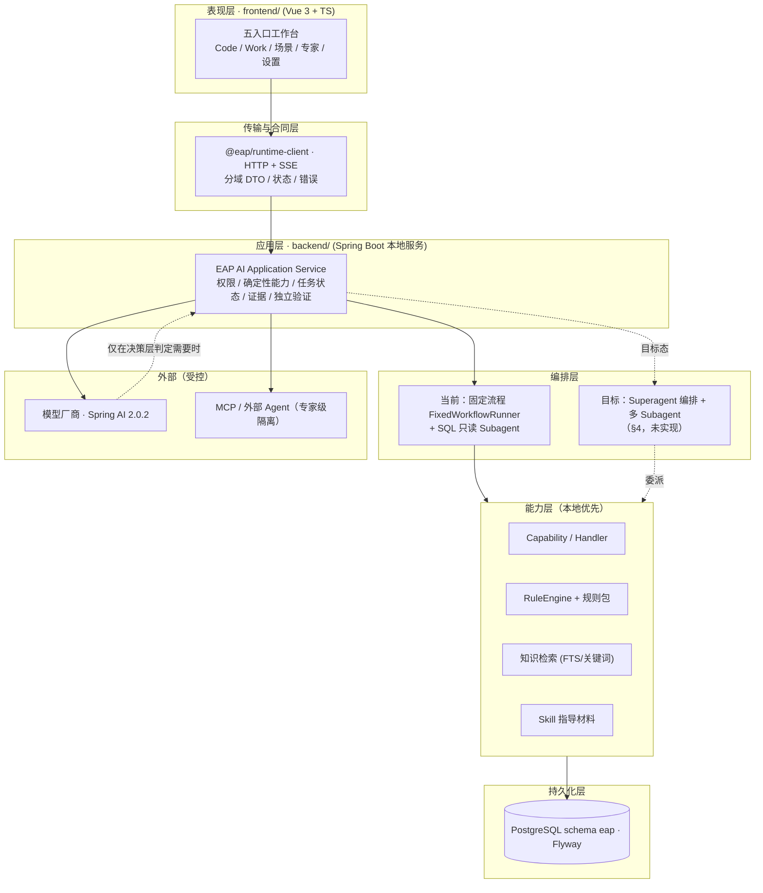
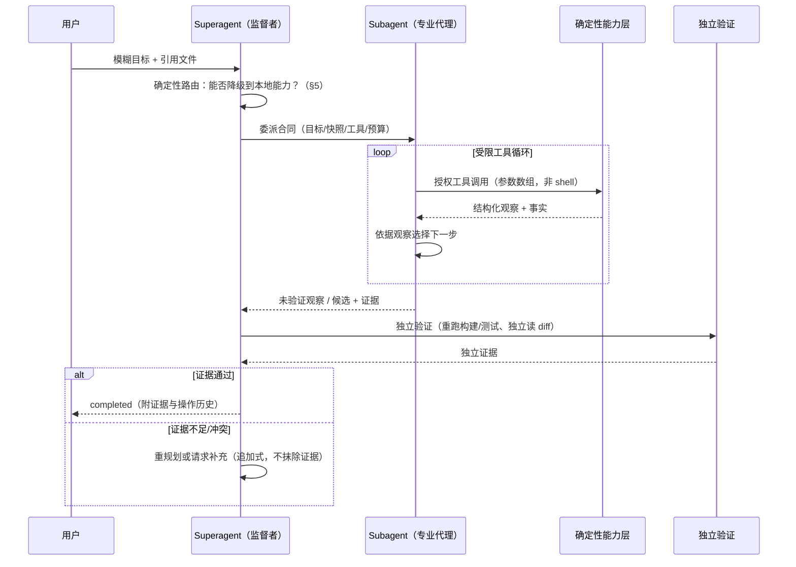
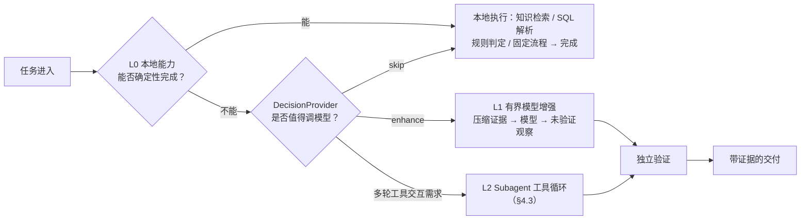

# EAP 架构方法总纲

> 状态：现行架构方法（2026-11-21）
> 定位：统摄 `backend/` / `frontend/` / Agent 运行时的**设计方法与决策顺序**。
> 本文件只回答「怎么想、怎么切、怎么验收」，**不记录进度、不复制验收数字、不重述历史**。
>
> 事实源与冲突处理：
>
> | 类别 | 唯一事实源 | 本总纲的处理 |
> |---|---|---|
> | 运行约束（本机单机、非 SaaS） | [running-context.md](running-context.md) | 完全继承，不另立口径 |
> | 当前实现与剩余关口 | [planning-status.md](planning-status.md) | 只引用，不复制数字 |
> | 产品交互合同（五入口等） | [v1.6 合同](EAP-frontend-architecture-adjustment-v1.6-Spring-AI.md) | 只引用，不改写 |
> | 历史证据与阶段记录 | [records/](records/README.md)、[audits/](audits/) | 不改写、不续期 |
> | 源码与测试 | `backend/`、`frontend/` | 实现事实以源码为准；目标设计不得冒充已实现 |
>
> 本文出现的目标架构（尤其 §4 的 Superagent / Subagent、§5 的严格本地模式）均明确标注**目标态**，
> 不构成「已实现」或「立即开工」的指令；落地须经对应 roadmap 关口与用户授权。

---

## 0. 为什么需要这份总纲

`docs/` 下已有 70 篇文档，按「当前合同 → 当前进度 → 完整记录」分层维护。这套分层本身是正确的，
但随着切片增多，出现三类结构性风险：

1. **口径分散**：前后端规范散落在 `architecture.md`、`module-layout.md`、`frontend-ui-shared-module-boundaries.md`
   与 v1.6 的 §0A/§0C，新人难以判断「哪份是决策、哪份是背景」。
2. **术语漂移**：固定流程、专家、专业 Agent、Master/Supervisor、外部编码 Agent 等概念在
   `agent-runtime-evolution.md` 中逐步演进，缺少一个统一的概念模型把它们排进同一张图。
3. **诉求无落点**：本次新增的三项诉求——前后端规范、Superagent/Subagent 协作模式、
   基于知识库/规则的本地处理（简单任务不调模型）——都是**跨文档**议题，塞进任何单篇都会破坏其职责边界。

总纲的作用是给出一个**稳定的决策入口**：先在这里确定「方法」，再由各专题文档承载「细节」。
它不替代任何现有文档，而是被它们引用。

---

## 1. 三条公理（不可协商）

这三条来自既有文档，本文仅重申并作为后续所有设计的判定基准。

| 公理 | 内容 | 事实源 |
|---|---|---|
| **A1 本机单机** | 这是装在个人机器上、由一个人操作、只在本机运行的工程分析控制台。Java 服务是本机本地服务，不是远端多租户后端。上云 / 隔离云 VM / 代持异机路径与密钥是**被否决的方向**，不是「以后再说」。 | [running-context.md](running-context.md) |
| **A2 确定性优先，模型兜底** | 确定性能力先运行并产出结构化、可引用证据；只有确定性结果**明确不充分**时才调用模型，且只给它压缩过的结构化输入。任何特性若不能降低模型依赖或让模型输入更小、更可审计，就不进路线图。 | [pipeline.md](pipeline.md) |
| **A3 已实现与规划严格分离** | 每份文档都要能回答「这是今天跑的，还是目标」。目标设计必须带退出门禁与授权要求，不得用「已规划」冒充「已实现」。 | [architecture.md](architecture.md)、[agent-development-guide.md](agent-development-guide.md) |

由 A1 派生的一条**语汇约束**：不再使用「审计」「部署」「鉴权/多租户」等服务端语汇。
用「操作历史」「安装/投放」「能力边界/第三方隔离」。理由见 [running-context.md §语汇约束](running-context.md#语汇约束)。

---

## 2. 平台分层总览



**依赖方向铁律**（详见 [module-layout.md](module-layout.md)）：

- backend：`eap-api`（无框架依赖）← `eap-engine`（不依赖 ai/web）← `eap-ai` / `eap-web` ←
  唯一 Boot 宿主 `eap-full-application`。库不反向依赖应用，engine 不依赖 ai/web。
- frontend：`@eap/style`(L0) → `@eap/ui`(L1) → 共享基础设施(L2) → 组合件(L3) → `features/*`(L4) → App 壳(L5)。
  `@eap/ui` 不得依赖 `@eap/runtime-client`；跨包只走声明依赖与公开 `exports`。

---

<a id="sec-3-frontend"></a>
## 3. 前后端规范（backend / frontend）

### 3.1 一句话边界

| 端 | 是 | 不是 |
|---|---|---|
| **backend** | 本机 Spring Boot 服务：持有资料/会话/授权/确定性执行/模型接入/持久化/独立验证；受控执行本机命令 | 远端 SaaS 后端、多租户服务、模型厂商式托管 |
| **frontend** | Vue 工作台：连接本机服务、展示与操作、发出受控请求、渲染证据 | 写权限来源、凭据存放处、模型直连方、业务规则执行方 |

一句话记忆：**前端负责「看见与发起」，后端负责「判定、执行与举证」**。浏览器里的标签、`intendedPath`
或任何前端状态都不是写权限；真正的边界在后端 `ProcessExecutor` 的进程绑定根与授权表。

### 3.2 backend 分层与落点

当前 Maven 组合（以源码为准，完整表见 [module-layout.md §后端层次](module-layout.md#后端层次)）：

| 模块 | 职责 | 依赖边界 |
|---|---|---|
| `eap-api` (JAR) | 稳定执行/能力契约及 TaskRef | 无 Spring / 模型 SDK |
| `eap-engine/**` | core/local/sql/knowledge/mcp/delivery/workflow 七域；确定性与领域逻辑 | core/local 无 Spring/JDBC/模型依赖 |
| `eap-ai/**` | chat/model-openai/skill/context/codegen/sql 六域 | chat 不依赖供应商/workflow/delivery |
| `eap-web/**` | core/local/sql/knowledge/mcp/workflow/ai 七个 HTTP 适配 | 只做路由与状态码，不写业务事务 |
| `eap-spring/**` | autoconfigure + core/local/ai starter | 条件装配、缺授权拒绝、允许覆盖 |
| `eap-applications/eap-full-application` | **唯一 Boot 宿主**：资源、迁移、显式装配、跨模块验收 | 无库反向依赖 |

规范要点：

1. **显式装配优于扫描**：宿主显式导入产品组件，不扫描所有 EAP 包；缺省库装配不授予文件系统或工具访问。
2. **HTTP 只做适配**：Controller 不直接访问 Mapper、不声明业务事务；事务在管理服务上，请求 DTO 独立于 Controller。
3. **能力 = 处理器 + 声明**：一个 `CapabilityHandler` 组件加一条声明；测试断言声明集合与注册集合一致。
4. **Spring AI 是唯一模型/工具循环**：不得维护第二套 Provider 注册或 tool loop；确有兼容需求只保留薄适配桥。
   （见 [v1.6 §0A.2](EAP-frontend-architecture-adjustment-v1.6-Spring-AI.md#section-0a-2)）

### 3.3 frontend 分层与落点

前端采用 [L0–L5 分层](decisions/frontend-ui-shared-module-boundaries.md)：

| 层 | 包/位置 | 允许 | 禁止 |
|---|---|---|---|
| L0 | `@eap/style` | Token、主题 API | Vue 组件、业务文案 |
| L1 | `@eap/ui` | 基础/通用复合 UI、BEM 样式 | 调用 runtime-client、读写业务状态 |
| L2 | hooks/effects/layout/toggle/plugin 契约 | 无领域依赖的基础设施 | 单 feature 专用逻辑、再造按钮/弹层 |
| L3 | `apps/web/src/components/` | ≥2 feature 复用的产品组合件 | 单页提前抽包 |
| L4 | `apps/web/src/features/<area>` | 领域页面与局部状态 | 平行 `Modal.vue`、跨 feature 相对路径共享 |
| L5 | `App.vue` / 导航 | 工作台装配 | 领域 API 编排 |

规范要点：

1. **先查 `@eap/ui`，再判层，最后才建包**。新建 `packages/*` 必须先改共享模块决策文档与 `pnpm-workspace.yaml`。
2. **领域状态留在 feature**：`@eap/ui` 不认识任务、会话、插件。
3. **门禁自动化**：`check:boundaries` / `check:architecture` 检查缺失清单、未声明依赖、跨包相对导入与循环。
4. **原型与产品分离**：`docs/prototype/console.html` 与 `UI/` 原型只演示交互，不等于后端实现；
   产品实现以 `frontend/apps/web` 为准。

<a id="sec-3-4-contract"></a>
### 3.4 前后端通信合同

- 传输：HTTP + 业务 SSE；统一走 `@eap/runtime-client`，传输细节在 `@eap/request`。
- 错误：`ProblemResponses` 是唯一 HTTP 错误构造器；机器码 `code` 与本地化 `detail` 分离，
  前端 union 从领域常量派生，不搜索人类可读错误文本做业务分支。
  （见 [domain-status-and-backend-i18n.md](decisions/domain-status-and-backend-i18n.md)）
- 状态：每个领域/函数只有一个有限状态定义；不因 wire 字符串相同而合并 CLI / 工具执行 / 源码应用 /
  独立验证 / 看板列 / 专家运行状态。
- 服务只监听 loopback。**这不是「尚未做鉴权的临时状态」，而是终态**（A1），不要为「以后公开」加认证层。

### 3.5 前后端红线（速查）

| 禁止 | 正确做法 |
|---|---|
| 浏览器直连模型厂商 / 把密钥放进前端或 Trace | 凭据留本地服务，HTTPS 外呼由后端发起 |
| 前端把 localStorage 路径当 cwd / 写权限 | 后端进程绑定根 + 授权表判定 |
| 在 `features/*` 复制按钮/弹窗/焦点陷阱/布局壳 | 先入 `@eap/ui` 或按 §3.3 判层 |
| Controller 直接访问 Mapper / 声明事务 | 服务层持有事务，请求 DTO 独立 |
| 为同一 Git 操作在 Chat/Expert/看板各拼一套命令 | 复用 Capability / Handler / ProcessExecutor |
| 维护第二套模型 Provider / tool loop | 统一 Spring AI；兼容需求只留薄适配桥 |
| 把 Fake / Mock / 目标设计写成「已验收」 | 以源码、测试与台账为准，标注证据层级 |

<a id="sec-3-6-verify"></a>
### 3.6 验证分级与交付节奏（决定「跑多少」，不是「跑不跑」）

验证强度按**改动性质**分级，不再一律全跑。分级只决定范围，不松任何不变量：
授权、审批、UNKNOWN、取消、去重、恢复、草稿保护永远要测；断言永远不能削弱。

| 级别 | 适用（全部满足才算） | 必跑 | 明确不要求 |
|---|---|---|---|
| **T0 文档** | 只改 `docs/`、注释、README | 改了内部链接时跑链接校验 | 构建、测试、截图 |
| **T1 外观** | 只改 CSS / 主题 token / 文案 / 间距 / 图标，无逻辑分支、无接口变化 | `typecheck` + 受影响页面各一张 1440 截图 | 领域测试全跑、窄屏、逐页走查 |
| **T2 组件/交互** | 新增或改动组件、页面状态、请求调用、表单校验 | `typecheck` + **受影响领域**定向测试 + `build` | 其他领域回归、全站走查 |
| **T3 契约/安全** | 状态机、错误码、DTO/wire、迁移、授权或执行路径 | T2 + `check:boundaries` + 相关领域**全量**定向回归（+ 领域契约脚本） | — |

判定口径：

- **升级就高**：一个改动同时命中多级时按最高级跑，不按最小的那一级自我豁免。
- **公共件从 T2 起**：改 `@eap/ui` / `@eap/style` / `@eap/runtime-client` / `@eap/request`，至少把直接消费方的测试纳入范围，因为影响面由消费方决定。
- **「全站布局任务」有明确边界**：只有同时影响 ≥3 个入口的公共壳（导航骨架、布局栅格、主题 token）才需要逐页走查；单页布局改动只验该页。走查可用批量截图完成，不要求逐页人工复读每张图。
- **后端同构**：单模块改动用 `-pl :目标 -am` 增量验证该模块及其直接依赖；`clean` 只在源码移动、模块归属变化或怀疑 `target` 陈旧时跑，不作为默认动作。

交付节奏（台账从「每次提交」移到「切片收口」）：

- **每次提交**：commit message 写清 passed / failed / skipped / **unverified** 四类与实际执行命令即可。
- **切片收口或里程碑**：同步台账（`planning-status.md` 对应行、决策记录、必要证据链接）一次。
- 永远保留：不得把实现、Mock、HTTP 200 或「截图文件存在」写成用户验收；未验证项必须显式标 unverified。
- 台账缺失只阻塞**里程碑提交**，不阻塞切片内的连续提交——否则每个小步都要先造证据，节奏会被文件工作吃掉。

---

<a id="sec-4-agents"></a>
## 4. Agent 运行时：从固定流程到 Superagent / Subagent

> **状态：目标架构（未实现）。** 当前代码实际是「固定 DAG 专家 + 单个 SQL 只读 Subagent」，
> Master/Supervisor、多专家路由与外部编码 Agent 仍在规划态（见 [architecture.md §What is planned](architecture.md#what-is-planned-not-yet-implemented)）。
> 本节给出统一概念模型与落地路线，**不是已实现清单**。

### 4.1 概念模型（三层）

```text
Superagent（监督者 / 编排者，目标态）
  │  理解目标 → 分解任务 → 选择并委派 Subagent
  │  聚合证据 → 独立验证 → 决定 完成 / 重规划 / 求助用户
  │  拥有任务状态机；不亲自执行能力，不替 Subagent 下结论
  ▼
Subagent（专业代理，EA-03 已有一个实例：SQL 只读 Agent）
  │  单一专业目标；在授权工具集内自主选择工具
  │  基于观察决定 调用工具 / 请求补充 / 结束
  │  产出「未验证观察 / 候选」，不持有全局任务状态
  ▼
Capability（确定性能力，当前实现）
     本地执行：Git/ripgrep、SQL 解析、规则包、知识检索、CLI、MCP
     产出结构化观察与可引用事实；简单任务到此为止，不调模型
```

现有术语与本总纲术语的对应关系：

| 现有文档术语 | 本总纲术语 | 当前状态 |
|---|---|---|
| Master / Supervisor、Multi-expert routing | **Superagent** | 规划态（architecture.md §planned） |
| 专业 Agent、SQL 只读 Agent（EA-03） | **Subagent** | SQL 单实例已实现（限只读、限当前连接） |
| ExpertGraph 固定 DAG / FixedWorkflowRunner | 固定流程（Subagent 可组合的能力之一） | 已实现 |
| CodingAgentProvider（Codex/Claude/Hermes） | 外部 Subagent（独立会话，输出为观察） | 部分适配，需独立验收 |
| Capability / Handler / RulePack / Knowledge | **确定性能力层** | 已实现 |

### 4.2 Superagent 职责与边界（目标态）

**职责**：理解模糊目标；分解为可委派子任务；依据能力目录与专家目录选择合适 Subagent；
为每个子任务下发受限委派合同（§4.4）；聚合各方观察；触发**独立于执行者**的验证；
按验收标准决定推进、重规划或请求用户补充；拥有并推进任务状态机。

**明确不持有**：

- 不亲自调用 Capability 执行写操作——执行归 Subagent 或固定流程，且需授权与审批。
- 不把自身或 Subagent 的文本输出当作完成事实——所有输出是**未验证观察**。
- 不用 `ChatMemory` 充当任务状态——状态归 Task/Run/Mission，模型等待不占用整轮数据库事务。
- 不绕过确定性层直接「凭感觉」路由——优先确定性路由，复杂才升级（见 §5）。

**决策实现的优先级**：Superagent 的路由/监督决策**先做成确定性策略**（复用 `DecisionProvider` 思路），
只有确定性证据不足时才用模型，且输出仍需独立验证。这保证 A2 在编排层同样成立。

### 4.3 Subagent 职责与边界

**职责**：围绕单一专业目标，在**委派时授予的工具集**内，基于观察自主选择下一步：
调用授权工具、调用固定流程、请求补充信息、结束并交付证据。现有 `sql-readonly-agent@1`
是第一个实例：它复用 Spring AI tool loop，工具只读取证，自由文本不算完成，必须调用终结工具。

**明确不持有**：不持有全局任务状态；不接受委派合同之外的工具/SQL/路径/授权参数；
不自动应用写候选；不能宣布 `completed`（见 [backend-architecture.md §Target state machine](backend-architecture.md#target-state-machine-phase-3-not-yet-enforced)）。

**隔离要求**：每个 Subagent 调用在属于 `(执行, 专家, 服务器)` 三元组的会话中进行；
专家级能力（MCP 工具、远端端点）永不全局启用（见 [backend-architecture.md §MCP tools are expert-scoped](backend-architecture.md#mcp-tools-are-expert-scoped-not-platform-capabilities)）。

### 4.4 委派合同（Delegation Contract）

这是 Superagent 与 Subagent 之间的**唯一接口**，务必显式、可校验、可审计（目标态设计）：

| 字段 | 含义 | 约束 |
|---|---|---|
| `goal` | 单一、可判定的专业目标 | 不得是「完成整个任务」这类全局目标 |
| `inputSnapshot` | 输入快照（源码/SQL/资料等的只读副本） | 绑定版本/摘要；防基线漂移 |
| `allowedTools` | 授权工具集（Capability id 白名单） | 与专家 grant 取交集；越界即失败 |
| `requiredTools` | 必需能力（产出事实的前提） | 缺失则阻塞并标部分结果，不伪装完成 |
| `budget` | 轮次 / token / 时间 / 输出上限 | 复用现有 45s / 6 轮 / 累计预算模型 |
| `workspaceBoundary` | 可写路径与基线 | 由后端绑定根限定；前端无法指定 cwd |
| `evidenceRequirements` | 必须回传的观察与引用 | 未满足则结论只能是 `unverified` |

委派时序（目标态）：



### 4.5 状态机与独立验证

复用 [backend-architecture.md 的目标状态机](backend-architecture.md#target-state-machine-phase-3-not-yet-enforced)，
不另建平行状态机：

```text
planned → running → expert-review → validating → completed
                         │              │
                    replanning ←──── evidence fails
                    awaiting-user（用户追加，append-only）
                    escalated（确定性能力不可用）
```

- **只有 Superagent 能发出 `completed`**，且必须在独立验证提供证据之后；Subagent 只能提出 `done`。
- 独立验证独立于执行者：重跑构建/测试、独立读 diff，不采信执行者的自我声明。
- 用户补充是追加式事件，产生新的计划修订，不抹除既有证据。

### 4.6 落地路线（当前 → 近期 → 目标）

| 阶段 | 交付 | 退出门禁 | 对应现有切片 |
|---|---|---|---|
| **当前（已实现）** | 固定 DAG 专家；SQL 只读 Subagent 单例；Capability/规则/知识本地执行 | 已有验证见台账；不把单实例说成通用运行时 | EA-01~EA-04、[模块组合](decisions/backend-module-composition.md) |
| **近期（可授权切片）** | Subagent 泛化：把 SQL 只读 Agent 的「工具循环 + 预算 + 审批」抽象为可复用 Subagent 骨架；显式单步委派（无自主多跳）；多专家路由（调用方显式指定） | 至少两个专业 Subagent 走同一骨架；委派合同字段可校验；越界工具被拒；独立验证可运行 | 复用 [EA-02 角色与流程合同](decisions/agent-runtime-evolution.md#112-建议职责) 的版本化绑定 |
| **中期（需明确协作需求）** | Superagent 监督层：按 delegation contract 委派、聚合证据、状态机推进、重规划/求助 | 跨 ≥2 Subagent 的任务完成闭环；`completed` 仅在独立验证后；模型/工具等待不占长事务；UNKNOWN 不被重放 | 对应 architecture.md 的 Master/Supervisor、Multi-expert routing（均规划态） |
| **目标（按需求另批）** | 外部编码 Agent 作为 Subagent 接入；可选 A2A 互操作 | 外部输出一律作为未验证观察并经独立验证；A2A 仅在明确互操作需求后按 [协议选择](decisions/agent-runtime-evolution.md#4-协议与框架选择) 判定；内部委派不套协议 | CodingAgentProvider、A2A（均延期） |

推进顺序由 [roadmap.md](roadmap.md) 与 [planning-status.md](planning-status.md) 决定；总纲只给方法，不给排期。

### 4.7 风险提示与常见坑

| 风险 / 坑 | 说明与规避 |
|---|---|
| **造第二套模型循环** | 最大风险。Superagent/Subagent 必须复用 Spring AI 的 ChatClient/tool loop，只在 EAP 侧放业务决策与执行约束。 |
| **Superagent 自证完成** | 监督者与被监督者若共用同一证据来源，等于自证。独立验证必须是独立执行者 + 独立读取。 |
| **委派做成同步长事务** | 沿用现有教训：模型/工具等待不持数据库事务；用短事务保存状态与检查点，跨重启显式续跑。 |
| **把固定 DAG 自动升级为 Agent** | `eap/v1` 的 steps/edges 仍是固定流程；不得把「有连线」解释成「有自主目标」。版本化合同显式选择模式。 |
| **过早套 A2A / MCP 协议** | 内部静态委派不需要通信协议；A2A 面向独立 Agent 互操作，仅在明确需求后按决策文档判定。 |
| **专家级能力被全局化** | MCP/远端端点带状态，全局启用会导致游标污染与静默漏读；必须保持专家级隔离与会话三元组。 |
| **预算/取消只做门面** | 超时、取消、预算耗尽必须在步骤边界真正阻断后续动作，且不能把终态改回成功；不宣称能撤回已发网络请求。 |

---

<a id="sec-5-local"></a>
## 5. 本地确定性执行：知识库与规则驱动（简单任务不调模型）

> 这一节落实用户诉求「支持基于知识库、规则等的本地代码级处理（简单任务不使用大模型）」。
> 它的已有实现基础是 [pipeline.md](pipeline.md) 与 [knowledge-local-execution.md](decisions/knowledge-local-execution.md)，
> 本文把它们统一为一套**任务分级与路由方法**。

### 5.1 目标与边界

目标：让**能够用本地代码确定性解决的任务，全程不调用大模型**；必须用模型时，也只给它压缩过的结构化证据。
边界：检索本地 ≠ 全流程离线。若外部模型 Chat/Agent 被选中，授权命中的知识摘录可能进入模型上下文；
要区分「本地数据位置 / 本地计算 / 不使用生成模型 / 是否向外传出摘录」四件事（见 [knowledge-local-execution.md](decisions/knowledge-local-execution.md)）。

### 5.2 任务分级与路由



| 级别 | 适用任务 | 执行路径 | 调模型？ |
|---|---|---|---|
| **L0 本地确定性** | 查资料/定位来源；按确定规则检查；执行固定步骤 | 知识 FTS 检索、AST 事实提取 + RuleEngine、FixedWorkflowRunner | **否** |
| **L1 有界增强** | 确定性证据不足、需语义判断 | 压缩结构化证据 → 模型 → 未验证观察 | 仅当 DecisionProvider 判定 `enhance` |
| **L2 Subagent** | 需多轮工具交互（取证/追问/候选） | 复用 tool loop + 预算 + 审批 | 按工具选择，结论仍需验证 |
| **L3 Superagent** | 跨多个专业子任务的复杂目标 | §4 编排 + 独立验证 | 优先确定性路由，不足才升级 |

**路由判定是配置，不是硬编码**：`DecisionProvider` 依据 `parseStatus`、`confidence`、`complexity`、
`requiresModelReview` 与用户显式意图决定 `skip`/`enhance`；`requiresModelReview` 由规则包的
`policy`（`actionableWeight`、`reviewComplexityThreshold`）推导。更严格的规则包更早升级，
更宽松的规则包把更多工作留在本地——**升级点是配置**，这正是「简单任务不调模型」可调的开关。

### 5.3 知识库的角色：检索，不执行

- 知识库存**脱敏文本**，分块、保存 SHA-256，使用 PostgreSQL 全文检索 + 关键词打分（含中文二元切分）；
  **无向量检索、无 embedding 调用**。
- 知识检索是既有 Capability：专家仅查询已授权知识库，发布命中与来源证据；检索本身不调用模型。
- **普通知识文档不会自动变成可执行规则或授权**。文档写「遇到错误先清空目录」不会让平台自动删文件；
  操作必须对应已注册能力、参数约束、授权与必要审批。

### 5.4 规则包的角色：从事实到判定

- `SqlFactExtractor` 用真实解析器产出**结构化事实**（无领域判断），每个事实标注 `producedBy`；
  `RuleEngine` 用 JSON 规则包对事实判定，产出 finding / severity / confidence。
- 检查项、严重度、措辞、升级阈值都是**配置**——加一条规则不需改代码。
- **覆盖即诚信**：规则依赖的事实若因对应能力未执行而缺失，该规则记为 **blocked**，
  结果降级为 `partial` 并给出明确建议；**绝不能显示成「没有问题」**（见 [pipeline.md §Invariants](pipeline.md#invariants)）。
- 专家引用规则包时，固定流程中必须存在产出所需事实的能力节点，否则保存与启用都被拒绝。

### 5.5 「不调模型」的严格保证

| 机制 | 保证 |
|---|---|
| `DecisionProvider` fail-closed | 服务不可用或未知决策类型一律回退 `skip`，不会误升级到模型。 |
| 模型缺省关闭 | 模型未配置时确定性能力与手工设计仍可用；配置存在 ≠ 连接成功。 |
| 严格本地模式（目标） | 「严格不调用模型」应**显式拒绝模型回退**；「优先本地」遇证据不足只解释缺口并按用户许可升级（见 [knowledge-local-execution.md §建议顺序](decisions/knowledge-local-execution.md)）。 |
| 模型输出隔离 | 模型文本是未验证观察，单独渲染，不改写确定性分析、不自动把任务置为 `completed`。 |
| 可解释 | 每次请求返回 `modelAdvisor`（是否调用、原因、压缩比），「为何调/没调模型」永远可回答。 |

<a id="sec-5-6-rules"></a>
### 5.6 从经验到可执行规则（人工转化流程）

已验证经验要变成**本地可执行**能力，必须人工整理，不能靠检索分数自动执行：

1. 写成带**适用条件 / 前置检查 / 输入输出 / 风险级别 / 失败策略**的规则或固定流程；
2. 关联原文与版本，保证可追溯；
3. 复用现有 Capability 注册、授权与审批机制；**不另造「知识执行器」**；
4. 先建立真实问题/预期来源基线评测检索质量，只有词法检索不足时才评估向量/混合检索。

---

## 6. 不变量清单（验收自检）

设计或评审任一 Agent / 前后端特性时，逐条对照；任一条不满足即不得标「完成」。

1. 能力命令是参数数组，绝不 shell 拼接；每次执行返回带退出码与捕获输出的结构化观察。
2. 外部 Agent 输出是观察，不是事实；验证者独立于执行者读仓库。
3. 范围、授权与变更文件在完成前可见；专家/知识/规则定义使用前先校验。
4. 领域判断是配置（规则包）；代码只提取事实，不因某个 expertId 分支。
5. 每个事实标注产出能力，每个规则包声明所需能力；未产出的事实记为 blocked，不伪装通过。
6. 每类能力都有管理入口；被停用与缺失是不同状态，均不得被旧授权偷偷放回。
7. 专家级能力（MCP/远端端点）永不全局启用；会话按 `(执行, 专家, 服务器)` 隔离。
8. 知识访问缺省拒绝且逐条引用；规则由平台判定，专家不能自证合规。
9. 模型只接收脱敏、压缩、token 受限的输入；不可用则降级到确定性结果，不返回错误页。
10. 确定性阶段永远先跑；模型输出不改写确定性结论、不单独授权、不单独宣布完成。
11. 委派合同显式可校验；越界工具在校验期与运行期都被拒绝。
12. 目标状态机唯一；`completed` 仅由 Superagent 在独立验证后发出。
13. 前端不含写权限、不直连供应商；后端 HTTP 只做适配，事务在服务层。
14. 单一事实源不被复制：进度看台账，约束看 running-context，历史看 records。

---

<a id="sec-7-map"></a>
## 7. 文档地图（各归其位）

| 主题 | 文档 | 与本总纲的关系 |
|---|---|---|
| **方法总纲（本文）** | [architecture-method.md](architecture-method.md) | 决策入口：怎么想、怎么切、怎么验 |
| 运行约束（唯一事实源） | [running-context.md](running-context.md) | 本文 §1 A1 的来源，冲突时以它为准 |
| 平台架构与实现边界 | [architecture.md](architecture.md) | 模块边界、当前已实现 vs 规划 |
| **数据模型评审（库表对齐）** | [data-model-review.md](data-model-review.md) | 本文 §2/§4/§5 的持久化落点：识别固定值壳表与硬编码约束，给出收敛/去硬编码/增量新增建议 |
| 后端运行时参考 / HTTP / 状态机 | [backend-architecture.md](backend-architecture.md) | 本文 §3.2 / §4.5 的细节 |
| 五阶段流水线 | [pipeline.md](pipeline.md) | 本文 §5 的核心实现基础 |
| 前后端模块与命令 | [module-layout.md](module-layout.md) | 本文 §3 的落点清单 |
| 前端 UI 分层与 Agent 落点 | [frontend-ui-shared-module-boundaries.md](decisions/frontend-ui-shared-module-boundaries.md) | 本文 §3.3 的唯一规范 |
| 领域状态与错误合同 | [domain-status-and-backend-i18n.md](decisions/domain-status-and-backend-i18n.md) | 本文 §3.4 |
| Agent 能力演进 / 专家-Agent-流程边界 | [agent-runtime-evolution.md](decisions/agent-runtime-evolution.md) | 本文 §4 的概念来源（§11 专家/专业Agent/固定流程） |
| 后端模块组合实施 | [backend-module-composition.md](decisions/backend-module-composition.md) | 本文 §4.6 落地的实现证据 |
| 知识与本地执行边界 | [knowledge-local-execution.md](decisions/knowledge-local-execution.md) | 本文 §5 的核心实现基础 |
| 专家 / 知识 / 规则使用 | [expert-knowledge-rules.md](expert-knowledge-rules.md)、[runtime-workflow.md](runtime-workflow.md) | 本文 §5 的用户侧入口 |
| 产品交互合同（五入口） | [v1.6 合同](EAP-frontend-architecture-adjustment-v1.6-Spring-AI.md) | 本文不改写，只引用 |
| 前端原型 | [frontend-prototype.md](frontend-prototype.md)、[UI 原型](../UI/)、[console.html](prototype/console.html) | 交互演示，不等于后端实现 |
| 进度 / 路线 / 验收 | [planning-status.md](planning-status.md)、[roadmap.md](roadmap.md)、[agent-development-guide.md](agent-development-guide.md) | 本文不给排期、不复制数字 |
| 历史证据与阶段记录 | [records/](records/README.md)、[audits/](audits/) | 不改写、不续期 |
