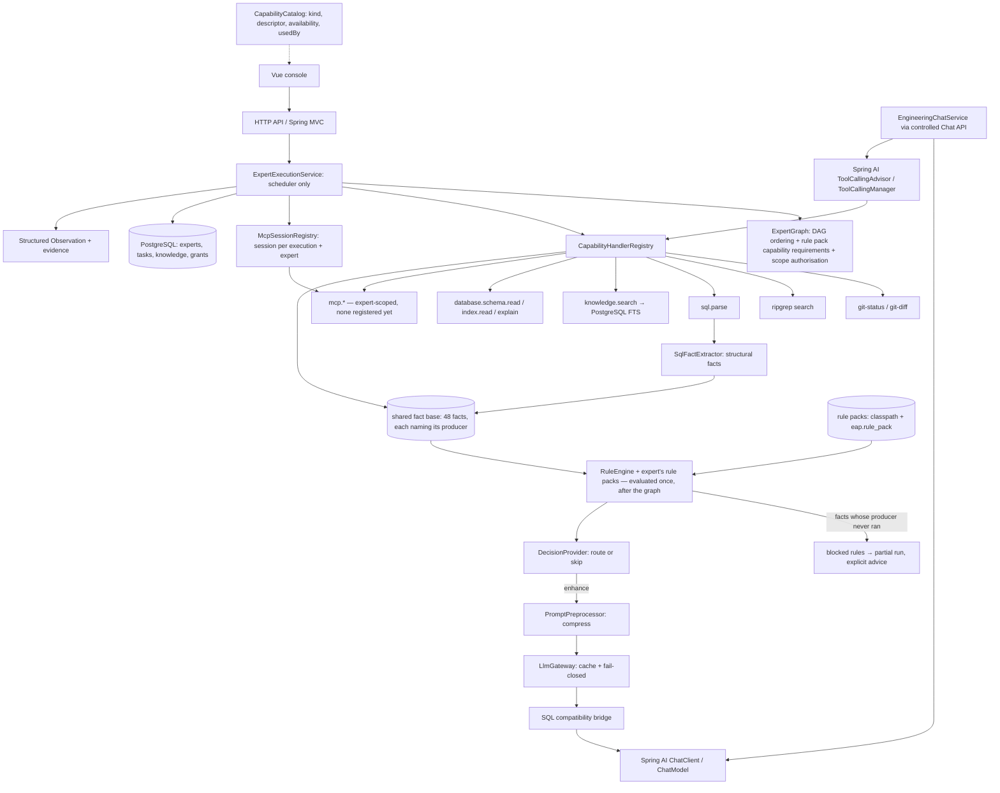
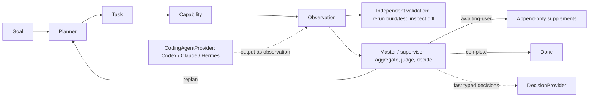

# Architecture

2026-10-24 implementation update: chat now accepts selected expert guidance, user-selected text files and
saved prototype references, and can produce reviewable source proposals through the selected Spring AI
connection. Writes are separately confirmed, workspace-bound and never imply build/test verification.
The existing SQL workflow remains available; it is not the required entry for general engineering tasks.
See [the bounded task slice](decisions/chat-engineering-task-slice.md) for actual scope and limitations.

The platform is a cross-platform engineering console: a Vue frontend, a **local Java service** on the
operator's machine, and optional Python **install/bootstrap** tooling (not an agent host). Its
defining decision is **deterministic-first, model-last** — see [pipeline.md](pipeline.md). Product
placement (single-operator, colocated local service, no multi-tenant cloud) is constrained by
[running-context.md](running-context.md).

This document describes **what is implemented today** and, separately, **what is planned**. Earlier
revisions of this file mixed both, which made it impossible to tell what actually runs. That mistake
is fixed here.

## Module boundaries

```text
frontend/            Vue 3 + TypeScript monorepo (Vite+ / pnpm)
  apps/web           browser console (product UI)
  packages/ui        shared presentational primitives (all basic chrome)
  packages/runtime-client HTTP client and shared API types, exported through a package entry point
  packages/expert-sdk typed expert authoring DSL (compile-to-manifest, tooling only)
  internal/tsconfig  shared TypeScript configuration, published as @eap/tsconfig
  (planned) hooks / effects / layout / plugin-* — see UI shared-module decision
backend/             Java 25 / Spring Boot / Maven reactor
  eap-api            stable contracts, including TaskRef (JAR)
  eap-engine/        deterministic modules: core/local/sql/knowledge/mcp/delivery/workflow
  eap-ai/            chat/model-openai/skill/context/codegen/sql
  eap-web/           core/local/sql/knowledge/mcp/workflow/ai HTTP adapters
  eap-spring/        conditional auto-configuration; core/local/ai starters
  eap-applications/eap-full-application
                     only executable Boot host: explicit product wiring, resources, migrations,
                     and cross-module acceptance tests
  eap-applications/eap-full-application/src/main/resources/db/migration
                     25 migrations: retained V1–V22 plus incremental V23–V25
docs/                architecture, pipeline, roadmap, environment, expert/knowledge/rules, prototype
```

The layout above is the implemented composition through the current SQL Agent slice. `eap-api` has no framework dependencies;
engine core/local have no Spring, JDBC or model runtime dependencies (core retains Jackson for existing
manifest/value serialization). Libraries never depend on the application; engine never depends on AI or HTTP.
Only `eap-full-application` uses Boot repackage. `FullApplicationConfiguration` explicitly imports product
components instead of scanning every EAP package. Default library wiring does not grant filesystem or tool access.

Deterministic proposal application/verification lives in `com.lh.eap.delivery`; Board and JDBC task adapters
remain in workflow. Domain handlers live with SQL/knowledge/MCP, with SQL-specific knowledge hints supplied
by a workflow adapter. Expert execution, the product catalog and CLI management still combine domains;
AI codegen/context still contain product integration. See [implementation and remaining gates](decisions/backend-module-composition.md#implementation)
and [module layout](module-layout.md). Historical five-module evidence remains in the architecture records.

Frontend UI placement (primitives in `@eap/ui`, planned hooks/effects/layout/plugin modules, agent workflow)
is normative in [frontend-ui-shared-module-boundaries.md](decisions/frontend-ui-shared-module-boundaries.md);
planned packages are not implemented until an approved slice creates them.

## What is implemented today



**Deterministic capabilities.** Git status/diff and ripgrep search run through `ProcessExecutor`
(argument arrays, no shell interpolation). Each capability is a `CapabilityHandler` bean registered by
name; the executor no longer contains any per-capability logic.

**Capabilities are typed, self-describing, and each kind is manageable.** Every handler declares *what
kind of thing it is* (`command` / `cli` / `mcp` / `http`), *who may turn it on* (`platform` / `expert`),
a descriptor (title, summary, inputs, grants, executor, the facts it publishes, the evidence it
contributes) and whether it is runnable right now (`available` / `missing-binary` / `not-configured` /
`disabled`, probed for `cli` by a pure `PATH` lookup). `CapabilityCatalog` serves this at
`/api/capabilities`, grouped by kind, reconciled against the declared vocabulary and annotated with
which experts use each capability — so the console renders facts about the runtime rather than a
hard-coded list. A read-only catalog is only half a catalog, so each kind also declares **where an
operator can change it** (`CapabilityManagement`): `command` capabilities can be switched on/off with a
note, `cli` capabilities additionally take a binary override (applied live) and an explicit probe, and
`mcp` servers have a full registration surface. Local CLI programs can also be registered manually and
given fixed-argument operations; Git is one program with preconfigured status/diff operations. Manual
operations emit redacted process evidence. Structured fact producers still require a handler implementation.
See [module-layout.md](module-layout.md) and [expert-knowledge-rules.md](expert-knowledge-rules.md) §3.

**One switch per capability, absent means enabled, and disabled is not missing.** `eap.capability_setting`
is opt-out (an unreadable table yields a working platform), switching off a capability an *enabled*
expert runs is refused with the expert names that still use it, and a disabled capability is reported as
`disabled` — never as `missing-binary` / `not-configured`, because "switched off" is a decision and
"broken" is a defect. A manifest referencing a disabled capability is rejected with *…已在平台停用…请
在能力目录中重新启用*, and `CapabilityHandlerRegistry.resolveFor` refuses it at run time too, so a stale
grant cannot smuggle it back in.

**Expert-scoped capabilities are never globally enabled.** MCP tools and remote endpoints carry an
external session and a per-expert trust decision, so they are not registered "for everyone": an
operator registers the server through `/api/mcp-servers` (disabled and untrusted by default, with a tool
allow-list, `id` validated against the `mcp.<server>.<tool>` segment shape at the source), the expert
declares the tool in `mcpTools`, activation writes the grant into `eap.expert_mcp_grant`, the graph
validator rejects a node whose tool was not declared, and the run-time lookup
(`CapabilityHandlerRegistry.resolveFor`) refuses an undeclared tool even though the handler exists. Each
call runs in a session owned by one `(execution, expert, server)` triple (`McpCallScope` +
`McpSessionRegistry`) which is closed when the execution ends, so two experts can never share a
server's session state. See [expert-knowledge-rules.md](expert-knowledge-rules.md) §3.

**Declarative rules.** `SqlFactExtractor` parses SQL with JSQLParser and emits a flat map of structural
facts — it contains no domain judgement. `RuleEngine` interprets the expert's rule packs over those
facts and produces findings, severity counts, complexity and a confidence. The packs themselves are
JSON (`rules/*.json` shipped, `eap.rule_pack` authored) with a measured confidence policy, so checks,
severities, wording and escalation thresholds are all editable without a rebuild.

**Facts name their producer, and packs declare what they need.** Every fact in `SqlFactVocabulary`
carries `producedBy`, so the capabilities a pack requires are *derivable* from the facts its rules
reference; `requires.capabilities` is validated against that derived set, and `ExpertGraph` refuses an
expert that references a pack without the nodes producing those facts. At run time the judgement stage
executes once over the accumulated fact base (after the whole graph), and any rule whose producers did
not run is reported as a **blocked** rule — the run degrades to `partial` with explicit advice instead
of reporting "no findings". See [expert-knowledge-rules.md](expert-knowledge-rules.md) §2–§3.

**Fixed-workflow expert orchestration.** An expert is a declarative JSON manifest (`eap/v1`) with steps, explicit
edges, rule pack references and platform invariants. `ExpertGraph` validates the DAG (single entry, no
cycles, known capabilities, satisfiable rule pack requirements) and orders it. `ExpertExecutionService`
resolves the declared rule packs, runs nodes in dependency order, blocks dependents of a failed required
node, enforces knowledge and database grants, redacts evidence and persists observations. Shipped
experts are seeded into `expert_definition` with `builtin = true` by `BuiltinResourceSeeder`, so
built-in and operator-authored experts share one code path.

**Versioned SQL Agent behavior.** Explicit `eap/v2` manifests bind `sql-readonly-agent@1`; old DAG experts are not upgraded implicitly. The Agent uses Spring AI to select authorized evidence, request input or propose one SQL file. Task-owned checkpoints, lease ownership and cumulative budgets survive restart; only explicitly queued runs receive automatic scheduling consent. Separate digest-bound approval applies the candidate through existing delivery services. UNKNOWN writes are not replayed. Ordinary Responses function tools passed a real two-call evidence/candidate/approval/readback test and restart verification; this does not establish SQL correctness or performance. See [stage evidence](decisions/backend-module-composition.md#responses-tools-acceptance).

**Knowledge.** `knowledge.search` performs PostgreSQL full-text search plus local keyword matching
(including Chinese bigram segmentation). Access is deny-by-default via `expert_knowledge_grant`.
There is **no** vector retrieval in the current implementation.

**Database snapshots.** `database.schema.read` / `database.index.read` read a human-registered,
redacted metadata snapshot from `eap.database_profile`. The runtime never connects to a business
database and never executes user SQL.

**Model gateway.** `LlmGateway` + `OpenAiCompatibleProvider` + `PromptPreprocessor` +
`DecisionProvider` implement stages 3–5 of the pipeline. The model is off by default.
The provider class is a compatibility bridge to Spring AI 2.0.2; no custom HTTP/JSON model transport
or model tool loop remains. `EngineeringChatService` uses Spring AI's official tool loop and window
memory, with server-owned workspace permissions and existing Capability handlers. Memory is not a
durable history store or Mission Runtime. The controlled Chat HTTP/UI integration is implemented;
model configuration is not proof of successful connectivity or accepted engineering delivery.
Knowledge/Skill use makes a session sticky-sensitive: subsequent turns clear model memory,
including derived answers, until a replacement invalidation policy is verified. Window memory and
the session registry are in-memory, not restart recovery. The external Codex adapter remains separate.
See [roadmap.md](roadmap.md) for current gates; [S1 Chat design](decisions/s1-chat-spring-ai-design.md)
is the historical bounded slice, not evidence that today's HTTP/UI routes are absent. Fixed bundled
Chat/Builder plugin prototypes and persistent Task/Run delivery slices exist; a general plugin
installer, autonomous planning and full process recovery do not follow from those slices.

**Persistence.** PostgreSQL schema `eap`, managed by Flyway. The user-approved development reset
consolidated V1–V18 into `V1__initial_schema.sql` on 2026-10-26. Existing development databases require
an explicit reset; automatic legacy adoption was removed. Future changes use incremental migrations.
See [runtime-workflow.md](runtime-workflow.md).

## What is planned (not yet implemented)

### Remaining backend composition work

The [BM stage table](decisions/backend-module-composition.md) records what is implemented and what remains:
Expert/registry/CLI service decoupling, product Chat contributions, independent schema initialization and
cross-environment service acceptance. The local IDEA host and bounded SQL Agent provider chain have passed their checks. The module hierarchy, core/local/Chat starters and minimum composition tests
are implemented; they must not be listed as wholly unimplemented or as full product acceptance.

These are target designs, not current behaviour. Each is gated behind a roadmap phase with exit
criteria in [roadmap.md](roadmap.md).



- **Independent validation expansion.** Bounded Run checks, source delivery and persisted accept/reject
  decisions already exist. General executor/target coverage and a real-provider EAP page delivery
  remain open; read diff, rebuild and rerun tests independently of agent claims.
- **Master / supervisor.** A platform-owned decision layer that aggregates evidence, maps it to
  acceptance criteria, and owns the task state machine (`planned → running → expert-review →
  validating → completed | replanning | awaiting-user | escalated`).
- **User supplements.** Append-only task events that create a new plan revision without erasing
  prior evidence.
- **CodingAgentProvider.** Adapters that call an external coding agent, whose output is treated as an
  unverified observation and revalidated.
- **Multi-expert routing.** Selecting an expert from a goal; today the caller names one explicitly.
- **Desktop packaging.** A safe Electron/preload scaffold already wraps the same Vue app; sidecar,
  integrated startup/recovery and installer acceptance remain planned. Preserve the `DesktopPlatform` contract with the
  renderer left unprivileged (`nodeIntegration: false`, `contextIsolation: true`, `sandbox: true`) and
  OS access behind a preload allow-list — [desktop-spec.md](desktop-spec.md).

## Technology decisions

### Agent/runtime review (2026-11-05; planning only)

[Agent/runtime evolution](decisions/agent-runtime-evolution.md) records source evidence and bounded
exit criteria. Keep Spring AI; compare LangChain4j only for an explicit collaboration need or
reproducible framework blocker. Both document memory, RAG and MCP support; missing application
wiring does not establish a framework limitation. Do not maintain parallel model/tool loops.

- Separate transcript, model window, task working memory, long-term facts and ephemeral retrieved
  context. Define token/output budgets, source/version dependencies and derived-content revocation
  before relaxing sensitive-session clearing. Evaluate existing FTS/keyword retrieval before vectors.
- Tool execution may be Java logic, registered local CLI or future MCP; registration is not
  installation. Add one versioned managed-tool slice only after data-root/resource ownership is
  defined. Reuse Capability/CLI/ProcessExecutor; argv/cwd/TEMP limits are not an OS sandbox.
- Plan stable config/tools/task-scratch/artifacts/cache/log locations with old-data migration and
  UNKNOWN retention. Pure UI previews use browser resources when sufficient; real disk/process work
  uses narrow local-runtime interfaces. Never expose arbitrary fs/shell to the renderer.
- Make board/editor views trusted contributions, while core owns Task/Run, persistence, policy,
  execution and verification. Prototype-to-code is a scenario composing plugins/services, not a
  plugin-owned executor. General external installation and third-party isolation remain deferred.
- MCP Client first: one real read-only server, discovery/call/denial/error/timeout/isolation/cleanup.
  A2A concerns independent agents; neither internal DAG nor every local tool needs a protocol wrapper.

- **Backend:** Java 25, Spring Boot 4.1, Maven, Spring MVC, JDBC (`JdbcTemplate`), Flyway, JUnit 5.
  Single local process (the **local service**); Docker/Kubernetes/Spring Cloud and isolated cloud VMs
  are out of scope. **The platform is a single-operator, single-machine tool** — see
  [running-context.md](running-context.md). That is a terminal state, not a phase: there is no second
  user, so accounts, roles, tenants and an auth layer are *not* planned future work. Model connection
  settings and workspace binding may live in the local service data directory; they must not be
  framed as a remote multi-tenant grant store. The threat model is about what the operator *imports*
  (third-party experts, MCP servers, model output), not about other people.
- **SQL parsing:** JSQLParser 5.4. Parsing is local and deterministic.
- **Model integration:** Spring AI 2.0.2 BOM and official OpenAI Starter in eap-ai-model-openai. ChatClient,
  ChatModel, ToolCallingAdvisor/Manager and ChatMemory are framework responsibilities. A saved local
  OpenAI-compatible connection can be selected for chat; that setting is auxiliary and is not a
  provider catalog, router, gateway, or authentication system. LlmProvider and its compression,
  cache and fallback stay on the SQL compatibility bridge and are not applied to chat memory or to
  Codex/Hermes. Those external agents keep their own runtime entry and configuration. No provider
  SDK in `eap-api`. No duplicate ModelProvider framework or Agent loop. Old eap.llm connection
  settings are rejected when AI is enabled, with an explicit migration message; deterministic local
  tools and manual Builder remain usable when no model connection is configured.
- **Frontend:** Vue 3, TypeScript, Vite+, pnpm workspace, Tailwind CSS 4 via the Vite plugin.
- **Database:** PostgreSQL. Vector search is *not* part of the current phase (see
  [environment.md](environment.md)).

## Non-negotiable invariants

- Capability commands are argument arrays, never shell-interpolated strings.
- Every execution returns a structured observation with exit code and captured output.
- External agent output is observation, not truth.
- The validator reads the repository independently of an executor's claims.
- Scope, authorisation, and changed files are visible before completion.
- Expert, knowledge-base and rule definitions are validated before use.
- **Domain judgement is configuration.** A check, its severity, its wording and its escalation
  threshold belong in a rule pack; adding one must not require a code change.
- **Code only extracts facts.** Capability dispatch goes through the handler registry; neither the
  executor nor any service branches on a specific expert id.
- **Every fact names the capability that produces it, and every rule pack declares the capabilities it
  needs.** The declaration is validated against the facts the rules reference, and an expert that
  references a pack without the nodes that produce those facts is rejected at save/enable time
  (`ExpertGraph.validate`). A requirement that is unmet at run time is reported as a *blocked* rule —
  never as "no findings".
- **A capability declares its kind, its scope, its description and its availability.** The console
  renders the catalog the runtime reports; it never infers capability metadata or invents capability
  groups.
- **Every kind of capability has a management entry point.** Each kind
  declares what an operator may change (enable/disable, binary override for `cli`, server registration
  for `mcp`). Generic CLI operations are registered as fixed argument arrays and process evidence;
  structured fact producers require reviewed code. A capability switched off is reported as `disabled`, not
  as missing, and is refused both at manifest validation and at run time.
- **An expert-scoped capability (MCP tool, remote endpoint) is never globally enabled.** It is
  registered with the platform, declared by the expert, granted on activation, resolved per expert and
  called in a session owned by one execution — never in a session shared between experts.
- Knowledge access is deny-by-default and every retrieved source is cited.
- Rules are evaluated by the platform; experts cannot self-certify compliance.
- A model is consulted only after deterministic evidence and only with a compressed, bounded prompt.
