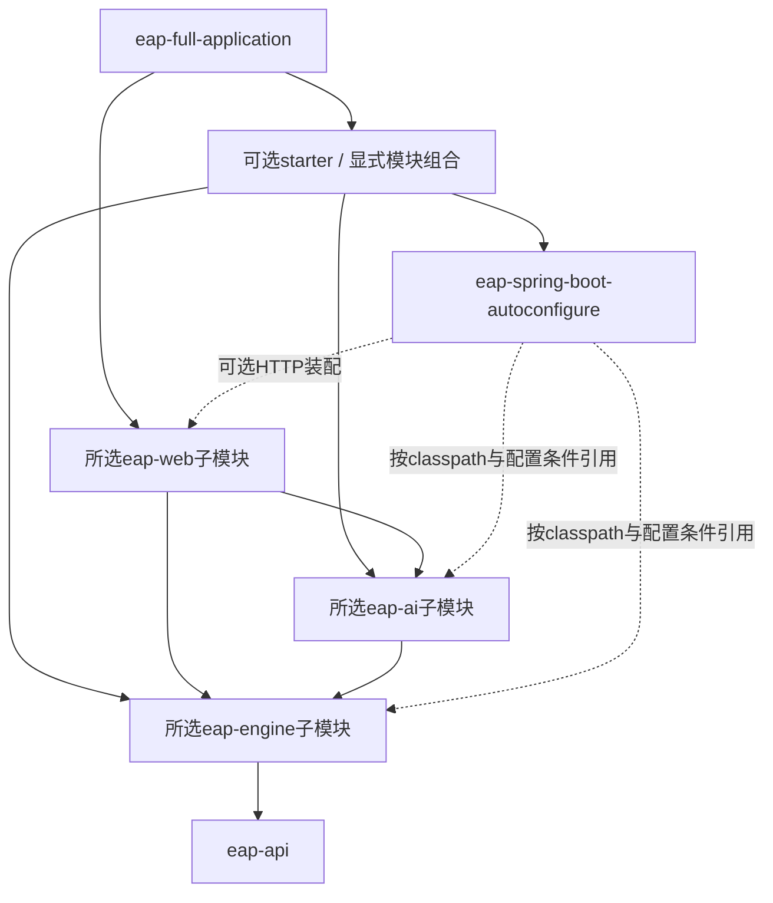

# 后端模块组合、Spring集成与应用宿主规划

状态：模块组合及十四轮边界调整已实施，后续复杂SQL证据修复纳入 `2c7e87b`。完整产品仍有明确跨域耦合，不将所有领域声明为独立可选。本文维护有效结构、复用合同与剩余关口；逐轮执行证据已归入[后端实施记录](../records/backend-composition-history.md)。

本决定统一此前[engine可选能力设计](agent-runtime-evolution.md#engine-optional-modules)，并纳入用户指定的`eap-applications/eap-full-application`。主方案、模块布局和台账只维护摘要，以本文件为目标结构的详细事实源。当前实现已使用六个顶层分组：api、engine、ai、web、spring、applications；旧runtime模块已退出reactor。AGENTS与启动脚本已同步，新宿主保持com.lh.eap.EapApplication。

<a id="target-layout"></a>
## 1. 目标结构

```text
backend/
  pom.xml                                  根聚合、版本和构建管理（POM）
  eap-api/                                 稳定跨域契约（JAR）
  eap-engine/                              确定性能力聚合（POM）
    eap-engine-core/                       通用能力、策略端口、执行生命周期
    eap-engine-local/                      工作区、Git/ripgrep、只读文件、CLI通道/存储端口
    eap-engine-sql/                        SQL解析、事实和规则、数据库分析
    eap-engine-knowledge/                  知识导入、检索、引用与授权
    eap-engine-mcp/                        MCP协议、会话及授权适配
    eap-engine-delivery/                   候选、基线、应用、验证、证据
    eap-engine-workflow/                   Task/Mission/Expert DAG/看板整合
  eap-ai/                                  AI业务与模型适配聚合（POM，分阶段）
    eap-ai-chat/                           Chat、上下文、会话与流式编排
    eap-ai-model-openai/                   OpenAI/Responses、连接与认证适配
    eap-ai-skill/                          Skill版本、解析、资源及生命周期
    eap-ai-codegen/                        模型候选解析、交付调用适配
    eap-ai-context/                        知识/Skill到Chat的可选上下文整合
    eap-ai-sql/                            SQL模型增强兼容桥及只读自主Agent
  eap-web/                                 HTTP适配聚合（POM，分阶段）
    eap-web-core/                         API防护、公共错误映射
    eap-web-local/                        工作区/本地工具HTTP适配
    eap-web-sql/                          SQL/数据库资料/SQL规则HTTP适配
    eap-web-knowledge/                    知识HTTP适配
    eap-web-mcp/                          MCP管理HTTP适配
    eap-web-workflow/                     任务/专家/看板/场景/原型HTTP适配
    eap-web-delivery/                     独立交付HTTP适配（有独立入口时创建）
    eap-web-ai/                           Chat/模型连接/Skill/生成HTTP适配
  eap-spring/                               Spring Boot集成聚合（POM）
    eap-spring-boot-autoconfigure/         条件装配、配置属性、生命周期连接
    eap-spring-boot-starter-core/          最小内核依赖集合（普通JAR）
    eap-spring-boot-starter-local/         本地能力依赖集合（普通JAR）
    eap-spring-boot-starter-ai/            常用Chat组合（普通JAR）
  eap-applications/                         应用组合聚合（POM）
    eap-full-application/                  当前EAP完整产品（唯一首期Boot可执行JAR）
```

这是一张目标职责图，不是一次性建目录清单。一个子模块须有真实职责、消费者和验证才创建。`web-delivery`暂列条件目标：当前Chat apply入口随web-ai，看板交付入口随web-workflow；不能为目录对称复制HTTP路由。未来确需独立交付API再建该模块。starter已落实core/local/ai；ai starter仅提供无供应商的Chat装配，模型适配由消费者显式引入；不为每个类生成starter。

`eap-runtime`的内容迁入`eap-applications/eap-full-application`，完成等价验证后移除旧模块，不留下两套主类/迁移目录/启动包。`runtime`一词仍可用于执行领域或前端runtime-client，不做无关名称替换。以后可增加其他明确的应用组合，但不预建空应用。

根POM和各聚合POM的`modules`仅定义构建关系；`dependencyManagement`定义版本，`dependencies`定义实际依赖，三者不混淆。父POM不得通过dependencies让所有子模块继承全部业务栈。所有模块仍在backend内；子模块用正确relativePath连接各自父POM；库模块为普通JAR，仅应用模块启用Boot repackage。

## 2. 各层边界

| 层 | 应拥有 | 不应拥有 |
|---|---|---|
| eap-api | 少量稳定能力/执行/授权契约、跨域值对象与SPI | Spring、HTTP状态码、模型SDK、所有领域DTO的大集合 |
| eap-engine | 确定性能力、授权/执行/持久化业务语义、工作流及交付 | Chat工具循环、具体模型SDK、HTTP控制器、应用主类 |
| eap-ai | Spring AI编排、模型协议适配、上下文/Skill与AI业务整合 | 确定性文件应用的最终授权、Task完成判定、HTTP容器 |
| eap-web | 请求校验、HTTP DTO/状态映射、SSE订阅和API防护 | 核心业务事务、模型执行生命周期、直接决定工具授权 |
| eap-spring | 条件装配、配置绑定、默认实现选择、宿主覆盖和资源销毁 | 第二套能力目录、业务规则、Provider框架、数据库DDL、产品主类 |
| eap-applications | 应用组合、产品默认配置/资源、启动/打包、完整应用验收 | 被库反向依赖的服务实现或可复用核心Bean唯一实现 |

**eap-api继续保留JAR。** 当前有14个Java契约（新增中立TaskRef）且POM无依赖，无需为对称改成聚合POM。只有以后出现真实独立版本/依赖需求才拆分；领域独占请求/DTO放所属模块。API表示Java契约，不表示HTTP API。

**eap-ai-model-openai与eap-spring不是同一职责。** 前者持有现有OpenAI/Responses/OAuth协议逻辑；后者只负责选择、构建和注册Bean。Chat使用Spring AI公开接口，不能因为拆模块重造Provider/记忆/工具循环。SDK供应商依赖不应由通用Chat模块强制带入。现有SQL缓存/回退的业务部分归SQL领域，模型调用桥归ai-sql。

**eap-spring不意味着立即清除所有Spring依赖。** api、core和基础local已形成无Spring/JDBC/模型依赖的复用边界；core的既有JSON清单/规则值对象显式依赖Jackson，不能宣称纯JDK零依赖；其他领域已有Spring/JDBC代码按切片隔离，不能把所有带注解的业务类搬入集成层。JdbcTemplate仓储实现仍按领域归属，后续有第二存储实现需求再拆基础设施模块；不建覆盖所有领域的全局jdbc模块。

## 3. 依赖关系与防环

箭头表示“依赖”。图中同层模块不表示互相依赖。



- core依赖api；local依赖core；sql/knowledge/mcp依赖core。通用knowledge不能依赖SQL词表；SQL需要知识时由SQL适配显式组合。
- delivery依赖core/local，通过任务绑定端口连接宿主；workflow实现Board任务适配并依赖delivery，delivery不得反向依赖workflow。BoardDeliveryService/BoardCodeTaskBinding归workflow整合，通用候选/Store归delivery。
- ai-chat不强制依赖codegen、workflow、sql或OpenAI供应商适配；ai-codegen依赖chat和delivery；ai-context依赖chat与显式选择的knowledge/skill组合；ai-sql依赖SQL服务端口及Spring AI模型接口。上下文整合初期组合knowledge+skill，不承诺每个资源已能单独裁剪。
- web-core不依赖任何业务实现；领域web依赖web-core及对应领域。web-ai首期是Chat相关HTTP组合，可能携带Skill/codegen依赖，必须如实标注；最小headless Chat消费者直接用ai-chat。进一步拆HTTP适配仅在独立组合验证有收益时进行。
- autoconfigure编译期涉及的可选领域依赖使用optional，并按配置类隔离；starter显式选择实际依赖。业务/HTTP模块不得反向依赖autoconfigure或starter。不得在顶层签名、静态初始化或扫描中提前加载缺失领域类型。
- 唯有完整应用显式选入全产品依赖；不提供被基础starter自动依赖的隐式all集合。API、engine、ai、web、spring任何库均不能依赖applications。
- 不制造整个横向模块互相指向的循环；SQL+专家工作流、AI+Board等跨域整合由上层适配或应用装配完成。

## 4. 按需启用的准确语义

| 关口 | 含义 | 必须验证 |
|---|---|---|
| 构建选入 | 消费者显式引入某个JAR/starter | dependency tree不拖入无关模型/数据库/Web栈 |
| Spring装配 | 类存在、模块配置启用、必需Bean满足 | 未选模块不创建Bean；用户自定义Bean能替换默认实现 |
| 依赖就绪 | 数据源/schema、模型连接或本地工具满足要求 | 未配置明确不可用；显式启用但缺必要依赖时失败或报告原因，不显示available |
| 能力授权 | 全局开关、专家/任务grant、工作区/参数和审批通过 | 缺授权拒绝；引入starter不能隐式扩大权限 |
| 业务验收 | 真正完成受控调用并留有证据 | HTTP成功、配置存在和Fake模型均不能替代真实验收 |

`eap-full-application`中的“全模块启用”定义为**组合全部已实现产品模块，装配相应入口和管理能力**。它不意味着自动填充密钥、信任MCP服务器、安装CLI、启用写权限或开启付费探测。模型未配置仍呈现not_configured，MCP仍需trust/grant，本地写入仍需确认。

自动装配沿用现有Capability/Handler/catalog；通过动态贡献接口去掉注册器对具体CLI/MCP类的认识，不引入另一套发现体系。库不广泛扫描com.lh.eap来强制加载全部领域，完整应用也使用受控装配。缺失模块与已安装但未配置的模块分别呈现；未安装模块的HTTP适配不注册，有明确产品兼容需要时才提供unsupported响应。

## 5. 耦合处理状态与剩余边界

| 边界 | 初始问题 / 当前限制 | 当前处理与剩余项 |
|---|---|---|
| CapabilityContext | 原引用ExpertExecutionService.Request、RulePack、SqlFactVocabulary | 已提取中立输入/执行范围，能力输入按领域分离；SQL事实校验留SQL适配 |
| CapabilityHandlerRegistry | 原持有CliOperationHandler/McpReadonlyHandler | 已使用动态贡献接口，保留冲突、启停和授权检查 |
| ExpertExecutionService | 原固定依赖SQL增强、规则与MCP会话 | 已通过ExpertAnalysisPolicy与ExecutionResource组合；SQL实现归sql，MCP实现归mcp；workflow仍因ExpertDefinition/目录等保留SQL/MCP模块依赖 |
| KnowledgeSearchHandler | 原依赖SQL事实词表和分析结果 | 已提供通用检索，由SQL整合侧转换请求 |
| CapabilityCatalog/Settings/CliChannels | 产品目录/CLI程序管理仍依赖JDBC与workflow，通道已独立 | Settings已依赖CapabilityUsageQuery；CliChannels及CliChannelStore已归local，JDBC事务归workflow适配；产品目录/程序审批整体组合仍待拆分 |
| AiChatApplication/TaskContext | 产品Chat仍组合模型/Skill/生成/Board | ai-context已通过ExpertKnowledgeAccess去除workflow依赖，保留行锁/授权复查；Chat用例的生成/工具贡献仍待拆分；TaskRef已中立 |
| CapabilityManagementController / McpManagementController | 原HTTP层持有事务与程序Mapper | MCP已独立；本轮清除Web事务/Mapper访问，CLI程序定位进入CliProgramService，MCP激活读改写归服务；CLI产品管理仍位于web-workflow |
| FullApplicationConfiguration | 原RuntimeConfiguration唯一提供执行器/工作区Bean | 已由spring提供可复用装配，完整应用显式选择产品Bean；保留覆盖/缺类/禁用回归 |
| CodeChangeService/BoardDeliveryService | 模型解释、文件应用与看板验收混合 | 按ai-codegen/delivery/workflow拆解；保留同源验证、UNKNOWN互锁及持久决定 |

不把拆分中的暂存包宣称为独立可选模块。某个切片暂时需要完整依赖时在台账列明，直到组合启动测试证实闭包已断开。

<a id="runtime-migration"></a>
## 6. 已实施的宿主迁移与兼容约束

下表保留旧宿主到新宿主的迁移对照。源码迁移和默认装配提取已完成；后续改动继续遵守资源唯一、工作目录与数据位置不变的约束。

| 旧宿主内容 | 当前落点 | 归属/保护要求 |
|---|---|---|
| EapApplication | eap-full-application/src/main/java | 保留主类com.lh.eap.EapApplication；全应用Boot入口 |
| RuntimeConfiguration | FullApplicationConfiguration与spring自动装配 | 默认库装配和产品选择已分开；不复制两套Bean |
| CliRetentionConfiguration | 新应用的同名配置 | 通用保留期装配可下沉spring，产品策略留应用 |
| BuiltinResourceSeeder | 新应用 | 完整产品内置专家播种；基础库加载不能写数据库 |
| application.yml及外置配置约定 | 新应用resources | 内容/本机值不改；部署外置配置与工作目录显式核对，不把本机配置当模板重写 |
| db/migration全部已存在SQL | 新应用resources/db/migration | 文件名、内容/校验和不变；保留classpath位置且每份资源只能出现一次；不clean/repair/baseline |
| experts/sql-expert.json | 新应用resources | 内置产品资源随应用；通用规则/Chat资源仍随所属库 |
| META-INF/spring-devtools.properties | 新应用resources | 更新子JAR匹配范围，避免同包跨加载器；重导入与真实重启单列 |
| 跨模块/启动/持久化门控测试 | 新应用src/test/java | 保留断言与环境门禁；纯单元测试再按实际依赖移动；库不能反向引用应用测试 |
| Boot插件、驱动、Flyway、Actuator | 新应用POM | 库不继承repackage；其他组合不自动获得全数据库栈 |

现有包名和HTTP/JSON先保持；构件坐标和文件路径改变需提供旧→新对照，不能宣称旧runtime JAR用户零修改。嵌套目录会改变测试和运行时相对路径，尤其当前架构测试以`Path.of("..")`定位backend：需改为可靠的reactor根定位或显式测试属性。工作区、相对数据根、产物和模型连接文件不得因新user.dir而悄悄迁移；验收时验证同一外置配置仍指向原数据。

已发现的同步入口包括：backend/AGENTS.md、根AGENTS.md、开发指南、architecture/module-layout、README/环境启动说明、`scripts/eap_bootstrap.py`、`scripts/verify-p0.ps1`、`scripts/check_deepseek_readonly.py`、`scripts/collect-sandbox-snapshot.ps1`、`scripts/sandbox-preflight-once.ps1`。实施时重新rg清点IDEA配置、桌面sidecar/安装器和其他脚本，不将本清单视为穷尽。历史记录保留旧路径并标历史，不机械改写过去的命令。

规划后的完整构建命令仍为`rtk proxy mvn -f backend/pom.xml clean verify`；选择宿主的目标命令为`rtk proxy mvn -f backend/pom.xml -pl :eap-full-application -am clean verify`。两者均指向已存在的新reactor；执行结果以当前实施记录为准。开发启动须先确保兄弟依赖可解析，不能对reactor所有库无差别执行spring-boot:run。IDEA运行classpath切换新应用，服务重启另验。

持久模块独立复用仍需明确schema合同。现有大基线不会因模块拆分自动变成按需DDL；本轮规划保留完整应用独占迁移历史。其他应用所需schema初始化/版本兼容为后续关口，不能复制一份V1进每个starter。

## 7. 消费组合与验收矩阵

| 组合 | 显式选择 | 不应被动带入 | 验收 |
|---|---|---|---|
| Java嵌入式本地能力 | api/core/local，手动构造授权/执行依赖 | Boot、Spring AI、JDBC、Servlet | 无Spring context完成有授权的只读操作；越界拒绝 |
| Boot本地能力 | starter-local | SQL、知识、MCP、模型、Web服务器 | ApplicationContext启动/覆盖/禁用；无DataSource不失败 |
| Headless Chat | ai-chat+模型适配，或明确的starter-ai组合 | Web、SQL、workflow、delivery | Fake模型测试、上下文与取消；真实模型另门控 |
| 本地文件HTTP | starter-local+web-core/web-local及显式Web运行依赖 | AI/SQL/knowledge | HTTP防护完整；禁用能力不可调用 |
| SQL分析 | sql及所需装配；HTTP时再加web-sql | MCP/Chat | 无模型可运行确定性分析；解析与数据库依赖分开验证 |
| 知识/MCP/交付 | 对应领域及实际存储/授权适配 | 无关领域 | 缺存储/授权拒绝，初始化不触发外部调用；明确schema前置 |
| 完整产品 | eap-full-application显式组合全部实际模块 | 未批准的外部插件/服务 | 现有回归、Boot包、迁移资源、API/SSE、互锁与安全边界保持 |

每个组合验证实际依赖树、缺失classpath（如FilteredClassLoader）、条件装配、用户Bean覆盖、开关与权限、初始化副作用。完整应用同时测试多个同类型执行器的限定注入、内置资源唯一性和所有需要的Controller被注册；最小组合必须证明没有无关Bean/路由，不能靠mock空Bean补齐全部依赖。

资源/生命周期验收保留：进程超时与后代清理、断线后执行、显式取消、事件终态/预算、UNKNOWN阻塞、知识撤权、Skill版本、MCP会话隔离。模块迁移本身不完成持久事件回放、跨重启进程接管或真实供应商验收。

## 8. 分阶段实施与范围控制

| ID | 当前实施范围 | 仍需完成/验收 |
|---|---|---|
| BM-01 | runtime源码/测试/资源迁入applications/full；唯一Boot宿主、主类不变、脚本/测试根定位已更新 | 当前IDEA新宿主classpath与原配置启动已验证；跨环境启动及业务验收仍独立 |
| BM-02 | core/local已独立；核心上下文不引用SQL/专家实现；动态Handler贡献与开关/查询端口已提取，Settings消费UsageQuery；CLI通道已下沉local并通过存储端口复用 | 产品CapabilityCatalog、CliProgramService/Mapper和JdbcCliChannelStore仍在workflow；完整CLI登记/审批/执行管理仍需数据库 |
| BM-03 | core/local/ai starter、缺类/禁用/覆盖条件装配；完整应用显式Import；默认本地根/能力调用拒绝 | 领域服务仍由完整应用显式组合；其他组合需要提供存储/授权端口，尚无每领域starter |
| BM-04 | SQL/knowledge/MCP/delivery/workflow七域分包；领域Handler归位；交付不依赖AI，TaskRef中立；ExpertExecution已改用分析/资源端口，ExpertDefinition/管理目录改用规则与专家范围能力查询接口，固定流程定义/调度已从专家服务提取到core，能力输入契约已归SQL/local领域，分析策略由宿主按专家解析并绑定单次执行；行为id/version已存入manifest并接通管理校验、授权生命周期及执行历史；新增Agent通过core授权/持久端口复用Task短事务；V23扩展原Task的检查点、租约和审批绑定，复用交付候选/应用与UNKNOWN互锁；V25记录不可变后台许可，SQL Agent自动续跑，专家页提供任务列表及候选审批 | 产品目录及其他服务仍组合SQL/MCP，workflow整体尚未独立；旧专家保留固定DAG，新v2已支持SQL只读Agent，角色/行为合同及阶段边界见[分阶段记录](agent-runtime-evolution.md#expert-agent-boundary)；完整产品显式选择SQL分析策略；JDBC交付Store因任务事务归workflow；schema按需裁剪未实施 |
| BM-05 | chat/model-openai/skill/context/codegen/sql六域分包；Chat不依赖供应商/交付/workflow；Skill、知识上下文及codegen均已去workflow依赖，原型查询通过delivery只读端口；model-openai补齐Responses函数工具协议，ai-sql复用Spring AI工具循环完成真实两轮候选审批验收 | codegen仍包含产品AiChatApplication和工具编排，并组合模型/knowledge/skill/delivery；context通过授权接口组合，产品行锁/授权适配由workflow提供；未完成所有Chat用例的可选贡献拆解 |
| BM-06 | core/local/sql/knowledge/mcp/workflow/ai七个HTTP模块；MCP控制器已独立，URL不变；管理事务和Mapper访问已下沉服务 | local只提供文件HTTP；CLI管理和Expert/SQL产品路由仍在web-workflow；产品目录/JDBC依赖未完全拆开；web-delivery无独立入口不建空模块 |
| BM-07 | 干净reactor、最小组合与完整Bean图、资源/模块归属验证；开发文档同步 | IDEA原配置启动已验证；SQL Agent普通Responses单文件整链已实测，其余实库业务/官方MCP/模型效果门禁独立；跨应用schema初始化/版本发布后续验收 |

BM-02与BM-03可在一个小的core/local闭包内交替落地，不能让临时整体依赖永久进入基础starter。宿主迁移先做等价切片，AI/Web拆分以组合收益驱动，不要求先拆完所有模块才恢复业务迭代。暂不创建BOM、动态插件加载器、多存储抽象层或每领域独立服务；版本对齐/发布策略出现真实外部消费需求再补。

本轮已执行源码迁移、条件装配和回归；实际构建数字见下方实施记录，不复用上轮759项充数。实施提交前必须同步主方案验收行、台账及本决定，记录实际模块/剩余闭包/失败与跳过，禁止用新目录存在代替可复用验收。

<a id="implementation"></a>
## 9. 当前实施与复用入口

保留已有实现与回归，不建立平行执行器或能力注册中心。CodeChange/Verification及Store契约迁至`com.lh.eap.delivery`；绑定TaskRef迁至`com.lh.eap.api`。JDBC交付实现仍归workflow模块，因为它们参与Board任务/原型/UNKNOWN互锁事务；其他交付消费者须提供自己的Store及DirtyRunner。原Java坐标/包名发生变化，HTTP/JSON保持兼容。迁移阶段的配置内容和原22份SQL迁移按字节保留；第十二轮另增V23/V24，第十三轮另增V25，不改已应用版本。

| 消费入口 | 实际使用方式 | 已知限制 |
|---|---|---|
| Java本地 | 依赖eap-engine-local，构造RuntimeWorkspace/WorkspaceFilesService、CliChannels或FileExecutionArtifactStore；原Git/ripgrep能力保留 | 显式指定授权根；仅JUnit的模块测试验证无Spring/JDBC/模型/Servlet类 |
| Boot本地 | 依赖eap-spring-boot-starter-local，设置eap.local.workspace及eap.runtime.authorized-root | 无授权根时读目录拒绝；库不默认授予文件权限；core registry没有CapabilitySwitches时默认拒绝；CLI通道默认只读，可覆盖CliChannelStore |
| Headless Chat | 依赖eap-spring-boot-starter-ai并提供ChatModel，或直接用eap-ai-chat的ChatClients | 每次调用需设置ChatMemory.CONVERSATION_ID；starter不自动提供凭据/供应商；真实模型效果另验 |
| Chat知识上下文 | eap-ai-context + ExpertKnowledgeAccess实现 + 既有knowledge.search Handler/能力开关 | 不依赖workflow/SQL/MCP；调用方提供同一事务中的专家行锁与实时授权读取；完整产品通过WorkflowExpertKnowledgeAccess复用原存储 |
| Chat原型与生成整合 | eap-ai-codegen + PrototypeVersionQuery实现；继续由既有CodeChangeService提供受控交付 | 无workflow/SQL/MCP依赖；仍带模型/knowledge/skill/delivery，非最小Chat；完整产品复用PrototypeVersionService，查询缺失/失败拒绝，任务绑定仍走原持久快照 |
| 本地HTTP | starter-local + eap-web-local + Web运行依赖 | 自动装配文件控制器和公共Host/Origin防护；不装入其他领域控制器 |
| 完整产品 | eap-applications/eap-full-application | FullApplicationConfiguration显式选入产品Bean；现有产品默认授权策略保留；Runner/生产启动不能以Mock装配替代 |

迁移、IDEA启动问题、专业Agent演进及真实供应商验证分别见[完整实施记录](../records/backend-composition-history.md)。各轮执行授权和门控独立记录，不将首轮限制或后轮成功套用到其他轮次。

启动目录：Maven `spring-boot:run` 显式固定到 `backend/`，与本检出已有 `.eap`、`.eap-ai-artifacts` 目录一致；自定义部署使用 `-Deap.run.working-directory=<原绝对目录>` 保持原相对路径基准。IDEA/JAR 保持原 working directory；未读取连接凭据、未移动数据。嵌套模块下直接运行时工作区检测也兼容原宿主的 backend 回退。

## 10. 验证与历史入口

当前代码基线、测试结果与未验收项统一见[验收台账](../planning-status.md#validation-baseline)。BM-01～07的剩余关口以第8节为准；跨环境组合、领域schema、产品目录/CLI登记审批、Chat产品编排和旧DAG长事务仍需按切片验证。

<a id="responses-tools-acceptance"></a>
### Responses函数工具与真实审批整链

完整原文已归入[后端实施记录](../records/backend-composition-history.md#responses-tools-acceptance)；此处保留旧链接入口。

<a id="stage-checkpoint"></a>
### 阶段提交 c76cded

完整原文已归入[后端实施记录](../records/backend-composition-history.md#stage-checkpoint)；此处保留旧链接入口。

<a id="complex-sql-acceptance"></a>
### 复杂SQL与知识边界验收

完整原文已归入[后端实施记录](../records/backend-composition-history.md#complex-sql-acceptance)；此处保留旧链接入口。

<a id="expert-workspace-navigation"></a>
### 专家界面分层与截图反馈

完整原文已归入[后端实施记录](../records/backend-composition-history.md#expert-workspace-navigation)；此处保留旧链接入口。

### 运行中宿主的独立产物命名（2026-11-11）

唯一full宿主build.finalName取自eap.application.final-name，默认值仍为artifactId-version。需要保留运行中宿主时可明确指定新名字完成同一套Boot package，不新增profile或宿主，不改运行数据路径。不要以clean/删除/覆盖正在使用的JAR解决重打包失败。当前新文件名reactor package退出0，Boot清单/165依赖/关键模块字节码/ZIP完整性已检查。该归档已通过独立 JVM 隔离启动：PropertiesLauncher 仅增加测试数据源配置，应用主类和生产依赖来自 Boot 包；健康、创建会话、查询模型历史均为 HTTP 200，自有 schema 和进程清理完成，模型调用为零。默认配置的普通 java -jar、日常库迁移及真实模型业务仍独立待验；此包为本轮入口依赖开发之前的产物，不能声称含后续源码。具体命令见agent-development-guide，证据见[台账](../planning-status.md#integration-build-source-check)。
