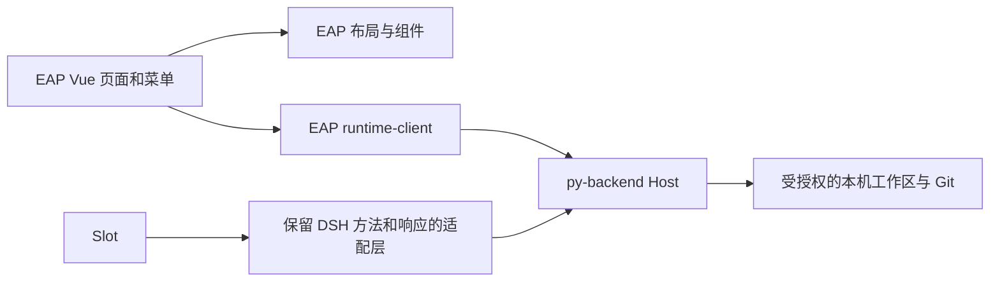

# 基于 dsh-personal 的 EAP Vue + Vite 定制版

状态：实施计划。首版以 dsh-personal 的 Vue 客户端组装和插件行为为基线，以本机 py-backend 为 Host。涉及插件宿主选型时，以本文为实施依据。EAP 基础包与后端分层背景见[前端基础包与 py-backend 分层迁移](frontend-py-backend-architecture-migration.md)。

## 首版交付目标

从 Vite 启动 EAP，左侧在「插件」上方显示「工作台」。工作台展示实际可用的使用统计和待办，点击待办进入对应任务。插件中心展示系统与会话共用的全局插件。聊天页右栏支持 dsh-better-sidebar 0.31.1，能展开目录、打开文件预览、查看 Git 变更和本轮文件。产品菜单采用 EAP 的品牌与术语，组装时排除 DeepSeek 官方登录、余额和账号入口，保留 EAP 的模型提供商设置。

首版关键路径是从固定的 dsh-personal 版本启动 Vue + Vite，跑通原插件，再接入 EAP 产品菜单及 Host。现有 EAP 前端用于盘点业务入口与复现差异。是否继续使用某个 EAP 模块，由该模块是否进入插件依赖闭包、以及能否通过基线用例决定。

## 目标结构

| 层 | 职责 | 初始落点 |
| --- | --- | --- |
| EAP 产品组装 | 工作台菜单、业务路由、任务与统计页面、品牌及账号入口取舍 | Vue + Vite 应用的产品入口及扩展注册 |
| EAP 业务页面 UI | 工作台等 EAP 自有页面的原语、主题、翻译和通知 | 按业务页面依赖复用现有 EAP 包 |
| DSH 插件宿主 | Cordis 客户端生命周期、布局与席位、标签控制、插件清单、渲染与资源加载 | 基于 dsh-personal 引入覆盖这一组职责的依赖闭包，作为定制版唯一的前端插件宿主 |
| EAP Host | 会话、安装与启停、工作区授权和本地文件/Git 操作 | `py-backend`。Web HTTP 契约通过 `@eap/runtime-client` 使用 |
| dsh-personal 来源 | 已验收基线、可复用模块、测试用例和升级工具 | `dsh-personal/` 及明确登记来源的导入代码 |



## 分阶段实施

### 0. 固定版本和插件验收样例

- [ ] 固定 dsh-personal 检出提交、已验收上游版本及 dsh-better-sidebar 0.31.1。在参考应用回放安装启停、侧栏停靠、设置弹窗、目录展开、文件预览与 Git。记录交互结果和 Host 请求。同步状态的 `pending` 作为候选记录。
- [ ] 由 dsh-personal 的 Web 启动入口追踪 Cordis 装配、公开出口及运行时依赖，覆盖 `ui-slots`、`ui-layout`、`ui-sidebar-right`、插件清单和 remotes。记录外部插件依赖的服务注入、生命周期、主题变量、图标、资源 URL 和 CSS 作用域。
- [ ] 用同一用例记录 EAP 当前差异，包括目录新开标签、关闭按钮和 Git 内容区域，形成后续验收清单。

**验收**　同一版本、同一临时仓库下可重放参考行为，并能从每个操作追溯到插件贡献点及 Host 调用。

### 1. 先跑通 dsh-personal Vue + Vite 和原插件

- [ ] 从 dsh-personal 的 Web 启动与客户端组装提取最小可运行闭包，成组引入布局、席位、renderer、标签控制、生命周期以及需要的主题与资源能力。在独立验证入口启动，登记来源仓库、提交、路径、许可证和关联测试。
- [ ] 先复用已实现的 Vue 代码。`AppFrame.tsx` 和 `PluginInventorySettingsTab.tsx` 已使用 Vue；仍使用 React 的必需组件以参考行为移植到 Vue，并验证其插槽、响应性及卸载行为。
- [ ] 用参考 Host 或明确标注的测试夹具验证完整插件链路。完成真实 Host 验收后再切换 EAP 正式调用方。若现有 EAP 席位或兼容层与引入的宿主同职，随调用方迁移收敛到一条生产路径；可保留通过等价验收的薄转发。

**验收**　同一插件通过原有贡献入口加载。目录原地展开，文件新开预览标签，关闭后回到原文件树。设置弹窗开关期间保持右栏挂载和按钮位置。核对图标、颜色、Git 标签和插件卸载。

### 2. 在已验证的壳上叠加 EAP 产品定制

- [ ] 通过壳的扩展入口在「插件」上方添加可深链接的「工作台」。插件导航与内置、全局插件清单来自同一个宿主注册和状态来源。EAP UI 基础包可用于工作台和业务页面；若要用于插件宿主内部，先通过该部分的参考用例。
- [ ] 接入真实使用统计与待办。现有 `/stats` 要核对指标口径，`/tasks` 当前固定返回空数组。待办应接项目任务板等权威数据，并显示加载、真实空态与错误状态。
- [ ] 在产品组装处排除官方账号菜单和设置贡献，保留模型连接。移除任何相关模块前先核对插件和公共服务的依赖。

**验收**　可从工作台进入插件、聊天和具体任务，刷新及键盘导航可用。回放阶段 1 的插件主流程，确认产品定制后仍通过。

### 3. 通过稳定入口接入本机 Host

- [ ] 逐方法登记调用者、原入口和参数、响应及错误、目标处理器、工作区作用域、授权和验证用例。调用契约以阶段 0 记录的 dsh-personal 基线为准。保留客户端服务名、方法、payload、请求路径与 envelope，在 Host 适配处替换实现。复用现有 EAP 工作区处理器前校验参数、响应和错误语义；有差异时在适配层转换或补齐 Host 能力。
- [ ] 先复验 `fs.tree`、`fs.read`、`/sidebar/write`、Git 状态/差异/历史/暂存/取消暂存。Web 和 DSH 调用共享现有本机工作区注册表，文件与 Git 功能作为全局能力注册。保存继续校验编辑基线，过期草稿返回 `fs-conflict`。
- [ ] 用临时工作区分批接入文件新建、重命名、删除、上传，以及 Git 提交、推拉、分支和工作树。每批核对 DSH 交互和权限。远端仓库操作和破坏性操作沿用相应的授权、确认及错误合同。能力发现只声明已实现且已授权的方法。
- [ ] 「本轮文件」从会话关联的实际操作记录读取。核对会话切换后数据隔离，区分尚无记录、接口失败与当前确有修改。

**验收**　点击目录在原树展开，点实际文件时新开预览标签，关闭文件标签后恢复原文件树。Git 能显示变更和内容，真实文件和索引测试使用临时仓库。独立 Web 接口与 DSH 入口读取同一状态，权限拒绝与保存冲突均可复现。

### 4. 把上游升级变成可重复流程

- [ ] 按 [dsh-personal 上游升级教程](../../dsh-personal/docs/cookbook/sync-dsh-upstream.zh.md) 固定已验收上游 B、目标 U 和 Personal 检查点 P。先取得完整 Git 差异，再与 EAP 导入清单求交集，并核对传递依赖和删除、重命名。
- [ ] 候选按契约、基础模块、消费者的顺序合入。运行 Windows 预检。Vue codemod 用于它明确支持的模式，插槽、焦点和异步订阅由定向用例覆盖。
- [ ] 记录目标提交、包路径、EAP 适配差异、许可证和验证结果。通过产物验证、Host 合同和工作台至插件的浏览器主流程后，才推进 EAP 导入基线。Personal 的同步状态由它既有的验收流程维护。

**验收**　用两个已知版本演练一次。评审者可从版本区间、包清单和测试结果复现导入范围，能定位到受升级影响的 EAP 适配。

## 每个切片的交付检查

从仓库根运行适用检查。命令与启动参数见[开发指南](../agent-development-guide.md)，测试强度见[架构方法](../architecture-method.md#sec-3-6-verify)。

```powershell
rtk proxy vp -C frontend run typecheck
rtk proxy vp -C frontend run check:boundaries
rtk proxy vp -C frontend build
rtk proxy python scripts/verify-domain-contracts.py
```

UI 变动验证实际 Vite 路由、插件资源加载和浏览器交互。Host 变动用对应 pytest 用例覆盖正常请求、权限拒绝和冲突。每次交付记录 passed、failed、skipped 和 unverified，并注明实际验证的版本和范围。
