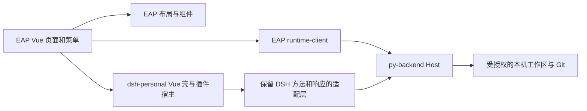

# 基于 dsh-personal 的 EAP Vue + Vite 定制版

状态：选项 2 的宿主迁移和本轮文件验收已完成。前端插件宿主采用 `__DSH_BOOT__` + 真实 `ui-*` 闭包，不以 `@eap/plugin-runtime` shim 为终态。py-backend 仍为 Chat / 安装启停 / Host 权威。正式切换生产入口前，须在独立 Boot 入口完成**真实 py-backend**合同与浏览器主流程；夹具或参考 Host 仅证明客户端装配。涉及插件宿主选型时，以本文为实施依据；L2 合同见[py-backend L2](py-backend-plugin-host-l2.md)。EAP 基础包与后端分层背景见[前端基础包与 py-backend 分层迁移](frontend-py-backend-architecture-migration.md)。

## 首版交付目标

从 Vite 启动 EAP，左侧在「插件」上方显示「工作台」。工作台展示实际可用的使用统计和待办，点击待办进入对应任务。插件中心展示系统与会话共用的全局插件。聊天页右栏支持 dsh-better-sidebar 0.31.1，能展开目录、打开文件预览、查看 Git 变更和本轮文件。产品菜单采用 EAP 的品牌与术语，组装时排除 DeepSeek 官方登录、余额和账号入口，保留 EAP 的模型提供商设置。

首版关键路径是从固定的 dsh-personal 版本启动 Vue + Vite，跑通原插件，再接入 EAP 产品菜单及 Host。现有 EAP 前端用于盘点业务入口与复现差异。是否继续使用某个 EAP 模块，由该模块是否进入插件依赖闭包、以及能否通过基线用例决定。

## dsh-personal 设计依据

先读[架构说明](../../dsh-personal/docs/architecture.zh.md)。其中「Profile 与组合包」用于定位参考组装，「桌面应用」说明静态 Web 资源如何等待 Host 注入，「会话日志」提供轮次文件投影的设计依据。按[浏览器组合包](../../dsh-personal/packages/bundle/web-app/README.zh.md)定位包与依赖。EAP 复用客户端组装、插件生命周期和契约，py-backend 负责 EAP 的运行与授权。参考 profile 用于对照验收。

## 目标结构

| 层 | 职责 | 初始落点 |
| --- | --- | --- |
| EAP 产品组装 | 工作台菜单、业务路由、任务与统计页面、品牌及账号入口取舍 | Vue + Vite 应用的产品入口及扩展注册 |
| EAP 业务页面 UI | 工作台等 EAP 自有页面的原语、主题、翻译和通知 | 按业务页面依赖复用现有 EAP 包 |
| DSH 插件宿主 | Cordis 客户端生命周期、布局与席位、标签控制、插件清单、渲染与资源加载 | 基于 dsh-personal 引入覆盖这一组职责的依赖闭包，作为定制版唯一的前端插件宿主 |
| EAP Host | 会话、安装与启停、工作区授权和本地文件/Git 操作 | `py-backend`。Web HTTP 契约通过 `@eap/runtime-client` 使用 |
| dsh-personal 来源 | 已验收基线、可复用模块、测试用例和升级工具 | `dsh-personal/` 及明确登记来源的导入代码 |



## 分阶段实施

### 0. 固定版本和插件验收样例

- [x] 固定 dsh-personal 检出提交、已验收上游版本及 dsh-better-sidebar 0.31.1。证据见 `docs/evidence/dsh-personal/eap-boot-baseline.md`；同步状态的 `pending` 仍保留。参考 e2e 历史通过；EAP+py-backend 浏览器回放仍见门禁文。
- [x] 由 dsh-personal 的 Web 启动入口追踪 Cordis 装配（`__DSH_BOOT__`、`ui-slots` seed、`ui-layout` / `ui-renderer` / `ui-sidebar-right`）；EAP 导入清单见 `eap-import-manifest.json`。
- [x] EAP 与参考差异清单已写入基线证据（新标签、关闭、Git 内容区）；浏览器对照仍 **unverified**。

**验收**　同一版本、同一临时仓库下可重放参考行为，并能从每个操作追溯到插件贡献点及 Host 调用。

#### 首次基线验证

- EAP 检查点为 `31f2ec05`，本仓库 dsh-personal 源码基线由 `0c55ad24` 引入。同步状态记录的已验收上游为 `39163dd30f703a79079e2d2446545cff3c453738`，候选仍保留在 `pending`。
- 参考 Web Host 已在临时 `DSH_HOME` 下启动并监听本机端口。参考应用的 Vite 入口依赖 Host 注入的 `__DSH_BOOT__` 和 `__ModuleLoader__`，以及启动前的资源加载配置。移植时保留此启动合同，由 EAP 入口提供经验证的接线。
- **Passed**　参考工作区的 `built-boot.expected.e2e.ts` 与 `client-plugin-live.e2e.ts` 共 8 项通过，覆盖已构建 Vue 宿主启动及插件夹具生命周期。
- **Passed**　参考入口与 EAP 候选入口已回放 Better Sidebar 0.31.1 的文件树、文件预览和 Git 差异。实际步骤见浏览器验收记录。

#### 参考 Host 的实际启动清单

隔离参考 Host，经其本地认证入口取得 HTTP 200。HTML 包含模块加载器和启动清单，清单有 76 个客户端条目、3 个加载批次。以下为采样到的启动边界。条目中的依赖以实际清单为准，源码 import 还需核对静态链接。

| 位置 | 观察结果 |
| --- | --- |
| Web 启动 | `AppWebEntry` 读取 `__DSH_BOOT_READY__`、`__ModuleLoader__` 和 `__DSH_BOOT__`，加载插件后由 `uiRenderer` 挂载。批次 URL 相对于文档。 |
| 席位和渲染 | `ui-slots` 由 Web seed 静态链接。清单中的 `ui-renderer` 注入模块系统。 |
| 布局 | `ui-layout` 注入 locale、renderer、session UI、theme 和 shortcuts。 |
| 右栏 | `ui-sidebar-right` 注入 session-controller、resources、conversation UI、layout、session UI、shortcuts 和 context-menu。 |
| 登录 | 官方账号设置是单独条目，注入 remotes、locale、chat UI、layout、settings 和 theme。删除条目前仍须核对反向依赖。 |
| 传输 | `connection` 是客户端清单条目。内置插件清单和 remotes 的装配形态需在完整闭包验证中继续定位。 |

现有 py-backend Host 对未注册方法返回 `ok: false` 和 `not-found`，因此「本轮文件」在接通会话操作流前属于不可用能力。暂存和保存等已登记写操作仍沿用权限拒绝和冲突合同。

### 1. 先跑通 dsh-personal Vue + Vite 和原插件

- [x] 独立验证入口 `@eap/dsh-boot-verify` + `@eap/dsh-boot` composer（fixture 装配证明）；导入清单已登记。完整 `AppWebEntry` + 真实 `lib/client.js` 闭包仍依赖 dsh-personal 工件链接。
- [x] 前端默认 dev / build / preview 使用实际 AppWebEntry 和 EAP 启动图。旧 Web 已移除 DshBootHost 组件及挂载。
- [x] 真实 AppWebEntry、py-backend 和 Better Sidebar 的浏览器主流程已验收，随后切换前端仓库默认入口。

**验收**　同一插件通过原有贡献入口加载。目录原地展开，文件新开预览标签，关闭后回到原文件树。设置弹窗开关期间保持右栏挂载和按钮位置。核对图标、颜色、Git 标签和插件卸载。

**切换范围**　默认 Web 面向 py-backend，提供工作台、基础任务板、会话和 DSH 插件。任务运行、验证与交付是 EAP 自有的 Java 工作流，本次确认暂不迁移。旧 Web 的显式业务入口仍可用于 Java 工作流，DSH 过渡宿主挂载已退役。

### 2. 在已验证的壳上叠加 EAP 产品定制

- [x] 「工作台」位于插件前（`#overview`）；插件启停权威为 py-backend。
- [x] `/stats` 与 py-backend `GET /board/tasks`（及详情）同一轨；深链接合同 pytest 覆盖。
- [x] EAP overlay 排除官方账号相关 client 行；保留模型提供商设置。

**验收**　可从工作台进入插件、聊天和具体任务，刷新及键盘导航可用。回放阶段 1 的插件主流程，确认产品定制后仍通过。

**EAP 侧已实现**　现有 Web 新增 `#overview`，左侧「工作台」位于「插件中心」前。py-backend 的 `/stats` 按实际入库记录统计近七天的新会话与用户消息。待办复用项目任务板接口与任务深链接，支持部分项目读取失败。py-backend 已提供任务列表、详情、创建与更新，候选宿主已验证工作台、任务就绪流转和任务深链接。EAP 自有的任务运行、验证与交付继续由 Java 工作流提供。

### 3. 通过稳定入口接入本机 Host

- [x] Host 方法经 `registry` / `host_bridge` 登记；基线追溯见 `eap-boot-baseline.md`。envelope 保持 DSH `{ok,value|error}`。
- [x] `fs.tree` / `fs.read` / write / Git 读写与冲突合同由 `test_host_bridge_fs_errors.py` 覆盖。
- [x] 文件新建、建目录和重命名已接入 Web 与 DSH 的共用工作区注册表。保持 `path` / `name` 请求与 `{ path }` 响应，使用临时工作区覆盖授权、同名冲突和范围限制。
- [x] 接入 DSH 树内删除与二进制上传，Web 与 DSH 共用处理器。上传最多 16 MiB，采用独占落盘以保留已有文件。Web 删除要求显式确认，DSH 保留插件现有确认交互。
- [x] Git 提交、本地分支列表与切换、已链接工作树列表与选中已接入。Web 与 DSH 共用处理器。临时仓库覆盖提交只影响所选工作树、禁用写入、拒绝越界工作树与拒绝选项式分支名。
- [x] Git 推拉复用配置的上游分支，由本机写授权和单独的远端 Git 开关控制。临时 bare 仓库验证推送、快进拉取、拒绝分叉及权限关闭。
- [x] 接入 `/sidebar/ws/fs-watch` 与 `/sidebar/ws/agent-opens` 同源通道。Chromium 验证握手及临时目录变更帧；服务端打开意图按会话隔离。真实插件运行时建立两条连接，停用后两条连接均关闭。
- [x] 工作树创建/删除本轨不暴露；列出/选择已实现。能力发现只声明已实现方法。
- [x] 「本轮文件」：通过真实模型服务的自主文件读取验收。Chromium 从 DSH 对话提交请求，模型调用受工作区约束的读取工具，Better Sidebar 在同一会话显示实际读取的源文件。

**验收**　点击目录在原树展开，点实际文件时新开预览标签，关闭文件标签后恢复原文件树。Git 能显示变更和内容，真实文件和索引测试使用临时仓库。独立 Web 接口与 DSH 入口读取同一状态，权限拒绝与保存冲突均可复现。

### 4. 把上游升级变成可重复流程

- [x] B / U / P 固定；与 `eap-import-manifest.json` 交集流程见 `eap-upgrade-drill-2026-11-26.md`。未晋升 accepted。
- [x] 对 U 的隔离工作树重跑 Windows 预检，输出 10 条待审项；本次未合入 pending。
- [x] 适配差异与验证结果已记录；浏览器主流程仍为晋升阻断项。

**验收**　用两个已知版本演练一次。评审者可从版本区间、包清单和测试结果复现导入范围，能定位到受升级影响的 EAP 适配。

## 每个切片的交付检查

从仓库根运行适用检查。命令与启动参数见[开发指南](../agent-development-guide.md)，测试强度见[架构方法](../architecture-method.md#sec-3-6-verify)。

```powershell
rtk proxy vp -C frontend run typecheck
rtk proxy vp -C frontend run check:boundaries
rtk proxy vp -C frontend build
rtk proxy python scripts/verify-domain-contracts.py
```

UI 变动验证实际 Vite 路由、插件资源加载和浏览器交互。Host 变动用对应 pytest 用例覆盖正常请求、权限拒绝和冲突。每次交付记录 passed、failed、skipped 和 unverified，并注明实际验证的版本和范围。
