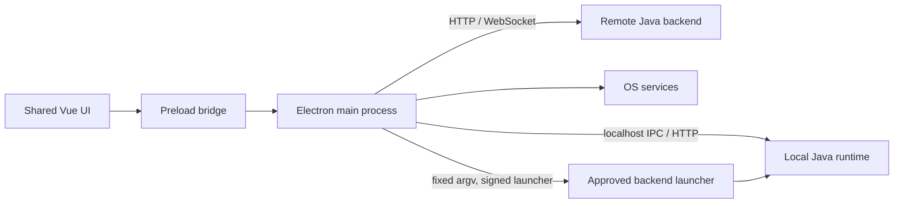

# Desktop frontend specification

## Decision

The frontend is a shared Vue application with two delivery targets:

```text
packages/ui + packages/domain
          ↓
apps/web       browser deployment
apps/desktop   Electron desktop shell
```

The desktop target is built on **Electron**. It ships one bundled Chromium and one bundled Node
runtime, so the console renders identically on Windows, macOS, and Linux, and the shell can speak to
the local Java runtime from the same main process. Electron keeps operating-system access behind
`contextBridge`: the renderer never touches `electron`, `fs`, or `child_process` directly, and every
capability is an explicit IPC channel validated in the main process. [Electron](https://www.electronjs.org/docs/latest/),
[Context isolation](https://www.electronjs.org/docs/latest/tutorial/context-isolation)

This decision was taken deliberately after Tauri 2 had been the working assumption. Tauri 2 remains
a technically sound option and is not ruled out for the future; the reasons for the change are in the
next section, and the conditions that would justify going back are recorded under *Reconsideration
triggers*.

## Why Electron instead of Tauri

This is a delivery decision, not a claim that Tauri is incapable. Both shelve the same Vue UI behind
the same `DesktopPlatform` contract. The deciding factors were:

1. **One rendering engine, pinned by us.** A desktop acceptance criterion is that task, Master,
   Expert, knowledge-base, and rule screens behave identically on web and on the desktop. A bundled
   Chromium makes "identical" a property of the build rather than a property of the operator's
   machine, and removes the WebView2 / WKWebView / WebKitGTK version matrix from the QA surface.
   [Chromium support in Electron](https://www.electronjs.org/docs/latest/tutorial/electron-timelines)
2. **The shell's real work is process and log handling around a Java runtime.** Launching a signed
   backend launcher, supervising its lifetime, tailing its logs, and probing `/api/health` are Node
   problems with mature, boring solutions. Doing the same from a Rust core duplicates a boundary that
   the frontend team would then have to maintain in a second language.
3. **One language across the whole renderer boundary.** Main process, preload script, and frontend
   are all TypeScript. The IPC surface is reviewable by the people who own the UI, which matters more
   here than a smaller artifact: an unaudited privilege boundary is a worse outcome than a larger
   installer.
4. **Ecosystem coverage for packaging, signing, and auto-update.** Windows, macOS, and Linux
   installers, notarisation, and update channels are configuration rather than custom work.

The costs are real and accepted:

- **Larger artifact.** Chromium and Node are bundled instead of borrowed from the OS.
- **A wider default boundary.** Electron's renderer is privileged by default in ways that have to be
  turned off explicitly. The security posture in this document is therefore *configured*, not
  inherited — `nodeIntegration: false`, `contextIsolation: true`, `sandbox: true`, a preload that
  exposes a hand-written allow-list, and main-process validation of every argument. This is the main
  ongoing cost of the decision and the reason the boundary rules below are mandatory rather than
  advisory. [Electron security](https://www.electronjs.org/docs/latest/tutorial/security)
- **More runtime to track.** Electron releases track Chromium closely; the version is pinned in the
  build and upgraded deliberately, with the contract tests re-run.

## Migration risk and portability strategy

There is a real migration risk if Electron becomes part of the application domain. The project must
therefore treat Electron as a replaceable shell, not as the desktop architecture itself.

```text
Shared Vue application
├─ domain / task state / Master UI
├─ API client
├─ desktop platform contract  ← stable boundary
│  ├─ electron adapter        (current)
│  └─ Tauri adapter           (possible later)
└─ web adapter
```

The shared application may depend on a small `DesktopPlatform` interface, for example:

```ts
export interface DesktopPlatform {
  chooseWorkspace(): Promise<string | null>
  showNotification(input: NotificationInput): Promise<void>
  openExternal(url: string): Promise<void>
  getPlatformInfo(): Promise<PlatformInfo>
}
```

Vue components must call this interface or a composable, never `electron`, `@electron/remote`, or a
preload global directly. Window handles, IPC channel names, main-process services, and sidecar
supervision remain inside `apps/desktop/platform/electron`. A future Tauri implementation can satisfy
the same contract through its own commands.

### Portability rules

- Keep task, Master, Expert, knowledge-base, rule, and validation logic in Java/backend or shared TypeScript domain code.
- Keep filesystem and process execution behind backend APIs whenever possible.
- Limit desktop-specific APIs to workspace selection, notifications, window controls, secure preferences, and approved sidecar launch.
- Define contract tests that run against Web and the desktop shell, so the adapter can be replaced under them.
- Do not persist Electron-specific object shapes in task data or backend APIs.
- Do not make Electron, Node, or preload types part of shared frontend packages.
- Do not expose `ipcRenderer` itself through the bridge; expose named functions only.

With this boundary, migration is a shell replacement project rather than a rewrite of the frontend.
The cost is still non-zero: packaging, auto-update, signing, filesystem permissions, IPC behaviour,
and platform QA must be reimplemented and verified.

| Decision factor | Tauri 2 | Electron | Project choice |
|---|---|---|---|
| Renderer | OS WebView (WebView2 / WKWebView / WebKitGTK) | Bundled, pinned Chromium | **Electron**; identical rendering across platforms |
| Native boundary | Rust core plus capability files | Node.js main process plus IPC | **Electron**; the shell's work is Node-shaped (process supervision, log tailing) and stays in one language |
| Default exposure | Narrow by default; capabilities declare what is allowed | Wide by default; must be closed down explicitly | **Tauri advantage** — Electron's posture has to be configured and then kept configured |
| Existing UI | Reuses Vue/Vite | Reuses Vue/Vite | Tie |
| Local Java backend | Permissioned sidecar or local service | Main-process launcher and supervisor | **Electron**; no Rust layer needed around `spawn` and health probes |
| Artifact/resource footprint | Generally smaller because WebView is supplied by the OS | Larger because Chromium and Node are bundled | **Tauri advantage** — accepted cost of the decision |
| Rendering consistency | Depends on WebView2/WKWebView/WebKitGTK versions | Consistent Chromium version | **Electron**; supports the "identical screens" acceptance criterion |
| Ecosystem and Node modules | Smaller desktop ecosystem; native work may require Rust/plugin | Mature Node desktop ecosystem | **Electron** |
| Packaging, signing, auto-update | Available, more custom work | Configuration-level | **Electron** |
| Best fit | Secure, capability-scoped shell with a minimal footprint | Chromium-first desktop product with Node-side process work | **Electron for this repository** |

Two rows are honest losses for Electron and are recorded as such: default exposure and footprint.
The mitigation for the first is the configured posture described in *Security posture*; the second is
accepted, because installer size is not a product constraint for an internal engineering console.

## Security posture

Because Electron's renderer is privileged by default, the boundary is defined here explicitly. Tauri
gets this from a capability file; Electron gets it from configuration plus a hand-written bridge.

```text
Renderer (Vue app)
  │  window.eap.chooseWorkspace() / showNotification() / openExternal() / getPlatformInfo()
  ▼
Preload (contextBridge)      ← the only surface; named functions, no ipcRenderer passthrough
  ▼
Main process                 ← validates every argument, holds fs / dialog / shell / child_process
  ▼
Operating system
```

Non-negotiable renderer settings:

- `nodeIntegration: false` — the renderer has no `require`, no `fs`, no `child_process`;
- `contextIsolation: true` — page script and preload run in separate contexts;
- `sandbox: true` — renderer processes run sandboxed;
- `webSecurity` on, and navigation plus `window.open` restricted to an allow-list so the window can
  never be steered to a remote document;
- every IPC handler treats its arguments as untrusted: paths are resolved and prefix-checked against
  the selected workspace, URLs are re-validated in the main process even though the UI already did.

The operation history is written in the main process, not the renderer. The threat here is not a
"compromised page" in the multi-user sense: there is one operator. It is that the renderer displays
*untrusted data* — repository contents, model output, MCP responses — and a record the page could
edmit is a record the operator cannot trust when reconstructing what happened. The same rule is
stated on the prototype's permissions page.

## Desktop versus web

| Concern | Web | Desktop |
|---|---|---|
| UI | Shared Vue routes and components | Same Vue routes and components in the packaged Chromium |
| Runtime | Remote backend API | Local backend connection or bundled local runtime |
| Workspace | User selects a remote/project URL | User selects local workspace directory |
| Git/SVN/Shell | Backend executes them | Backend service or approved sidecar executes them |
| File access | Upload/API scope | Main process reads only the selected workspace directory |
| Notifications | Browser permission | Main-process `Notification`, no browser permission prompt |
| Updates | Refresh the local build | Signed installer and update channel |
| Scope | Both targets run on this machine; neither is a remote deployment | |
| Offline mode | Limited | Optional local-first task queue and cached observations |

## Desktop shell boundaries

The Electron shell may provide only platform services:

- workspace folder selection;
- native window and menu behaviour;
- notifications;
- secure storage for non-secret local preferences;
- opening an external URL;
- launching explicitly approved sidecars.

The shell must not contain task planning, Master decisions, Expert authorization, or validation logic.
Those remain in the Java backend so web and desktop clients have identical semantics. The main process
is a service host, not a second application domain — it contains no domain rules, and no renderer-reachable
channel performs a domain action.

## Local runtime options

The first desktop release should use a separately started Java backend connection. A later distribution
can bundle a Java runtime and backend launcher as a signed sidecar. Sidecar execution must be explicitly
permissioned, argument-scoped, recorded, and bounded: the main process spawns the signed launcher with a
fixed argument array, never through a shell, and the channel that starts it is the only path to it. The
renderer cannot name a binary, pass a flag, or influence the environment.



## Desktop acceptance criteria

- The same task, Master decision, Expert, knowledge-base, and rule screens work on web and desktop.
- A desktop task can select a local workspace without granting unrestricted filesystem access.
- Every OS operation is represented by an explicit shell capability and is recorded in the operation
  history, so it can be reconstructed later.
- Closing the window does not lose task state; running tasks are resumed or marked interrupted.
- Windows, macOS, and Linux builds run the same contract and conformance tests.
- No Node REPL, arbitrary JavaScript execution, or unrestricted shell is reachable from the renderer.
- The renderer bundle contains no direct `electron`, `fs`, or `child_process` import; only the preload
  bridge crosses the boundary.

## Reconsideration triggers

Re-evaluate Tauri only if at least one of these becomes a hard requirement:

- installer or runtime footprint becomes a product constraint (for example a managed-fleet rollout
  with a hard size or memory ceiling);
- the shell stops being a shell and the main process gains enough logic that a Rust core would be the
  smaller risk — which would itself violate the boundary rules above;
- a security review decides that a capability-file model with a narrow default is required, and the
  configured posture proves too easy to regress in practice;
- keeping an upgradeable, pinned Chromium becomes more expensive than accepting per-platform WebView
  differences.

## Implementation order

1. Extract shared UI and typed API/domain packages.
2. Add `apps/desktop` Electron shell with the configured security posture, a preload bridge exposing
   only the `DesktopPlatform` functions, and a read-only Overview and Task detail screen.
3. Add workspace picker and backend connection settings.
4. Add sidecar supervision for the local runtime, with fixed argv and main-process validation.
5. Add native notifications, update channels, signing, and platform CI builds.
6. Add a bridge-boundary test: a renderer import of `electron`, `fs`, or `child_process` fails the build.
