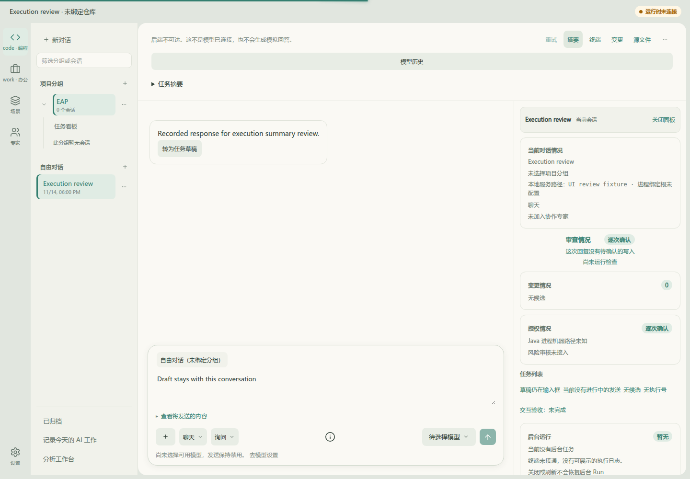
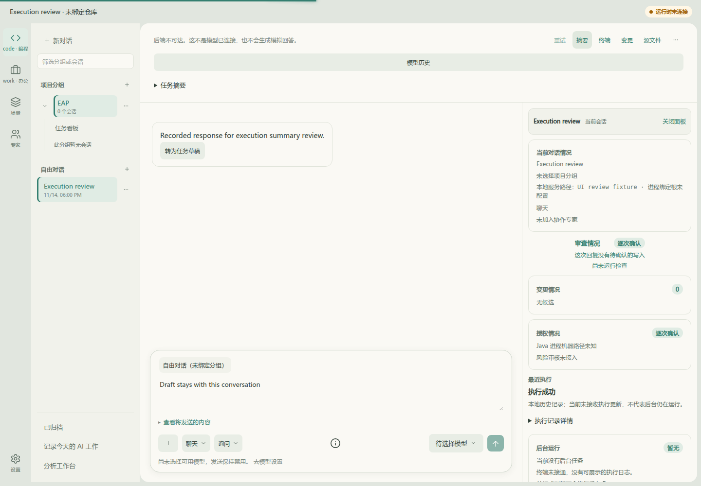
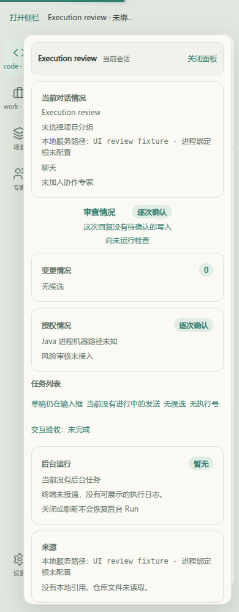
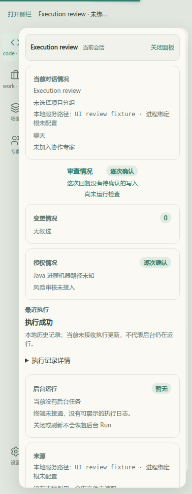

# 聊天摘要执行投影：Before / After

基线：`34fb18fbde034df4dfb7c8b07caa24c53a25e306`。After：`f8d4712e1b6974522c2b950c3c2e05e30ed9006a`，执行投影与上下文连接编辑器共同验证的G1源码版本；截图采集于该提交的相同源码工作树。随后提交仅补齐证据版本引用。

截图来自实际EAP Vue应用，不是重画的示意图。相同浅色主题、1440×1000 / 390×1000、同一浏览器本地会话夹具与`SUCCEEDED`历史执行记录。网络拦截仅提供只读夹具并拒绝写入，不连接真实后端/模型；页面明确显示后端不可达。这验证的是历史证据展示和会话隔离，不是实际模型执行、后台恢复或用户接受。

| 视口 | Before：固定步骤无视真实历史执行 | After：按当前会话的最近执行展示并注明历史观察边界 |
|---|---|---|
| 1440×1000 |  |  |
| 390×1000 |  |  |

复现脚本：[浏览器验证](../../../frontend/apps/web/__tests__/browser/chat-execution-summary-live.mjs)。从根目录设置`EAP_PLAYWRIGHT_MODULE`、`EAP_CHROMIUM`及可选`EAP_SUMMARY_BASE`，执行`node frontend/apps/web/__tests__/browser/chat-execution-summary-live.mjs before`或`after`；脚本加载实际应用，种入明确的本地历史夹具并禁止后端写入。

已核对：执行ID与成功状态被读取，旧固定步骤已移除；切到新草稿后显示无执行记录，不泄漏前一会话执行身份；两个草稿均保留，两个视口无pageerror。记录状态不等于当前仍在执行；UNKNOWN/取消中/终态及未收到执行身份由组件和会话回归分别覆盖。原候选应用、验证与人工接受仍是独立证据。
