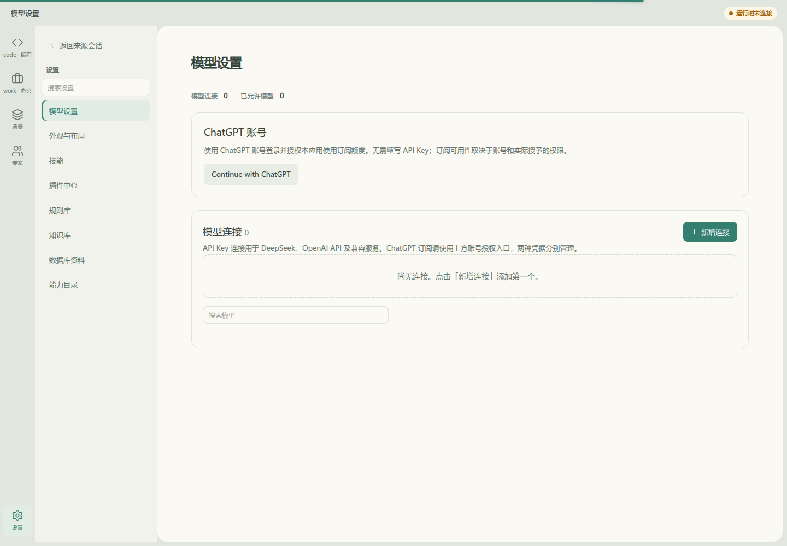
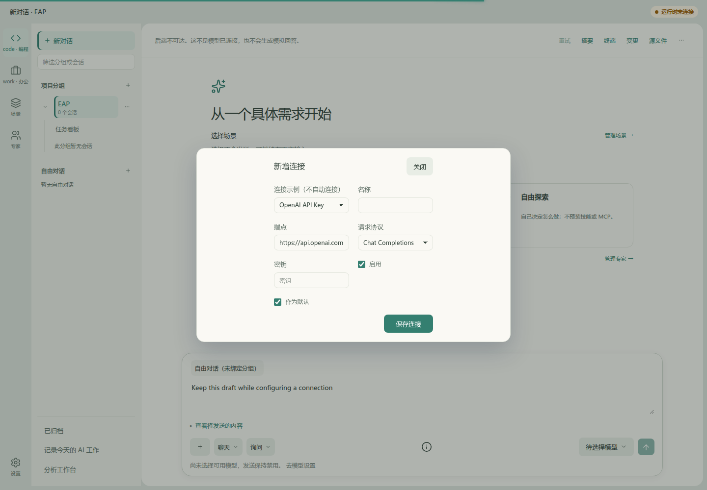
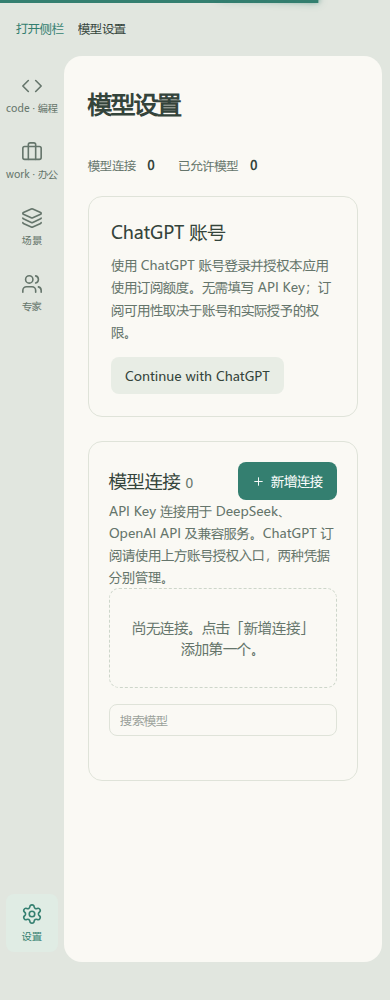
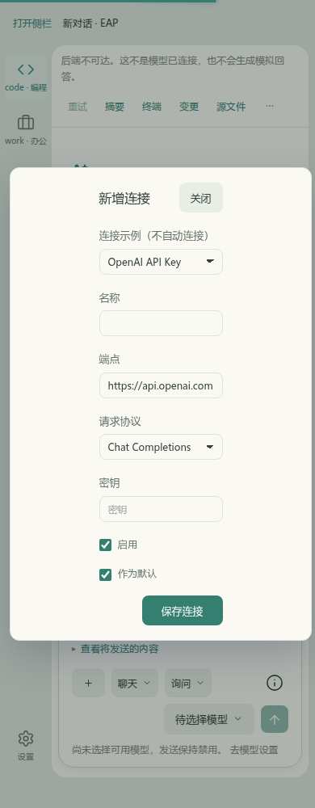

# 聊天内连接配置：Before / After

基线：`34fb18fbde034df4dfb7c8b07caa24c53a25e306`。After为本PR的G1共享编辑器实现；最终变更提交及验证结果由PR说明标识。

相同场景：实际应用`#chat`、未选择模型、草稿`Keep this draft while configuring a connection`，点击模型选择器中的连接设置入口。相同浅色主题，1440×1000及390×1000。只读HTTP夹具返回空连接目录，其余请求返回明确失败；无真实凭据、后端写入、模型或供应商调用。

| 视口 | Before：设置动作跳离聊天到全页目录 | After：同一动作在原对话打开共享连接编辑器 |
|---|---|---|
| 1440×1000 |  |  |
| 390×1000 |  |  |

[浏览器脚本](../../../frontend/apps/web/__tests__/browser/chat-model-context-live.mjs)加载实际Vue组件；`before`核对原`#model-settings`跳转，`after`核对仍在`#chat`并保留草稿。截图为实际应用捕获，不是模型生成的旧界面。表单、协议选择、凭据处理、保存、模型目录及未保存确认复用同一领域编辑器，完整设置工作面继续可用。

未证明：真实供应商目录发现、真实连接调用、DSH原生插件、用户交互接受或全站交互迁移。键盘/未保存/保存失败/读回恢复与离开保护已按[验证记录](../../records/chat-g1-validation.md)通过自动回归和上述浏览器交互；不把这些技术结果升级为用户接受。
