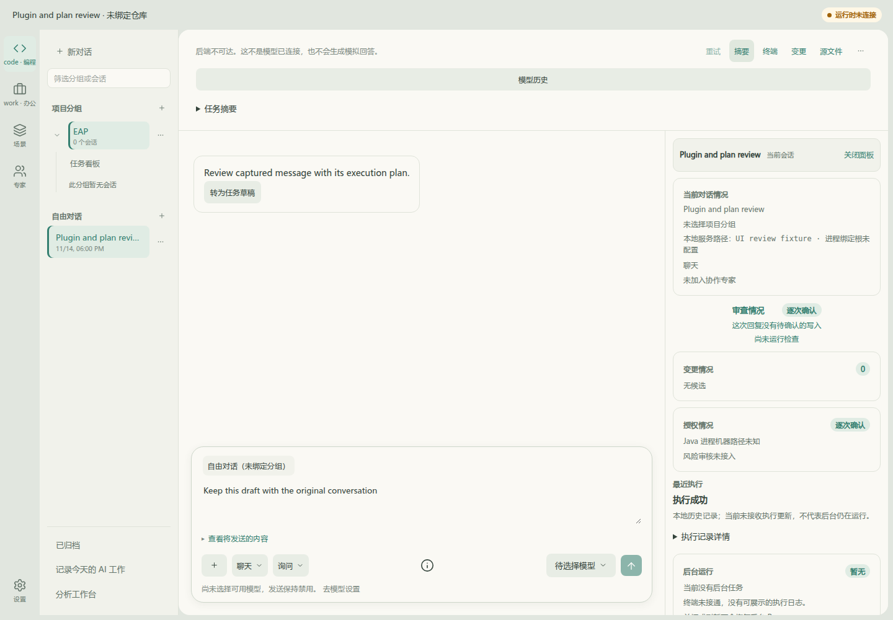
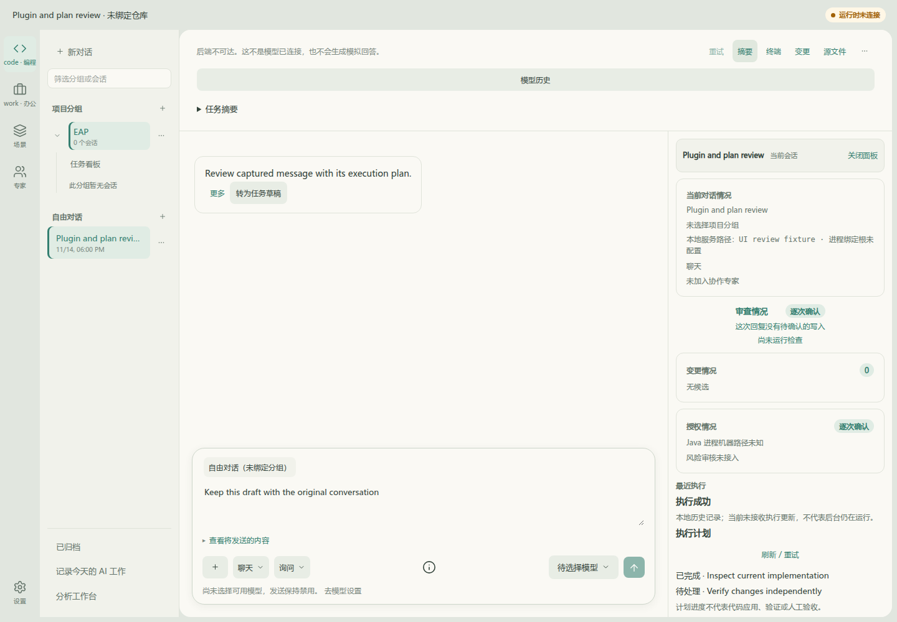
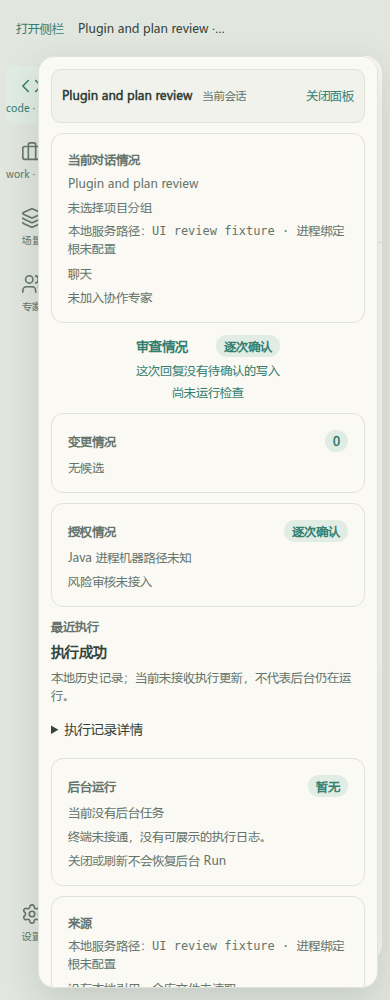
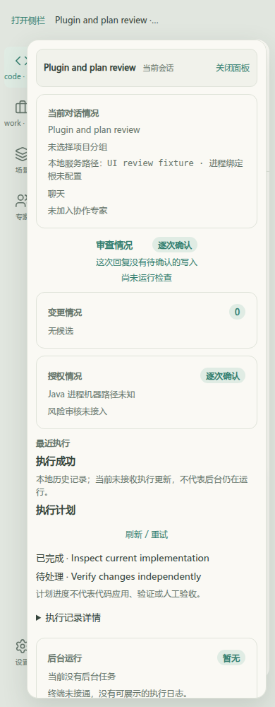

# 内置执行计划：Before / After

真实应用对比，固定基线`35ff91ab556b8357d5c42d26be0db2fddb73794c`；After源码`94505934471356eb335ca3703f7e549fc53f0a22`，截图采集于该提交相同源码工作树，随后提交仅补版本引用。相同浅色主题、1440×1000 / 390×1000、同一conversation/execution与历史SUCCEEDED回复、相同未发送草稿、摘要打开状态。HTTP GET只读夹具返回同一revision2的两条计划；基线尚不读取或展示该合同，After调用实际生产GET/观察器/摘要组件。没有模型或后端写入。

| 视口 | Before：执行记录，无结构化计划 | After：后端快照投影的计划与独立证据边界 |
|---|---|---|
| 1440×1000 |  |  |
| 390×1000 |  |  |

[基线脚本](../../../frontend/apps/web/__tests__/browser/chat-plugin-plan-baseline.mjs)、[变更脚本](../../../frontend/apps/web/__tests__/browser/chat-plugin-plan-live.mjs)共享[同一夹具](../../../frontend/apps/web/__tests__/browser/chat-plugin-plan-fixture.mjs)。已核对完整两项及completed/pending展示、revision2持久观察、当前会话/执行/草稿保持、零pageerror及零API写入。计划completed不是代码应用、独立验证或人工接受。浏览器HTTP夹具不证明后端持久化；真实JDBC/PostgreSQL及模型工具回归分别见[验证记录](../../records/chat-plugin-plan-validation.md)。
