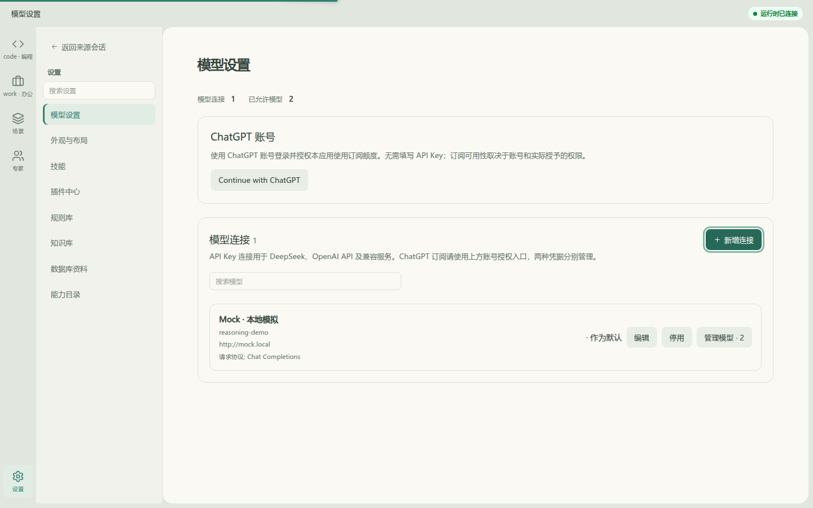
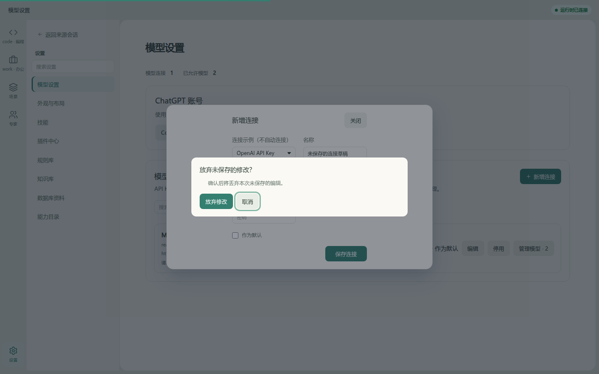
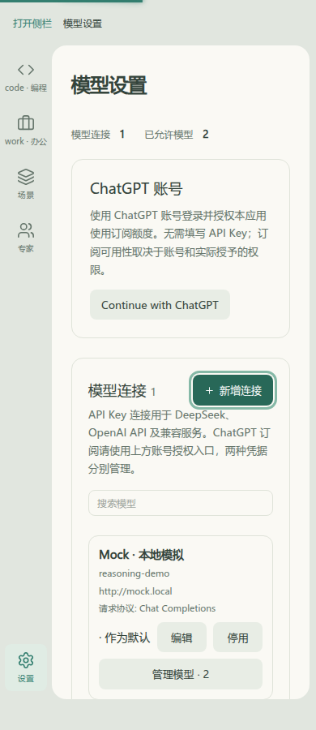
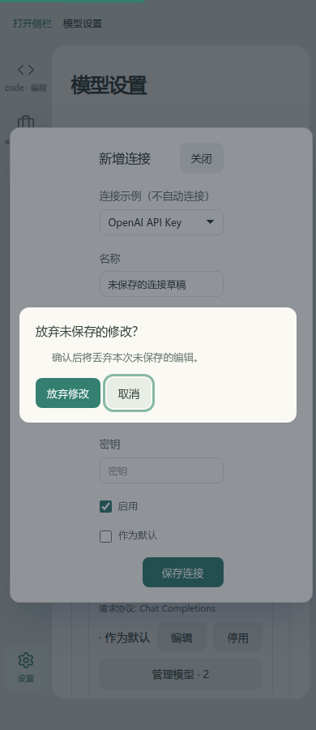

# 模型连接表单的未保存关闭保护（2026-11-14）

## 问题、范围和处理

在“设置 → 模型设置 → 新增连接”输入名称后按Escape，旧实现立即关闭，重新打开后名称丢失；编辑已有连接、点击关闭或遮罩也走相同直接丢弃路径。该问题在合并PR #3后的`c02b64d`基线上用实际应用复现。

本片只修改ModelSettings的连接表单：初始化后保留六个字段的内存比较快照；字段改变时，三种关闭入口统一打开现有`@eap/ui` ConfirmBox。取消保持表单，明确放弃后清空本次密钥输入并关闭；没有修改或改回初值时直接关闭。保存中不允许关闭，保存失败保留草稿及关闭保护。复用已有product中英文文案，不新增提示词或平行弹窗。比较快照的初始密钥始终为空，不把输入的密钥写入localStorage/sessionStorage。

共享落点检查：已搜索ConnectionDialog/ConfirmBox → 归settings L4局部状态 → 写入现有ModelSettings → 无新增包/暂存 → architecture及UI/消费方回归通过。

## Before / After

同为实际应用、独立HTTP Mock后台数据、默认浅色主题。两侧执行同一动作：新增连接 → 输入“未保存的连接草稿” → Escape。基线为`c02b64d`；After为本PR实现提交（准确revision见PR）。没有填写密钥、保存连接、请求外部模型或写日常数据库。Before已直接关闭，After仍保留输入并提供放弃确认。四张截图均已查看。

| 视口 | Before | After |
|---|---|---|
| 1440×900 |  |  |
| 390×900 |  |  |

[Before机器结果](before/result.json)、[After机器结果](after/result.json)。After还检查：取消保持名称；关闭按钮/遮罩均提示；确认框Escape只取消放弃；明确放弃后重新打开为空；未修改表单无需确认直接关闭、焦点回入口；无横溢，0 pageerror，0修改请求。

## 本轮实际验证

```sh
vp -C frontend test run apps/web/__tests__/features/settings/modelConnectionDraft.test.ts apps/web/__tests__/features/settings/modelRequestProtocol.test.ts packages/ui/__tests__
vp -C frontend run typecheck
vp -C frontend run check:architecture
vp -C frontend/apps/web build
vp -C frontend fmt apps/web/src/features/settings/ModelSettings.vue apps/web/__tests__/browser/connection-draft-live.mjs
vp -C frontend lint apps/web/src/features/settings/ModelSettings.vue apps/web/__tests__/browser/connection-draft-live.mjs apps/web/__tests__/features/settings/modelConnectionDraft.test.ts
```

通过：7文件31项，其中新增9项覆盖新增/编辑、三种关闭入口、取消/放弃、秘密值重开清空、改回初值、协议/勾选字段、保存中关闭被拒与保存失败草稿保留。原实现上3项无修改关闭通过，其余6项失败；修复后全部通过。typecheck、architecture、build、定向fmt/lint、diff检查通过；构建保留已有大chunk告警。

真实Chromium脚本`frontend/apps/web/__tests__/browser/connection-draft-live.mjs`。`EAP_PLAYWRIGHT_MODULE`选择`vp i -g @playwright/test`管理安装，`EAP_VISUAL_URL`默认127.0.0.1:5186；`EAP_DRAFT_PHASE=before`仅在旧实现运行，否则默认after。浏览器缺失系统库使用用户临时目录`LD_LIBRARY_PATH`，后台和Vite启动方式沿用[上一片记录](../dialog-focus/README.md)。脚本重跑会覆盖本目录该阶段证据。

未验证/未覆盖：路由离开、浏览器刷新、完整站点草稿策略及独立模型目录编辑器；本次没有添加持久化秘密值的草稿恢复。目录编辑器和MCP编辑器的关闭草稿风险已静态发现，尚未在本片修复或宣称完成。真实连接保存/供应商兼容性与用户接受独立。准备阶段记录的全量Builder SSR与Linux Junction失败未改，后端/实库未重跑。
