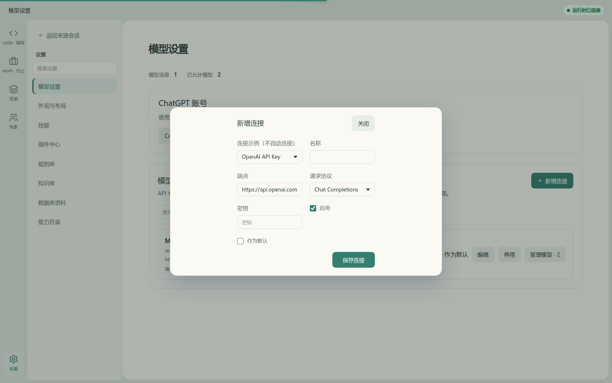
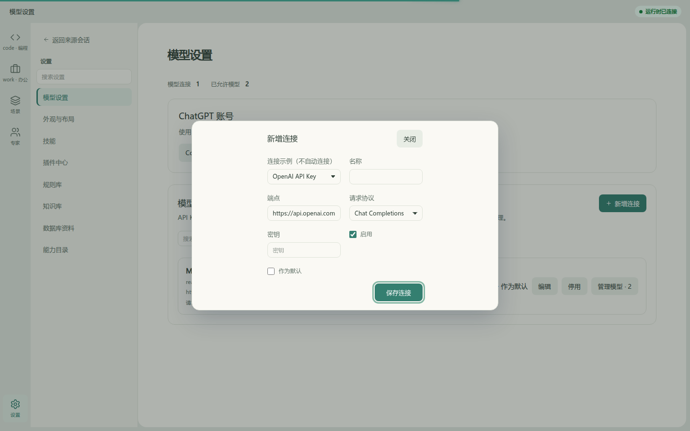
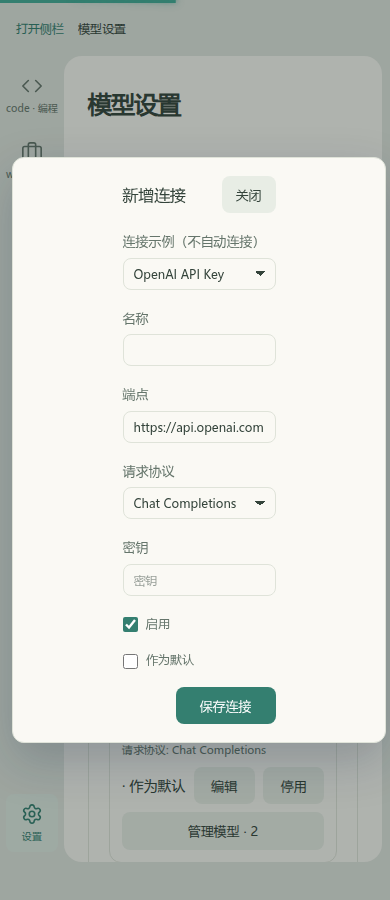
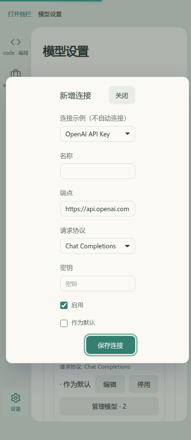

# 共享弹窗键盘交互局部验证（2026-11-14）

开发准备完成后的首个局部交互修复。没有改页面布局或导航：模型设置的“新增连接”使用无标题栏的公共 Dialog，初始焦点在容器上；旧实现第一次 Shift+Tab 落到遮罩按钮，焦点离开表单。修复复用现有 UI hook，并给 ConfirmBox 根节点补 tabindex。隐藏、禁用、inert 和负 tabindex 控件不参与循环，无可用操作时保留根焦点；卸载后等待 Vue/inert 清理，且尊重调用方已明确设置的新焦点。

## 实际应用 Before / After

基线：`14963359ad093634f003a1ba215f7dc661fcae47` 的原始 hook。After：本 PR 提交中的 hook/ConfirmBox；完整变更 revision 见 PR 描述。Before 使用真实生产页面源码，不是重绘模拟图。后台为单独运行的 HTTP Mock，使用独立浏览器上下文；没有保存连接、填写凭据、调用模型或写日常数据库。

同场景：设置 → 模型设置 → 新增连接 → 初始 Shift+Tab。相同默认浅色主题、900px 高度，分别在 1440/390px 宽度捕获。Before 焦点落在遮罩，After 在最后一个操作“保存连接”上，焦点环可见。

| 视口 | Before | After |
|---|---|---|
| 1440×900 |  |  |
| 390×900 |  |  |

机器结果：[Before](before/result.json)、[After](after/result.json)。After 还验证24次双向Tab循环、末项Tab到首项、Escape关闭后回到“新增连接”、无横向溢出及0 pageerror。截图已逐张查看。没有变更未保存草稿策略，保留相关已有回归。

## 验证命令与边界

工具由准备阶段安装的 Vite+ 使用。工作树安装：`vp -C frontend install --frozen-lockfile`。本轮命令：

```sh
vp -C frontend test run packages/ui/__tests__ apps/web/__tests__/features/settings/modelRequestProtocol.test.ts apps/web/__tests__/features/shell/taskListCreate.test.ts
vp -C frontend run typecheck
vp -C frontend run check:architecture
vp -C frontend/apps/web build
vp -C frontend fmt packages/ui/src/hooks/useFocusTrap.ts packages/ui/src/confirm-box/ConfirmBox.vue apps/web/__tests__/browser/focus-trap-probe.mjs
vp -C frontend lint packages/ui/src/hooks/useFocusTrap.ts apps/web/__tests__/browser/focus-trap-probe.mjs packages/ui/__tests__/focus-trap.test.ts
```

浏览器脚本：`frontend/apps/web/__tests__/browser/focus-trap-probe.mjs`，设置 `EAP_PLAYWRIGHT_MODULE` 指向 `vp i -g @playwright/test` 安装、`EAP_VISUAL_URL` 指向独立前端服务。默认检查修复后；仅在基线源码上使用 `EAP_FOCUS_PHASE=before`。脚本会覆盖本目录对应阶段产物。浏览器用本用户 Chromium；缺少的系统库通过 `apt download`/`dpkg-deb -x` 解压到临时目录并用 `LD_LIBRARY_PATH` 加载，未修改系统包。中文字体来自本机已有 Windows 字体。

独立 Mock 的现有 `node src/server.ts` 在 Linux 先报扩展名解析失败，`tsx` 则因 runtime-client 的 import.meta.env 失败；本次未扩展产品修改范围，而用 Vite SSR 转换运行同一服务：从 frontend 目录执行 `node --input-type=module -e 'import { createServer } from "vite-plus"; const vite = await createServer({configFile:false,server:{middlewareMode:true}}); await vite.ssrLoadModule("/apps/backend-mock/src/server.ts")'`，监听127.0.0.1:53200。前端 `vp -C frontend/apps/web dev --mode mock --host 127.0.0.1 --port 5186 --strictPort`。

原始hook的9项新增定向测试8失败/1通过，证明缺陷而非仅镜像实现。最初修复在消费方“新增任务后焦点到新详情”回归失败，原因是延迟回焦覆盖调用方显式焦点，已修正为尊重该交接并新增回归。最终定向结果：7文件31项通过（UI焦点12项、任务创建9项及其他UI/协议回归）。类型、架构、Web构建及定向格式/lint通过（构建保留已有大chunk告警）。

这不是全站重设计或全量产品接受。准备 PR #2 记录的 Builder SSR localStorage 和 Linux Windows Junction 全量失败未在本切片修复；未重跑后端或真实模型/实库。历史 PB-01 生成候选的独立焦点/技术ACCEPT关口不因共享UI通过而关闭。复杂嵌套弹层、完整辅助技术矩阵、其他主题及原生系统缩放仍独立验收。
