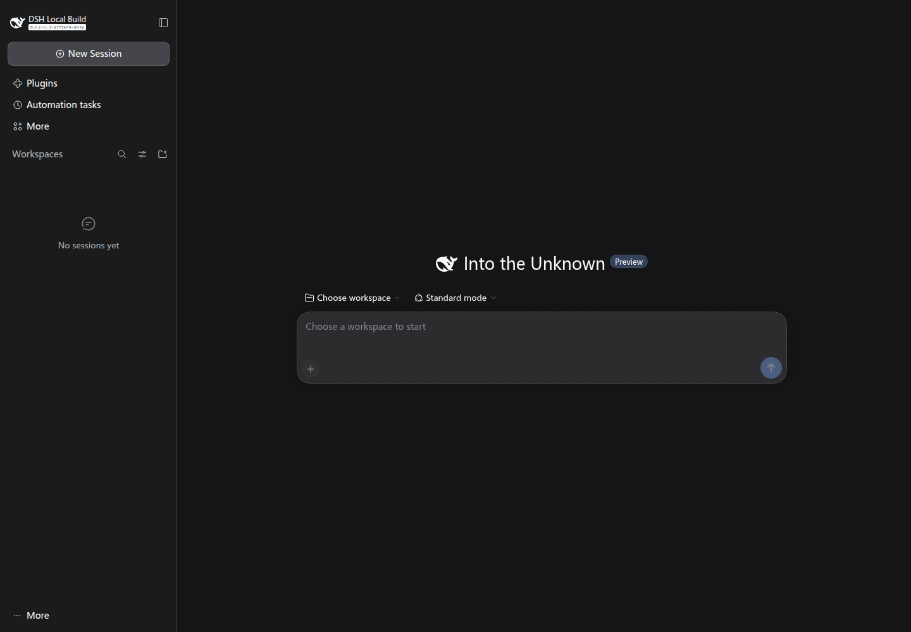
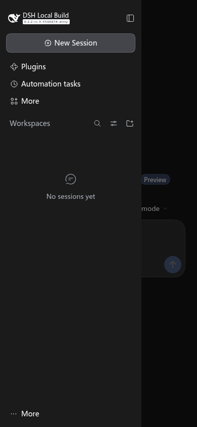
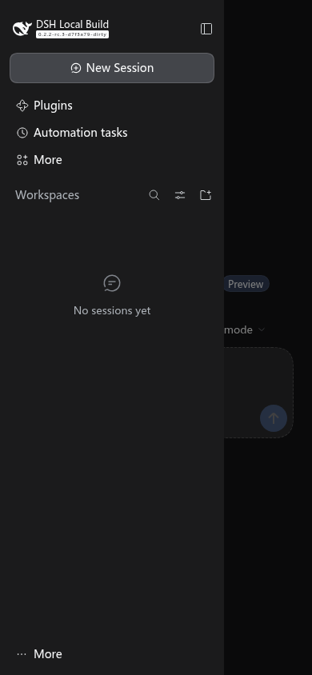

# DSH 原生 Vue 迁移实际界面对照

2026-11-16 捕获实际运行应用，非设计稿或合成图。Before 来自固定上游 `39163dd30f703a79079e2d2446545cff3c453738` 导入的独立原版 React 副本；关键 SidebarRoot 源文件通过 GitHub API 与该固定 revision 比对一致，SHA256 为 `99afedce21a93471b94f6bd205e5072bac14bb4d228755e4ae1220bd78f5adff`。After 使用本仓库 `5eac9593acea7a87840b5871654e3117c1260042` 的生产源码。捕获前后未再更改这些界面的生产实现；画面角标仍显示构建时的本地提交/dirty 元信息，不能用它推断上游 revision。

两侧条件相同：Chromium、dark、en-US、空工作区，关闭 Preview 与 Get started 提示，桌面 1440×1000，窄屏 390×844 且侧栏展开。先等待应用内容和 Standard mode 出现、真实关闭 onboarding，再等布局稳定；截图禁用动画。未隐藏实际界面元素，未包含凭据或聊天内容。

| 场景 | Before — React | After — Vue |
| --- | --- | --- |
| 桌面 |  |  |
| 窄屏侧栏展开 |  |  |

两侧页面错误均为零；实际 DOM 测量的导航行矩形、字体、padding、gap 和空态位置一致。Vue 侧真实 desktop→390→desktop→390→展开侧栏保留五列、侧栏/brand/overlay 身份及已关闭 onboarding；另有草稿和关闭态组件回归。这里仅记录该场景的复核，不代表完整 Web replay、全部功能验收或用户接受。

| 文件 | SHA256 |
| --- | --- |
| Before desktop | `a2a4d3819c1c4704e9040a537a6b6bb50ead26c2155022fc7d1da796106254a7` |
| Before mobile | `230ee6e1bc9fc084e7dd58a9f5cc1e64c3e0ee08a5b5d7af32cab9dd03aa15fe` |
| After desktop | `77f106dde0768e10828f80e7aa2752c284b01eb66623b9eabb04e9e4f5a54c2c` |
| After mobile | `0bcb82bdb75c4ffa9f4cf154463748fcd4c46041efd35eb482485bade347fa25` |
