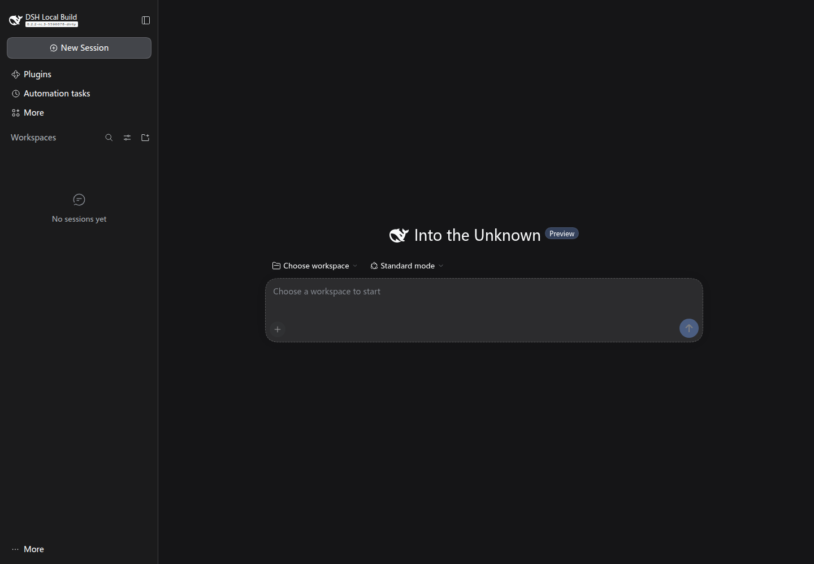

# DSH 原生 Vue 迁移实际界面对照

2026-11-16 捕获实际运行应用，非设计稿或合成图。Before 来自固定上游 `39163dd30f703a79079e2d2446545cff3c453738` 导入的独立原版 React 副本；关键 SidebarRoot 源文件通过 GitHub API 与该固定 revision 比对一致，SHA256 为 `99afedce21a93471b94f6bd205e5072bac14bb4d228755e4ae1220bd78f5adff`。After 于最终构建后重新捕获，使用本仓库 `e85a3d455b48f1ea2615b44d554f874975dc749b` 的生产源码与独立审阅 Host。捕获前后未更改生产实现；画面角标仍显示构建时的本地提交/dirty 元信息，不能用它推断源码或上游 revision。

两侧条件相同：Chromium、dark、en-US、空工作区，关闭 Preview 与 Get started 提示，桌面 1440×1000，窄屏 390×844 且侧栏展开。先等待应用内容和 Standard mode 出现、真实关闭 onboarding，再等布局稳定；截图禁用动画。未隐藏实际界面元素，未包含凭据或聊天内容。

| 场景 | Before — React | After — Vue |
| --- | --- | --- |
| 桌面 |  |  |
| 窄屏侧栏展开 |  |  |

原 Before 捕获记录页面错误为零；本次最终 After 捕获页面错误也为零。After 使用任务私有 fontconfig 与 Chromium 运行依赖，Preview 提示已处于关闭状态，实际点击关闭 Get started，再从 desktop 切换至 390 窄屏并点击展开侧栏；onboarding 未重新出现，原侧栏 DOM 节点仍连接。逐图复核显示导航、空态、输入区域及展开抽屉布局保持对应；构建角标和 Preview 字样的渲染存在差异，不宣称逐像素或字体完全相同。本次未重测旧记录的 DOM 几何、五列及 brand/overlay 身份。这里仅记录该场景的复核，不代表完整 Web replay、全部功能验收或用户接受。

| 文件 | SHA256 |
| --- | --- |
| Before desktop | `a2a4d3819c1c4704e9040a537a6b6bb50ead26c2155022fc7d1da796106254a7` |
| Before mobile | `230ee6e1bc9fc084e7dd58a9f5cc1e64c3e0ee08a5b5d7af32cab9dd03aa15fe` |
| After desktop | `42845caee934be8724fc6990beeb67ca88abd4e2ba5e3f5ab8302743385db266` |
| After mobile | `242f6518c00d230c5bc5629873796b65e596ad9067dd1806ecd36469396569e5` |
