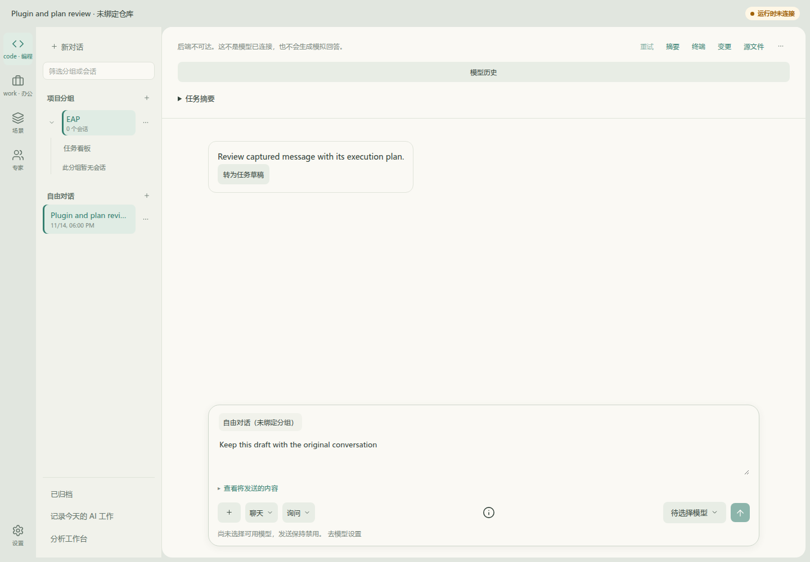
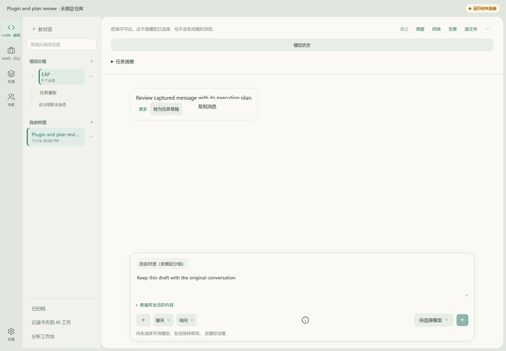
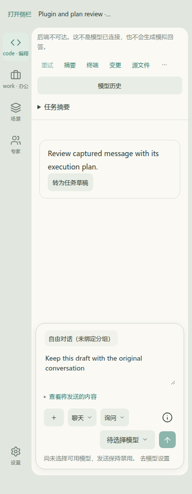
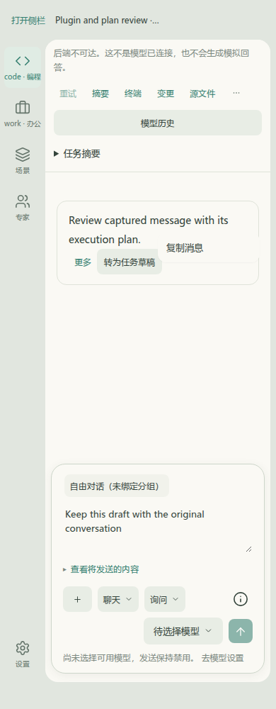

# DSH 原客户端菜单：Before / After

固定基线`35ff91ab556b8357d5c42d26be0db2fddb73794c`；After源码`94505934471356eb335ca3703f7e549fc53f0a22`，截图采集于该提交相同源码工作树，随后提交仅补版本引用。实际应用、同一浅色主题、1440×1000 / 390×1000、同一消息文本、执行/会话及未发送草稿，关闭摘要后对消息右键。基线没有应用上下文菜单，浏览器原生菜单不进入页面截图；After为固定DSH原context-menu客户端实际渲染，不是重画的示例。

| 视口 | Before：无应用菜单 | After：原客户端菜单加载及EAP复制动作 |
|---|---|---|
| 1440×1000 |  |  |
| 390×1000 |  |  |

[基线脚本](../../../frontend/apps/web/__tests__/browser/chat-plugin-plan-baseline.mjs)、[变更脚本](../../../frontend/apps/web/__tests__/browser/chat-plugin-plan-live.mjs)使用[同一只读夹具](../../../frontend/apps/web/__tests__/browser/chat-plugin-plan-fixture.mjs)。实际浏览器授予剪贴板权限并读回原消息全文，不stub clipboard；验证右键与可见“更多”按钮/键盘开启、Escape关闭并回焦、外点关闭、视口边界、草稿与会话/执行保持、零pageerror/零API写入。原CSS初次因宿主token缺失导致透明表面，修复为原样式+现有EAP token别名，最终计算背景两视口均为`rgb(250,249,244)`，没有弱化风格断言。

适配的是固定基线`39163dd3`的原client和明确依赖闭包，不是所有DSH插件或任意npm原包。没有独立DSH宿主、Agent、RPC或第二业务状态源。原client失败Toast的React重复key已单独记录为低影响上游限制；具体兼容矩阵、生命周期和升级验证见[记录](../../records/chat-plugin-plan-validation.md)。
