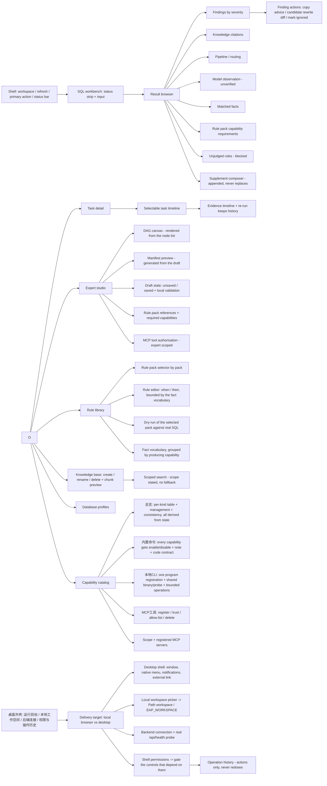

# Frontend prototype

## What was wrong with the first screen

The first frontend was a debug panel, not a product. It had:

- a hash-routed page that dumped expert manifests as raw JSON in a `<textarea>`;
- forms stacked with `<details>` and checkbox grids, with no visual hierarchy;
- no results browser: findings, knowledge citations and model output were rendered as a flat list;
- no way to see *why* the runtime did or did not call a model.

A prototype that fixes the information architecture is committed at
`docs/prototype/console.html` (self-contained, open directly in a browser). It is also the reference
for *interaction* behaviour: every control on it either changes visible state or explains why it
cannot. The Vue app is aligned to it.

## Product shell

> 2026-10-15 会话交互补充：新增默认入口 `#chat`，普通聊天与绑定工作区的会话独立于
> `#sql` 分析工作台。会话不再等同于一次执行；管理配置如何选择、生效、失效与保留历史，
> 以 [conversation-interaction.md](conversation-interaction.md) 为准。下方 studio 描述仅指
> 分析工作台的执行记录与报表视图，不能作为持续会话模型。此变更目前仅落实在 HTML 原型，
> Vue/Java 会话功能尚未实现。

A three-column console. The workspace and runtime state stay visible; the inspector explains the
currently selected item, and is **page-scoped**: on every page switch it resets to that page's own
description instead of keeping the previous page's selection.

The shell is state too, not decoration — the workspace dropdown, 刷新, 运行分析 and the status bar all
read the same snapshot the pages read, so the header can never disagree with the body.

```text
┌──────────────┬──────────────────────────────────────────────┬─────────────────────┐
│ EAP  工作空间 [engineering-automation ▾] ● 已连接 [浏览器] [刷新] [运行分析]      │
├──────────────┼──────────────────────────────────────────────┼─────────────────────┤
│ 工作         │ 每页内容全部由状态渲染；控件要么改变状态，   │ 检查器 · 当前页     │
│ ◎ 会话       │ 普通聊天 / 工作区会话（新增原型，默认入口）  │ 按需查看上下文      │
│ ▷ 分析工作台 │ 执行记录与完整报表，不再兼任会话列表         │ 已选中：发现        │
│              │   · 分析工作台 任务列表 | 任务流 | 输入区    │ 或：本页说明        │
│              │     （任务流：请求 → 执行过程 → 发现/报表）  │ （本页无对象时）    │
│ 设置         │   · 专家定义  集合页 → 条目页                │ severity: high      │
│ ◈ 专家定义   │      （流程 / 清单 / 授权）                  │ evidence: …         │
│ ▤ 规则库     │   · 规则库    集合页 → 条目页（规则/试算）   │ suggestion: …       │
│ ▢ 知识库     │   · 知识库    集合页 → 条目页（文档）        │                     │
│ ▦ 数据库资料 │   · 数据库资料 资料表；新增与编辑进抽屉，    │ 当前任务的流水线    │
│ ⚙ 能力目录   │      删除走模态                              │ deterministic ✓     │
│ ▣ 桌面外壳   │   · 能力目录  页签由种类声明生成：总览 |     │ decision: skip      │
│              │      内置命令 | 本地CLI | MCP工具            │ model: not called   │
│              │      （HTTP 既不可管也为空，无页签）         │                     │
│              │   · 桌面外壳  窗口与菜单 | 本地工作空间 |    │                     │
│              │      后端连接 | 系统权限与操作历史           │                     │
├──────────────┴──────────────────────────────────────────────┴─────────────────────┤
│ 就绪  运行目标: 浏览器  工作空间: engineering-automation  本地目录: 未选择        │
└──────────────┴──────────────────────────────────────────────┴─────────────────────┘
```

**The rail is two groups, not one list.** 「工作」holds what the operator came here to do — the
分析工作台. 「设置」holds the **application-level capability configuration**: 专家定义、规则库、知识库、
数据库资料、能力目录 (and 桌面外壳). These are not peers of the work surfaces; they describe *the same
environment* and do not vary by workspace (see [running-context.md](running-context.md)), so giving them
the same weight as 分析工作台 would say that changing configuration and running an analysis are the same
kind of action. That is a website's sitemap, not a tool's shell.

**任务 is not a page — it is the workbench's execution list (2026-10-15).** An analysis and its evidence
are two halves of the same thing; splitting them made the workbench a lone form and the task page a lone
table. The workbench is now a **studio**: left = this workspace's task list (one run per entry), middle =
the selected task's **stream** (request on top → execution record → findings/report; a local-CLI task
says honestly that it produces no structured findings), bottom = the composer that starts the next
analysis. 第一眼看到的是正在做的事和下一步的输入框，而不是一张配置表。

**The analysis workbench is an execution surface, not the conversation landing page.** 分析工作台 contains an execution list, a
stream and an input box, not a dashboard of counts. The four numbers that used to occupy a whole 概览
page (已注册能力 / 专家定义 / 近 N 日任务 / 模型调用占比) now live in a **status strip** at the top of
that page, with their provenance line intact and everything else folded into a 这些数字从哪来
disclosure. Nothing was lost but the implication that a single operator opens their own local tool in
order to read a dashboard.

**One entry per page.** Within a group, 专家定义 / 规则库 / 知识库 are **hierarchical routes**, not
sibling tabs (see [navigation-structure-refactor.md](navigation-structure-refactor.md)): the URL is the
single source of truth — `#<area>` is the collection page, `#<area>/<itemId>/<face>` is one item's face,
and `#<area>/<mode>` is a collection-level working surface (事实词表, 跨库检索) that belongs to no item.
刷新、深链、前进与后退 therefore all land on the same thing, and the selected tab can never disagree with
what is displayed. 能力目录 and 桌面外壳 keep sibling tabs, because their sub-pages really are parallel
destinations; the 能力目录 tabs are generated from the runtime's kind declaration (see below) rather than
written into the markup — so a kind that becomes manageable or non-empty appears on its own, and HTTP,
which is neither, has no tab.

**One-off transactions keep the list put; destructive ones go through a modal.** 新建 / 编辑 must never
move the context away from the list it belongs to — the prototype slides the form in from the right, the
app uses an inline panel in the same column (`pack-form` / the manager toolbars) because both satisfy the
rule that matters: the list stays visible and the action does not become a page of its own. Closing an
unsaved form asks first instead of discarding silently, and it does so **in the page**: `@eap/ui`
`ConfirmBox` is the one confirmation surface, `window.confirm` appears nowhere (asserted by
`apps/web/src/tests/destructive.test.ts`, which reads the source rather than trusting a review). 删除 goes
through that modal, which names the impact and, when the backend refuses, keeps the confirm button
present but disabled with the reason beside it.

Choosing 桌面端 on the 桌面外壳 page wraps this same shell in a window frame with a native menu
(文件 / 视图 / 帮助) and enables the platform services that only the shell can provide; the controls that
cannot work in a browser stay in place, disabled, with the reason printed beside them.

## Core screens



## Interaction rules

- **The pipeline is first-class.** Every SQL result shows the route explicitly:
  `deterministic → decision (enhance/skip + rationale) → model (called / not called)`, with the
  measured `compressionRatio` when a model was used. This is what makes cost reduction visible.
- **Findings are structured.** Each finding shows a severity chip, its category, the observed
  evidence and a semantics-preserving suggestion. No raw JSON in the primary view.
- **Findings are explainable.** Because a finding comes from a rule pack, the result browser can show
  the **matched facts** behind it and the pack that produced it (`rulePacks` in the response). "Why
  did it say that" must always have an answer that is not "it's in the code".
- **Capabilities are grouped by kind, not listed flat.** The catalog renders the runtime's own
  declaration as sub-pages: **总览 / 内置命令 / 本地 CLI / MCP 工具** — tabs inside the page, not extra
  rail entries. The tab list itself is built from each kind's declared management entry point plus whether
  it currently has any capability, so HTTP (nothing to manage yet) gets no tab while MCP gets one even
  while empty — because that page *is* the entry point that makes it non-empty. The tabs genuinely switch
  content — exactly one sub-page is rendered at a time, never four stacked sections — and a sub-page with
  no entries says why it is still there instead of drawing an empty shell. Selecting a capability (its card
  header or its row in the full table) drives the inspector, which is what makes the catalogue actionable
  rather than decorative.
  Each capability shows its title, what it must be given, what it
  must be authorised for, what actually executes it, the facts it publishes, the evidence it contributes
  and whether it is runnable right now (a CLI with a missing binary shows `缺少可执行文件`, a capability
  switched off shows `已停用`). A declaration-consistency panel surfaces declared-but-unregistered and
  undeclared-but-registered capabilities rather than hiding them. The console never invents a kind or
  a capability description — both come from `/api/capabilities`.
  **Nothing on this page is markup-derived.** The kind table, per-kind counts and state chips, the
  per-capability cards, the full capability table and the inspector all read one capability list and one
  kind declaration, so a single switch-off cannot leave "可用 5" in one place and "已停用" in another. The
  same rule decides what the expert editor may offer: the platform node picker excludes capabilities the
  operator switched off and lists them separately with the reason (`disabledPlatform`), instead of letting
  an operator wire a node the runtime refuses to resolve.
- **Each kind of capability has a management surface, and it is honest about its limits.** Every
  capability of a manageable kind gets a card — no subset. Both 内置命令 and 本地 CLI offer enable/disable
  plus a note. 内置命令 still requires a handler bean and a declaration. 本地 CLI uses a two-level model
  behind one compact management surface: register the executable once, then list bounded operations with
  fixed argument arrays below it. Git is therefore one program with preconfigured `git-status` and
  `git-diff` operations, not two registrations of the same binary. Operators only open the advanced form
  when adding another operation. Operator-registered operations emit only redacted stdout/stderr evidence;
  publishing structured facts still requires code. Each program card also provides a
  binary override, reset and explicit 探测 action that runs `<binary> --version` once; nothing is executed
  while the page renders. MCP 工具 offers full server management: registration form, per-server enable/trust/probe/edit/
  delete, and the list of capabilities each server publishes. A disabled capability is rendered as
  `已停用`, never as `缺少可执行文件` / `未接入` — "switched off" is a decision, "broken" is a defect, and
  switching one off that an *enabled* expert runs is refused by name.
  MCP 的管理与使用参照 `docs/mcp-management-design.md`：工具以对象清单形式保存
  (`{name, source, verified}`)，服务器带 `probeState`（`unknown` / `reachable` / `missing`，
  **只描述传输目标，绝不写成"已连接"**），专家侧授权按服务器分组呈现且明说不共享会话。
  逐工具放行开关与调用记录被明确推迟到平台有 MCP 客户端之后。
- **Capability requirements are visible at every level.** A rule pack shows 需要能力 (its
  `requires.capabilities`); the expert studio shows 所需能力 derived from the packs it references and
  warns when the graph has no node that can produce those facts; the SQL result shows a
  `规则包能力需求` block (required / met / missing) plus a `未判定的规则` list naming the missing facts and
  capabilities. The console never presents "no findings" as equivalent to "checked and clean".
- **Capability scope is visible, not implied.** The console shows `平台级` / `专家级` on every
  capability and on each kind, an MCP server block (registered, enabled, trusted, allow-listed tools),
  and `globallyRunnable` as reported by the runtime. An MCP tool is listed as an expert-scoped
  capability with "不会全局启用" and its authorised experts, never next to `sql.parse` as if every
  expert could run it. The expert editor has an MCP authorisation block: a declared tool becomes a
  selectable node, an undeclared one is a blocking error, and the flat capability picker stays
  platform-only. Capabilities the operator switched off are excluded from that picker and listed
  separately, so the omission is explainable instead of silent. These rules live in `capabilityScope.ts`
  and are unit tested.
- **Rules are first-class content.** The rule library lists every pack (shipped packs marked
  read-only), shows each rule's condition and advice, and offers a dry-run that reports the matched
  facts, the findings, the severity counts and the summary for a given SQL — the same computation the
  runtime performs, with nothing saved. Authoring a rule never requires a code change and never
  executes SQL. The fact vocabulary is grouped by producing capability, so it is obvious which
  capability a rule depends on before publishing it.
- **Selecting a rule pack drives its detail panel.** The pack list is the selector; the panel renders
  *that* pack's rules — condition, escalation, evidence, advice, and the capability that produces each
  fact. A shipped pack (`builtin`) is read-only and every edit affordance on it is refused with the
  actual remedy (复制为自定义), because editing it in place would be silently overwritten by the next
  upgrade. A custom pack gets inline rule editing (severity / evidence / advice) plus add and remove,
  and the revision counter increments on every save — the visible proof that rules are data.
  Authoring stays bounded by the fact vocabulary: a rule naming an undeclared fact is refused, and the
  producing capability is folded into `requires` automatically, because a rule referencing an unknown
  fact would never fire and would look exactly like "nothing wrong". Deleting or disabling a pack is
  refused while an enabled expert still references it, naming the experts. The dry-run runs against the
  pack you have selected, so what is tried is what is being edited.
- **Knowledge is a container you can manage, and search is scoped.** Knowledge bases and documents are
  created, renamed and deleted from the page; a new document is written into the selected base, and the
  document view shows the ordered concatenation of the chunks that were indexed — that concatenation is
  what retrieval returns, and the page says so instead of implying a per-chunk editor the runtime does
  not have. Deleting a base or a document goes through a modal that names what goes with it. Search
  states its own scope — the union of the enabled
  experts' granted bases — and an ungranted base contributes **zero** results rather than falling back
  to everything, because deny-by-default has to be visible, not merely implemented. A query with no
  match explains its scope instead of showing a blank list, and a document that looks like it contains a
  credential is refused with the reason.
- **An analysis is a run with states, and re-running preserves history.** 运行分析 disables the button,
  marks the run `执行中` and appends a task; when it settles the run is either `已完成` or `部分完成`,
  and `部分完成` is used exactly when model review was requested but the deterministic stage alone could
  not decide. The previous run is never overwritten: 重新运行 adds a new row and the timeline switches
  to it, so "what changed since" stays answerable. A run that could not be judged lists its unjudged
  rules and the missing facts instead of reporting success.
- **A finding has three actions, and none of them mutate the input.** 复制建议 puts the
  semantics-preserving suggestion on the clipboard; 查看候选改写 renders a before/after diff that says
  in the panel that it 不会自动执行、也不会替换你的输入; 标记忽略 records the operator's judgement on
  that finding only, and the finding stays visible (marked, not removed) so the review trail survives.
  Ignoring a finding never edits the rule pack, and no candidate rewrite is ever executed.
- **Expert editing is draft-based, and the manifest is generated from the draft.** Editing mutates a
  deep copy; the header shows 有未保存的修改 / 已保存 and 保存草稿 is the only way to commit. The
  manifest preview is produced from that draft rather than from a fixed sample, so it cannot advertise
  something the editor does not contain, and the DAG canvas renders from the same node list, so adding
  or removing a node moves the graph immediately. 校验 applies the backend's own rules locally — id
  shape (`^[a-z0-9][a-z0-9_-]{0,60}$`), non-empty name, at least one node, no duplicate capability, no
  node using an expert-scoped capability that was never authorised, no dangling knowledge / profile /
  rule-pack reference, no disabled rule pack, and no rule pack whose `requires` capability has no node
  — so 校验 and the server can only disagree if the server is wrong. The rule pack picker is populated
  from `/api/experts/catalog`, so an expert can only reference packs that resolve. A built-in expert
  cannot be deleted (the control is disabled and 复制为自定义 is offered) and an enabled expert must be
  stopped before deletion. Validation and authorisation stay in the backend: the browser never executes
  an expert definition.
- **The inspector is an evidence panel, not a form.** It shows the selected item's command, arguments,
  exit code, stdout/stderr, diff scope and validation evidence where applicable — and for a finding,
  its severity, the matched facts behind it and the pack that produced it.
- **Permissions are visible before a run.** Knowledge-base and database grants are shown as explicit
  removable chips, with deny-by-default semantics. Anything the runtime cannot hold is refused at the
  field with the reason — a connection password in a database profile, a secret in a CLI path or an MCP
  endpoint, a credential pasted into a knowledge document or a supplement — and the page never displays
  a credential that was not stored. The refusal is not cosmetic: the runtime rejects these same fields
  server-side (`SensitiveData.containsSecret`, which also refuses a binary path, an MCP address, a
  knowledge document and an execution plan that contain a credential) and redacts stdout/stderr and
  model text on the way out.
- **No control is decorative.** Every button, row and chip either changes visible state or states why
  it cannot, and where a real endpoint exists it is named: `POST /api/mcp-servers` to register a
  server, `DELETE /api/databases/{id}`, `POST /api/rule-packs/dry-run`, `POST /api/experts/{id}/execute`.
  Interactions that live only in the prototype say so instead of implying a backend. The top-bar workspace
  switcher is client-side — tasks are not scoped by workspace on the server — and says so when it is used,
  pointing at 桌面外壳 → 本地工作空间 for the directory that actually decides where the local CLI
  capabilities run; 重新运行 and 补充上下文 both name `POST /api/experts/{id}/execute` as what a real console
  would call, and the supplement composer states outright that the runtime has no supplement resource
  today, so a supplement is a new execution rather than an in-place rewrite of history. The inverse is
  enforced too — 内置命令 does not offer creation, while operator-registered CLI capabilities are explicitly
  limited to fixed argument arrays and redacted process evidence. LLM settings remain a read-only table rather than a form that could never
  submit. The one place the prototype *adds* capability, the desktop shell, is gated by a declared
  permission and the gate is printed next to the control.
- **Model output is separated.** Model text is always rendered under an "unverified observation"
  heading and never merged into the deterministic findings.
- **Primary action is one button** (`Run` / `运行分析`); it is the same action as the SQL studio's, so
  there is no second, differently-behaving entry point. Destructive actions require confirmation and a
  visible scope.
- **The inspector is page-scoped, not a permanently empty panel.** It is labelled with the current
  page name, and on every page switch it resets to that page's own description — it never keeps the
  previous page's selection. Only pages that actually produce per-item results (SQL findings today)
  render a selection card; on the others the panel states plainly what can be inspected and where that
  detail is shown instead of leaving a stale or generic prompt. The pipeline block appears only where
  it means something (分析工作台 / 任务); the platform-wide safety note is explicitly labelled
  全局说明（与页面无关） so it is not mistaken for page state.
- **Narrow screens** collapse the inspector below the workbench and keep the same navigation order.
- **The delivery target is state, and the shell is not the product.** 浏览器 and 桌面端 are two targets
  of one UI, so the shell page can switch between them: switching draws the window frame and the native
  menu, and switching back does **not** hide the desktop-only controls — it disables them and writes the
  reason next to them (浏览器读不到本机目录 / 没有窗口生命周期 / 不能持久化偏好). Nothing in the shell plans
  tasks, decides, authorises an expert or validates anything; the menu carries only platform services
  (选目录 / 窗口 / 通知 / 打开外部链接 / 操作历史), and the console asserts that explicitly.
- **A local workspace is not the top-bar workspace.** The picker chooses a directory on disk, which is
  the backend process's execution directory (`Path workspace` ← `EAP_WORKSPACE`, otherwise the process
  start directory, or its parent when the start directory has no `.git`). The runtime exposes no way to
  change it while running, so the console writes it into the launch configuration and says 需要重启后端才生效
  instead of pretending the switch applied. The top-bar switcher stays a client-side view filter, and the
  two are deliberately not one control — merging them would imply a dropdown decides where `git` runs. A
  missing directory is refused rather than silently falling back to the previous one, because that failure
  surfaces much later, in the wrong place.
- **The connection is probed, not faked, and configuration stays read-only.** 测试连接 issues a real
  `GET /api/health` and reports the status and latency it actually got — including a truthful failure, and
  a truthful "this environment has no `fetch`" when it cannot probe at all. A credential in the address is
  refused by parsing the URL's userinfo, not by pattern-matching the string. The LLM budget is a read-only
  table of the `eap.llm.*` environment variables, because the runtime has no config-write endpoint: a form
  there could never submit, so it is not drawn.
- **Revoking a shell permission disables what depends on it.** The permission table is the source of truth
  for the desktop-only controls, so revoking `dialog:allow-open` really disables 浏览本地目录 and names that
  capability in the reason; granting it back re-enables the control. Every shell action is appended to an
  operation history — and switching a sub-tab appends nothing, because it records actions, not
  redraws. (Not an *audit* log: there is one operator on one machine, see [running-context.md](running-context.md).)
- **Closing the window is a state transition, not a shutdown.** Closing while a run is in flight marks it
  `已中断` — visible, filterable, evidence preserved, re-runnable — and the settle timer is not allowed to
  overwrite that with `已完成`.
- **Every number on the status strip states where it comes from.** The strip is the one place whose
  headline figures look like they were computed, so they must actually be computed or explicitly labelled.
  Two sources, and only two:
  - *Derived from state* — 已注册能力 reads `CAPABILITIES` (switch one off and the card says `1 已停用`),
    专家定义 reads `EXPERTS` (add one and the count follows). Both re-render from the source's own renderer,
    so the strip can never hold a value the 能力目录 or 专家定义 no longer has.
  - *Windowed sample* — 近 7 日任务 and 模型调用占比 need a task table with timestamps, which the prototype
    does not have. They come from `DEMO_HISTORY` (one declaration, not digits in the markup) and carry a
    printed 口径 line. The point is not that the figures are demo data; it is that a reader can tell which
    of the numbers would survive contact with a real backend.
  Nothing else may be written into the card markup: `id="ovCapV">—<` is a placeholder for the script, and a
  contract asserts all eight are still placeholders in the source. The 状态栏's 确定性覆盖 is the same
  figure as the strip's 确定性直接完成, because two labels for one number is how they drift apart.
  (The strip is folded by default: the four numbers and their 口径 line stay visible, and the bars and
  reasoning sit behind 这些数字从哪来. Folding is not hiding — the numbers are read before the disclosure
  is opened.)

### Why the collapsed blocks exist

Ten `details.why` blocks carry the reasoning behind a screen (one per page, two in the status strip). The
summary is
the question a reader would actually ask; the body is the answer. Two rules keep them from reading like
leftovers:

- **The summary is the question, nothing else.** `为什么 · 为什么模型不是第一步` duplicated the label and the
  question and read like a botched find-and-replace; the marker is now drawn with borders rather than a font
  glyph, because the original was a literal `U+0015` + `B8` in the stylesheet and the browser printed `B8`.
- **The body may only assert what the code does.** The 工作空间 block used to claim it scoped tasks, experts
  *and* material. Only the task list is filtered (`TASKS.filter(t => t.workspace === currentWorkspace)`);
  experts, knowledge bases and database profiles are not, and no table in the backend schema has a workspace
  column. That narrower scope is the intended one, not a gap: what a workspace separates is the **actual
  scenario** — one repository's runs — while experts, knowledge bases and database profiles are
  **application-level capability configuration** describing one environment, kept once rather than copied
  per repository. The block and the workspace menu now say that, instead of implying the UI already scopes
  more than it does.

## Implementation slices

Two tracks, because the prototype is deliberately ahead of the app. `原型` = the interactive prototype
(`docs/prototype/console.html`), `应用` = the Vue app (`frontend/apps/web`). A slice is only ✅ on a
track when that track really behaves that way; interactions the prototype demonstrates but the app has
not adopted yet are marked on the 原型 track alone.

1. ✅ 应用 · ✅ 原型 — Shell and route model: a rail split into **工作** (分析工作台，含任务列表与任务流) and **设置**
   (专家定义, 规则库, 知识库, 数据库资料, 能力目录, 桌面外壳), **landing on the work surface** rather than
   on a dashboard, with a **page-scoped inspector** that resets on every route change and reports the
   current page by name.
2. ✅ 应用 · ✅ 原型 — Typed API client aligned to the runtime response (`modelAdvisor`, structured
   findings).
3. ✅ 应用 · ✅ 原型 — SQL workbench with a real results browser, the pipeline/routing block, and the
   status strip that carries the numbers the 概览 page used to own.
4. ✅ 应用 · ✅ 原型 — Rule library: pack catalog, rule list with conditions and advice, dry-run, fact
   vocabulary grouped by producing capability, per-pack capability requirements.
5. ✅ 应用 · ✅ 原型 — Capability catalog as **interactive** sub-pages (总览 / 内置命令 / 本地 CLI /
   MCP 工具), where the sub-pages, per-kind counts and per-capability cards are **derived from the kind
   declaration and the capability list** rather than written into the markup, so a switch-off updates the
   tab, the kind row, the full table, the card and the inspector together. Per-kind management surfaces —
   enable/disable + note for built-in commands, CLI program registration and fixed-argument operations,
   shared binary override/reset/probe, MCP server registration/trust/tool declaration/delete — plus per-capability metadata,
   availability, scope and declaration-consistency reporting in both directions (declared-but-unregistered
   and registered-but-undeclared, plus MCP published-but-undeclared and declared-but-unpublished). The
   expert studio shows the capabilities its rule packs require, the MCP tools the expert is authorised to
   call, and excludes the platform-disabled capabilities from the node picker while listing them with the
   reason.
6. ✅ 应用 · ✅ 原型 — Live task state and evidence timeline: a run has an explicit state, the timeline
   is driven by the selected task, and re-running appends a row instead of overwriting one.
7. ✅ 应用 · ✅ 原型 — Rule editor: select a pack, edit a rule inline (severity / evidence / advice),
   add and remove rules, refuse edits on a shipped pack with the 复制为自定义 remedy, and try the rule
   pack being edited. The app keeps `draft` / `baseline` so 有未保存的修改 is a *visible state* rather
   than a silent loss, runs a local mirror of the backend's own checks (unknown fact, missing
   `requires` entry) **and then still calls `POST /api/rule-packs/validate`**, because the local half can
   name the offending rule while only the server can see reserved identifiers and cross-pack references.
   Compound conditions (`all` / `any` / `not`) and `policy` thresholds are edited in a JSON draft panel
   rather than through a form that would cover only part of the manifest. `dry-run` posts the current
   draft, so what is tried is what is being edited. Delete and enable/disable go through the shared
   confirm modal; a refusal from the backend leaves the confirm button in place, disabled, with the
   reason beside it.
8. ✅ 应用 · ✅ 原型 — Expert editor with a **generated** manifest preview, draft state (有未保存的修改),
   knowledge / profile / rule-pack chips, MCP tool authorisation picker, a DAG canvas rendered from the
   node list, and 校验 that mirrors the backend's own checks. The manifest panel is labelled
   「由草稿生成的 Manifest（只读）」 and says why it cannot disagree with the canvas: all three read one
   state. 启用/停用 lists what the action *grants or revokes* (knowledge bases, database profiles, MCP
   tools) rather than showing a bare verb, and the refusal reason stays next to a disabled confirm
   button. No `window.confirm` anywhere.
9. ✅ 应用 · ✅ 原型 — Decision panel, unjudged-rule list and supplement composer: the skipped decision
   is clickable and explains why, an undecided run names the missing facts, and a supplement is
   appended without erasing prior evidence. A supplement is a **new** `POST /api/experts/{id}/execute`
   appended to the history — never an edit of a previous run.
10. ✅ 应用 · ✅ 原型 — Finding actions and diff viewer: 复制建议, 查看候选改写 (before/after diff that
    is never auto-executed and never replaces the input), 标记忽略 (records judgement without hiding
    the finding or editing the pack). A candidate rewrite is offered **only** when the change is decidable
    from the statement alone (`= NULL` → `IS NULL`); every other case names the missing ingredient
    instead of rendering a plausible-looking diff (`rewrites.ts`).
11. ✅ 应用 · ✅ 原型 — MCP server registration UI (transport, allow-listed tools, trust). The backend
    registry is writable through `/api/mcp-servers`; the probe reports `verified: false` until an MCP
    client exists.
12. ✅ 应用 · ✅ 原型 — Knowledge container management (create / rename / delete a base, add a document,
    delete a document) and scoped search whose scope is stated on the page. The document view shows the
    ordered concatenation of the indexed chunks and says so, because that concatenation *is* what
    retrieval returns; there is no per-chunk preview because the runtime stores no chunk boundaries in
    the document listing. Deleting a base or a document names what goes with it (the base's documents,
    the document's chunks) and keeps the confirm button visible when the backend refuses because an
    enabled expert still grants it.
13. ✅ 应用 · ✅ 原型 — 刷新 / 工作空间 / status bar as real state, with the top-bar workspace
    switcher labelled client-side because tasks are not scoped by workspace on the server. The workspace
    scope covers the task list only; expert definitions, knowledge and database profiles are
    application-level configuration, and the page says so rather than implying a missing server field.
    The status bar reads `状态 / 工作空间 / 最近刷新 / 确定性覆盖 / 模型调用（近 N 日）`.
14. ⬜ 应用 · ✅ 原型 — **桌面外壳**: a delivery-target switch (浏览器 / 桌面端 · Electron) that draws the
    window frame and native menu, with desktop-only controls disabled *and explained* in browser mode;
    window/menu/notification/external-link services; the **local workspace picker** (recent list, a
    missing directory handled honestly, the main-process filesystem scope, and the distinction from the
    top-bar workspace); **backend connection** settings (remote / local runtime / packaged sidecar,
    address validation, a real `GET /api/health` probe, non-secret preferences, and the LLM budget as a
    read-only table); and **shell permissions + operation history** (revoking a capability really
    disables the control that depends on it, and every OS action is appended to the history).
    Desktop-only
    interactions that need no endpoint say so; the ones that map to the runtime name the call they
    would make. See `docs/desktop-spec.md` for the contract this is modelled on.
    **Not started, and it cannot be a page.** The prototype draws the frame in CSS, but a real shell is
    an Electron **main process**: `nodeIntegration:false` / `contextIsolation:true` / `sandbox:true`, a
    preload that exposes named functions only (no `ipcRenderer` passthrough), main-process validation of
    every argument, and the operation history written in main rather than in the renderer. There is no
    `apps/desktop` in the workspace and `electron` is not a dependency, so the browser app has nothing to
    bridge to. The order in `docs/desktop-spec.md` §Implementation order starts with extracting shared
    UI/API packages (done: `packages/ui`, `packages/runtime-client`) and then adds `apps/desktop`; that step
    also needs `vp install` outside the sandbox, which fails here on `J:\.pnpm-store` (`os error 5`).
    Until then the honest state is: the 桌面外壳 route exists in the prototype, not in the app.
15. ✅ 应用 · ✅ 原型 — **状态条的数字有出处**: 已注册能力 / 专家定义 由 `CAPABILITIES` / `EXPERTS` 推导
    （停用一个能力、新增一个专家，数字跟着变）；近 N 日任务 / 模型调用占比 来自**持久化的走向**而不是
    采样 —— `eap.task.model_enhancement` 记录每次运行走的是 `unverified-observation` / `skipped` /
    `unavailable`，`NULL` 表示**从未到达判定阶段**（规划任务没有模型可跳过，把它算成"确定性解决"会
    抬高这个数字）。因此 `GET /api/stats?windowDays=7` 在还没有任何运行记录走向时返回 `null` 而不是
    `0`——「还没有运行过」不是「0%」。四个数字都不得写进 HTML——契约断言它们留在源码里仍是占位符。
    状态栏的「确定性覆盖」与状态条里的「确定性直接完成」是**同一个值**：两个标签一个数字才会漂移。
    这些数字原先独占一个「概览」落地页；2026-10-15 折叠进分析工作台顶部的状态条——**折叠不是藏起来**：
    四个数字与口径那一行默认可见，柱状图与推理收在「这些数字从哪来」里。
    见上文「Every number on the status strip states where it comes from」。
